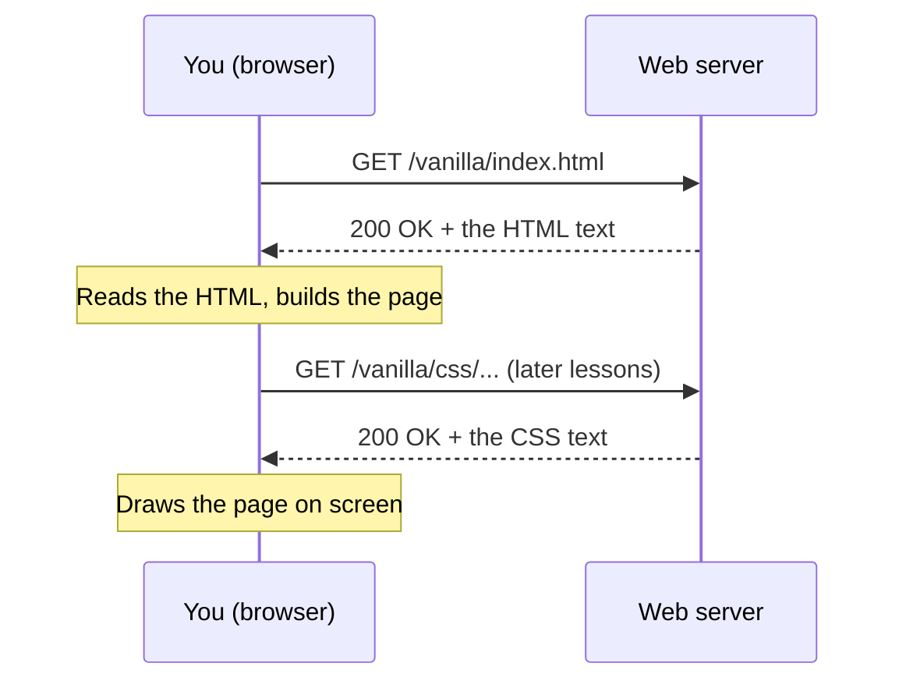

# Lesson 00 — Your toolkit & how the web works

Welcome! Over the next few weeks you'll build a Discord-style chat app from an empty folder: first with plain HTML, CSS and JavaScript, then again with React. This first lesson sets up your tools, then you'll make your first web page and look inside it with the browser's developer tools.

## 🎯 Goal

By the end of this lesson your browser shows a page you wrote yourself, served by a local web server at an address like `http://127.0.0.1:5500/vanilla/index.html`:

{.screenshot}

It's plain, but every website starts like this. You'll also know how to open **DevTools** and find your page's structure, its network request and its console.

## 🧠 New concepts

<ConceptList />

### How a web page gets to your screen

When you type an address into the browser, three things happen:

1. The browser sends a **request** to a **server** (a program on another computer, or on yours) asking for a file.
2. The server sends back a **response**: usually an **HTML** file.
3. The browser reads the HTML and draws the page. If the HTML mentions other files (styles, scripts, images), the browser requests those too.



A web page is built from three languages, each with its own job:

| Language | Job | In the chat app |
| --- | --- | --- |
| **HTML** | *What's on the page*: headings, buttons, lists | the server list, the messages, the message box |
| **CSS** | *How it looks*: colors, sizes, layout | the dark theme, round server icons, four columns |
| **JavaScript** | *What it does*: reacting to clicks and keys, changing the page | sending a message, switching channels |

This lesson only uses HTML.

### Why a local server instead of double-clicking the file?

If you double-click an `.html` file, the browser opens it from disk, with an address that starts with `file://`. That works for a simple page, but some features you'll use later (JavaScript modules in Lesson 17 and loading data files in Lesson 18) are blocked on `file://` pages for security reasons. So from day one you'll use a small **local web server**. Your page then loads over `http://`, just like a real website. The server runs only on your computer: the address `127.0.0.1` always means "this computer".

### The HTML document skeleton

Every HTML page starts with the same skeleton. Here's what each line means:

```html
<!DOCTYPE html>
<html lang="en">
  <head>
    <meta charset="utf-8">
    <title>My Chat App</title>
  </head>
  <body>
    <h1>Hello, world!</h1>
    <p>This is the start of my chat app.</p>
  </body>
</html>
```

- `<!DOCTYPE html>`: "this is a modern HTML document". Always the first line.
- `<html lang="en">` … `</html>`: wraps the whole page. `lang="en"` tells browsers and screen readers the page is in English.
- `<head>`: information *about* the page that isn't shown in the page itself.
  - `<meta charset="utf-8">`: the text encoding, so emoji and accents display correctly.
  - `<title>`: the text on the browser tab.
- `<body>`: everything you see in the window.
  - `<h1>`: the main **heading**.
  - `<p>`: a **paragraph**.

Most of these come in pairs: an **opening tag** like `<p>` and a **closing tag** like `</p>`, with content in between. Together they make an **element**. A few elements, like `<meta>`, have no content and no closing tag. Lesson 02 covers this properly.

::: tip Python comparison
In Python, indentation is part of the syntax. In HTML it isn't: the browser ignores extra spaces and line breaks between tags. You still indent nested elements so *you* can read the structure, the same way you'd indent a nested `for` loop.
:::

### The terminal

You'll type a few commands in the **terminal** (a text window for giving your computer commands). The terminal runs a program called a **shell**, which reads what you type. Different shells understand slightly different commands. Every command in this course is written for the **bash** family of shells, so that the same line works for everyone:

- **macOS:** the Terminal app, or VS Code's built-in terminal. Both use `zsh` by default, which understands the commands in this course.
- **Linux:** any terminal.
- **Windows:** **Git Bash**, a bash terminal that comes with Git for Windows. VS Code's built-in terminal on Windows uses PowerShell unless you change it, so Step 2 shows you how to switch it to Git Bash. Don't use PowerShell or Command Prompt for this course.

You need four commands today:

| Command | Means | Example |
| --- | --- | --- |
| `pwd` | **p**rint **w**orking **d**irectory: "where am I?" | `pwd` |
| `ls` | **l**i**s**t what's in this folder | `ls` |
| `mkdir` | **m**a**k**e a **dir**ectory (folder) | `mkdir code` |
| `cd` | **c**hange **d**irectory: move into a folder | `cd code` |

`~` is shorthand for your **home folder**, the folder that holds your own files. Typing `~/code` means "the `code` folder inside my home folder".

| | Your home folder, as `pwd` prints it |
| --- | --- |
| macOS | `/Users/your-name` |
| Linux | `/home/your-name` |
| Windows (Git Bash) | usually `/c/Users/your-name`, which is the `C:\Users\your-name` folder that File Explorer shows |

::: warning Check your own home folder
Git Bash writes Windows paths with forward slashes and `/c/` for the `C:` drive. That is how Git Bash normally behaves, but a school or work computer can place the home folder elsewhere. To see yours, type `cd ~` and then `pwd`.
:::

## 🛠️ Build it

### Step 1 — Install VS Code, Chrome and (on Windows) Git

You need an editor (VS Code), a browser (Google Chrome) and, on Windows, Git for Windows, because it brings Git Bash. Skip anything you already have.

::: os mac
1. **VS Code:** download it from [code.visualstudio.com/download](https://code.visualstudio.com/download), open the downloaded `.dmg` file and drag **Visual Studio Code** into your **Applications** folder. See the [macOS setup page](https://code.visualstudio.com/docs/setup/mac).
2. **Chrome:** download it from [google.com/chrome](https://www.google.com/chrome/), open `googlechrome.dmg` and drag Chrome into **Applications**. See [Google's install steps](https://support.google.com/chrome/answer/95346).
:::

::: os windows
1. **Git for Windows (includes Git Bash):** download the installer from [git-scm.com/install/windows](https://git-scm.com/install/windows), run it and follow the prompts. Git for Windows provides Git Bash, a bash terminal, together with Git. The installer asks several questions; the defaults are fine for this course. (The same page also shows a `winget` command if you prefer the command line.)
2. **VS Code:** download it from [code.visualstudio.com/download](https://code.visualstudio.com/download). The "User setup" installer is the one VS Code recommends and doesn't need administrator rights. See the [Windows setup page](https://code.visualstudio.com/docs/setup/windows). If the installer shows a **Select Additional Tasks** step, leave **Add to PATH** checked.
3. **Chrome:** download it from [google.com/chrome](https://www.google.com/chrome/), run the file and follow the prompts. See [Google's install steps](https://support.google.com/chrome/answer/95346).
:::

::: os linux
1. **VS Code:** VS Code publishes `.deb` and `.rpm` packages, an apt repository, a dnf repository and a Snap package. Follow the steps for your distribution on the [Linux setup page](https://code.visualstudio.com/docs/setup/linux); other distributions differ.
2. **Chrome or Chromium:** Google's [install steps](https://support.google.com/chrome/answer/95346) for Linux say to download the `.deb` package (Debian/Ubuntu) or the `.rpm` package (Fedora/openSUSE), open it and choose **Install**. Chromium, the open-source browser Chrome is built on, is usually in your distribution's software center and works for this course too.
3. Git is installed in Lesson 01 if you don't have it yet.
:::

::: warning Tool setup can change
Installer screens, download pages and button names change over time. If something doesn't match what you see, look for the closest option on the official page linked above. I could not check the installer screens themselves, only the official pages.
:::

<!-- no-solution: installing tools, nothing to type -->

### Step 2 — Make your terminal use bash

::: os mac
The Terminal app (in **Applications → Utilities**, or search for "Terminal") already works. VS Code's built-in terminal does too, and that's what you'll use. Open it with <Keys mac="Ctrl+`" win="Ctrl+`" /> (that's the Control key, not Cmd), or with **Terminal → New Terminal** in the menu bar at the top of the screen. Nothing to change.
:::

::: os linux
Any terminal works. VS Code's built-in terminal is handy because it opens inside your project: open it with <Keys mac="Ctrl+`" win="Ctrl+`" /> or with **Terminal → New Terminal** in the window's menu bar. Nothing to change.
:::

::: os windows
VS Code's terminal uses PowerShell by default, so you must switch it to Git Bash once:

1. Open VS Code and press <Keys mac="Cmd+Shift+P" win="Ctrl+Shift+P" /> to open the **Command Palette**.
2. Type `Terminal: Select Default Profile` and choose that command.
3. In the list that appears, choose **Git Bash**. (You can also find the same command in the dropdown arrow next to the **+** button of the terminal panel.)
4. Open a new terminal with <Keys mac="Ctrl+Shift+`" win="Ctrl+Shift+`" /> or **Terminal → New Terminal** in the window's menu bar. Open and close the panel with <Keys mac="Ctrl+`" win="Ctrl+`" />.

If **Git Bash** isn't in the list, Git for Windows isn't installed yet or VS Code started before you installed it. Install Git (Step 1), then close and reopen VS Code.
:::

::: warning Check which terminal you have
VS Code's docs say Windows uses PowerShell by default and that Git Bash is detected automatically, but I couldn't check the exact look of your screen. If a command in this course fails in strange ways, open the terminal dropdown next to the **+** button and confirm the profile in use is **Git Bash**.
:::

<!-- no-solution: configuring the editor, nothing to type -->

### Step 3 — Install Live Server and turn on Auto Save

1. In VS Code, click the **Extensions** icon in the left bar (four squares), and install:
   - **Live Server** by *Ritwick Dey*: a local web server that reloads the page every time you save. Check the publisher name before installing, because several look-alike extensions exist.
   - *(Optional)* **Prettier - Code formatter**: tidies indentation. If you install it, leave "format on save" off for now so your code keeps the layout you typed.
2. Turn on **File → Auto Save** in VS Code so you never test an unsaved file.

::: warning Tool setup can change
Extension names, menus and buttons change over time. If something below doesn't match what you see, look for the closest option. If Live Server isn't available anymore, Microsoft's **Live Preview** extension does the same job. On macOS the **File** menu is in the bar at the top of the screen; on Windows and Linux it's in VS Code's own window.
:::

<!-- no-solution: installing tools, nothing to type -->

### Step 4 — Create the project folder in the terminal

Open VS Code's terminal (<Keys mac="Ctrl+`" win="Ctrl+`" />, or **Terminal → New Terminal**). On Windows it must be Git Bash (Step 2). Type each command and press <kbd>Enter</kbd>:

```sh
pwd
mkdir -p ~/code/chat-clone/vanilla
cd ~/code/chat-clone
ls
```

- `pwd` shows where you are, probably your home folder.
- `mkdir -p ~/code/chat-clone/vanilla` creates three nested folders at once (`-p` means "make the parent folders too, and don't complain if they already exist").
- `cd ~/code/chat-clone` moves you into the project folder.
- `ls` should print `vanilla`.

`chat-clone` will become your Git repository in the next lesson. The plain HTML/CSS/JS version of the app lives in `vanilla/`. In Lesson 32 a `react/` folder joins it.

The `code` folder now sits inside your home folder (`~`): <Os mac="`/Users/your-name/code`" windows="`C:\Users\your-name\code` in File Explorer" linux="`/home/your-name/code`" />.

::: solution
Your terminal should look roughly like this. Your user name will differ, and the first line shows your home folder: `/Users/sam` on macOS, `/home/sam` on Linux, `/c/Users/sam` in Git Bash on Windows.

```text
$ pwd
/Users/sam
$ mkdir -p ~/code/chat-clone/vanilla
$ cd ~/code/chat-clone
$ ls
vanilla
```
:::

### Step 5 — Open the folder in VS Code

Use **File → Open Folder…**, go to your home folder → `code` → `chat-clone`, and click **Open**. The Explorer sidebar now shows `CHAT-CLONE` with a `vanilla` folder inside.

Always open the **`chat-clone`** folder itself, not `code` and not `vanilla`. Live Server uses the opened folder as the root of its website.

<!-- no-solution: clicking through a menu -->

### Step 6 — Write your first page

Hover over `vanilla` in the Explorer, click the **New File** icon, and name the file `index.html`. Browsers and servers look for a file with exactly this name when you open a folder.

Type the skeleton from the *New concepts* section into it, line by line. Don't paste it: typing it once is how you'll remember it.

::: solution
```html [vanilla/index.html]
<!DOCTYPE html>
<html lang="en">
  <head>
    <meta charset="utf-8">
    <title>My Chat App</title>
  </head>
  <body>
    <h1>Hello, world!</h1>
    <p>This is the start of my chat app.</p>
  </body>
</html>
```
:::

### Step 7 — Serve it with Live Server

Right-click `index.html` in the Explorer and choose **Open with Live Server**. Your default browser opens an address like:

```text
http://127.0.0.1:5500/vanilla/index.html
```

If it opened a browser other than Chrome, copy that address into Chrome.

Now change the text of the `<h1>` in VS Code, for example to `Hello, Hubbub!`. With Auto Save on, the page in the browser updates by itself a moment later.

::: solution
- `127.0.0.1` means "this computer", and `5500` is the **port** Live Server listens on.
- `/vanilla/index.html` is the path of your file inside the `chat-clone` folder.
- If the address shows `/index.html` without `/vanilla/`, you opened the `vanilla` folder instead of `chat-clone` in Step 5.
:::

### Step 8 — Look inside with DevTools

Every browser has built-in **developer tools** (DevTools). You'll use them in every lesson. In Chrome, open them with <Keys mac="Cmd+Option+I" win="F12 or Ctrl+Shift+I" />, or right-click the page and choose **Inspect**. Other useful shortcuts from Chrome's documentation: the Console panel opens with <Keys mac="Cmd+Option+J" win="Ctrl+Shift+J" />, and the Elements panel in inspect mode with <Keys mac="Cmd+Option+C" win="Ctrl+Shift+C" />.

1. **Elements panel**: shows the page as a tree of elements. Click the small triangles to open `<html>`, then `<body>`. Hover over `<h1>`: the heading lights up on the page.
2. **Edit live**: double-click the text inside the `<h1>` in the Elements panel, type something else and press <kbd>Enter</kbd>. The page changes. Now reload (<Keys mac="Cmd+R" win="F5 or Ctrl+R" />): your change is gone. DevTools edits the page *in memory only*; your file is unchanged.
3. **Network panel**: click the **Network** tab and reload. You'll see a row for `index.html` with **Status 200** (meaning "OK") and **Type document**. That's the request and response from the diagram above.
4. **Console panel**: click **Console**. It's empty for now. In later lessons this is where errors and your JavaScript messages show up.
5. **Page source**: press <Keys mac="Cmd+Option+U" win="Ctrl+U" />. A new tab shows the exact text the server sent. Compare it with the Elements tree: it's the same structure.

<!-- no-solution: exploring DevTools, nothing to type -->

## ✅ Checkpoint

You're done when all of these are true:

- [ ] `~/code/chat-clone/vanilla/index.html` exists (in Git Bash on Windows, that's `C:\Users\your-name\code\chat-clone\vanilla\index.html`) and is open in VS Code.
- [ ] Chrome shows your heading and paragraph at `http://127.0.0.1:5500/vanilla/index.html`.
- [ ] The tab title says **My Chat App**.
- [ ] Saving a change in VS Code updates the page without a manual reload.
- [ ] In DevTools → **Network**, reloading shows `index.html` with status **200**.
- [ ] In DevTools → **Elements**, you can find `<h1>` inside `<body>`.

## 🐛 Common mistakes

**The page shows the raw code (`<h1>Hello…`) instead of a heading.** The file isn't named `.html`. It may be `index.html.txt` with the extension hidden by <Os mac="Finder" windows="File Explorer" linux="your file manager" />. Rename it in VS Code's Explorer.

**The address starts with `file://`.** You double-clicked the file instead of using Live Server. That works today but will break in Lesson 17. Use **Open with Live Server**.

**"Cannot GET /vanilla/index.html" or a 404.** VS Code has the wrong folder open. Open `chat-clone` itself (Step 5), then start Live Server again.

**Changes don't show up.** The file isn't saved (a white dot on the tab means unsaved). Turn on **File → Auto Save**. If the page still doesn't update, do a hard reload with <Keys mac="Cmd+Shift+R" win="Ctrl+Shift+R or Ctrl+F5" />.

**Windows: commands fail or behave strangely, or the prompt doesn't look like bash.** You are probably in PowerShell, VS Code's default on Windows. Redo Step 2 (**Terminal: Select Default Profile** → **Git Bash**), then open a **new** terminal. `mkdir -p` and other commands in this course are written for bash, and PowerShell and Command Prompt use different rules for options and for `~`.

**Windows: "Git Bash" is not in the profile list.** Git for Windows isn't installed, or VS Code was already open during the install. Install it (Step 1), then close and reopen VS Code.

**macOS: a window offers to install developer tools.** That's the Command Line Tools prompt, and it appears the first time you use Git. It's expected; see Lesson 01.

**Linux: no Chrome in the software center, or the Chrome package won't install.** Chrome comes as a `.deb` or `.rpm` file from Google's site, not from every distribution's own store. Install Chromium from your distribution instead, or follow Google's Linux steps in Step 1. Other distributions differ, so check your distribution's documentation.

**Port 5500 is already in use.** Another Live Server is still running, maybe from another VS Code window. Click **Port: 5500** in VS Code's bottom status bar to stop it, then start it again.

## 📝 Quiz

::: quiz
You type an address into the browser and press Enter. What happens **first**?

- [ ] The browser draws the page from the HTML it already has
- [x] The browser sends a request to a server asking for the file
- [ ] The server runs your JavaScript
- [ ] DevTools opens the Elements panel

> The browser has nothing to show until it asks a server for the file and the server replies. Only then does it read the HTML and draw the page.
:::

::: quiz
You change the `<h1>` text in the DevTools **Elements** panel, then reload the page. What do you see?

- [ ] Your new text, because DevTools saved it to `index.html`
- [x] The original text from `index.html`, because DevTools changes are temporary
- [ ] An empty page
- [ ] An error in the Console

> DevTools edits the page that's currently in the browser's memory. Reloading asks the server for the file again, and the file on disk never changed. DevTools is great for experimenting; the real change always happens in VS Code.
:::

::: quiz
Why does this course use Live Server instead of opening `index.html` by double-clicking it?

- [ ] Double-clicking doesn't work on any computer
- [ ] Live Server makes the page load faster on the internet
- [x] Pages served over `http://` behave like real websites, and some features you'll use later don't work on `file://` pages
- [ ] Live Server is required to write HTML

> A `file://` page works for plain HTML, but browsers block some features there for security, such as JavaScript modules and loading data files. Live Server gives you a real `http://` address and reloads the page whenever you save.
:::

## 💾 Commit

You'll set up Git in the next lesson, so there's nothing to commit yet. Your first commit in Lesson 01 will save this page with the message `Add hello page`.
