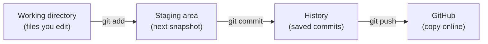

# Lesson 01 — Git & GitHub: save and share your work

Before you write more code, you'll set up a safety net. **Git** records snapshots of your project so you can always go back, and **GitHub** keeps a copy online. You'll make your first commit and push it.

## 🎯 Goal

By the end of this lesson your Lesson 00 page is saved as the first **commit** (a saved snapshot) in a Git repository on your computer, and a copy is on GitHub at `https://github.com/YOUR-USERNAME/chat-clone`.

<!-- no-screenshot: nothing changes in the browser this lesson; the result is terminal output and your repository page on GitHub -->

Nothing changes in the browser this time. Your results are in the terminal and on GitHub. Running `git log --oneline` will print one line like this (your code, the letters and digits before the message, will differ):

```text
a1b2c3d (HEAD -> main) Add hello page
```

After pushing, your repository page on github.com lists the `vanilla` folder, `README.md` and `.gitignore`, and shows the README text under the file list.

## 🧠 New concepts

<ConceptList />

### Version control

Imagine saving `essay.py`, then `essay_v2.py`, then `essay_final.py`, then `essay_final_REALLY.py`. **Version control** does this properly. You tell it when to take a snapshot, and it stores only what changed. Later you can see what you changed and when, compare two versions, or go back to an old one.

**Git** is the most popular version control tool. It runs on your computer and works without internet.

### The pieces of Git

| Word | Meaning |
| --- | --- |
| **Repository** ("repo") | A project folder that Git is tracking. Git keeps its records in a hidden folder named `.git` inside it. |
| **Working directory** | The files you see and edit in the folder. |
| **Staging area** | A waiting room. You choose which changes go into the *next* snapshot by **staging** them. |
| **Commit** | One saved snapshot, with a message that says what changed. |
| **History** | The list of all commits, newest first. |



Why a staging area? You might fix a bug and also start a new feature in the same hour. Staging lets you commit them as two separate snapshots, each with its own message.

::: tip Python comparison
Think of a commit like a `git`-powered "save game": it records the whole project at one moment. The staging area is like picking which files go into a zip file *before* you zip it.
:::

### The commands

| Command | What it does |
| --- | --- |
| `git --version` | Checks that Git is installed. |
| `git config` | Sets your name, your email and other settings. |
| `git init` | Turns the current folder into a repository. |
| `git status` | Shows what changed and what is staged. Use it all the time. |
| `git add` | Stages changes for the next commit. |
| `git commit` | Saves the staged changes as a snapshot. |
| `git log` | Lists the history. |
| `git diff` | Shows line-by-line what you changed but haven't staged yet. |
| `git remote` | Manages the online copies of the repository. |
| `git branch` | Lists or renames branches. |
| `git push` | Uploads your commits to the remote. |

A **branch** is a line of history. Yours will have one branch, named `main`, for the whole course. A **remote** is a copy of the repository somewhere else, usually on GitHub. By convention the main remote is named `origin`.

### Markdown

A `README.md` file is the front page of a repository. The `.md` means **Markdown**: plain text with a few symbols that turn into formatting.

| You type | You get |
| --- | --- |
| `# Title` | a big heading |
| `## Section` | a smaller heading |
| `- item` | a bullet point |
| `` `code` `` | `code` in a monospace font |
| `**bold**` | **bold** |

GitHub shows the formatted version of `README.md` under the file list. This course's lessons are written in Markdown too.

### .gitignore

Some files should never be saved in a repository, such as junk your computer creates by itself. A file named `.gitignore` lists names Git should ignore. On macOS, Finder creates a file called `.DS_Store` in folders you open. You don't want it in your history, so you'll list it. Later lessons add folders like `node_modules` here too.

A line starting with `#` in `.gitignore` is a comment.

## 🛠️ Build it

### Step 1 — Check that Git is installed

Open the terminal in VS Code (**View → Terminal**) and type:

```sh
git --version
```

If Git is installed you'll see a version line such as `git version 2.39.5 (Apple Git-154)`. The numbers will differ.

On a Mac that has never used Git, macOS may pop up a window offering to install the **Command Line Developer Tools**. Click **Install** and wait for it to finish (it can take several minutes), then run `git --version` again.

::: warning Tool setup can change
The exact wording of the macOS install window may differ. If no window appears and the command fails, search for "install Git on macOS" at [git-scm.com](https://git-scm.com/book/en/v2), which has current instructions.
:::

<!-- no-solution: checking a tool, nothing to type into a file -->

### Step 2 — Tell Git who you are

Every commit records its author. Set your name and email once for your whole computer (`--global`). Replace the placeholders with your own:

```sh
git config --global user.name "Your Name"
git config --global user.email "you@example.com"
git config --global init.defaultBranch main
```

The third line makes new repositories start on a branch called `main`. To check your settings, type:

```sh
git config --global --list
```

Use the same email address you will use for GitHub in Step 9, so GitHub can link commits to your account. If you'd rather not publish your real email, GitHub offers a private "noreply" address in its email settings. Look for it there when you sign up.

::: solution
```text
$ git config --global --list
user.name=Your Name
user.email=you@example.com
init.defaultbranch=main
```

Git prints the setting names in lowercase, and other settings may appear in the list too.
:::

### Step 3 — Turn your project folder into a repository

Move into the project folder from Lesson 00 and initialize Git:

```sh
cd ~/code/chat-clone
git init
```

Git answers with something like:

```text
Initialized empty Git repository in /Users/sam/code/chat-clone/.git/
```

Check the path in that message. It must end in `chat-clone/.git/`. If it names your home folder, you ran `git init` in the wrong place (see Common mistakes).

::: solution
```text
$ cd ~/code/chat-clone
$ git init
Initialized empty Git repository in /Users/sam/code/chat-clone/.git/
```
:::

### Step 4 — Write a README and a .gitignore

In VS Code, create a new file at the top of `chat-clone` (not inside `vanilla`) named `README.md`. Hover over the `CHAT-CLONE` folder name in the Explorer and use the **New File** icon. Type:

::: solution
```md [README.md]
# My Chat App

A Discord-style chat app I'm building to learn frontend development.

## What's inside

- `vanilla/` — the plain HTML, CSS and JavaScript version
```
:::

Now create a second file, also at the top level, named `.gitignore`. Start the name with a dot; it will look like a hidden file, and that's normal. Type:

```text [.gitignore]
# macOS creates these files in every folder you open in Finder
.DS_Store
```

::: solution
```text [.gitignore]
# macOS creates these files in every folder you open in Finder
.DS_Store
```
:::

The long dash in the README (`—`) is a normal character. If you can't type it, a simple hyphen `-` works too.

### Step 5 — See what Git noticed

```sh
git status
```

Git lists what it found:

```text
On branch main

No commits yet

Untracked files:
  (use "git add <file>..." to include in what will be committed)
	.gitignore
	README.md
	vanilla/

nothing added to commit but untracked files present (use "git add" to track)
```

**Untracked** means Git sees the files but isn't recording them yet. The wording may differ a little between Git versions.

<!-- no-solution: reading command output, nothing to type -->

### Step 6 — Stage and commit

Stage everything in the folder, then check again:

```sh
git add .
git status
```

The `.` means "this folder and everything in it". The files now appear under **Changes to be committed**, which is the staging area. Now take the snapshot:

```sh
git commit -m "Add hello page"
```

`-m` gives the commit **message**. Write messages in the imperative, like a command: "Add hello page", "Fix typo". Make them specific so your future self knows what happened.

If Git opens a strange text editor instead (usually `vim`), you forgot `-m`. Press <kbd>Esc</kbd>, type `:q!` and press <kbd>Enter</kbd> to leave without committing, then try again.

::: solution
```text
$ git commit -m "Add hello page"
[main (root-commit) a1b2c3d] Add hello page
 3 files changed, 20 insertions(+)
 create mode 100644 .gitignore
 create mode 100644 README.md
 create mode 100644 vanilla/index.html
```

Your commit code and line counts will differ a little.
:::

### Step 7 — Read the history

```sh
git log --oneline
git status
```

`git log --oneline` shows one line per commit. `git status` should now say `nothing to commit, working tree clean`: your working directory matches the last snapshot.

Try the cycle once more. In `README.md`, add a line at the bottom such as `Built step by step, lesson by lesson.`, save, then run:

```sh
git status
git diff
```

`git status` shows `README.md` as **modified**. `git diff` prints the exact lines you added, marked with a `+`. Press <kbd>Q</kbd> to leave the diff view if it stays open. You can either keep this change for the next commit or remove the line again. If you keep it, the commit in Step 12 will include it.

::: solution
```text
$ git log --oneline
a1b2c3d (HEAD -> main) Add hello page
```
:::

### Step 8 — Create a GitHub account

If you don't have one, go to [github.com](https://github.com) and sign up. Choose a user name you wouldn't mind in a web address, because your site will be at `YOUR-USERNAME.github.io` later in the course.

::: warning Tool setup can change
GitHub's sign-up pages and buttons change from time to time. Follow what the site shows you.
:::

<!-- no-solution: creating an account in the browser -->

### Step 9 — Create an empty repository on GitHub

1. On github.com, use the **+** menu at the top right and choose **New repository**.
2. Name it `chat-clone`.
3. Choose **Public**. Later (Lesson 31) you'll publish the app with GitHub Pages, and free accounts have needed public repositories for that. Check GitHub's current plans on their site, because this can change.
4. Do **not** tick "Add a README file", ".gitignore" or a license. Your local repository already has its own history, and an empty repository avoids conflicts.
5. Click **Create repository**.

GitHub then shows a page with setup commands. You'll use a version of them next.

::: warning Tool setup can change
GitHub redesigns this page now and then, so buttons may have moved or been renamed. The important parts are the repository name, **Public**, and *not* adding any starter files.
:::

<!-- no-solution: clicking through a website -->

### Step 10 — Install the GitHub CLI and sign in

The **GitHub CLI** (`gh`) is a command-line tool that logs you in to GitHub so `git push` works. If you use Homebrew (a popular Mac package installer), install it with:

```sh
brew install gh
```

If you don't have Homebrew, download the installer from [cli.github.com](https://cli.github.com/) instead. Then sign in:

```sh
gh auth login
```

`gh` asks a few questions. Choose **GitHub.com**, choose **HTTPS** as the protocol, say yes if it offers to authenticate Git with your GitHub credentials, and choose to log in **with a web browser**. It shows a one-time code; paste it into the page that opens in your browser and approve. When it finishes, check with:

```sh
gh auth status
```

It should say you are logged in to github.com.

::: warning Tool setup can change
The questions and wording in `gh auth login` may differ in newer versions. Read each prompt and pick the closest option to those above. Remember: your GitHub password does *not* work for `git push` over HTTPS. Git needs a login created by `gh` (or a personal access token).
:::

<!-- no-solution: installing and signing in; output differs per machine -->

### Step 11 — Connect your repository to GitHub

On your repository's GitHub page, copy its HTTPS address; it looks like `https://github.com/YOUR-USERNAME/chat-clone.git`. In the terminal (still in `~/code/chat-clone`), type the following with your own user name:

```sh
git remote add origin https://github.com/YOUR-USERNAME/chat-clone.git
git branch -M main
git push -u origin main
```

- `git remote add origin <address>` gives the remote the name `origin`.
- `git branch -M main` makes sure your branch is named `main`. It does nothing new if you set `init.defaultBranch` earlier.
- `git push -u origin main` uploads your commits. `-u` remembers the connection, so next time `git push` alone is enough.

Reload your repository page on GitHub. You should see your files.

::: solution
```text
$ git push -u origin main
Enumerating objects: 6, done.
Counting objects: 100% (6/6), done.
Writing objects: 100% (6/6), 700 bytes | 700.00 KiB/s, done.
To https://github.com/YOUR-USERNAME/chat-clone.git
 * [new branch]      main -> main
branch 'main' set up to track 'origin/main'.
```

The numbers and extra lines will differ. The key line is `main -> main`.
:::

### Step 12 — Look at Git in VS Code

VS Code has a built-in **Source Control** view (the branching-lines icon in the left bar). If you added the extra line to the README in Step 7, it lists `README.md` under **Changes**. Click the file to see a side-by-side comparison with the last commit. Files with changes get a letter next to their name (such as `M` for modified).

You can use the buttons there instead of the terminal, but this course uses the terminal commands so you learn what happens underneath.

If you made the extra README change, save and commit it now with the commands from the Commit section below. If you removed the line again, there's nothing to commit.

<!-- no-solution: exploring the Source Control view -->

## ✅ Checkpoint

- [ ] `git --version` prints a version number.
- [ ] `git config --global --list` shows your `user.name` and `user.email`.
- [ ] `~/code/chat-clone` contains a hidden `.git` folder. Check with `ls -a`.
- [ ] `git log --oneline` shows a commit named **Add hello page**.
- [ ] `git status` says `nothing to commit, working tree clean`.
- [ ] Your repository page on GitHub lists `vanilla`, `README.md` and `.gitignore`, and shows the README text below.
- [ ] In VS Code, the Source Control view shows no pending changes (or only changes you chose to leave).

## 🐛 Common mistakes

**You ran `git init` in your home folder (or in `code`) instead of `chat-clone`.** Git is now tracking far too much. Check the path in the `Initialized empty Git repository in ...` message. To undo it, delete the stray hidden `.git` folder in that wrong place (for example `rm -rf ~/.git`, only if you are sure it is the one you just created), then `cd` into the right folder and run `git init` again.

**`git status` says `nothing to commit` but you changed a file.** You may have forgotten to save, or you are in a different folder. Run `pwd`.

**You ran `git commit` but it says `no changes added to commit`.** You forgot `git add .` first. Stage the files, then commit again.

**Git says "Author identity unknown" or "Please tell me who you are".** You skipped Step 2. Run the two `git config --global` commands with your name and email, then commit again.

**`git push` is rejected, asks for a password, or says authentication failed.** GitHub no longer accepts account passwords for HTTPS pushes. Sign in with `gh auth login` (Step 10), then try `git push` again. If the message says the remote contains work you don't have, you probably ticked "Add a README file" when creating the repository. Ask for help or recreate the empty repository and push again.

**You get warnings about an "embedded repository" or a folder that won't commit.** There is a second `.git` folder somewhere inside `chat-clone` (for example inside `vanilla`). A repository can't track another repository's folder as normal files. Make sure you ran `git init` only once, in `chat-clone`.

## 📝 Quiz

::: quiz
What is the **staging area**?

- [ ] The GitHub website where your code lives
- [x] A place where you gather the changes that will go into your next commit
- [ ] The folder where your files are edited
- [ ] A backup of your whole computer

> `git add` moves changes into the staging area. `git commit` then saves everything staged as one snapshot. This lets you decide exactly what each snapshot contains.
:::

::: quiz
You edit `vanilla/index.html`, save it, and run `git commit -m "Change title"` without running anything else first. What happens?

- [ ] The change is committed and pushed to GitHub
- [x] Git says there is nothing added to commit, and the change is not saved in history
- [ ] Git commits the change automatically, because the file is already tracked
- [ ] Git deletes the file

> Tracked files that changed still need to be staged with `git add` before `git commit` includes them. Run `git status` to see what's modified and what's staged. Remember that a commit is only on your computer until you `git push`.
:::

::: quiz
You add this line to `.gitignore`:

```text
.DS_Store
```

What is the effect?

- [ ] Git deletes every `.DS_Store` file on your computer
- [x] Git ignores files named `.DS_Store` when you run `git add .`
- [ ] GitHub refuses to show the file
- [ ] Nothing, because `.gitignore` only works on folders

> `.gitignore` tells Git which names to skip. The files still exist on disk, and Git just won't stage them. One catch: it doesn't affect files that Git is already tracking.
:::

## 💾 Commit

You made your first commit in Step 6, so there's nothing new to commit unless you changed the README in Step 7. From now on, every lesson ends with these three commands. If you do have a pending change, run them now:

```sh
git add .
git commit -m "Add a line to the README"
git push
```

Replace the message with one that describes your change. Lesson 02 ends with your next real commit.
