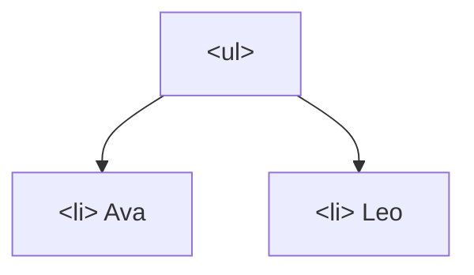

# Lesson 02 — Elements, attributes & nesting

Your first page had one heading and one paragraph. Now you'll write the *content* of the whole chat app as plain HTML: the logo, a list of servers, channels, messages and members. It won't look like Discord yet. In this lesson you learn what is on the page, and the next lessons make it look good.

## 🎯 Goal

By the end of this lesson `vanilla/index.html` is one long, unstyled page for an app called **Hubbub**. It shows a small speech-bubble logo, the heading "Hubbub", then headings and bulleted lists for servers, channels and members, and a numbered list of chat messages:

{.screenshot}

It looks like a document from 1995, and that's the point: the structure comes first. The browser tab now says **Hubbub** and shows the logo as its icon.

## 🧠 New concepts

<ConceptList />

### Anatomy of an element

An HTML **element** is a piece of the page, written with **tags**:

```html
<p lang="en">Hello <strong>world</strong></p>
```

```text
 opening tag      content           closing tag
┌───────────┐ ┌─────────────────────┐ ┌────┐
<p lang="en">Hello <strong>world</strong></p>
   └───┬───┘
  attribute (name="value")
```

- The **opening tag** `<p ...>` and **closing tag** `</p>` wrap the **content**. Together they are the element.
- An **attribute** adds information to an element. It goes inside the opening tag as `name="value"`. Here, `lang="en"` says the text is English. You already used the same attribute on `<html>`.
- Tag names are case-insensitive, but by habit you write them in lowercase.

Some elements can't have content, so they have no closing tag. They're called **void elements**. You'll use two today: `<meta>` and ``, and one more, `<link>`. See MDN's [void element](https://developer.mozilla.org/en-US/docs/Glossary/Void_element) entry.

### Nesting: elements inside elements

Elements go inside other elements, which makes a **tree**. Here's a small part of your page:

```html
<ul>
  <li>Ava</li>
  <li>Leo</li>
</ul>
```



The `<ul>` is the **parent**; the two `<li>`s are its **children** and **siblings** of each other. Elements must close in the reverse order they opened, like nested parentheses: `<p><strong>Hi</strong></p>` is right, and `<p><strong>Hi</p></strong>` is wrong.

::: tip Python comparison
In Python, nesting is expressed by indentation. In HTML it's expressed by tags. Indentation in HTML is only for *you*: the browser ignores it.
:::

### Headings

HTML has six heading levels, `<h1>` to `<h6>`. This lesson uses three:

- `<h1>`: the page's main title. Use one per page.
- `<h2>`: a major section.
- `<h3>`: a sub-section inside an `<h2>`.

Pick the level for the *meaning* of the heading, not for how big it looks. You can change sizes with CSS later. Screen readers let people jump between headings, so the levels should form a sensible outline. See [headings on MDN](https://developer.mozilla.org/en-US/docs/Web/HTML/Reference/Elements/Heading_Elements).

### Lists

| Element | Meaning |
| --- | --- |
| `<ul>` | an **u**nordered list (bullets). Order doesn't matter, like the servers you joined. |
| `<ol>` | an **o**rdered list (numbers). Order matters, like messages from oldest to newest. |
| `<li>` | one **l**ist **i**tem. It goes inside a `<ul>` or `<ol>`. |

Only `<li>` elements belong directly inside a `<ul>` or `<ol>`. An `<li>` can hold anything: text, paragraphs, even other lists.

### Links

```html
<a href="https://developer.mozilla.org/en-US/docs/Web/HTML">MDN: HTML</a>
```

`<a>` (the "anchor") makes a link. Its `href` attribute (**h**ypertext **ref**erence) is where the link goes. The content between the tags is the clickable text. See [`<a>` on MDN](https://developer.mozilla.org/en-US/docs/Web/HTML/Reference/Elements/a).

### Images and alt text

```html

```

- `src`: where the image file is. `assets/brand/logo.svg` is a **relative path**: it starts from the folder that holds the current HTML file.
- `alt`: **alternative text**, a short description of the image. Screen readers read it aloud to blind users, and the browser shows it if the image fails to load. Never skip `alt`. (An image that is pure decoration gets an empty `alt=""` instead, which tells screen readers to skip it.)
- `width` and `height`: the size in pixels. Giving them lets the browser reserve the space before the image has loaded, so the page doesn't jump.

`` is a void element, so there's no closing tag. See [`` on MDN](https://developer.mozilla.org/en-US/docs/Web/HTML/Reference/Elements/img).

### Inline text: strong, em, code

Some elements sit *inside* a line of text to mark part of it:

| Element | Meaning | Browser default |
| --- | --- | --- |
| `<strong>` | strong importance | **bold** |
| `<em>` | stress or emphasis | *italic* |
| `<code>` | a piece of computer code | monospace font |

Choose them for what the text *means*. The look can be changed with CSS later.

### Comments and entities

A **comment** is a note for humans. The browser ignores it:

```html
<!-- The servers you have joined -->
```

Some characters have a special meaning in HTML. `<` starts a tag, and `&` starts a **character entity**. To show them as text, use an entity:

| Type | To show |
| --- | --- |
| `&lt;` | `<` (**l**ess-**t**han) |
| `&gt;` | `>` (**g**reater-**t**han) |
| `&amp;` | `&` (**amp**ersand) |

So `<code>&lt;p&gt;</code>` displays as `<p>`. In Lesson 21 you'll see why escaping text like this matters for safety. MDN calls these [character references](https://developer.mozilla.org/en-US/docs/Glossary/Character_reference).

### Whitespace collapses

The browser squashes any run of spaces, tabs and line breaks in your text into a single space. Five blank lines between two words look the same as one space. That's why you can indent and wrap your HTML freely, and why you can't make extra spacing with the space bar. CSS does spacing, starting in Lesson 05.

### What goes in `<head>`

You already have `charset` and `title`. This lesson adds two more things:

```html
<meta name="viewport" content="width=device-width, initial-scale=1">
<link rel="icon" href="assets/brand/logo.svg">
```

- The **viewport meta** tells phone browsers to use the real screen width instead of pretending to be a big desktop screen. Without it, your layout looks tiny on phones. A `<meta>` with `name` and `content` attributes holds a named setting. See [viewport on MDN](https://developer.mozilla.org/en-US/docs/Web/HTML/Reference/Elements/meta/name/viewport).
- A **`<link>`** connects the page to another file. Its `rel` attribute (**rel**ationship) says what kind of file. `rel="icon"` makes it the little **favicon** on the browser tab. In Lesson 04 you'll use `<link>` for a stylesheet.

## 🛠️ Build it

### Step 1 — Add the logo file

Create the folders `assets` and, inside it, `brand`, under `vanilla`. In `brand`, create `logo.svg` and paste in the file below. It's an **SVG**: an image written as text, so it stays sharp at any size. You don't need to understand its contents yet (Lesson 06 explains SVG).

::: starter
<<< @/../solutions/lesson-02/vanilla/assets/brand/logo.svg [vanilla/assets/brand/logo.svg]
:::

Your folder should now look like this:

```text
chat-clone/
└── vanilla/
    ├── assets/
    │   └── brand/
    │       └── logo.svg
    └── index.html
```

<!-- no-solution: the logo is a pasted starter file -->

### Step 2 — Update the head

Open `vanilla/index.html`. Change the `<title>` to `Hubbub`, and add the viewport meta tag and the favicon link inside `<head>`:

::: solution
```html [vanilla/index.html]
<!DOCTYPE html>
<html lang="en">
  <head>
    <meta charset="utf-8">
    <meta name="viewport" content="width=device-width, initial-scale=1">
    <title>Hubbub</title>
    <link rel="icon" href="assets/brand/logo.svg">
  </head>
  <body>
    <h1>Hello, world!</h1>
    <p>This is the start of my chat app.</p>
  </body>
</html>
```
:::

Save. The browser tab now says **Hubbub**. The favicon may take a reload to appear, because browsers cache it. If it doesn't show, hard reload with <kbd>Cmd</kbd>+<kbd>Shift</kbd>+<kbd>R</kbd>.

### Step 3 — Replace the body: logo and title

Delete the old `<h1>` and `<p>` inside `<body>`. Type a comment, the logo image and the main heading:

::: solution
```html [vanilla/index.html]
<body>
  <!-- The app's logo and name -->
  
  <h1>Hubbub</h1>
</body>
```
:::

Each later step adds more *inside* `<body>`, after what you already have. The snippets only show the `<body>` part. Keep your `<head>` as it is.

Try removing `width` and `height` and reloading, to see the logo at its natural size. Then put them back.

### Step 4 — The server list

Add a section for servers after the `<h1>`. Type the comment, the `<h2>`, the `<ul>` and the first two items yourself:

```html
<!-- The servers you have joined -->
<h2>Servers</h2>
<ul>
  <li>Frontend Friends</li>
  <li>Pixel Art Club</li>
</ul>
```

Then add the other three items by pasting these three lines **inside the `<ul>`**, after `Pixel Art Club`:

::: starter
```html
<li>Weekend Hikers</li>
<li>Study Group</li>
<li>Game Night</li>
```
:::

::: solution
```html [vanilla/index.html]
<!-- The servers you have joined -->
<h2>Servers</h2>
<ul>
  <li>Frontend Friends</li>
  <li>Pixel Art Club</li>
  <li>Weekend Hikers</li>
  <li>Study Group</li>
  <li>Game Night</li>
</ul>
```
:::

### Step 5 — The channels

Below the servers, add the channels of the first server. This uses a heading level for each part of the outline: `<h2>` for the server and `<h3>` for each kind of channel. Type the text channels yourself:

```html
<!-- The channels of the selected server -->
<h2>Frontend Friends</h2>
<h3>Text Channels</h3>
<ul>
  <li># general</li>
  <li># help</li>
  <li># showcase</li>
  <li># off-topic</li>
</ul>
```

Then add the voice channels. Type the heading and the first item, then paste the second:

::: starter
```html
<li>Pair Programming</li>
```
:::

::: solution
```html [vanilla/index.html]
<!-- The channels of the selected server -->
<h2>Frontend Friends</h2>
<h3>Text Channels</h3>
<ul>
  <li># general</li>
  <li># help</li>
  <li># showcase</li>
  <li># off-topic</li>
</ul>
<h3>Voice Channels</h3>
<ul>
  <li>Lounge</li>
  <li>Pair Programming</li>
</ul>
```
:::

The `#` here is just a character in the text (Discord uses it to mark text channels). It is not HTML.

### Step 6 — The messages

Messages are in order, oldest first, so use an ordered list `<ol>`. Each `<li>` holds two paragraphs: the author and time, then the text. Type the heading, the intro paragraph and the first message:

```html
<!-- The messages in the selected channel -->
<h2># general</h2>
<p>Chat about anything frontend: HTML, CSS, JavaScript, React.</p>
<ol>
  <li>
    <p><strong>Ava</strong> <em>Yesterday at 10:15 AM</em></p>
    <p>Hey @Sam, how's the clone going? Did you get the grid layout working?</p>
  </li>
</ol>
```

Notice the nesting: `<strong>` and `<em>` are inside a `<p>`, which is inside an `<li>`, which is inside an `<ol>`. Draw that tree on paper if it helps.

Now add the other three messages **inside the `<ol>`**, after the first `</li>`. Before you paste, read the third and fourth messages for two new things: a link and an entity.

::: starter
```html
<li>
  <p><strong>Sam</strong> <em>Yesterday at 10:22 AM</em></p>
  <p>Getting there! The four columns line up now.</p>
</li>
<li>
  <p><strong>Noah</strong> <em>Yesterday at 10:30 AM</em></p>
  <p>Bookmarking the docs for later: <a href="https://developer.mozilla.org/en-US/docs/Web/HTML">MDN: HTML</a></p>
</li>
<li>
  <p><strong>Priya</strong> <em>Yesterday at 10:31 AM</em></p>
  <p>Tip: write <code>&lt;p&gt;</code> to show a tag as text &amp; not as HTML.</p>
</li>
```
:::

::: solution
```html [vanilla/index.html]
<!-- The messages in the selected channel -->
<h2># general</h2>
<p>Chat about anything frontend: HTML, CSS, JavaScript, React.</p>
<ol>
  <li>
    <p><strong>Ava</strong> <em>Yesterday at 10:15 AM</em></p>
    <p>Hey @Sam, how's the clone going? Did you get the grid layout working?</p>
  </li>
  <li>
    <p><strong>Sam</strong> <em>Yesterday at 10:22 AM</em></p>
    <p>Getting there! The four columns line up now.</p>
  </li>
  <li>
    <p><strong>Noah</strong> <em>Yesterday at 10:30 AM</em></p>
    <p>Bookmarking the docs for later: <a href="https://developer.mozilla.org/en-US/docs/Web/HTML">MDN: HTML</a></p>
  </li>
  <li>
    <p><strong>Priya</strong> <em>Yesterday at 10:31 AM</em></p>
    <p>Tip: write <code>&lt;p&gt;</code> to show a tag as text &amp; not as HTML.</p>
  </li>
</ol>
```
:::

In the browser, check that the link is clickable and that Priya's message shows `<p>` and `&` as plain text. If you had typed `<p>` directly instead of `&lt;p&gt;`, the browser would have treated it as a tag and it would have vanished.

### Step 7 — The members

Last, add the member list. Type the heading and the first two names. Paste the rest:

```html
<!-- The people in this server -->
<h2>Members</h2>
<ul>
  <li>Ava</li>
  <li>Leo</li>
</ul>
```

::: starter
```html
<li>Maya</li>
<li>Noah</li>
<li>Priya</li>
<li>Sam</li>
```
:::

::: solution
```html [vanilla/index.html]
<!-- The people in this server -->
<h2>Members</h2>
<ul>
  <li>Ava</li>
  <li>Leo</li>
  <li>Maya</li>
  <li>Noah</li>
  <li>Priya</li>
  <li>Sam</li>
</ul>
```
:::

### Step 8 — Check your whole file

Compare your file with the complete version below. Every line should match, including the comments.

::: solution
```html [vanilla/index.html]
<!DOCTYPE html>
<html lang="en">
  <head>
    <meta charset="utf-8">
    <meta name="viewport" content="width=device-width, initial-scale=1">
    <title>Hubbub</title>
    <link rel="icon" href="assets/brand/logo.svg">
  </head>
  <body>
    <!-- The app's logo and name -->
    
    <h1>Hubbub</h1>

    <!-- The servers you have joined -->
    <h2>Servers</h2>
    <ul>
      <li>Frontend Friends</li>
      <li>Pixel Art Club</li>
      <li>Weekend Hikers</li>
      <li>Study Group</li>
      <li>Game Night</li>
    </ul>

    <!-- The channels of the selected server -->
    <h2>Frontend Friends</h2>
    <h3>Text Channels</h3>
    <ul>
      <li># general</li>
      <li># help</li>
      <li># showcase</li>
      <li># off-topic</li>
    </ul>
    <h3>Voice Channels</h3>
    <ul>
      <li>Lounge</li>
      <li>Pair Programming</li>
    </ul>

    <!-- The messages in the selected channel -->
    <h2># general</h2>
    <p>Chat about anything frontend: HTML, CSS, JavaScript, React.</p>
    <ol>
      <li>
        <p><strong>Ava</strong> <em>Yesterday at 10:15 AM</em></p>
        <p>Hey @Sam, how's the clone going? Did you get the grid layout working?</p>
      </li>
      <li>
        <p><strong>Sam</strong> <em>Yesterday at 10:22 AM</em></p>
        <p>Getting there! The four columns line up now.</p>
      </li>
      <li>
        <p><strong>Noah</strong> <em>Yesterday at 10:30 AM</em></p>
        <p>Bookmarking the docs for later: <a href="https://developer.mozilla.org/en-US/docs/Web/HTML">MDN: HTML</a></p>
      </li>
      <li>
        <p><strong>Priya</strong> <em>Yesterday at 10:31 AM</em></p>
        <p>Tip: write <code>&lt;p&gt;</code> to show a tag as text &amp; not as HTML.</p>
      </li>
    </ol>

    <!-- The people in this server -->
    <h2>Members</h2>
    <ul>
      <li>Ava</li>
      <li>Leo</li>
      <li>Maya</li>
      <li>Noah</li>
      <li>Priya</li>
      <li>Sam</li>
    </ul>
  </body>
</html>
```
:::

### Step 9 — Explore in DevTools

Open DevTools (<kbd>Cmd</kbd>+<kbd>Option</kbd>+<kbd>I</kbd>) and go to **Elements**.

1. Expand `<body>` and then `<ol>`. Find the nesting you typed.
2. Find Priya's message. The Elements panel shows `&lt;p&gt;` as `<p>` text: the browser turned the entity into the character.
3. Hover over the ``. DevTools shows its size (48 × 48).
4. Click the **Network** tab and reload. You'll see `index.html` and also `logo.svg`: the browser asked for the logo because your HTML mentions it.

<!-- no-solution: exploring DevTools, nothing to type -->

## ✅ Checkpoint

- [ ] The tab title is **Hubbub** and the logo shows as the tab icon (hard reload if not).
- [ ] The page shows the logo, the heading Hubbub, and five lists: servers, text channels, voice channels, messages (numbered 1 to 4) and members.
- [ ] Names in messages are bold and times are italic.
- [ ] Priya's message displays `<p>` and `&` as text, and the MDN link opens when clicked.
- [ ] DevTools → **Elements** shows each `<li>` nested inside its `<ul>` or `<ol>`.
- [ ] DevTools → **Network** shows `logo.svg` with status **200** after a reload.
- [ ] DevTools → **Console** shows no red errors.

## 🐛 Common mistakes

**The logo shows as a broken-image icon with the text "Hubbub logo".** The `src` path doesn't match where the file is. Check that the file is `vanilla/assets/brand/logo.svg`, spelled exactly, and that `index.html` is in `vanilla/`. That alt text appearing is `alt` doing its job.

**Everything after one spot is bold or italic.** You forgot a closing tag such as `</strong>` or `</em>`, so the element runs on. Check that every opening tag has its closing partner.

**A list shows bullets in the wrong place, or text appears outside the list.** An `<li>` is outside its `<ul>`/`<ol>`, or a closing tag is in the wrong order. Use the Elements panel: where the tree looks wrong, your HTML has a typo just before it.

**You typed `<p>` in a message but it doesn't show.** The browser read it as a tag. Write `&lt;p&gt;` to show the characters.

**The page is unchanged after saving.** You may have edited a different `index.html`, or not saved. Check the file path at the top of the editor tab and the address in the browser (`/vanilla/index.html`).

**The favicon doesn't appear.** Browsers cache favicons heavily. Hard reload, or open the page in a new tab. Check the `href` path too.

## 📝 Quiz

::: quiz
Which line has an element nested **correctly**?

- [ ] `<p><strong>Hi</p></strong>`
- [x] `<p><strong>Hi</strong></p>`
- [ ] `<strong><p>Hi</strong></p>`
- [ ] `<p><strong>Hi</strong>`

> Elements must close in the reverse order they were opened, so the innermost one closes first. The first and third lines cross over each other, and the last never closes `<p>`.
:::

::: quiz
What does the browser show for this HTML?

```html
<p>Use &lt;em&gt; for emphasis &amp; <em>stress</em>.</p>
```

- [ ] Use &lt;em&gt; for emphasis &amp; stress.
- [ ] Use for emphasis & stress. (with "stress" in italics)
- [x] Use `<em>` for emphasis & *stress*. (the first `<em>` as plain text, the last word in italics)
- [ ] Nothing, because the HTML is invalid

> The entities `&lt;` and `&gt;` become the plain characters `<` and `>`, and `&amp;` becomes `&`. Only the real `<em>` tag creates emphasis.
:::

::: quiz
Why should every `` have an `alt` attribute?

- [ ] It makes the image load faster
- [ ] It sets the size of the image
- [x] Screen readers read it aloud, and the browser shows it if the image can't load
- [ ] It's required to make the image a link

> `alt` is the text version of the image. Without it, someone using a screen reader gets no information about it. For purely decorative images, use an empty `alt=""` so screen readers skip it.
:::

## 💾 Commit

Save this lesson in Git and upload it:

```sh
git add .
git commit -m "Write the app content as plain HTML"
git push
```
