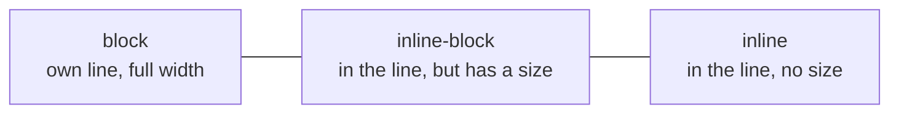

# Lesson 05 — The box model

Every element on a web page is a rectangular box. In this lesson you learn how those boxes get their size and spacing: content, padding, border and margin. That gives the app its proportions: round server icons, a 240px sidebar, padded channel buttons and a rounded message box.

## 🎯 Goal

By the end of this lesson the sidebar and the server rail have their real sizes, spacing and shapes. The rail is 72px wide with perfectly round 48px server buttons, the channel sidebar is 240px wide with a header bar, and channel buttons have padding and rounded corners.

{.screenshot}

The columns are still stacked *vertically*: the rail sits on top, the sidebar is under it, and the chat area and member list are further down the page (scroll down to see them). Putting them side by side is Lesson 06 and Lesson 07. The page no longer has the browser's default gaps, bullets or indentation.

## 🧠 New concepts

<ConceptList />

### Every element is a box

The browser lays out every element as a rectangle made of four layers, from the inside out:

```text
┌──────────────────────────────────────────────┐
│                    margin                    │  ← space OUTSIDE the box
│   ┌──────────────────────────────────────┐   │
│   │               border                 │   │  ← the box's edge line
│   │   ┌──────────────────────────────┐   │   │
│   │   │          padding             │   │   │  ← space INSIDE, around content
│   │   │   ┌──────────────────────┐   │   │   │
│   │   │   │       content        │   │   │   │  ← your text / images
│   │   │   └──────────────────────┘   │   │   │
│   │   └──────────────────────────────┘   │   │
│   └──────────────────────────────────────┘   │
└──────────────────────────────────────────────┘
```

| Layer | What it is | Property |
| --- | --- | --- |
| **Content** | the text or child elements | `width`, `height` |
| **Padding** | breathing room between the content and the border. The background colour **fills** the padding | `padding` |
| **Border** | a line around the padding | `border` |
| **Margin** | empty space *outside* the border, pushing other elements away. Always **transparent** | `margin` |

The mnemonic: **padding is inside, margin is outside.** A button with a coloured background and lots of padding is a big coloured button. The same button with lots of margin is a small button with empty space around it.

See [the CSS box model on MDN](https://developer.mozilla.org/en-US/docs/Web/CSS/Guides/Box_model/Introduction_to_the_CSS_box_model).

### Width and height, and `box-sizing`

`width` and `height` set the size of a box. What does that size include? By default, browsers use `box-sizing: content-box`: `width` is the size of the **content only**, and the padding and border are added on top.

```css
.box {
  width: 200px;
  padding: 20px;
  border: 2px solid white;
}
```

With the default `content-box`, this box takes up 200 + 20 + 20 + 2 + 2 = **244px** across. That's awkward: you ask for 200 and get 244.

With `box-sizing: border-box`, `width` covers content, padding **and** border. The box above is exactly **200px** across, and the content shrinks to fit (156px). That matches how you think about sizes, so nearly every modern project turns it on for everything:

```css
* {
  box-sizing: border-box;
}
```

`*` is the **universal selector**: it matches every element. After this rule, `width: 240px` means exactly 240px in the layout. See [`box-sizing` on MDN](https://developer.mozilla.org/en-US/docs/Web/CSS/Reference/Properties/box-sizing).

`min-width` and `min-height` set a **minimum**: the box can grow but can't get smaller than that. You'll use `min-height` on the message box, so it's at least one comfortable line tall but grows if needed.

### Padding and margin: the shorthand

Each side has its own property: `padding-top`, `padding-right`, `padding-bottom`, `padding-left`, and the same for `margin`. The **shorthand** `padding` / `margin` sets several sides in one declaration. The number of values decides how they are used:

| Values | Meaning | Example | Result |
| --- | --- | --- | --- |
| 1 | all four sides | `padding: 8px` | 8 top, right, bottom, left |
| 2 | vertical, horizontal | `padding: 12px 16px` | 12 top and bottom, 16 left and right |
| 3 | top, horizontal, bottom | `padding: 24px 8px 4px` | 24 top, 8 left and right, 4 bottom |
| 4 | top, right, bottom, left (clockwise) | `padding: 0 8px 16px 0` | 0 top, 8 right, 16 bottom, 0 left |

Remember "clockwise from the top": top, right, bottom, left. `margin` works identically. A value of `0` needs no unit.

A special value is `margin: 0 auto`: with a fixed width, `auto` on the left and right margins centres a block in its parent. You'll see this on the thin divider line under the home button.

### Percentages

`%` means "a percentage of something". For `width`, it's a percentage of the **parent's width**: `width: 100%` fills the parent exactly. For `border-radius` it's a percentage of the box's own size, as you'll see next.

### Rounded corners and shadows

**`border-radius`** rounds corners: `border-radius: 4px` is a slight rounding. `border-radius: 50%` on a **square** makes a perfect circle. That's how the 48 × 48px server buttons become round. See [`border-radius` on MDN](https://developer.mozilla.org/en-US/docs/Web/CSS/Reference/Properties/border-radius).

**`box-shadow`** draws a shadow outside the box without taking up any space:

```css
.panel {
  box-shadow: 0 1px 0 rgba(0, 0, 0, 0.3);
}
```

The values are: horizontal offset, vertical offset, blur, colour. Here: no horizontal shift, 1px down, **no blur**, a see-through black. A shadow with zero blur is a crisp line. This is the thin line under the header bars. You can list several shadows separated by commas. See [`box-shadow` on MDN](https://developer.mozilla.org/en-US/docs/Web/CSS/Reference/Properties/box-shadow).

### Block, inline and inline-block

Elements have a **display** type that decides how they sit in the page:

| `display` | Behaviour | Examples |
| --- | --- | --- |
| `block` | starts on a new line and fills the full width available. `width`, `height`, `margin` and `padding` all work | `<div>`, `<p>`, `<ul>`, `<li>`, `<h1>` |
| `inline` | flows inside a line of text, only as wide as its content. `width` and `height` are **ignored** and vertical margin doesn't push other lines | `<span>`, `<a>`, `<strong>` |
| `inline-block` | flows like inline text, but `width`, `height`, padding and margin work like a block | `<button>`, ``, `<input>` by default |



The avatar placeholder is a `<span>` (inline), so to give it a size, you change it to `inline-block`. `display: block` goes the other way. `text-align` aligns text and inline content *inside* a box: `left`, `center` or `right`. See [`display` on MDN](https://developer.mozilla.org/en-US/docs/Web/CSS/Reference/Properties/display).

### The browser's default spacing, and resets

The browser's default stylesheet adds spacing you didn't ask for. Chrome gives `<body>` an 8px margin, headings and paragraphs vertical margins, and lists a bullet marker plus about 40px of left padding. Those defaults suit documents but not an app. So you **reset** them to zero and add the spacing you want, element by element:

- `margin: 0` removes margins.
- `padding: 0` removes padding.
- `list-style: none` removes bullets and numbers.
- `resize: none` stops the drag handle on a `<textarea>` (you'll use it on the message box).

::: tip Python comparison
This is like clearing a variable before you set it: start from nothing so every number in your CSS is a decision you made.
:::

## 🛠️ Build it

You'll edit all six CSS files from last lesson. In each step, the **new or changed declarations** are what to type. The solutions show the whole file so you can compare.

### Step 1 — Add sizes and lines to the theme

In `vanilla/css/theme.css`, add two groups of variables inside `:root`, **between the status colours and the fonts**:

- `Lines and shadows`: `--divider` and `--header-shadow`. The shadow is three layered shadows separated by commas. It draws a crisp line, with two fainter ones below it.
- `Sizes`: the widths of the three columns, the header height and two corner radii.

Putting sizes in variables is useful: Lesson 11's responsive layout will reuse some of them. Using the same name `--radius-small` everywhere means one edit changes all corners.

::: solution
<<< @/../solutions/lesson-05/vanilla/css/theme.css [vanilla/css/theme.css]
:::

### Step 2 — `border-box` for everything, and no body margin

Open `vanilla/css/base.css`. Add a rule for the universal selector at the top, right after the file comment, and a `margin: 0` declaration at the **start** of the `body` rule:

::: solution
```css [vanilla/css/base.css]
/* Base styles: things every part of the app shares. */

/* width and height include padding and border (much easier to reason about) */
* {
  box-sizing: border-box;
}

body {
  margin: 0;
  background-color: var(--bg-tertiary);
  color: var(--text-normal);
  font-family: var(--font-sans);
  font-size: 16px;
  line-height: 1.375;
}

/* ...rest unchanged... */
```
:::

Save. The 8px gap between the page content and the window edge is gone: the content now touches the edges of the browser window.

### Step 3 — Reset buttons, text and lists

Still in `base.css`, add three rules **after** the `button, input, textarea` rule, in this order:

- `button`: `padding: 0`. You'll add padding back to specific buttons.
- `h1, h2, h3, p`: a selector list that sets `margin: 0`.
- `ul, ol`: no margin, no padding, no bullets (`list-style: none`).

The stacked page gets tighter, and the bullets disappear. The numbers `1.` and `2.` in the message list are gone too.

::: solution
```css [vanilla/css/base.css]
button,
input,
textarea {
  font: inherit;
  color: inherit;
  background: none;
  border: none;
}

button {
  padding: 0;
}

/* Remove the browser's default spacing; we'll add our own where we want it */
h1,
h2,
h3,
p {
  margin: 0;
}

ul,
ol {
  margin: 0;
  padding: 0;
  list-style: none;
}

/* ...rest unchanged... */
```
:::

### Step 4 — Code, avatars and icon buttons

Last in `base.css`:

1. Give `code` some padding, rounded corners and a background (inside the existing rule, before `font-family`). Padding in `em` scales with the code's font size.
2. Add the **`.avatar`** rule: the `<span>`s with the letters. It's inline by default, so it needs `display: inline-block` before `width` and `height` work. `border-radius: 50%` makes it a circle. `line-height: 40px` equals the height, which centres the letter vertically, and `text-align: center` centres it horizontally.
3. Add the **`.icon-button`** rule used by Mute, Deafen, Settings, Pins and others.

Compare with the full file:

::: solution
<<< @/../solutions/lesson-05/vanilla/css/base.css [vanilla/css/base.css]
:::

### Step 5 — Size the server rail

Open `vanilla/css/server-rail.css`:

- `.server-rail`: a fixed width from the theme, and vertical padding of 12px (`12px 0` means 12 top and bottom, 0 sides).
- `.server-item` (the `<li>`): `margin-bottom: 8px` to space the buttons, and `text-align: center` so the buttons sit in the middle of the 72px rail. A button is inline-block, so `text-align` centres it.
- `.server-button`: the **48 × 48 circle**: `width`, `height` and `border-radius: 50%`.
- `.brand-logo`: the logo image inside the home button, at 30 × 30px.
- `.server-separator`: the thin line: 32px wide, 2px tall, `margin: 0 auto 8px` (0 top, auto left and right to centre, 8px bottom), slightly rounded and filled with the divider colour.

Because of `box-sizing: border-box` the server buttons are exactly 48 × 48. Don't change their existing declarations.

::: solution
<<< @/../solutions/lesson-05/vanilla/css/server-rail.css [vanilla/css/server-rail.css]
:::

Save. The round buttons appear, and a thin line is visible under the logo button.

### Step 6 — Size the channel sidebar

Open `vanilla/css/channels.css`. Here's what to add, rule by rule:

| Rule | Add |
| --- | --- |
| `.channel-sidebar` | `width: var(--sidebar-width);` as the first declaration |
| `.sidebar-header` (new, before `.server-name`) | height from the theme, `padding: 12px 16px`, the header shadow |
| `.channel-list` (new, after `.server-name`) | `padding: 0 8px 16px 0` (4 values: top, right, bottom, left) |
| `.category` (new) | `padding-top: 16px` |
| `.category-toggle` | `padding: 0 8px 4px 8px` as the first declaration |
| `.channel-item` (new, after `.category-toggle`) | `padding-left: 8px` |
| `.channel-button` | `width: 100%`, `margin: 1px 0`, `padding: 6px 8px`, `border-radius`, and `text-align: left` |
| `.user-panel` | `height: 52px`, `padding: 6px 8px` |
| `.user-panel-profile` (new) | `padding: 4px 2px`, `border-radius`, `text-align: left` |
| `.user-panel-profile .avatar` (new) | a smaller avatar: 32 × 32, `font-size: 14px`, `line-height: 32px` |

Why the last rule works: `.user-panel-profile .avatar` is a descendant selector with **two classes**. It's more specific than the plain `.avatar` rule (one class), so it wins, no matter where it's written.

`width: 100%` on `.channel-button` means 100% of its parent (the `<li>`'s content width), so every channel button fills the row.

::: solution
<<< @/../solutions/lesson-05/vanilla/css/channels.css [vanilla/css/channels.css]
:::

### Step 7 — Size the chat area

Open `vanilla/css/chat.css`. This file has the most changes, so go in order:

1. `.chat-header`: new rule, after `.chat`. Height from the theme, `padding: 0 8px 0 16px`, the header shadow.
2. `.chat-topic`: add `padding-left`, `margin-left` and a `border-left` (a 1px solid line using the divider colour) before the colour. This makes the thin vertical bar before the topic text.
3. `.search-input`: **move** this rule up, directly after `.chat-topic`, and give it a width, height and padding. The old copy at the bottom of the file goes. Keep `background-color` and `font-size`, and add `border-radius`.
4. A new comment `/* ---------- Message feed ---------- */`, then `.message-list` with `padding-bottom: 24px`.
5. `.date-divider`: `margin: 24px 16px 8px` (3 values) first, and `text-align: center` last.
6. `.message`: new, `padding: 2px 48px 2px 16px`. Then `.message.is-group-start` with `margin-top: 17px`. The group starts get extra space above them. Then `.message-gutter` with `width: 40px`.
7. After `.message-content`, a comment `/* ---------- Composer ---------- */`. In `.composer`: add `margin: 0 16px 24px`, `padding: 0 8px` and `border-radius: var(--radius)`. Add `.composer-input` with `min-height: 44px`, `padding: 11px 8px` and `resize: none`.

::: solution
<<< @/../solutions/lesson-05/vanilla/css/chat.css [vanilla/css/chat.css]
:::

You can't see most of this yet: the chat is lower on the page and still stacked. Scroll down to look at the message list. Dates are centred, and each group of messages has space above it.

### Step 8 — Size the member list

Open `vanilla/css/members.css`:

- `.member-list`: `width: var(--members-width)` and `padding: 0 8px 20px`.
- `.member-group-title`: `padding: 24px 8px 4px` as its first declaration.
- A new `.member` rule after the group-title rule (full-width, `margin: 1px 0`, `padding: 4px 8px`, rounded corners, left-aligned text), and `.member .avatar` for the 32 × 32 avatar.

::: solution
<<< @/../solutions/lesson-05/vanilla/css/members.css [vanilla/css/members.css]
:::

### Step 9 — See the boxes in DevTools

1. Open DevTools → **Elements** and click one of the round server buttons (`<button class="server-button" ...>`).
2. Hover over the element in the Elements panel: the page highlights it with colours: **blue** is the content, **green** is the padding and **orange** is the margin.
3. In the **Styles** pane, scroll down (or open the **Computed** tab) to the **box model diagram**. It shows nested boxes with the numbers for margin, border, padding and content. For a server button, the content should read **48 × 48**, thanks to `border-box`.
4. Temporarily set `box-sizing: content-box` on `.server-button` in the Styles pane (type the new value) and add `padding: 10px`. The circle grows. Now you see why `border-box` is the default for this app. Reload to undo.
5. Select the `<ul class="server-list">` and look at its margin and padding: both are `0`, thanks to your reset. Untick `ul, ol` in the Styles pane to see the 40px default come back.

::: warning Tool UIs can change
In some versions of Chrome DevTools the box model diagram is in the **Computed** tab; in others it's at the bottom of the **Styles** pane. If you can't find it, look in both.
:::

<!-- no-solution: exploring DevTools, nothing to type -->

## ✅ Checkpoint

- [ ] The page has no gaps around the edges, no bullets and no numbered list markers.
- [ ] The server buttons are perfect circles, 48 × 48. Check the box model diagram in DevTools.
- [ ] The rail is 72px wide and the channel sidebar is 240px wide (hover the elements in DevTools to see the width).
- [ ] The channel buttons fill the sidebar, with rounded corners and padding.
- [ ] There's a thin line under the **Frontend Friends** header and a short line under the home button.
- [ ] Scrolling down, the date divider is centred, avatars are round, and the message box has rounded corners.
- [ ] DevTools → **Console** shows no errors, and the Network tab shows all six CSS files with status 200.

## 🐛 Common mistakes

**The server buttons are ovals or squares instead of circles.** You need `width`, `height` **and** `border-radius: 50%`, with equal width and height. Check all three on `.server-button`.

**The avatar letters ignore `width` and `height`.** An inline `<span>` ignores them. Add `display: inline-block` to `.avatar`.

**Your boxes are larger than the numbers you wrote.** The `* { box-sizing: border-box; }` rule is missing or misspelled. Check it is at the top of `base.css` and that you used a hyphen, not an underscore.

**There's still a white margin around the page.** `margin: 0` is missing from `body`. Add it to the `body` rule in `base.css`.

**`padding: 12px 0` gave a different result from what you expected.** Two values mean *vertical, horizontal*, not top and right. For four values, go clockwise from the top: top, right, bottom, left.

**A value like `8` does nothing.** Lengths need a unit: `8px`. The only exception is `0`.

**The page looks unchanged.** Check that the CSS file is saved, that the link is in `index.html` and that there's no typo in the selector. The Styles pane shows whether your rule was applied.

## 📝 Quiz

::: quiz
With `box-sizing: border-box`, how wide is this box, in total?

```css
.card {
  width: 200px;
  padding: 20px;
  border: 2px solid white;
}
```

- [ ] 244px
- [ ] 204px
- [x] 200px
- [ ] 160px

> With `border-box`, `width` includes the padding and the border, so the box is 200px wide in total, and the content area shrinks to 156px. With the default `content-box` it would be 244px.
:::

::: quiz
What does this declaration do?

```css
padding: 4px 8px 16px;
```

- [ ] 4px on all sides, then 8px and 16px on other things
- [ ] 4px top and bottom, 8px left, 16px right
- [x] 4px top, 8px left and right, 16px bottom
- [ ] 4px top, 8px right, 16px bottom and left

> With three values, the order is top, then left and right together, then bottom. With two values it's vertical then horizontal, and with four it's top, right, bottom, left.
:::

::: quiz
You set `width: 100px; height: 100px; border-radius: 50%;` on a `<span>`, but it's still plain text with no circle. Why?

- [ ] `border-radius` only works on buttons
- [ ] `50%` isn't a valid value
- [x] A `<span>` is inline, which ignores `width` and `height`. Add `display: inline-block`
- [ ] You need `margin: auto`

> Inline elements flow like text and can't be given a size. `inline-block` keeps the element in the line but lets it have a width and height. A `<button>` is already inline-block, which is why the server buttons didn't need it.
:::

## 💾 Commit

```sh
git add .
git commit -m "Add box model sizing and spacing"
git push
```
