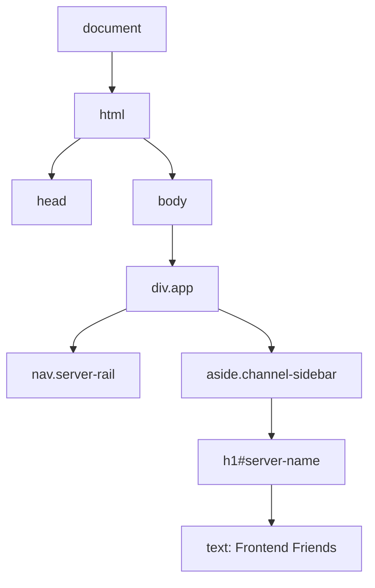

# Lesson 13 — The DOM: find and change elements

So far JavaScript only talked to the Console. Now it will reach into the page itself. You'll find elements, change their text and classes, and fill in the user panel at the bottom left from the data you wrote last lesson.

## 🎯 Goal

By the end of this lesson the user panel (bottom left) is filled in by JavaScript from `currentUser`. The avatar circle is now **blue** (Sam's `avatarColor`) instead of gray, the sidebar title and the browser tab say `Frontend Friends` (the tab says `Frontend Friends | Hubbub`), and the Console reports whether the member list is hidden.

{.screenshot}

It's a small visual change: the point is that the text, the color and the tab title now come from JavaScript data, not from the HTML you typed.

## 🧠 New concepts

<ConceptList />

### The DOM: the page as a tree of objects

When the browser reads your HTML, it builds a **tree of objects** in memory called the **DOM** (Document Object Model). Every tag becomes an object ("node"), and nesting in the HTML becomes parent–child links in the tree. You saw this tree in the **Elements** panel in Lesson 00.

```text
document
└── html
    ├── head
    │   ├── title
    │   └── link, script, ...
    └── body
        └── div.app
            ├── nav.server-rail
            ├── aside.channel-sidebar
            │   ├── header
            │   │   └── h1#server-name  "Frontend Friends"
            │   └── nav#channel-list
            └── main.chat
```



JavaScript can **read** this tree and **change** it. When it changes, the browser redraws the page to match. That is how every web app, from this chat to Gmail, updates without reloading: the HTML file is only the *starting* tree.

The global variable **`document`** is the root of the tree and your entry point to everything.

### Finding an element: `querySelector`

`document.querySelector('...')` takes a **CSS selector**, the same kind you wrote in Lessons 04 to 08, and returns the **first** element on the page that matches it.

```js
const heading = document.querySelector('#server-name');   // by id
const first = document.querySelector('.channel-item');    // by class
const inside = document.querySelector('.user-panel .avatar'); // descendant
```

So you already know the language for finding things. IDs are handy for this job because each one is unique. That is why you added ids like `server-name` and `user-panel-tag` to the HTML in Lesson 03.

If **nothing** matches, `querySelector` returns `null` (not an error). The error comes on the next line, when you try to use that `null`:

```text
Uncaught TypeError: Cannot set properties of null (setting 'textContent')
```

When you see an error mentioning `null`, the first suspect is a selector with a typo. Remember the `#` for ids and `.` for classes.

::: tip Python comparison
Think of the DOM like a parsed XML or HTML document in Python (for example with `BeautifulSoup`'s `soup.select_one('#server-name')`), except that it's *live*: change the object and the screen changes immediately.
:::

### Changing text: `textContent`

Every element has a **property** called `textContent` holding its text. You can read it or assign to it:

```js
const heading = document.querySelector('#server-name');
console.log(heading.textContent);       // 'Frontend Friends'
heading.textContent = 'Pixel Art Club'; // the page updates at once
```

`textContent` always treats what you give it as **plain text**. If you assign `'<b>hi</b>'`, the page shows those characters literally, tags and all. That makes it safe for text that comes from users. (There is another way to set content that does read tags as HTML. You'll meet it in Lesson 14, together with its dangers.)

### Changing classes: `classList`

Elements have a `classList` for the `class` attribute. Two methods you need today:

```js
element.classList.add('status-idle');      // adds a class
element.classList.remove('status-online'); // removes a class
```

Changing classes is the best way to change how something *looks* from JavaScript: your CSS already knows what `status-idle` or `is-selected` should look like. The script only decides *which* class an element has. This keeps "what it looks like" in CSS and "when it changes" in JavaScript.

### Setting a CSS variable from JavaScript

Every element has a `style` property that gives access to its inline `style` attribute. To set a CSS **custom property** (a `--something` variable, as in Lesson 04), use `setProperty`:

```js
element.style.setProperty('--avatar-color', '#3b82f6');
```

In this lesson's CSS, `.avatar` reads that variable with a fallback:

```css
background-color: var(--avatar-color, var(--gray));
```

`var(--avatar-color, var(--gray))` means "use `--avatar-color` if it is set on this element, otherwise gray". Each avatar can now have its own color from data, while all the other avatar styling stays in the stylesheet.

### Hiding things: `hidden`

HTML has a **`hidden`** attribute. An element with it isn't displayed at all, like `display: none`. In JavaScript it's a property that holds `true` or `false`:

```js
const memberList = document.querySelector('#member-list');
memberList.hidden = true;    // disappears
memberList.hidden = false;   // comes back
```

You'll use this for popups and panels later. One catch: the browser implements `hidden` with a very weak CSS rule. If *your* CSS gives the element a `display` value (for example `display: flex`), your rule wins and the element stays visible. You'll deal with that in Lesson 15.

### The tab title: `document.title`

`document.title` is the text on the browser tab, the same text as the `<title>` tag in `<head>`. You can read it and assign to it.

## 🛠️ Build it

### Step 1 — Explore the DOM in the Console

Open the page, open DevTools → **Console**, and type these one at a time. Predict what each will do before you press <kbd>Enter</kbd>:

```js
document.querySelector('#server-name');
document.querySelector('#server-name').textContent;
document.querySelector('#server-name').textContent = 'Hello!';
document.querySelector('#nope');
document.querySelector('.channel-item').textContent;
```

The page title in the sidebar changes to `Hello!`. Reload to undo it: remember that, as in Lesson 00, changes made from the Console only affect the page in memory.

Typing `$0` in the Console after selecting an element in the **Elements** panel gives you that element, which is handy for experiments.

<!-- no-solution: experimenting in the Console, nothing to type into a file -->

### Step 2 — Let avatars have their own color

Open `vanilla/css/base.css` and find the `.avatar` rule (under `/* ---------- Avatars ---------- */`). Change the `background-color` line so the color comes from a variable that JavaScript can set, and keep gray as the default:

::: solution
```css [vanilla/css/base.css]
.avatar {
  position: relative;
  display: flex;
  align-items: center;
  justify-content: center;
  width: 40px;
  height: 40px;
  flex-shrink: 0;
  border-radius: 50%;
  /* --avatar-color is set from JavaScript; gray if it isn't set */
  background-color: var(--avatar-color, var(--gray));
  color: white;
  font-weight: 600;
}
```
:::

### Step 3 — Fill in the user panel

`vanilla/js/data.js` doesn't change in this lesson: it still defines `currentUser` and `servers`. Open `vanilla/js/app.js`, **delete everything in it** (the Lesson 12 experiments served their purpose) and write this instead:

1. A comment saying what the lesson is about.
2. Three `querySelector` calls to find the user panel's name, tag line and avatar by their ids.
3. Two assignments to `textContent`, using `currentUser`.

Save and look at the bottom left of the page: it still says "Sam" and "Learning frontend 🚀", the same as the HTML you typed. Prove the JavaScript is in charge: temporarily change `displayName` in `data.js` to your own name, save, and watch the panel change. (Change it back to `'Sam'` afterwards so your page matches this course's later steps.)

::: solution
```js [vanilla/js/app.js]
// Lesson 13: changing the page from JavaScript.

// ---------- The user panel (bottom left) ----------

const userName = document.querySelector('#user-panel-name');
const userTag = document.querySelector('#user-panel-tag');
const userAvatar = document.querySelector('#user-panel-avatar');

userName.textContent = currentUser.displayName;
userTag.textContent = currentUser.customStatus;
```
:::

### Step 4 — Color the avatar and set the status dot

Add this under the two `textContent` lines. First `setProperty` gives the avatar its blue from the data. Then the status: the HTML you wrote already says `status-online` on that element, so we remove that class and add `status-` followed by the real status. The template literal builds the class name (`status-online`, `status-idle`, ...).

To see it work, temporarily set `status: 'idle'` in `data.js`. The little dot on the avatar should turn amber. Then set it back to `'online'`.

::: solution
```js [vanilla/js/app.js]
// The avatar's color comes from the data, through a CSS variable
userAvatar.style.setProperty('--avatar-color', currentUser.avatarColor);

// Show the right status dot: remove the one from the HTML, add the real one
userAvatar.classList.remove('status-online');
userAvatar.classList.add(`status-${currentUser.status}`);
```
:::

### Step 5 — The sidebar header and the tab title

Add a new section: find `#server-name` and set its text to the name of the first server, `servers[0].name`. Then set `document.title` to the same name followed by ` | Hubbub`.

Remember `servers` is an array, so `servers[0]` is the first item, and `.name` reads its property.

::: solution
```js [vanilla/js/app.js]
// ---------- The sidebar header ----------

const serverName = document.querySelector('#server-name');
serverName.textContent = servers[0].name;

// ---------- The tab title ----------

document.title = `${servers[0].name} | Hubbub`;
```
:::

### Step 6 — Check for `hidden`

Add a last section that finds the member list and logs whether it's hidden. It should log `false`. The comment inside shows how to experiment.

Then try it: in the Console, run `document.querySelector('#member-list').hidden = true`. The member column should disappear. Set it back to `false` to bring it back.

::: solution
```js [vanilla/js/app.js]
// ---------- Hiding and showing ----------

// Every element has a `hidden` property. Try this in the Console:
//   document.querySelector('#member-list').hidden = true
const memberList = document.querySelector('#member-list');
console.log('Is the member list hidden?', memberList.hidden);
```
:::

## ✅ Checkpoint

- [ ] The avatar circle at the bottom left is **blue**, not gray.
- [ ] The user panel still reads `Sam` and `Learning frontend 🚀`.
- [ ] The browser tab reads `Frontend Friends | Hubbub`.
- [ ] The Console shows `Is the member list hidden? false` and no red errors.
- [ ] Changing `displayName` in `data.js` and saving changes the name in the panel (change it back afterwards).
- [ ] In DevTools → **Elements**, the avatar `<span>` has `style="--avatar-color: #3b82f6;"` and the class `avatar status-online`.
- [ ] In the Console, `document.title` returns `'Frontend Friends | Hubbub'`.

## 🐛 Common mistakes

**`Uncaught TypeError: Cannot set properties of null (setting 'textContent')`.** `querySelector` found nothing, so you're assigning to `null`. Check the selector against the HTML: `#` for ids, and the id's spelling (`user-panel-name`). If the error says `Cannot read properties of null` instead, the cause is the same.

**The script runs but changes nothing.** You edited the file but the scripts aren't loaded in the right order, or `defer` is missing. `app.js` must come after `data.js` and both need `defer` (Lesson 12). Without `defer` the script runs before the elements exist, and `querySelector` returns `null`.

**`ReferenceError: currentUser is not defined`.** `data.js` isn't loaded, or you deleted the `const currentUser` from it. This lesson's `data.js` is the same as in Lesson 12.

**The avatar stays gray.** Either `base.css` still has the old `background-color: var(--gray)`, or you wrote the variable name differently in CSS and JavaScript. Both must be exactly `--avatar-color`, including the two dashes. In the Elements panel you can see whether the inline style was added.

**The status dot doesn't change.** `classList.add` takes a class name *without* a dot. `classList.add('.status-idle')` would be wrong. Also check that the string is a template literal with backticks, or `${...}` won't be replaced.

**You wrote `document.querySelector('#member-list').hidden = 'false'`.** A non-empty string is "truthy", so that *hides* the element. Use the boolean `false`, without quotes.

## 📝 Quiz

::: quiz
What does this do?

```js
const label = document.querySelector('.does-not-exist');
label.textContent = 'Hi';
```

- [ ] Nothing: the second line is silently ignored
- [ ] It creates a new element with the class `does-not-exist`
- [x] It throws a `TypeError`, because `label` is `null`
- [ ] It changes the first element on the page

> `querySelector` returns `null` when nothing matches. Assigning a property on `null` is an error, and that's the error you'll see most often in DOM code. The fix is almost always in the selector.
:::

::: quiz
An element has the class `status-online`. After this code runs, which classes does it have?

```js
userAvatar.classList.remove('status-online');
userAvatar.classList.add('status-idle');
userAvatar.classList.add('status-idle');
```

- [ ] `status-online status-idle`
- [ ] `status-idle status-idle`
- [x] `status-idle`
- [ ] No classes at all

> The first line removes `status-online`. The second adds `status-idle`. The third tries to add a class that is already there, which changes nothing: an element's class list never holds duplicates.
:::

::: quiz
Why does the avatar rule in `base.css` use `var(--avatar-color, var(--gray))` instead of just `var(--avatar-color)`?

- [ ] Because CSS requires two values inside `var()`
- [x] So avatars still get a gray background when no color has been set on them
- [ ] Because JavaScript can only set gray colors
- [ ] To make the color change faster

> The second value is a **fallback**. If `--avatar-color` isn't set on an element, the browser uses the fallback. That means avatars that JavaScript hasn't colored yet still look fine.
:::

## 💾 Commit

```sh
git add .
git commit -m "Fill user panel and page title from JavaScript data"
git push
```
