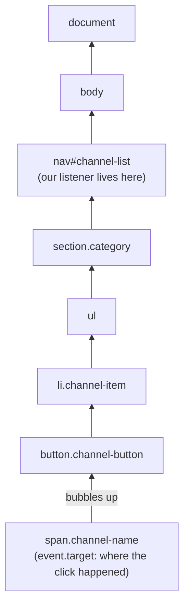

# Lesson 15 — Events & event delegation

The app finally reacts to you. In this lesson clicking a server shows that server's channels and members, clicking a channel selects it, category headers collapse, the member button toggles the member list, and on a narrow window the menu button opens the drawer. You'll learn how the browser tells your code that something happened, and a technique called event delegation that keeps all of this simple.

## 🎯 Goal

By the end of this lesson you can click around the app and it responds. The wide layout looks the same as before until you click something:

{.screenshot}

On a narrow window (under 760px wide) the menu button opens the channel drawer. Press <kbd>Escape</kbd> or click the dark area to close it:

{.screenshot}

Two things still don't work, on purpose: the messages in the middle don't change when you switch channel or server (they're still the hand-typed HTML), and the selection is kept in loose variables. Lesson 16 explains why that is a problem and fixes both.

## 🧠 New concepts

<ConceptList />

### Events and listeners

An **event** is the browser telling you that something happened: a click, a key press, a form being sent, the mouse moving. You tell the browser which function to call when it does, using **`addEventListener`**:

```js
const button = document.querySelector('#members-button');

button.addEventListener('click', () => {
  console.log('clicked!');
});
```

The first argument is the **event type** (a string such as `'click'` or `'keydown'`). The second is a **function**, the **listener** or **handler**, that the browser calls every time the event happens on that element. You pass the function itself and don't call it: `addEventListener('click', openNav)`, with no brackets after `openNav`.

```text
          your code                           the browser
   ┌──────────────────────┐             ┌─────────────────────┐
   │ addEventListener(    │  registers  │ "when #button gets  │
   │   'click', handler)  │ ──────────► │  a click, call      │
   └──────────────────────┘             │  handler(event)"    │
                                        └─────────────────────┘
```

::: tip Python comparison
Most Python programs you've written run top to bottom and finish. A web page *waits*: your script sets up listeners and ends, and later the browser calls your functions when things happen. It's a **callback** (a function you hand over to be called later). The closest Python relative is a GUI toolkit such as tkinter's `button.bind(...)`.
:::

### The event object

When the browser calls your handler it passes one argument, an **event object** that describes what happened:

```js
document.addEventListener('keydown', (event) => {
  console.log(event.key);      // 'a', 'Enter', 'Escape', ...
});

list.addEventListener('click', (event) => {
  console.log(event.target);   // the element that was clicked
});
```

- **`event.key`** (for keyboard events): which key was pressed, as text. The Escape key is `'Escape'`. This is what you compare with `===`.
- **`event.target`**: the element that the event happened on. For a click, it's the **innermost** element under the mouse pointer.

### Bubbling

Here is the key idea of this lesson. Look at the channel button in our app:

```html
<nav id="channel-list">
  <section class="category">
    <ul>
      <li class="channel-item">
        <button class="channel-button">
          <svg class="icon">...</svg>
          <span class="channel-name">general</span>
        </button>
      </li>
```

If you click the word "general", you clicked a `<span>`. But you also clicked the button around it, the `<li>` around that, and so on up to the page. The browser knows this, so the event **bubbles**: it starts at the innermost element (the `target`) and then travels **up** through each parent, giving every one of them a chance to react.



```text
click on "general"
   │
   ▼  span ──► button ──► li ──► ul ──► section ──► nav#channel-list ──► ... ──► document
   target                                            ▲
                                                     └── a click listener here runs
                                                         (event.target is still the span)
```

So a listener on `nav#channel-list` runs for clicks on *anything inside it*. And `event.target` still tells you which element was really clicked.

(The full story has a downward "capturing" phase before bubbling. You won't need it in this course. MDN's [Event bubbling](https://developer.mozilla.org/en-US/docs/Learn_web_development/Core/Scripting/Event_bubbling) article covers it.)

### `closest()`: from the clicked element to the one you care about

`event.target` might be the `<span>`, or the little icon inside the button, or the button itself, depending on where the pointer was. You don't want to care. **`element.closest('selector')`** walks *up* from the element (checking the element itself first, then its parent, then its grandparent...) and returns the first one that matches the CSS selector, or `null` if none does.

```js
const item = event.target.closest('.channel-item');
// clicked the span, the icon or the button → the same <li class="channel-item">
// clicked empty space in the nav          → null
```

Always check for `null` before you use the result.

### Event delegation

You could attach a click listener to each of the 15 channel buttons. But:

- That's a lot of listeners.
- Our lists are **re-drawn** by code (`replaceChildren()` throws the old elements away). Listeners attached to the old buttons are thrown away with them, so you'd have to re-attach them after every redraw.

Instead you attach **one** listener to the *container* that never gets replaced (`#channel-list`) and let bubbling bring every click to it. Inside the handler you use `closest()` to work out which item was clicked. This is **event delegation**: the parent handles events for its children.

```js
channelList.addEventListener('click', (event) => {
  const item = event.target.closest('.channel-item');
  if (item === null) {
    return; // the click wasn't on a channel
  }
  // ...item.dataset.channelId tells us which channel
});
```

Remember the `data-channel-id` attributes you set in Lesson 14? This is why they exist: the handler reads `item.dataset.channelId` to know which channel's data to use.

Delegation survives re-rendering because the listener sits on the container, not on the things inside it.

### `return` to leave early

A `return` with nothing after it ends the function immediately. In handlers it's used as a "guard": if the click isn't relevant, stop here. That keeps the rest of the code unindented, which reads better than wrapping it all in an `if`.

### `classList.toggle` and `classList.contains`

Two more `classList` methods:

```js
category.classList.toggle('is-collapsed');          // add it if it's missing, remove it if it's there
category.classList.contains('is-collapsed');        // true or false
```

`toggle` is perfect for a button that flips something on and off. The `!` operator reverses a boolean: `!category.classList.contains('is-collapsed')` means "is *not* collapsed".

### Accessibility attributes that change: `aria-expanded` and `aria-pressed`

Screen-reader users can't see that a section collapsed. HTML attributes tell them:

- **`aria-expanded="true"` or `"false"`** on a button says whether the thing it controls is open (category headers and the menu button).
- **`aria-pressed="true"` or `"false"`** on a toggle button says whether it's switched on (the members button).

Your code must update them whenever the state changes. Their values are text, so JavaScript's `String(true)` turns a boolean into `'true'`. (Python's `str(True)` gives `'True'` with a capital T, but the attribute needs lowercase.) Your CSS can also use them as hooks: Lesson 08 styled `.icon-button[aria-pressed="true"]`.

### CSS: `:not()` and `!important`

Two small CSS tools this lesson needs:

**`:not(selector)`** matches elements that do *not* match the inner selector:

```css
.category.is-collapsed .channel-item:not(.is-selected) {
  display: none;
}
```

Read it as: "inside a collapsed category, hide every channel item that isn't the selected one." (Discord does the same: a collapsed category still shows the channel you're in.)

**`!important`** after a declaration makes it beat declarations without it, whatever their specificity (Lesson 04). It's a blunt tool and usually a sign of a CSS tangle. There's one good use: the HTML `hidden` attribute (Lesson 13) is only a weak default rule in the browser, so any `display` rule of yours overrides it. This rule makes `hidden` win again, always:

```css
[hidden] {
  display: none !important;
}
```

`[hidden]` is an attribute selector (Lesson 08): any element that has the attribute.

## 🛠️ Build it

### Step 1 — CSS: make `hidden` always win and hide collapsed channels

Open `vanilla/css/layout.css`. After the `.chat-main` rule and before the `/* Hidden unless the drawer is open ... */` comment, add:

::: solution
```css [vanilla/css/layout.css]
/* The hidden attribute must win over any display rule we wrote */
[hidden] {
  display: none !important;
}
```
:::

Then open `vanilla/css/channels.css`. Find the rule `.category.is-collapsed .category-toggle .icon` (the one that rotates the arrow) and add the new rule right after it:

::: solution
```css [vanilla/css/channels.css]
/* A collapsed category points its arrow to the right */
.category.is-collapsed .category-toggle .icon {
  transform: rotate(-90deg);
}

/* ...and hides its channels, except the selected one */
.category.is-collapsed .channel-item:not(.is-selected) {
  display: none;
}
```
:::

Nothing happens visibly yet. To test the second rule, open DevTools → **Elements**, click one `<section class="category">`, and add the class `is-collapsed` by hand (double-click its `class` attribute). Its channels hide except the selected one, and the arrow rotates. Remove the class again.

### Step 2 — HTML: give the menu button `aria-expanded`

In `vanilla/index.html`, find the menu button in the chat header (`id="menu-button"`) and add `aria-expanded="false"` at the end of its opening tag. It starts closed.

::: solution
```html [vanilla/index.html]
          <button class="icon-button menu-button" type="button" id="menu-button" aria-label="Open channels" aria-expanded="false">
```
:::

### Step 3 — Category toggles start expanded

Open `vanilla/js/app.js`. Change the first comment line to say `// Lessons 14–15: building the lists from data, and reacting to clicks.`

In `createCategory`, add the line that sets `aria-expanded` to `'true'` on the toggle button, between `toggle.type = 'button';` and `toggle.append(...)`. The page starts with every category open.

::: solution
```js [vanilla/js/app.js]
// Lessons 14–15: building the lists from data, and reacting to clicks.

function createCategory(category, selectedChannelId) {
  const section = el('section', 'category');
  section.dataset.categoryId = category.id;

  const heading = el('h3');
  const toggle = el('button', 'category-toggle');
  toggle.type = 'button';
  toggle.setAttribute('aria-expanded', 'true');
  toggle.append(icon('chevron-down'), category.name);
  heading.append(toggle);

  const list = el('ul');
  for (const channel of category.channels) {
    list.append(createChannelItem(channel, channel.id === selectedChannelId));
  }

  section.append(heading, list);
  return section;
}
```
:::

### Step 4 — Render the chat header

When you pick a channel, the header at the top of the chat (its name and topic) and the composer's placeholder should change too. Delete the **"Draw everything once"** section at the end of `app.js` (the last lines, from `// ---------- Draw everything once ----------` down). You'll rewrite it in the next step.

In its place, below `renderUserPanel`, add:

1. `findChannel(server, channelId)`: searches every category of a server, and every channel in each, for the one with that id. Loops can be nested, and `return` leaves the function as soon as it finds a match. If nothing is found, it returns `null`.
2. `renderChatHeader(channel)`: sets the title, the topic and the composer's `placeholder` (a property for the greyed hint text in an input).

::: solution
```js [vanilla/js/app.js]
// ---------- Chat header ----------

const chatTitle = document.querySelector('#chat-title');
const chatTopic = document.querySelector('#chat-topic');
const composerInput = document.querySelector('#composer-input');

function findChannel(server, channelId) {
  for (const category of server.categories) {
    for (const channel of category.channels) {
      if (channel.id === channelId) {
        return channel;
      }
    }
  }
  return null;
}

function renderChatHeader(channel) {
  chatTitle.textContent = channel.name;
  chatTopic.textContent = channel.topic;
  composerInput.placeholder = `Message #${channel.name}`;
}
```
:::

### Step 5 — What's selected, and `showServer`

Right now the page can only show the first server. Add two **variables** that remember what's selected, plus a function that switches to a given server. They use `let` because they change.

`showServer(server)` records the new active server and its first channel, then re-draws the four parts that depend on it. Then add back a (shorter) "Draw everything once" section at the very end of the file.

(These loose variables work for now, but we have a problem coming: they're easy to get out of sync with what's on the screen. Lesson 16 fixes that with one state object.)

::: solution
```js [vanilla/js/app.js]
// ---------- What's selected right now ----------

let activeServer = servers[0];
let selectedChannel = activeServer.categories[0].channels[0];

function showServer(server) {
  activeServer = server;
  selectedChannel = server.categories[0].channels[0];
  renderServers(activeServer);
  renderChannels(activeServer, selectedChannel.id);
  renderMembers(activeServer);
  renderChatHeader(selectedChannel);
}

// ---------- Draw everything once ----------

showServer(servers[0]);
renderUserPanel();
```
:::

Save and reload. The page looks as before, but the chat header and composer placeholder are now filled from the data too. In the Console, try `showServer(servers[1])`: the rail, channels and members switch to *Pixel Art Club*. Next, make clicking do that.

### Step 6 — Click a server

Between `showServer` and the "Draw everything once" section, add a new section **`// ---------- Events ----------`**. Inside it, add the click listener for the server rail:

- It sits on `serverList`, the `<ul>` that is never replaced, and handles clicks on all servers (**delegation**).
- `event.target.closest('.server-item')` finds the clicked server's `<li>`, or `null` if the click was on the gap between items.
- `servers.find(...)` looks up the server object from the id stored in `data-server-id`. The arrow function's parameter is called `s` because we already have a variable named `server` elsewhere.
- Then `showServer` redraws everything.

Click each server: the channels, members and title switch. The rail itself is also redrawn each time, and the clicks still work afterwards because the listener is on the `<ul>`. Compare that with what would happen if you had put a listener on each button: they would vanish with every `replaceChildren()`.

::: solution
```js [vanilla/js/app.js]
// ---------- Events ----------

// One listener on the whole list handles clicks on every server (event delegation)
serverList.addEventListener('click', (event) => {
  const item = event.target.closest('.server-item');
  if (item === null) {
    return; // the click wasn't on a server
  }
  const server = servers.find((s) => s.id === item.dataset.serverId);
  showServer(server);
});
```
:::

### Step 7 — Click a channel, collapse a category

Add a second listener under the first one, on `channelList`. It handles two different clicks:

1. A click inside `.category-toggle`: find the `.category` around it, flip `is-collapsed` with `toggle`, then update `aria-expanded` to match (using `contains` and `!`). `return` afterwards so the code below doesn't also run.
2. A click on a `.channel-item`: ignore it if it's a voice channel (`return`; joining voice comes in Lesson 29). Otherwise remove `is-selected` from the previously selected item (found with `channelList.querySelector(...)`, which searches only inside the channel list), add it to the clicked item, remember the channel in `selectedChannel`, and update the chat header.

This is the handler from the snapshot, which also calls `closeNav()` at the end. You'll add that line in Step 9, once `closeNav` exists: leave it out for now.

::: solution
```js [vanilla/js/app.js]
channelList.addEventListener('click', (event) => {
  // A click on a category header collapses or expands it
  const toggle = event.target.closest('.category-toggle');
  if (toggle !== null) {
    const category = toggle.closest('.category');
    category.classList.toggle('is-collapsed');
    const isExpanded = !category.classList.contains('is-collapsed');
    toggle.setAttribute('aria-expanded', String(isExpanded));
    return;
  }

  // A click on a channel selects it
  const item = event.target.closest('.channel-item');
  if (item === null) {
    return;
  }
  const channel = findChannel(activeServer, item.dataset.channelId);
  if (channel.type === 'voice') {
    return; // joining voice channels comes in Lesson 29
  }
  const previous = channelList.querySelector('.channel-item.is-selected');
  if (previous !== null) {
    previous.classList.remove('is-selected');
  }
  item.classList.add('is-selected');
  selectedChannel = channel;
  renderChatHeader(channel);
});
```
:::

Try it: click **Text Channels** to collapse it (the arrow rotates, only `general` remains visible), click again to expand, click `help` to select it (the header changes to `help` with its topic and the composer says `Message #help`).

### Step 8 — The member list button

Add a listener on the members button in the chat header. `memberList` is the variable from Lesson 14. Its `hidden` property is flipped with `!`, and `aria-pressed` follows. Because of your new `[hidden]` rule, this works even when other CSS sets a `display`.

::: solution
```js [vanilla/js/app.js]
// The member list button shows and hides the member list
const membersButton = document.querySelector('#members-button');
membersButton.addEventListener('click', () => {
  memberList.hidden = !memberList.hidden;
  membersButton.setAttribute('aria-pressed', String(!memberList.hidden));
});
```
:::

### Step 9 — The drawer on small screens

Lesson 11 made the channel drawer open when `.app` has the class `is-nav-open`. Now JavaScript adds it. Add this under the members button code:

- `openNav` and `closeNav` add or remove `is-nav-open` on the `.app` element and keep `aria-expanded` of the menu button correct.
- The menu button opens, the backdrop closes. Note `addEventListener('click', openNav)` passes the function **without brackets**.
- A `keydown` listener on `document` closes the drawer when `event.key` is `'Escape'`. Key events go to the focused element and bubble up to `document`, so a listener there sees every key press.

Then go back to the channel handler from Step 7 and add `closeNav();` as its last line (after `renderChatHeader(channel);`): picking a channel on a phone should close the drawer.

::: solution
```js [vanilla/js/app.js]
// On small screens: the menu button opens the drawer, the backdrop closes it
const app = document.querySelector('.app');
const menuButton = document.querySelector('#menu-button');
const backdrop = document.querySelector('#drawer-backdrop');

function openNav() {
  app.classList.add('is-nav-open');
  menuButton.setAttribute('aria-expanded', 'true');
}

function closeNav() {
  app.classList.remove('is-nav-open');
  menuButton.setAttribute('aria-expanded', 'false');
}

menuButton.addEventListener('click', openNav);
backdrop.addEventListener('click', closeNav);

// The Escape key closes the drawer too
document.addEventListener('keydown', (event) => {
  if (event.key === 'Escape') {
    closeNav();
  }
});
```

And the finished channel handler from Step 7, with `closeNav();` as its last line:

```js [vanilla/js/app.js]
channelList.addEventListener('click', (event) => {
  // A click on a category header collapses or expands it
  const toggle = event.target.closest('.category-toggle');
  if (toggle !== null) {
    const category = toggle.closest('.category');
    category.classList.toggle('is-collapsed');
    const isExpanded = !category.classList.contains('is-collapsed');
    toggle.setAttribute('aria-expanded', String(isExpanded));
    return;
  }

  // A click on a channel selects it
  const item = event.target.closest('.channel-item');
  if (item === null) {
    return;
  }
  const channel = findChannel(activeServer, item.dataset.channelId);
  if (channel.type === 'voice') {
    return; // joining voice channels comes in Lesson 29
  }
  const previous = channelList.querySelector('.channel-item.is-selected');
  if (previous !== null) {
    previous.classList.remove('is-selected');
  }
  item.classList.add('is-selected');
  selectedChannel = channel;
  renderChatHeader(channel);
  closeNav();
});
```
:::

The finished events part of the file now reads, from top to bottom: the server listener, the channel listener, the members button, the drawer code, and then "Draw everything once".

### Step 10 — Test every interaction

1. Click each server. Channels, members and the header title change. The rail re-draws but keeps working.
2. Collapse and expand **Info**. Select `announcements` before collapsing **Info**: it stays visible when collapsed (that's the `:not(.is-selected)`).
3. Click the members button (the people icon in the header): the member list disappears and the button loses its highlight. Click again.
4. Drag the browser window narrower than 760px, or use the DevTools device toolbar (Lesson 11). Click the menu button (top left of the chat) to open the drawer. Close it with the backdrop, then reopen and press <kbd>Escape</kbd>.
5. Inspect the elements: collapsing a category toggles `is-collapsed` on its `<section>`, and the toggle button's `aria-expanded` flips between `"true"` and `"false"`.
6. **See bubbling happen.** Paste this in the Console, then click anywhere in the page, and look at the logged element:

   ```js
   document.addEventListener('click', (event) => console.log(event.target));
   ```

   Click the word "general": you get the `<span class="channel-name">`, even though no listener is attached to it. Reload the page to get rid of the experiment listener.

<!-- no-solution: testing and experimenting, nothing to type into a file -->

## ✅ Checkpoint

- [ ] Clicking a server in the rail switches the channel list, the member list and the sidebar title. The clicked server shows as active.
- [ ] Clicking a text channel highlights it and changes the chat header's name and topic, and the composer placeholder to `Message #name`.
- [ ] Clicking a voice channel does nothing yet (and no error).
- [ ] Clicking a category title collapses it, rotates its arrow and keeps only the selected channel. In DevTools, its toggle button's `aria-expanded` flips.
- [ ] The members button hides and shows the member list, and its `aria-pressed` flips.
- [ ] Below 760px wide, the menu button opens the drawer; the backdrop, <kbd>Escape</kbd> and choosing a channel close it. `aria-expanded` on the menu button follows.
- [ ] The Console has no red errors after any of these clicks.
- [ ] You can explain why clicking a server still works after the rail has been re-drawn.

## 🐛 Common mistakes

**Clicking does nothing and the Console says `Cannot read properties of null (reading 'addEventListener')`.** `querySelector` returned `null`, so the id or class in your selector doesn't match the HTML (`#members-button`, `#menu-button`, `#drawer-backdrop`, `.app`). Check spelling, and `#` versus `.`.

**The handler runs immediately, once, when the page loads, and never on clicks.** You wrote `addEventListener('click', openNav())` with brackets, which *calls* `openNav` right away and passes its result (`undefined`). Pass the function itself: `openNav`.

**Only clicks on the exact edge of a button work.** You used `event.target` directly instead of `event.target.closest(...)`. The target is the innermost element (the icon or text span), not the button. Use `closest` with the selector of the element you want.

**`Uncaught TypeError: Cannot read properties of null (reading 'dataset')`.** `closest` returned `null` (you clicked somewhere that isn't an item) and you used it anyway. Add the `if (item === null) { return; }` guard.

**The member button hides the list, but you can't bring it back (or the drawer doesn't hide).** A missing or misplaced `[hidden]` rule, or `[hidden]` placed in a file that isn't loaded. In Elements, check that the element really has the `hidden` attribute, then check the `display` the browser computes in the **Computed** tab. Also make sure `memberList.hidden = !memberList.hidden;` has the `!`.

**`aria-expanded` shows `"true"` all the time.** You passed a boolean expression without `String(...)`, or you computed the new state before toggling. In the collapse handler, call `toggle` first and read `contains` afterwards.

**After clicking a server, the messages in the middle don't change.** Expected: the messages are still plain HTML. Lesson 16 renders them from data.

## 📝 Quiz

::: quiz
A listener is attached to `<nav id="channel-list">`. The user clicks the text `general` inside a `<span class="channel-name">` inside a `<button>`. What is `event.target` in that listener?

- [ ] The `<nav>`, because that's where the listener is
- [ ] The `<button>`, because buttons are clickable
- [x] The `<span>`, because it's the innermost element that was clicked
- [ ] `document`

> `event.target` is where the event *started*. The event then bubbles up to the `<nav>`, which is why its listener runs at all. To get from the span to the item you care about, use `event.target.closest('.channel-item')`.
:::

::: quiz
What does the page do?

```js
const status = document.querySelector('#status');
status.addEventListener('click', console.log('clicked'));
```

- [ ] Logs `clicked` every time `#status` is clicked
- [x] Logs `clicked` once when the script runs, and nothing on later clicks
- [ ] Logs nothing at all
- [ ] Logs `clicked` twice for each click

> `console.log('clicked')` with brackets runs *right now*, and its return value (`undefined`) is what gets passed to `addEventListener`. To run code on each click, pass a function: `() => console.log('clicked')`.
:::

::: quiz
Why does the server rail use **one** listener on the `<ul>` instead of one listener per server button?

- [ ] Buttons can't have click listeners
- [ ] It makes the page load faster than any other approach
- [x] The rail is re-drawn with `replaceChildren()`, which discards old buttons and their listeners, but the `<ul>` stays
- [ ] `closest()` only works on `<ul>` elements

> Delegation attaches the listener to an element that survives re-renders, and bubbling brings the clicks to it. New buttons created later are handled automatically, with no extra code.
:::

## 💾 Commit

```sh
git add .
git commit -m "Add click handling with event delegation: servers, channels, members, drawer"
git push
```
