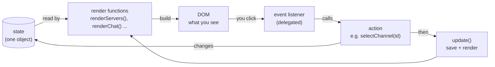

# Lesson 16 — State, rendering & localStorage

Lesson 15 works, but it has a hidden weakness: what's selected lives in a few loose variables *and* on the screen, and the two can drift apart. In this lesson you rebuild the app around one idea that every modern UI framework shares: keep everything the app knows in **one object**, and draw the screen **from** it. As a reward the app starts remembering your choices after a reload, and the message list is drawn from data for the first time.

## 🎯 Goal

By the end of this lesson the messages in the middle come from `data.js` and change when you switch channel or server. Your selections (server, channel, collapsed categories) survive a reload because they're saved in the browser. The screen looks like this:

{.screenshot}

The timestamps and the `**stars**` and backticks look raw because formatting them is later work (dates in Lesson 20, Markdown in Lesson 21). That is expected.

## 🧠 New concepts

<ConceptList />

### The problem with loose variables

Look at Lesson 15's code. The truth about "what is selected" is spread over three places:

1. the variables `activeServer` and `selectedChannel`,
2. CSS classes on elements (`is-selected`, `is-collapsed`),
3. attributes (`aria-expanded`).

Each click handler had to update *all* of them by hand, and the render functions threw some of it away: switch server and back, and your collapsed categories open again and your channel choice is forgotten, because the freshly built elements start from scratch. Every new feature would add more places to keep in sync, and each one is a chance to forget one.

### State: one object that holds everything the app knows

**State** is the data that describes what the app looks like *right now*. We put all of it into a single JavaScript object, `state`:

```js
const state = {
  activeServerId: 's-frontend',
  activeChannelByServer: {},   // server id → channel id
  collapsedCategoryIds: [],
  showMembers: true,
};
```

The rule is a **single source of truth**: if something on the screen can change, its value lives in `state` and nowhere else. The screen is only a *picture* of the state.

### The loop: state → render → DOM → event → action



Read it as a loop that runs on every click:

1. **Render functions** read `state` and build the page. They never decide *what* is selected; they only draw what `state` says.
2. You click something. A delegated **event listener** (Lesson 15) works out what was clicked.
3. It calls an **action**: a small function such as `selectChannel(id)` or `toggleMembers()` that changes `state`. Actions are the *only* code that changes state.
4. The action calls **`update()`**, which saves the state and runs `render()` again, and the screen now matches the new state.

::: tip Python comparison
In a Python script you'd probably print the new situation after each change. This is the same, with a screen instead of a printout: the loop is "change data, then redraw from the data".
:::

### Why re-draw everything?

It looks wasteful: to select one channel we rebuild the whole rail, channel list, messages and member list. For an app this size the browser does it in a blink. In return you get a big benefit: you can't forget to update something, because the render functions always rebuild *everything* from `state`. This "state in, UI out" model is exactly how React works (Lesson 32 onwards), so what you learn here carries straight over. (Lesson 29 shows one place where re-drawing everything would be too slow, and what to do instead.)

### `localStorage`: the browser's small notebook

The browser can store small pieces of text for your site that survive reloads and restarts. **`localStorage`** is a key–value store:

```js
localStorage.setItem('theme', 'dark');          // write
const theme = localStorage.getItem('theme');    // read → 'dark'
localStorage.getItem('nope');                   // → null when the key doesn't exist
```

- Values are **strings only**. To store an object, convert it to text first.
- Data belongs to the site's **origin** (the scheme, host and port, like `http://127.0.0.1:5500`). `http://localhost:5500` is a different origin and has its own storage.
- Browsers limit it to a few megabytes per origin (about 5 MB is typical).

### `JSON.stringify` and `JSON.parse`

**JSON** is a text format for data that looks like JavaScript objects. Two functions convert back and forth:

```js
const text = JSON.stringify({ name: 'Sam', tags: ['a', 'b'] });
// '{"name":"Sam","tags":["a","b"]}'   ← a string

const back = JSON.parse(text);
// { name: 'Sam', tags: ['a', 'b'] }   ← an object again
```

These are Python's `json.dumps(...)` and `json.loads(...)`. `JSON.parse` throws an error if the text isn't valid JSON. Lesson 18 covers JSON in more depth.

### `try` / `catch`

When code might fail in a way you can't prevent (corrupt saved data, for example), wrap it in `try`/`catch`. If anything inside `try` throws an error, JavaScript jumps to `catch` instead of crashing:

```js
try {
  const data = JSON.parse(text);
  console.log('parsed fine', data);
} catch (error) {
  console.warn('Could not parse:', error);
}
```

```python
try:
    data = json.loads(text)
except Exception as error:
    print("Could not parse:", error)
```

`console.warn(...)` is like `console.log` but shown in yellow, for things that are wrong but not fatal.

### Small tools used today

- **`array.includes(x)`** is `true` if the array contains `x` (Python: `x in array`).
- **`array.push(x)`** adds `x` to the end (Python: `append`).
- **`a ?? b`** (the *nullish* operator) means "use `a`, but if it's `null` or `undefined`, use `b`". It's like `a or b` in Python, except that it only falls back on `null`/`undefined` and not on other "falsy" values such as `0` or `''`.
- **`time.dateTime = '2026-10-11T09:12:00Z'`**: the property that matches the `datetime` attribute of a `<time>` element.
- **Bracket assignment on objects**: `state.activeChannelByServer[serverId] = channelId` adds or replaces a key, like `d[key] = value` on a Python dict.

## 🛠️ Build it

This lesson changes `app.js` in many places. We'll work through the file from top to bottom. While you're in the middle of it the page will be broken; it works again at the end of Step 10. It is easiest to keep your old `app.js` open next to the new one and edit it **in place**, section by section.

### Step 1 — See the problem first

Before changing anything, open the page from Lesson 15 and try this:

1. Collapse **Text Channels**. Select the `announcements` channel in **Info**.
2. Click the Pixel Art Club server, then click Frontend Friends again.
3. Which channel is selected? Is **Text Channels** still collapsed? Do the messages in the middle match the channel?
4. Reload the page. What's left of your clicks?

You'll see everything has been forgotten, and the messages never changed. After this lesson it will all be remembered.

<!-- no-solution: observing the Lesson 15 behaviour, nothing to type -->

### Step 2 — Empty the message list in the HTML

The hand-typed messages in `vanilla/index.html` are no longer needed: `data.js` already has the messages for each channel (look at the `messages` object at the bottom). Find `<ol class="message-list scroller" id="message-list">` and delete everything inside it, down to its closing `</ol>`. Keep the element and its `id`.

::: solution
```html [vanilla/index.html]
            <ol class="message-list scroller" id="message-list"></ol>
```
:::

### Step 3 — The state object (top of `app.js`)

Replace the first lines of `app.js`, from the top down to and including `getUser`, with the code below, and **delete the old `findChannel`** function further down (it moves up here, unchanged). Things to notice:

- `state` holds the data (`users`, `servers`, `messages`) and the choices that describe what you're looking at.
- `activeChannelByServer` is an object like a Python dict: server id → the channel you picked there. That's what lets each server remember its own channel.
- `getUser` now reads from `state.users`.
- `getActiveChannel` returns the picked channel, or the first channel of the server if nothing was picked yet. When `findChannel` finds nothing it returns `null`, and `??` then supplies the fallback.

::: solution
```js [vanilla/js/app.js]
// Lesson 16: one `state` object drives the whole screen.
//
//   click → action changes state → update() saves and re-renders → screen
//
// The render functions never decide WHAT is selected; they only read `state`.

const currentUser = users.find((user) => user.id === currentUserId);
const STORAGE_KEY = 'chat-clone-state-v1';

// ============================================================
//  State
// ============================================================

const state = {
  // Data
  users: users,
  servers: servers,
  messages: messages, // channel id → array of messages

  // What you're looking at
  activeServerId: servers[0].id,
  activeChannelByServer: {}, // server id → channel id
  collapsedCategoryIds: [],
  showMembers: true,
};

function getUser(userId) {
  return state.users.find((user) => user.id === userId);
}

function getActiveServer() {
  return state.servers.find((server) => server.id === state.activeServerId);
}

function findChannel(server, channelId) {
  for (const category of server.categories) {
    for (const channel of category.channels) {
      if (channel.id === channelId) {
        return channel;
      }
    }
  }
  return null;
}

// The selected channel of the active server (the first channel if none was picked yet)
function getActiveChannel() {
  const server = getActiveServer();
  const channelId = state.activeChannelByServer[server.id];
  return findChannel(server, channelId) ?? server.categories[0].channels[0];
}
```
:::

### Step 4 — Saving and loading

Add two functions below that, plus a banner comment for the next part of the file.

- `save()` copies the parts of `state` worth keeping into a plain object, turns it into text with `JSON.stringify` and stores it under one key. `showMembers` is left out on purpose, so the member list always starts visible.
- `loadSaved()` returns the saved object, or `null` if nothing is saved. A `try`/`catch` protects against corrupted text: instead of crashing the whole app it logs a warning and acts as if nothing was saved.

::: solution
```js [vanilla/js/app.js]
// ============================================================
//  Saving and loading (localStorage)
// ============================================================

function save() {
  const saved = {
    users: state.users,
    servers: state.servers,
    messages: state.messages,
    activeServerId: state.activeServerId,
    activeChannelByServer: state.activeChannelByServer,
    collapsedCategoryIds: state.collapsedCategoryIds,
  };
  localStorage.setItem(STORAGE_KEY, JSON.stringify(saved));
}

function loadSaved() {
  const text = localStorage.getItem(STORAGE_KEY);
  if (text === null) {
    return null; // nothing saved yet
  }
  try {
    return JSON.parse(text);
  } catch (error) {
    console.warn('Saved state was corrupted, starting fresh.', error);
    return null;
  }
}

// ============================================================
//  Rendering: state → screen
// ============================================================
```
:::

### Step 5 — Render the server rail and channels from `state`

The render functions lose their parameters: they read `state` themselves.

In the **Server rail** section, change `createServerItem` and `renderServers`. `isActive` is gone because the function can see `state.activeServerId`.

::: solution
```js [vanilla/js/app.js]
function createServerItem(server) {
  const item = el('li', 'server-item');
  item.dataset.serverId = server.id;
  if (server.id === state.activeServerId) {
    item.classList.add('is-active');
  }

  const button = el('button', 'server-button', server.icon);
  button.type = 'button';
  button.setAttribute('aria-label', server.name);
  if (server.iconIsEmoji) {
    button.classList.add('is-emoji');
  }

  item.append(button);
  return item;
}

function renderServers() {
  serverList.replaceChildren();
  for (const server of state.servers) {
    serverList.append(createServerItem(server));
  }
}
```
:::

In the **Channel list** section, leave `createChannelItem` as it is. Change `createCategory` so a category is drawn collapsed when its id is in `state.collapsedCategoryIds` (this is what makes collapsing survive a re-draw), and `renderChannels` so it needs no arguments:

::: solution
```js [vanilla/js/app.js]
function createCategory(category, selectedChannelId) {
  const isCollapsed = state.collapsedCategoryIds.includes(category.id);
  const section = el('section', 'category');
  section.dataset.categoryId = category.id;
  if (isCollapsed) {
    section.classList.add('is-collapsed');
  }

  const heading = el('h3');
  const toggle = el('button', 'category-toggle');
  toggle.type = 'button';
  toggle.setAttribute('aria-expanded', String(!isCollapsed));
  toggle.append(icon('chevron-down'), category.name);
  heading.append(toggle);

  const list = el('ul');
  for (const channel of category.channels) {
    list.append(createChannelItem(channel, channel.id === selectedChannelId));
  }

  section.append(heading, list);
  return section;
}

function renderChannels() {
  const server = getActiveServer();
  const selectedChannel = getActiveChannel();
  serverName.textContent = server.name;
  channelList.replaceChildren();
  for (const category of server.categories) {
    channelList.append(createCategory(category, selectedChannel.id));
  }
}
```
:::

### Step 6 — Render the chat: header and messages

Delete the old **Chat header** section lower in the file (`chatTitle`, `chatTopic`, `composerInput`, `renderChatHeader`). Add a new section right after `renderChannels` instead. It keeps the header code and adds the messages:

- `createMessage(message)` builds the `<li class="message">` structure from Lesson 03: gutter with an avatar, then a body with the author button, a `<time>` and the content. For now the time shows the raw timestamp text. Lesson 20 formats it. Because we don't pass a second argument to `avatar`, there's no status dot.
- `renderChat()` fills the header and placeholder, then draws the active channel's messages. `state.messages[channel.id] ?? []` means "this channel's messages, or an empty list if it has none".

::: solution
```js [vanilla/js/app.js]
// ---------- Chat: header and messages ----------

const chatTitle = document.querySelector('#chat-title');
const chatTopic = document.querySelector('#chat-topic');
const composerInput = document.querySelector('#composer-input');
const messageList = document.querySelector('#message-list');

function createMessage(message) {
  const author = getUser(message.authorId);
  const item = el('li', 'message is-group-start');
  item.dataset.messageId = message.id;

  const gutter = el('div', 'message-gutter');
  gutter.append(avatar(author));

  const body = el('div', 'message-body');
  const header = el('h3', 'message-header');
  header.append(el('button', 'message-author', author.displayName));
  const time = el('time', 'message-time', message.timestamp);
  time.dateTime = message.timestamp;
  header.append(time);
  body.append(header, el('div', 'message-content', message.content));

  item.append(gutter, body);
  return item;
}

function renderChat() {
  const channel = getActiveChannel();
  chatTitle.textContent = channel.name;
  chatTopic.textContent = channel.topic;
  composerInput.placeholder = `Message #${channel.name}`;

  messageList.replaceChildren();
  const channelMessages = state.messages[channel.id] ?? [];
  for (const message of channelMessages) {
    messageList.append(createMessage(message));
  }
}
```
:::

### Step 7 — Render the member list from `state`

In the **Member list** section, add the line that finds the members button (it moves here from the events part of the file; you'll delete the old one in Step 10), and change `renderMembers`. It now also applies `showMembers` to the `hidden` property and `aria-pressed`, so the *state* decides whether the list shows:

::: solution
```js [vanilla/js/app.js]
const memberList = document.querySelector('#member-list');
const membersButton = document.querySelector('#members-button');
```

```js [vanilla/js/app.js]
function renderMembers() {
  memberList.hidden = !state.showMembers;
  membersButton.setAttribute('aria-pressed', String(state.showMembers));

  const server = getActiveServer();
  const memberUsers = server.members.map((member) => getUser(member.userId));
  const onlineCount = memberUsers.filter((user) => user.status !== 'offline').length;

  memberList.replaceChildren();
  memberList.append(el('h3', 'member-group-title', `Members — ${memberUsers.length} (${onlineCount} online)`));
  for (const user of memberUsers) {
    memberList.append(createMember(user));
  }
}
```
:::

`createMember` and `renderUserPanel` are unchanged.

### Step 8 — `render()` and `update()`

Below `renderUserPanel`, replace what follows (the old chat-header, "What's selected" and `showServer` sections) with two small functions. `render()` calls all the render functions. `update()` is what actions call after changing state: save first, then redraw.

Delete the old `let activeServer`/`let selectedChannel` variables and `showServer`: the state object replaced them.

::: solution
```js [vanilla/js/app.js]
// ---------- Everything ----------

function render() {
  renderServers();
  renderChannels();
  renderChat();
  renderMembers();
  renderUserPanel();
}

// Call this after every change to the state.
function update() {
  save();
  render();
}
```
:::

### Step 9 — Actions

Now the only functions that may change `state`. Each one changes the state and calls `update()`:

- `selectServer(serverId)` sets the active server.
- `selectChannel(channelId)` ignores voice channels (still Lesson 29), then records the channel for the active server.
- `toggleCategory(categoryId)` adds or removes the id from `collapsedCategoryIds`. `includes` checks, `filter` builds a new list *without* that id, `push` adds it.
- `toggleMembers()` flips `showMembers` with `!`.

::: solution
```js [vanilla/js/app.js]
// ============================================================
//  Actions: the only places that change the state
// ============================================================

function selectServer(serverId) {
  state.activeServerId = serverId;
  update();
}

function selectChannel(channelId) {
  const channel = findChannel(getActiveServer(), channelId);
  if (channel.type === 'voice') {
    return; // joining voice channels comes in Lesson 29
  }
  state.activeChannelByServer[state.activeServerId] = channelId;
  update();
}

function toggleCategory(categoryId) {
  if (state.collapsedCategoryIds.includes(categoryId)) {
    state.collapsedCategoryIds = state.collapsedCategoryIds.filter((id) => id !== categoryId);
  } else {
    state.collapsedCategoryIds.push(categoryId);
  }
  update();
}

function toggleMembers() {
  state.showMembers = !state.showMembers;
  update();
}
```
:::

### Step 10 — Events call actions

Replace the old **Events** section (from `// ---------- Events ----------` to the members-button listener) with listeners that do nothing but call actions. They are much shorter than Lesson 15's: no class juggling, no `aria-*`, no variables. Delete the old `const membersButton = ...` line, because it now lives in the member-list section.

Then tidy the drawer section below: change its heading comment, and remove the blank line and comment above the `keydown` listener so it reads like the snapshot. The drawer logic itself is unchanged: it only toggles a class, which is not worth putting in state for now.

::: solution
```js [vanilla/js/app.js]
// ============================================================
//  Events: turn clicks into actions
// ============================================================

serverList.addEventListener('click', (event) => {
  const item = event.target.closest('.server-item');
  if (item !== null) {
    selectServer(item.dataset.serverId);
  }
});

channelList.addEventListener('click', (event) => {
  const toggle = event.target.closest('.category-toggle');
  if (toggle !== null) {
    toggleCategory(toggle.closest('.category').dataset.categoryId);
    return;
  }
  const item = event.target.closest('.channel-item');
  if (item !== null) {
    selectChannel(item.dataset.channelId);
    closeNav();
  }
});

membersButton.addEventListener('click', toggleMembers);
```

```js [vanilla/js/app.js]
// ---------- The drawer on small screens (only classes, no state needed) ----------

const app = document.querySelector('.app');
const menuButton = document.querySelector('#menu-button');
const backdrop = document.querySelector('#drawer-backdrop');

function openNav() {
  app.classList.add('is-nav-open');
  menuButton.setAttribute('aria-expanded', 'true');
}

function closeNav() {
  app.classList.remove('is-nav-open');
  menuButton.setAttribute('aria-expanded', 'false');
}

menuButton.addEventListener('click', openNav);
backdrop.addEventListener('click', closeNav);
document.addEventListener('keydown', (event) => {
  if (event.key === 'Escape') {
    closeNav();
  }
});
```
:::

### Step 11 — Start: load the saved state and draw

Replace the last lines of the file (the old "Draw everything once") with a **Start** section. If something was saved, copy it into `state`. Then draw once.

::: solution
```js [vanilla/js/app.js]
// ============================================================
//  Start
// ============================================================

// Use what was saved last time, if anything
const saved = loadSaved();
if (saved !== null) {
  state.users = saved.users;
  state.servers = saved.servers;
  state.messages = saved.messages;
  state.activeServerId = saved.activeServerId;
  state.activeChannelByServer = saved.activeChannelByServer;
  state.collapsedCategoryIds = saved.collapsedCategoryIds;
}

render();
```
:::

::: details Check your finished app.js
Compare your file with this complete version if something doesn't work:

<<< @/../solutions/lesson-16/vanilla/js/app.js [vanilla/js/app.js]
:::

### Step 12 — Try it, and look at the saved data

1. Reload the page. Messages appear for `general`, with raw timestamps and raw Markdown (that is expected).
2. Click through the servers and channels. Each channel shows its own messages, and each server remembers its own channel.
3. Collapse **Text Channels**, switch servers and back: it's still collapsed. Reload: still collapsed.
4. Hide the members (people icon), switch server: the list stays hidden. Reload: it comes back, since `showMembers` isn't saved.
5. Open DevTools → **Application** tab → **Local storage** → your site's address (`http://127.0.0.1:5500`). You'll see one key, `chat-clone-state-v1`, with a long text value. Click it to see the JSON.
6. In the Console run `state.activeServerId`, then `selectServer('s-pixel')`. The page switches: the actions are plain functions you can call by hand.
7. To reset everything, run `localStorage.clear()` in the Console and reload.

<!-- no-solution: testing in the browser, nothing to type -->

::: warning The saved copy includes the data
`save()` stores `users`, `servers` and `messages` too, because later lessons let you add messages and servers. Side effect: once something is saved, edits you make to `data.js` don't show up until you clear storage (`localStorage.clear()` in the Console). If your data edits seem to be ignored, this is why.
:::

## ✅ Checkpoint

- [ ] The message list in `index.html` is empty (`<ol ... id="message-list"></ol>`).
- [ ] The messages of the selected channel are drawn from data, and they change when you pick another channel or server.
- [ ] Each server remembers which channel you picked in it.
- [ ] Collapsed categories stay collapsed when you switch servers, and after a reload.
- [ ] The members button hides and shows the member list; the state survives switching server (but not a reload).
- [ ] DevTools → Application → Local storage shows the key `chat-clone-state-v1`.
- [ ] `state` typed into the Console shows the state object.
- [ ] The Console has no red errors; the drawer, menu button and <kbd>Escape</kbd> from Lesson 15 still work on a narrow window.

## 🐛 Common mistakes

**Nothing is selected / the page is empty and the Console shows an error from `render`.** A render function still has an old parameter, or you forgot to delete old code. For example `renderChannels(activeServer, ...)` calls from the old `showServer`. Search the file for `showServer` and `activeServer`: neither should remain.

**`Uncaught ReferenceError: Cannot access 'state' before initialization`.** `state` must be declared before the code that uses it runs. Keep the state block at the top of the file and the Start section (which calls `render()`) at the bottom.

**The page doesn't change after a click, but the Console shows no error.** The action changed `state` but didn't call `update()`, so nothing was redrawn. Every action ends with `update()`.

**It changes, but reverts after a reload.** `save()` isn't called, or `loadSaved()`'s result isn't copied into `state` at the start. Check the Application tab for the saved key.

**I edited `data.js` and nothing changed.** The saved copy in `localStorage` wins over `data.js` (see the warning in Step 12). Run `localStorage.clear()` in the Console and reload.

**`Uncaught SyntaxError: Unexpected token` while testing `JSON.parse` in the Console.** JSON is stricter than JavaScript: keys need double quotes and there are no trailing commas. `JSON.parse("{name: 'Sam'}")` fails; `JSON.parse('{"name": "Sam"}')` works.

**All channels show no messages.** Check that `messages` is still in `data.js` (you pasted it in Lesson 14) and that `state.messages` is set from it.

## 📝 Quiz

::: quiz
What does this print?

```js
const settings = { volume: 0 };
const volume = settings.volume ?? 50;
const other = settings.volume || 50;
console.log(volume, other);
```

- [ ] `50 50`
- [ ] `0 0`
- [x] `0 50`
- [ ] `50 0`

> `??` only falls back when the left side is `null` or `undefined`, and `0` is neither, so `volume` is `0`. `||` falls back for any falsy value, including `0`, so `other` is `50`. Use `??` when `0` or an empty string are legitimate values.
:::

::: quiz
In this lesson's design, which statement is true?

- [ ] Click listeners change the CSS classes of the clicked element directly
- [x] Click listeners call actions, actions change `state` and call `update()`, and `render()` redraws the page from `state`
- [ ] Render functions decide which channel is selected
- [ ] `localStorage` is read on every click to find the selected channel

> That is the loop: event, action, state, render. The screen never holds a truth of its own, so a redraw can't lose anything.
:::

::: quiz
What happens when `loadSaved()` runs and the saved text is `{broken`?

```js
try {
  return JSON.parse(text);
} catch (error) {
  console.warn('Saved state was corrupted, starting fresh.', error);
  return null;
}
```

- [ ] The page crashes with a red error
- [ ] `JSON.parse` returns an empty object
- [x] A warning is logged and `null` is returned, so the app starts with the data from `data.js`
- [ ] The corrupted text is repaired automatically

> `JSON.parse` throws an error on invalid JSON. `catch` handles it: the app logs a warning and returns `null`, which the Start section treats like "nothing saved".
:::

## 💾 Commit

```sh
git add .
git commit -m "Move app into a state object with render functions and save to localStorage"
git push
```
