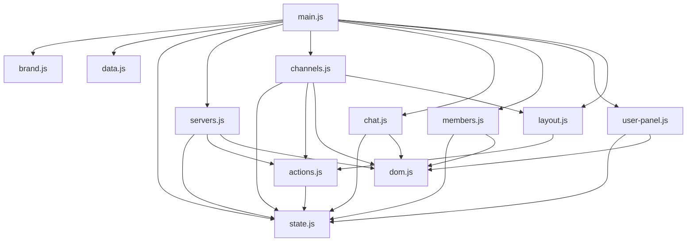

# Lesson 17 — Modules & the brand config

Your `app.js` is now about 370 lines, and every new feature will make it longer. In this lesson you split it into small files that import each other, and you move the app's name, logo and accent color into one file. Nothing new appears on screen; the point is a structure that stays easy to work in.

## 🎯 Goal

The app looks and behaves exactly as it did at the end of Lesson 16, but the code lives in twelve small files in `vanilla/js/`, loaded by a single `<script type="module">`. The one visible difference: the tab title is set by JavaScript, from `js/brand.js`.

{.screenshot}

You'll also be able to rebrand the whole app (name, logo, accent color) by editing one file.

## 🧠 New concepts

<ConceptList />

### Why split a file at all?

A 370-line file is already hard to scan. Imagine 1500 lines: where is the code that draws the member list? Which function changes `state`? With one file per job you can answer "where is X?" from the file names alone. In Python you already do this: you split code into `.py` files and use `import`.

### Modules: `export` and `import`

A JavaScript **module** is just a file that other files can import from. By default, nothing in a module is visible outside it. You choose what to share by putting `export` in front of it:

```js
// js/dom.js
export function el(tag, className, text) {
  // ...
}
```

Another file then asks for it by name:

```js
// js/servers.js
import { el } from './dom.js';
```

- `import { el } from './dom.js'` reads: "from the file `dom.js`, bring in the thing named `el`". Curly braces list the names; separate several with commas, as in `import { el, icon } from './dom.js'`.
- The path is **relative to the file that imports**. `./` means "in the same folder as me". The `.js` ending is required in the browser (Python lets you leave off `.py`; the browser does not guess).
- A name must be exported before another file can import it. If you forget `export`, or misspell a name, the browser stops with an error in the Console.
- You can export constants and objects too: `export const state = { ... }`.

::: tip Python comparison
`from dom import el` in Python is almost the same as `import { el } from './dom.js'`. The differences: in Python everything in a file is importable unless you hide it with a leading underscore. In JavaScript it is the other way around: nothing is importable until you write `export`. Python's `import x` followed by `x.name` has no direct equivalent here, so you'll always list names in braces.
:::

### Module scope: no more shared globals

In Lesson 16 your three scripts shared one big space: `const state` in `app.js` could be seen by every other script, because all classic scripts share their top-level names. That is convenient and dangerous: two files can accidentally use the same name.

In a module, a top-level `const` or `function` belongs to **that file only**. This is called **module scope**. The `serverList` variable in `servers.js` and a `serverList` in another file would be two different variables. Only what you `export` leaves the file.

Each module is also run **once**, the first time anything imports it. Every file that imports `state` from `state.js` gets the same single object, which is exactly what you want from shared state.

### Loading a module in HTML

Modules are switched on in the HTML with one attribute:

```html
<script type="module" src="js/main.js"></script>
```

You list **only the entry point**, `main.js`. The browser reads its `import` lines, fetches those files, reads their imports, and so on. You no longer list scripts in the right order by hand, and you no longer need `defer`: module scripts always wait until the page has been read.

Two more rules to know:

- Modules only work over `http://` (Live Server), not by double-clicking the file (`file://`). That is the reason you've used Live Server since Lesson 00.
- If any file in the chain fails to load (wrong path, typo), the whole app fails and the Console tells you which file.

### The module graph

Here is how the twelve files import each other. An arrow means "imports from".



Notice the shape: arrows point **down** toward the simple files. `state.js`, `dom.js`, `data.js` and `brand.js` import nothing. `main.js` is at the top and imports almost everything, because its job is to wire the pieces together.

Is there an arrow from `state.js` up to `main.js`? No, and there must not be. `main.js` imports `state.js`; if `state.js` imported `main.js` back, the two would depend on each other in a circle. Modules can technically handle circles, but they're confusing and easy to break, so we keep the arrows going one way. This raises a problem: after every change, `state.js` has to call `render()`, and `render()` lives in `main.js`. The next concept solves it.

### Callbacks to break a loop: `onChange`

Instead of importing `render`, `state.js` offers a small door:

```js
let onChangeCallback = null;

export function onChange(callback) {
  onChangeCallback = callback;
}

export function update() {
  save();
  if (onChangeCallback) {
    onChangeCallback();
  }
}
```

`main.js` calls `onChange(render)` once at start-up and hands `state.js` the function. `state.js` never learns where it came from; it just calls whatever it was given. Passing a function as a value is something you did in Lesson 12 with `.map(...)` and in Lesson 15 with `addEventListener`.

### One file for the brand

The app's identity (name, logo and accent color) is spread around: the `<title>` in the HTML, the logo path in two places, and `--brand-accent` in the CSS. Put it in **one** file:

```js
export const brand = {
  name: 'Hubbub',
  logo: 'assets/brand/logo.svg',
  accentColor: '#0f7b6c',
};
```

and a function that applies it to the page. It uses three things you know and two new ones:

- `document.title = brand.name` sets the tab title.
- `document.querySelector('.brand-logo').src = brand.logo` sets an image's `src` property. The same works for the `href` of a `<link>` (here the favicon, the little tab icon).
- `document.documentElement` is the `<html>` element. Setting a CSS variable on it with `style.setProperty('--brand-accent', ...)` has the same effect as writing `:root { --brand-accent: ... }` in CSS, but the value now comes from JavaScript.

Change `name`, `logo` or `accentColor` in `brand.js`, reload, and the app is rebranded.

## 🛠️ Build it

You'll create new files, then replace the contents of `app.js` piece by piece. **The app is broken until Step 10**, because `index.html` still points to the old scripts until then. That's normal when you reorganize: move everything, then test.

Here is where every part of the old `app.js` goes:

| Old `app.js` section | New file |
| --- | --- |
| `STORAGE_KEY`, the `state` object, `getUser`, `getActiveServer`, `findChannel`, `getActiveChannel`, `save`, `loadSaved`, `update` | `state.js` (plus new `getCurrentUser`, `getMessages`, `onChange`) |
| `selectServer`, `selectChannel`, `toggleCategory`, `toggleMembers` | `actions.js` |
| `createServerItem`, `renderServers`, the server list click listener | `servers.js` |
| `createChannelItem`, `createCategory`, `renderChannels`, the channel list click listener | `channels.js` |
| `createMessage`, `renderChat` | `chat.js` |
| `createMember`, `renderMembers` | `members.js` |
| `renderUserPanel` | `user-panel.js` |
| `openNav`, `closeNav`, the menu, backdrop, Escape and members-button listeners | `layout.js` |
| `render` and the start-up code at the bottom | `main.js` |
| (new) | `brand.js` |

Keep `app.js` open in a second tab while you work so you can copy lines out of it. Cut and paste is fine here: you wrote this code in the last lessons, and the point is where it goes. Do read each new file as you make it.

### Step 1 — Export the helpers in `dom.js` and `data.js`

Open `vanilla/js/dom.js`. Put `export` in front of each of the three functions, `el`, `icon` and `avatar`. Only the first line of each changes:

```js [vanilla/js/dom.js]
export function el(tag, className, text) {
  // ...body unchanged...
}
```

Do the same for `function icon(name)` and `function avatar(user, withStatus)`, leaving their bodies alone.

Now `vanilla/js/data.js`. Delete the line `const currentUserId = 'u-me';` (and the blank line after it): that value moves to `state.js` in the next step. Then add `export` before the three top-level constants `users`, `servers` and `messages`:

```js
export const users = [
  // ...the same user objects as before
];
```

```js
export const servers = [
  // ...the same server objects as before
];
```

```js
export const messages = {
  // ...the same message lists as before
};
```

You're only editing three `const` lines. Everything inside the brackets stays.

::: solution
```js [vanilla/js/dom.js]
// A function declaration after the change (the others look the same):
export function el(tag, className, text) {
  const element = document.createElement(tag);
  // ...rest unchanged...
  return element;
}

export function icon(name) {
  // ...rest unchanged...
}

export function avatar(user, withStatus) {
  // ...rest unchanged...
}
```

```js [vanilla/js/data.js]
// The app's fake data, as plain JavaScript values.
// (Lesson 18 moves this into JSON files.)

export const users = [
  // ...rest unchanged...
];

export const servers = [
  // ...rest unchanged...
];

export const messages = {
  // ...rest unchanged...
};
```
:::

### Step 2 — `state.js`: the app's state and lookups

Create `vanilla/js/state.js`. It gets everything about `state`: the object itself, saving and loading, and the functions that look things up.

Three differences from `app.js`:

1. `state` starts **empty** (`users: []`, `servers: []`, `activeServerId: null`). Filling it, from saved data or from `data.js`, becomes the job of `main.js`, so `state.js` doesn't need to import `data.js` at all.
2. The current user's id is now an exported constant, `CURRENT_USER_ID`, plus a small `getCurrentUser()` helper.
3. `update()` calls the function registered with `onChange` instead of calling `render()` directly (see the concepts above). There's also a new helper, `getMessages(channelId)`, so that other files don't need to know that messages are stored in an object keyed by channel id.

Everything that other files need gets `export`. `STORAGE_KEY` and `onChangeCallback` stay private to this file.

::: solution
```js [vanilla/js/state.js]
// The app's state: ONE object that holds everything the screen shows.
// Render functions read it; actions change it and then call update().

export const CURRENT_USER_ID = 'u-me';

const STORAGE_KEY = 'chat-clone-state-v1';

export const state = {
  // Data — saved in localStorage
  users: [],
  servers: [],
  messages: {}, // channel id → array of messages

  // What you're looking at — also saved
  activeServerId: null,
  activeChannelByServer: {}, // server id → channel id
  collapsedCategoryIds: [],

  // Temporary — not saved
  showMembers: true,
};

// ---------- Saving and loading ----------

export function save() {
  const saved = {
    users: state.users,
    servers: state.servers,
    messages: state.messages,
    activeServerId: state.activeServerId,
    activeChannelByServer: state.activeChannelByServer,
    collapsedCategoryIds: state.collapsedCategoryIds,
  };
  localStorage.setItem(STORAGE_KEY, JSON.stringify(saved));
}

// Returns the saved object, or null if there's nothing (valid) saved.
export function loadSaved() {
  const text = localStorage.getItem(STORAGE_KEY);
  if (text === null) {
    return null;
  }
  try {
    return JSON.parse(text);
  } catch (error) {
    console.warn('Saved state was corrupted, starting fresh.', error);
    return null;
  }
}

// ---------- Telling the app that something changed ----------

let onChangeCallback = null;

// main.js registers its render function here.
// (state.js can't import main.js: main.js already imports state.js.)
export function onChange(callback) {
  onChangeCallback = callback;
}

// Call this after every change to the state: it saves and re-renders.
export function update() {
  save();
  if (onChangeCallback) {
    onChangeCallback();
  }
}

// ---------- Looking things up ----------

export function getUser(userId) {
  return state.users.find((user) => user.id === userId);
}

export function getCurrentUser() {
  return getUser(CURRENT_USER_ID);
}

export function getActiveServer() {
  return state.servers.find((server) => server.id === state.activeServerId);
}

export function findChannel(server, channelId) {
  for (const category of server.categories) {
    for (const channel of category.channels) {
      if (channel.id === channelId) {
        return channel;
      }
    }
  }
  return null;
}

// The selected channel of the active server (its first channel if none was picked yet)
export function getActiveChannel() {
  const server = getActiveServer();
  const channelId = state.activeChannelByServer[server.id];
  return findChannel(server, channelId) ?? server.categories[0].channels[0];
}

export function getMessages(channelId) {
  return state.messages[channelId] ?? [];
}
```
:::

### Step 3 — `actions.js`: the functions that change the state

Create `vanilla/js/actions.js` and move the four action functions into it: `selectServer`, `selectChannel`, `toggleCategory`, `toggleMembers`. Add `export` to each. Each one needs a few names from `state.js`, so the file starts with an import line.

::: solution
```js [vanilla/js/actions.js]
// Actions: every change to the app's data goes through one of these functions.
// Each one changes `state`, then calls update() to save and re-render.

import { state, update, getActiveServer, findChannel } from './state.js';

export function selectServer(serverId) {
  state.activeServerId = serverId;
  update();
}

export function selectChannel(channelId) {
  const channel = findChannel(getActiveServer(), channelId);
  if (channel.type === 'voice') {
    return; // joining voice channels comes in Lesson 29
  }
  state.activeChannelByServer[state.activeServerId] = channelId;
  update();
}

export function toggleCategory(categoryId) {
  if (state.collapsedCategoryIds.includes(categoryId)) {
    state.collapsedCategoryIds = state.collapsedCategoryIds.filter((id) => id !== categoryId);
  } else {
    state.collapsedCategoryIds.push(categoryId);
  }
  update();
}

export function toggleMembers() {
  state.showMembers = !state.showMembers;
  update();
}
```
:::

### Step 4 — `servers.js`

Create `vanilla/js/servers.js`. It takes `createServerItem` and `renderServers` from `app.js` plus the click listener for the server list. Two changes:

- The `serverList` lookup (`document.querySelector('#server-list')`) moves here, because only this file uses it. Module scope keeps it private.
- The listener moves into an exported function, `setupServers()`, which `main.js` will call once. This keeps the file from doing work at import time, and gives `main.js` control over the order of things.

Check the imports at the top: this file reads `state`, calls the action `selectServer`, and builds elements with `el`.

::: solution
```js [vanilla/js/servers.js]
// The server rail: one round button per server.

import { state } from './state.js';
import { selectServer } from './actions.js';
import { el } from './dom.js';

const serverList = document.querySelector('#server-list');

function createServerItem(server) {
  const item = el('li', 'server-item');
  item.dataset.serverId = server.id;
  if (server.id === state.activeServerId) {
    item.classList.add('is-active');
  }

  const button = el('button', 'server-button', server.icon);
  button.type = 'button';
  button.setAttribute('aria-label', server.name);
  if (server.iconIsEmoji) {
    button.classList.add('is-emoji');
  }

  item.append(button);
  return item;
}

export function renderServers() {
  serverList.replaceChildren();
  for (const server of state.servers) {
    serverList.append(createServerItem(server));
  }
}

export function setupServers() {
  // One listener for the whole list (event delegation)
  serverList.addEventListener('click', (event) => {
    const item = event.target.closest('.server-item');
    if (item) {
      selectServer(item.dataset.serverId);
    }
  });
}
```
:::

### Step 5 — `channels.js`

Create `vanilla/js/channels.js` with `createChannelItem`, `createCategory`, `renderChannels`, and the channel list listener inside `setupChannels()`.

Two small changes from the old code, both on purpose:

- The old listener looked for `.channel-item`; the new one looks for `.channel-button`, then finds the item with `button.closest('.channel-item')`. The button is the thing you actually click and focus, so it's the more honest target. It behaves the same.
- A tiny tidy-up: the old `createChannelItem` stored the icon name in a variable first; the new one chooses it inline in one line. Same result.

`closeNav` comes from `layout.js` (Step 7). Importing a function you haven't written yet is fine: nothing runs until the whole app loads.

::: solution
```js [vanilla/js/channels.js]
// The channel sidebar: server name, categories and channels.

import { state, getActiveServer, getActiveChannel } from './state.js';
import { selectChannel, toggleCategory } from './actions.js';
import { el, icon } from './dom.js';
import { closeNav } from './layout.js';

const serverName = document.querySelector('#server-name');
const channelList = document.querySelector('#channel-list');

function createChannelItem(channel, isSelected) {
  const item = el('li', 'channel-item');
  item.dataset.channelId = channel.id;
  if (isSelected) {
    item.classList.add('is-selected');
  }

  const button = el('button', 'channel-button');
  button.type = 'button';
  button.append(icon(channel.type === 'voice' ? 'speaker' : 'hash'), el('span', 'channel-name', channel.name));

  item.append(button);
  return item;
}

function createCategory(category, activeChannelId) {
  const isCollapsed = state.collapsedCategoryIds.includes(category.id);
  const section = el('section', 'category');
  section.dataset.categoryId = category.id;
  if (isCollapsed) {
    section.classList.add('is-collapsed');
  }

  const heading = el('h3');
  const toggle = el('button', 'category-toggle');
  toggle.type = 'button';
  toggle.setAttribute('aria-expanded', String(!isCollapsed));
  toggle.append(icon('chevron-down'), category.name);
  heading.append(toggle);

  const list = el('ul');
  for (const channel of category.channels) {
    list.append(createChannelItem(channel, channel.id === activeChannelId));
  }

  section.append(heading, list);
  return section;
}

export function renderChannels() {
  const server = getActiveServer();
  const activeChannel = getActiveChannel();
  serverName.textContent = server.name;
  channelList.replaceChildren();
  for (const category of server.categories) {
    channelList.append(createCategory(category, activeChannel.id));
  }
}

export function setupChannels() {
  channelList.addEventListener('click', (event) => {
    const toggle = event.target.closest('.category-toggle');
    if (toggle) {
      toggleCategory(toggle.closest('.category').dataset.categoryId);
      return;
    }
    const button = event.target.closest('.channel-button');
    if (button) {
      selectChannel(button.closest('.channel-item').dataset.channelId);
      closeNav();
    }
  });
}
```
:::

### Step 6 — `chat.js`, `members.js` and `user-panel.js`

Three small files, three of the old render sections. Each file looks up its own DOM elements at the top and exports one render function.

`chat.js` is where `getMessages(channel.id)` pays off: the render code no longer needs `?? []` because the lookup helper handles a channel with no messages.

`user-panel.js` uses `getCurrentUser()` instead of a global `currentUser` constant. A file can only use names it imports or defines itself.

`members.js` reads `membersButton` too: it sets `aria-pressed` on it. (The click listener for that button is in `layout.js`.)

::: solution
```js [vanilla/js/chat.js]
// The chat area: header and the message feed.

import { getActiveChannel, getMessages, getUser } from './state.js';
import { el, avatar } from './dom.js';

const chatTitle = document.querySelector('#chat-title');
const chatTopic = document.querySelector('#chat-topic');
const messageList = document.querySelector('#message-list');
const composerInput = document.querySelector('#composer-input');

function createMessage(message) {
  const author = getUser(message.authorId);
  const item = el('li', 'message is-group-start');
  item.dataset.messageId = message.id;

  const gutter = el('div', 'message-gutter');
  gutter.append(avatar(author));

  const body = el('div', 'message-body');
  const header = el('h3', 'message-header');
  header.append(el('button', 'message-author', author.displayName));
  const time = el('time', 'message-time', message.timestamp);
  time.dateTime = message.timestamp;
  header.append(time);
  body.append(header, el('div', 'message-content', message.content));

  item.append(gutter, body);
  return item;
}

export function renderChat() {
  const channel = getActiveChannel();
  chatTitle.textContent = channel.name;
  chatTopic.textContent = channel.topic;
  composerInput.placeholder = `Message #${channel.name}`;

  messageList.replaceChildren();
  for (const message of getMessages(channel.id)) {
    messageList.append(createMessage(message));
  }
}
```

```js [vanilla/js/members.js]
// The member list on the right.

import { state, getActiveServer, getUser } from './state.js';
import { el, avatar } from './dom.js';

const memberList = document.querySelector('#member-list');
const membersButton = document.querySelector('#members-button');

function createMember(user) {
  const button = el('button', 'member');
  button.type = 'button';
  button.dataset.userId = user.id;
  if (user.status === 'offline') {
    button.classList.add('is-offline');
  }

  const names = el('span', 'member-names');
  names.append(el('span', 'member-name', user.displayName));
  if (user.customStatus) {
    names.append(el('span', 'member-status-text', user.customStatus));
  }

  button.append(avatar(user, true), names);
  return button;
}

export function renderMembers() {
  memberList.hidden = !state.showMembers;
  membersButton.setAttribute('aria-pressed', String(state.showMembers));

  const server = getActiveServer();
  const memberUsers = server.members.map((member) => getUser(member.userId));
  const onlineCount = memberUsers.filter((user) => user.status !== 'offline').length;

  memberList.replaceChildren();
  memberList.append(el('h3', 'member-group-title', `Members — ${memberUsers.length} (${onlineCount} online)`));
  for (const user of memberUsers) {
    memberList.append(createMember(user));
  }
}
```

```js [vanilla/js/user-panel.js]
// The user panel (bottom left).

import { getCurrentUser } from './state.js';
import { avatar } from './dom.js';

export function renderUserPanel() {
  const me = getCurrentUser();
  const userAvatar = avatar(me, true);
  userAvatar.id = 'user-panel-avatar';
  document.querySelector('#user-panel-avatar').replaceWith(userAvatar);
  document.querySelector('#user-panel-name').textContent = me.displayName;
  document.querySelector('#user-panel-tag').textContent = me.customStatus;
}
```
:::

### Step 7 — `layout.js`: the drawer and the members toggle

Create `vanilla/js/layout.js`. It gets `openNav` and `closeNav` (both exported: `channels.js` closes the drawer after you pick a channel) and the listeners for the menu button, the backdrop, the <kbd>Escape</kbd> key and the members button, all inside `setupLayout()`.

This file imports `toggleMembers` from `actions.js`, but the drawer itself doesn't touch the state, so `layout.js` doesn't import `state.js` at all.

::: solution
```js [vanilla/js/layout.js]
// Layout toggles: the member list and, on small screens, the channel drawer.

import { toggleMembers } from './actions.js';

const app = document.querySelector('.app');
const menuButton = document.querySelector('#menu-button');
const backdrop = document.querySelector('#drawer-backdrop');
const membersButton = document.querySelector('#members-button');

export function openNav() {
  app.classList.add('is-nav-open');
  menuButton.setAttribute('aria-expanded', 'true');
}

export function closeNav() {
  app.classList.remove('is-nav-open');
  menuButton.setAttribute('aria-expanded', 'false');
}

export function setupLayout() {
  menuButton.addEventListener('click', openNav);
  backdrop.addEventListener('click', closeNav);
  membersButton.addEventListener('click', toggleMembers);

  document.addEventListener('keydown', (event) => {
    if (event.key === 'Escape') {
      closeNav();
    }
  });
}
```
:::

### Step 8 — `brand.js`, and removing the accent from the CSS

Create `vanilla/js/brand.js` as described in the concepts: a `brand` object and `applyBrand()`.

::: solution
```js [vanilla/js/brand.js]
// ============================================================
//  BRANDING — the only file you need to edit to rebrand the app.
// ============================================================

export const brand = {
  name: 'Hubbub',
  logo: 'assets/brand/logo.svg',
  accentColor: '#0f7b6c',
};

// Applies the brand to the page: tab title, favicon, logo and accent color.
export function applyBrand() {
  document.title = brand.name;
  document.querySelector('link[rel="icon"]').href = brand.logo;
  document.querySelector('.brand-logo').src = brand.logo;
  document.documentElement.style.setProperty('--brand-accent', brand.accentColor);
}
```
:::

Now remove the old, duplicated source of the accent color. In `vanilla/css/theme.css`, delete the `--brand-accent` line and its comment, and change the header comment so the file doesn't claim to own the accent color anymore. `base.css` and `server-rail.css` still use `var(--brand-accent)`; they now get its value from JavaScript.

::: solution
```css [vanilla/css/theme.css]
/* The color palette for the whole app.
   Every other CSS file uses these variables instead of raw values,
   so changing the theme means changing this file only.
   (The brand accent color is not here: it comes from js/brand.js.) */

:root {
  /* Backgrounds, from darkest to lightest */
  --bg-tertiary: #1e1f22;      /* server rail */
  /* ...rest unchanged... */
}
```
:::

### Step 9 — `main.js`: wire it together

Create `vanilla/js/main.js`. This is the entry point. In order, it:

1. imports everything it needs,
2. defines `render()`, which calls each render function,
3. calls `applyBrand()`,
4. fills `state` from saved data or, if nothing was saved, from `data.js`,
5. calls the three `setup...()` functions once,
6. registers `render` with `onChange(render)` and draws the screen for the first time.

Compare it to the bottom of `app.js`: it is the same start-up code, now in one place with a job description.

::: solution
```js [vanilla/js/main.js]
// The starting point of the app: set everything up and draw the screen.

import { applyBrand } from './brand.js';
import { users, servers, messages } from './data.js';
import { state, onChange, loadSaved } from './state.js';
import { renderServers, setupServers } from './servers.js';
import { renderChannels, setupChannels } from './channels.js';
import { renderChat } from './chat.js';
import { renderMembers } from './members.js';
import { renderUserPanel } from './user-panel.js';
import { setupLayout } from './layout.js';

// Draws the whole screen from the current state.
function render() {
  renderServers();
  renderChannels();
  renderChat();
  renderMembers();
  renderUserPanel();
}

applyBrand();

// Use the saved state from last time if there is one, otherwise the data in data.js.
const saved = loadSaved();
if (saved !== null) {
  state.users = saved.users;
  state.servers = saved.servers;
  state.messages = saved.messages;
  state.activeServerId = saved.activeServerId;
  state.activeChannelByServer = saved.activeChannelByServer;
  state.collapsedCategoryIds = saved.collapsedCategoryIds;
} else {
  state.users = users;
  state.servers = servers;
  state.messages = messages;
  state.activeServerId = servers[0].id;
}

setupLayout();
setupServers();
setupChannels();

onChange(render);
render();
```
:::

### Step 10 — Load the module in `index.html`, delete `app.js`

In `vanilla/index.html`, make two changes in the `<head>`:

1. The title is now set by JavaScript, so give it a placeholder that makes it obvious if the script didn't run: `<title>Loading…</title>`. Add a comment above it.
2. Replace the three `<script ... defer>` lines (and the comment above them) with the single module script.

Then **delete `vanilla/js/app.js`**: every line of it has a new home. (Right-click the file in the Explorer and choose Delete.)

::: solution
```html [vanilla/index.html]
<head>
  <meta charset="utf-8">
  <meta name="viewport" content="width=device-width, initial-scale=1">
  <!-- The real title, favicon and logo come from js/brand.js -->
  <title>Loading…</title>
  <link rel="icon" href="assets/brand/logo.svg">
  <link rel="stylesheet" href="css/theme.css">
  <!-- ...the other stylesheet links, unchanged... -->
  <link rel="stylesheet" href="css/responsive.css">
  <!-- A module script: it can import other files, and runs after the page has been read -->
  <script type="module" src="js/main.js"></script>
</head>
```
:::

### Step 11 — Test it, then rebrand it

Reload the page through Live Server.

1. The app should look and behave as it did in Lesson 16: switch servers and channels, collapse a category, toggle the member list, resize the window and open the drawer. Reload: your selections are still there.
2. Open DevTools → **Network** and reload. You'll see `main.js` and, after it, each file it imports. The browser discovered them by reading the `import` lines.
3. In the **Console**, type `state` and press <kbd>Enter</kbd>. You get `ReferenceError: state is not defined`. That's module scope at work: `state` isn't a global anymore. (In Lesson 16 this showed the object.)
4. Open `brand.js`, change `accentColor` to `'#7c3aed'` and `name` to your own app name, and reload. The tab title and the accent color change (look at the focus outline, or the active server's pill on the left). Change them back, or keep them.

<!-- no-solution: testing and experimenting, nothing to type -->

## ✅ Checkpoint

- [ ] `vanilla/js/` contains `actions.js`, `brand.js`, `channels.js`, `chat.js`, `data.js`, `dom.js`, `layout.js`, `main.js`, `members.js`, `servers.js`, `state.js` and `user-panel.js`, and no `app.js`.
- [ ] `index.html` has exactly one `<script>`, with `type="module"`.
- [ ] The app works as before: servers, channels, categories, member toggle and the mobile drawer.
- [ ] The tab title says **Hubbub** (set by `brand.js`), not **Loading…**.
- [ ] DevTools → **Console** shows no errors on load.
- [ ] DevTools → **Network** lists every module with status **200**.
- [ ] Changing `accentColor` in `brand.js` changes the accent color after a reload.

## 🐛 Common mistakes

**The page is blank and the Console says something like `Failed to resolve module specifier`, or a file shows as 404.** The import path is wrong. Paths in the same folder need `./`, and need the `.js` ending: `'./state.js'`, not `'state'`.

**The Console says the requested module does not provide an export named `something`.** You imported a name that the other file doesn't export, or misspelled it. Check that file for `export` in front of the name, and that the two spellings match exactly (capital letters count).

**The page is blank and the Console shows a CORS or `file://` error.** You opened `index.html` by double-clicking. Modules don't load from `file://`. Use **Open with Live Server** (Lesson 00).

**The Console says `X is not defined` for a name that used to work.** In `app.js` every function could see every other one. Now each file only sees what it imports. Add the name to the file's `import` line (and make sure the source file exports it).

**The tab says "Loading…" forever.** `applyBrand()` never ran: usually because an earlier error stopped `main.js`. Scroll up in the Console for the first red message.

**Clicking does nothing.** You probably forgot to call a `setup...()` function in `main.js`. Defining `setupServers` doesn't attach the listener; calling it does.

## 📝 Quiz

::: quiz
`servers.js` defines `const serverList = document.querySelector('#server-list');` at its top level without exporting it. `channels.js` tries to use `serverList` without importing anything. What happens?

- [ ] It works, because all top-level names are shared between files
- [x] It fails with a "not defined" error, because the name is private to `servers.js`
- [ ] It works, but only after the page is reloaded
- [ ] It gives `null`

> Top-level names in a module belong to that module. Only names marked `export` (and imported by name) cross a file boundary.
:::

::: quiz
What does this line do, in a file that sits next to `state.js`?

```js
import { state, update } from './state.js';
```

- [ ] Runs `state.js` again every time the line is reached
- [x] Brings the exported names `state` and `update` into this file, using the single shared copy of `state.js`
- [ ] Copies the `state` object, so this file has its own private version
- [ ] Imports everything from `state.js`

> A module runs once. Every importer gets the same exported `state` object, which is why a change made in `actions.js` shows up when `chat.js` renders.
:::

::: quiz
Why does `state.js` call `onChangeCallback()` instead of importing `render` from `main.js`?

- [ ] Because JavaScript doesn't allow a file to import a function
- [ ] Because `render` is too slow to import
- [x] Because `main.js` already imports `state.js`; importing back would make the files depend on each other in a circle, so `main.js` hands its function to `state.js` instead
- [ ] Because `update` is only used by `main.js`

> Keeping arrows one-directional makes the module graph easy to follow. A callback lets the lower-level file call upward without importing upward.
:::

## 💾 Commit

```sh
git add .
git commit -m "Split app.js into ES modules and add brand.js"
git push
```
