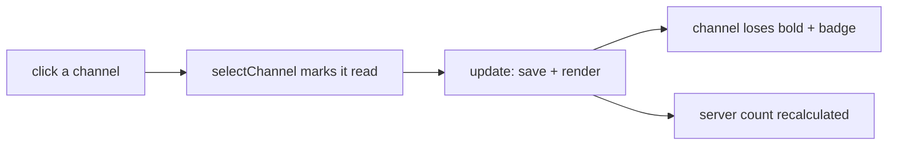

# Lesson 19 — Channel list: categories, voice, unread & mentions

The channel list becomes a real Discord sidebar: unread channels turn bold, mentions get a red badge, servers show unread dots and mention counts, voice channels list who is connected, and collapsing a category hides everything but what matters. Along the way you meet the idea that most of what the screen shows should be **calculated from your data**, not stored.

## 🎯 Goal

The server rail shows a white dot next to servers with unread channels and a red number for mentions. In the channel list, `# help` is bold with a red `1`, `# announcements` is bold, and under **Lounge** two small avatars show Ava and Priya, who are connected. Clicking a channel marks it read, so its bold style and badge disappear.

{.screenshot}

## 🧠 New concepts

<ConceptList />

### Derived data: calculate it, don't store it

Look at what the data already says. Each channel in `servers.json` has `unread` (true/false) and `mentions` (a number); voice channels have a list of the connected people, `voiceUserIds`. A server doesn't have an `unread` field. Should it?

If you stored one, you'd have two facts to keep in sync: "channel help is unread" and "server Frontend Friends is unread". Forget to update one and the screen lies. A better approach is to **derive** the server's value whenever you need it:

> a server is unread if **any** of its channels is unread.

Same for the mention count on a server: the **sum** of its channels' mention counts. This is the same rule as in Lesson 16: store the minimum (the truth) and calculate everything else from it. In spreadsheet terms, a formula cell instead of a typed number.

### `flatMap`: map, then flatten

Servers keep their channels inside categories:

```text
server.categories = [
  { name: 'Text Channels',  channels: [general, help, ...] },
  { name: 'Voice Channels', channels: [lounge, ...] },
]
```

To ask "is any channel unread?" you want one flat list of all channels. `.map` would give you a list of lists. `.flatMap` maps and then flattens one level, so you get a single list:

```js
const categories = [
  { name: 'Text', channels: ['general', 'help'] },
  { name: 'Voice', channels: ['lounge'] },
];

categories.map((category) => category.channels);
// [['general', 'help'], ['lounge']]

categories.flatMap((category) => category.channels);
// ['general', 'help', 'lounge']
```

In Python you'd write a nested comprehension: `[c for cat in categories for c in cat.channels]`.

### `some`: does any item match?

`array.some(test)` returns `true` if the test function returns `true` for **at least one** item, and `false` otherwise (for an empty array, `false`). It stops as soon as it finds a match. It's like Python's `any(...)`.

```js
const channels = [{ unread: false }, { unread: true }];

channels.some((channel) => channel.unread);   // true
```

### `continue`: skip to the next loop round

You know `break` from Python (leave the loop) and `continue` (skip the rest of this round and go to the next item). JavaScript has both with the same meaning:

```js
for (const channel of channels) {
  if (channel.type === 'voice') {
    continue;   // don't process voice channels
  }
  console.log(channel.name);
}
```

You'll use `continue` to leave channels out of a collapsed category.

### Why collapsing moves from CSS to JavaScript

In Lesson 16, a collapsed category was hidden by a CSS rule: `.category.is-collapsed .channel-item:not(.is-selected) { display: none }`. CSS can only hide items. Now the rule is more complicated: a collapsed category should still show the **selected** channel and any **voice channel with people in it** (like Discord does). That's a decision about data (`voiceUserIds.length`), so JavaScript is the right tool: the render function simply doesn't create the items that should be hidden.

### Mark as read

When you open a channel, it's no longer unread. That's a change to the data, so it belongs in an **action**: set `channel.unread = false` and `channel.mentions = 0`. Because the badges are derived from those two fields, the channel's bold text, its red badge, and the server's dot and total all update on their own at the next render.



## 🛠️ Build it

The unread flags and voice user lists are already in your JSON data. You'll write the code that reads them.

### Step 1 — Lookup helpers in `state.js`

Open `vanilla/js/state.js`. Three changes to the "Looking things up" section:

1. **New `getChannels(server)`**: returns a flat list of all channels of a server, using `flatMap`.
2. **Rewrite `findChannel`**: it now takes only a `channelId` and searches **all servers** (loop over `state.servers`, get each server's channels, and `.find` the match). Return `null` if nothing matches. A badge on another server can only be cleared if you can find channels in any server.
3. **Rewrite `getActiveChannel`**: use `getChannels` too. The fallback when nothing was selected is now "the first **text** channel" instead of "the first channel", so a server whose first category happened to be voice still opens on a text channel.

Then, at the bottom of the file, add two derived-data functions: `isServerUnread(server)` (uses `some`) and `countServerMentions(server)` (adds up `channel.mentions`, treating a missing value as 0 with `?? 0`).

Everything is exported.

::: solution
```js [vanilla/js/state.js]
export function getActiveServer() {
  return state.servers.find((server) => server.id === state.activeServerId);
}

// All channels of a server, without the categories around them.
export function getChannels(server) {
  return server.categories.flatMap((category) => category.channels);
}

// Finds a channel in any server.
export function findChannel(channelId) {
  for (const server of state.servers) {
    const channel = getChannels(server).find((c) => c.id === channelId);
    if (channel) {
      return channel;
    }
  }
  return null;
}

// The selected channel of the active server (its first text channel if none was picked yet)
export function getActiveChannel() {
  const server = getActiveServer();
  const channelId = state.activeChannelByServer[server.id];
  const channels = getChannels(server);
  return channels.find((c) => c.id === channelId) ?? channels.find((c) => c.type === 'text');
}

export function getMessages(channelId) {
  return state.messages[channelId] ?? [];
}

// ---------- Unread and mentions ----------

// A server is unread if any of its channels is.
export function isServerUnread(server) {
  return getChannels(server).some((channel) => channel.unread);
}

export function countServerMentions(server) {
  let total = 0;
  for (const channel of getChannels(server)) {
    total += channel.mentions ?? 0;
  }
  return total;
}
```
:::

### Step 2 — Mark channels read in `actions.js`

In `vanilla/js/actions.js`:

- Change the import: `selectServer` now needs `getActiveChannel`, and `selectChannel` no longer needs `getActiveServer` (the new `findChannel` takes just the id).
- Add a small helper, `markChannelRead(channel)`, that sets `unread` to `false` and `mentions` to `0`. It isn't exported: only actions use it.
- In `selectServer`, after switching, mark the newly shown channel read.
- In `selectChannel`, look the channel up with `findChannel(channelId)`, and mark it read after it's been selected (not for voice channels: they return early, as before).

::: solution
```js [vanilla/js/actions.js]
// Actions: every change to the app's data goes through one of these functions.
// Each one changes `state`, then calls update() to save and re-render.

import { state, update, getActiveChannel, findChannel } from './state.js';

function markChannelRead(channel) {
  channel.unread = false;
  channel.mentions = 0;
}

export function selectServer(serverId) {
  state.activeServerId = serverId;
  markChannelRead(getActiveChannel());
  update();
}

export function selectChannel(channelId) {
  const channel = findChannel(channelId);
  if (channel.type === 'voice') {
    return; // joining voice channels comes in Lesson 29
  }
  state.activeChannelByServer[state.activeServerId] = channelId;
  markChannelRead(channel);
  update();
}

export function toggleCategory(categoryId) {
  if (state.collapsedCategoryIds.includes(categoryId)) {
    state.collapsedCategoryIds = state.collapsedCategoryIds.filter((id) => id !== categoryId);
  } else {
    state.collapsedCategoryIds.push(categoryId);
  }
  update();
}

export function toggleMembers() {
  state.showMembers = !state.showMembers;
  update();
}
```
:::

### Step 3 — Badges on the server rail

In `vanilla/js/servers.js`, import `isServerUnread` and `countServerMentions` from `state.js`. In `createServerItem`:

- add the class `is-unread` to the list item when `isServerUnread(server)` is true (the CSS for the white dot beside the icon is already in your stylesheets);
- count the server's mentions and, if there are any, append `<span class="mention-badge">` to the button with the number as text.

`String(mentions)` turns the number into text: `el(...)` expects a string.

::: solution
```js [vanilla/js/servers.js]
// The server rail: one round button per server.

import { state, isServerUnread, countServerMentions } from './state.js';
import { selectServer } from './actions.js';
import { el } from './dom.js';

const serverList = document.querySelector('#server-list');

function createServerItem(server) {
  const item = el('li', 'server-item');
  item.dataset.serverId = server.id;
  if (server.id === state.activeServerId) {
    item.classList.add('is-active');
  }
  if (isServerUnread(server)) {
    item.classList.add('is-unread');
  }

  const button = el('button', 'server-button', server.icon);
  button.type = 'button';
  button.setAttribute('aria-label', server.name);
  if (server.iconIsEmoji) {
    button.classList.add('is-emoji');
  }

  const mentions = countServerMentions(server);
  if (mentions > 0) {
    button.append(el('span', 'mention-badge', String(mentions)));
  }

  item.append(button);
  return item;
}
```
:::

### Step 4 — Unread, mentions, voice users and collapsing in `channels.js`

Update `vanilla/js/channels.js` in four places:

1. **A new function `createVoiceUser(userId)`**: looks the user up with `getUser`, builds a `<li class="voice-user">` with a tiny avatar and the display name. The avatar is the normal one plus the class `tiny` (CSS in Step 5). Import `getUser` and `avatar`.
2. **In `createChannelItem`**: add `is-unread` to the item if `channel.unread`; append a `channel-mention-badge` span to the button if `channel.mentions > 0`; and, for voice channels with connected people, append a `<ul class="voice-users">` with one `createVoiceUser` per id.
3. **In `createCategory`**: while looping over the channels, decide which ones to show. A channel in a collapsed category is skipped with `continue` unless it's the selected one or a voice channel with people in it.
4. The first comment line changes to mention voice channels. (Harmless; it keeps the file's description accurate.)

Read the whole file below once. Notice that `channel.voiceUserIds` only exists for voice channels, so `channel.type === 'voice' &&` has to come first: for a text channel the check stops there, and `voiceUserIds.length` is never evaluated.

::: solution
```js [vanilla/js/channels.js]
// The channel sidebar: server name, categories, text and voice channels.

import { state, getActiveServer, getActiveChannel, getUser } from './state.js';
import { selectChannel, toggleCategory } from './actions.js';
import { el, icon, avatar } from './dom.js';
import { closeNav } from './layout.js';

const serverName = document.querySelector('#server-name');
const channelList = document.querySelector('#channel-list');

function createVoiceUser(userId) {
  const user = getUser(userId);
  const item = el('li', 'voice-user');
  item.dataset.userId = userId;
  const userAvatar = avatar(user);
  userAvatar.classList.add('tiny');
  item.append(userAvatar, el('span', 'voice-user-name', user.displayName));
  return item;
}

function createChannelItem(channel, isSelected) {
  const item = el('li', 'channel-item');
  item.dataset.channelId = channel.id;
  if (isSelected) {
    item.classList.add('is-selected');
  }
  if (channel.unread) {
    item.classList.add('is-unread');
  }

  const button = el('button', 'channel-button');
  button.type = 'button';
  button.append(icon(channel.type === 'voice' ? 'speaker' : 'hash'), el('span', 'channel-name', channel.name));
  if (channel.mentions > 0) {
    button.append(el('span', 'channel-mention-badge', String(channel.mentions)));
  }
  item.append(button);

  // Voice channels list the people who are connected
  if (channel.type === 'voice' && channel.voiceUserIds.length > 0) {
    const list = el('ul', 'voice-users');
    for (const userId of channel.voiceUserIds) {
      list.append(createVoiceUser(userId));
    }
    item.append(list);
  }
  return item;
}

function createCategory(category, activeChannelId) {
  const isCollapsed = state.collapsedCategoryIds.includes(category.id);
  const section = el('section', 'category');
  section.dataset.categoryId = category.id;
  if (isCollapsed) {
    section.classList.add('is-collapsed');
  }

  const heading = el('h3');
  const toggle = el('button', 'category-toggle');
  toggle.type = 'button';
  toggle.setAttribute('aria-expanded', String(!isCollapsed));
  toggle.append(icon('chevron-down'), category.name);
  heading.append(toggle);

  const list = el('ul');
  for (const channel of category.channels) {
    const isSelected = channel.id === activeChannelId;
    // A collapsed category still shows the selected channel and busy voice channels.
    const isBusyVoice = channel.type === 'voice' && channel.voiceUserIds.length > 0;
    if (isCollapsed && !isSelected && !isBusyVoice) {
      continue;
    }
    list.append(createChannelItem(channel, isSelected));
  }

  section.append(heading, list);
  return section;
}

export function renderChannels() {
  const server = getActiveServer();
  const activeChannel = getActiveChannel();
  serverName.textContent = server.name;
  channelList.replaceChildren();
  for (const category of server.categories) {
    channelList.append(createCategory(category, activeChannel.id));
  }
}

export function setupChannels() {
  channelList.addEventListener('click', (event) => {
    const toggle = event.target.closest('.category-toggle');
    if (toggle) {
      toggleCategory(toggle.closest('.category').dataset.categoryId);
      return;
    }
    const button = event.target.closest('.channel-button');
    if (button) {
      selectChannel(button.closest('.channel-item').dataset.channelId);
      closeNav();
    }
  });
}
```
:::

### Step 5 — CSS

Three small CSS changes.

**a) A tiny avatar.** In `vanilla/css/base.css`, add this rule directly after the `.avatar` rule. Two classes on one element, with no space between them, means "an element that has both":

::: solution
```css [vanilla/css/base.css]
.avatar.tiny {
  width: 24px;
  height: 24px;
  font-size: 11px;
}
```
:::

**b) Voice styles.** Create `vanilla/css/voice.css` for the list of connected users: indented under the channel, each row a flex line with the avatar and name, and an ellipsis for long names.

::: solution
```css [vanilla/css/voice.css]
/* Voice channels: who is connected. */

.voice-users {
  padding: 0 0 4px 32px;
}

.voice-user {
  display: flex;
  align-items: center;
  gap: 8px;
  height: 32px;
  padding: 0 8px;
  border-radius: var(--radius-small);
  color: var(--text-muted);
  font-size: 14px;
}

.voice-user:hover {
  background-color: var(--bg-hover);
  color: var(--text-normal);
}

.voice-user-name {
  flex: 1;
  white-space: nowrap;
  overflow: hidden;
  text-overflow: ellipsis;
}
```
:::

**c) Remove the old collapse rule.** In `vanilla/css/channels.css` delete this whole rule and the comment above it: JavaScript now does the hiding.

```css
/* ...and hides its channels, except the selected one */
.category.is-collapsed .channel-item:not(.is-selected) {
  display: none;
}
```

<!-- no-solution: part (c) is a deletion -->

Finally, link the new stylesheet in `vanilla/index.html`, after `members.css` and before `responsive.css`:

::: solution
```html [vanilla/index.html]
<link rel="stylesheet" href="css/members.css">
<link rel="stylesheet" href="css/voice.css">
<link rel="stylesheet" href="css/responsive.css">
```
:::

### Step 6 — Test it

Your browser has the earlier version of the data in `localStorage`, with the same unread flags, so it should already work. Reload and look:

1. The Frontend Friends icon has a red `1`, and servers with unread channels have a white dot beside them.
2. `# help` and `# announcements` are bold; `# help` has a red `1`.
3. Click `# help`: the bold style and the badge disappear, and the red `1` on the server icon disappears too.
4. Collapse **Text Channels**: only the selected channel stays visible. Collapse **Voice Channels**: **Lounge** stays (Ava and Priya are in it) but **Pair Programming** (empty) hides.
5. Click **Lounge**: nothing happens yet (voice joining is in Lesson 29).
6. Switch to the **Study Group** server (`SG`): it has a `2` mention in `# homework`. Click that channel and the badge goes away.

To get the unread badges back, delete the key `chat-clone-state-v1` in DevTools → Application → Local Storage and reload: the app reloads the original JSON.

<!-- no-solution: testing, nothing to type -->

## ✅ Checkpoint

- [ ] Unread channels are bold; channels with mentions show a red number.
- [ ] Servers with unread channels show a white dot; the red badge on a server is the **sum** of its channels' mentions.
- [ ] Clicking a channel clears its unread style and badge, and the server's numbers update.
- [ ] Voice channels list connected users with tiny avatars.
- [ ] A collapsed category hides its channels, except the selected channel and busy voice channels.
- [ ] `css/channels.css` no longer contains `.category.is-collapsed .channel-item`.
- [ ] DevTools → **Console** shows no errors. In Network, `voice.css` loads with status **200**.

## 🐛 Common mistakes

**`Cannot read properties of undefined (reading 'length')` when rendering channels.** You read `channel.voiceUserIds.length` on a text channel, which has no such list. Check `channel.type === 'voice'` first.

**Badges never disappear.** You marked the channel read but the screen wasn't redrawn, or you changed a copy. Make sure `markChannelRead` is called **before** `update()` in the action (so the saved and rendered state includes it).

**Every channel in a collapsed category disappears, even the selected one.** The `continue` condition has the wrong logic. It should skip only when the category is collapsed **and** the channel is not selected **and** it's not a busy voice channel: `isCollapsed && !isSelected && !isBusyVoice`.

**The tiny avatar looks full size.** `.avatar.tiny` was written with a space (`.avatar .tiny`), which means "a `.tiny` inside an `.avatar`". No space means both classes on the same element. Also check that the rule comes after the `.avatar` rule.

**Nothing shows for voice users.** `voice.css` isn't linked in `index.html`, or the path is wrong. Check the Network panel for a 404.

**The old rule still hides channels after you removed it.** Hard-reload (<kbd>Cmd</kbd>+<kbd>Shift</kbd>+<kbd>R</kbd>); the browser may have cached the old CSS.

## 📝 Quiz

::: quiz
What does this print?

```js
const servers = [
  { channels: [{ unread: false }, { unread: false }] },
  { channels: [{ unread: true }] },
];

const all = servers.flatMap((server) => server.channels);
console.log(all.length, all.some((channel) => channel.unread));
```

- [ ] `2 false`
- [ ] `3 false`
- [ ] `2 true`
- [x] `3 true`

> `flatMap` joins the two channel lists into one list of 3 channels. `some` is `true` because the third channel is unread.
:::

::: quiz
Why does the app *calculate* whether a server is unread instead of storing a `unread` field on each server?

- [ ] Calculating is faster than reading a field
- [ ] JSON files can't store booleans on servers
- [x] A stored value could disagree with the channels; a calculated value always matches them
- [ ] `some` can't be used on stored data

> Derived data has a single source of truth (the channels). Anything calculated from it can never go out of date.
:::

::: quiz
What does `continue` do here?

```js
for (const n of [1, 2, 3]) {
  if (n === 2) {
    continue;
  }
  console.log(n);
}
```

- [ ] Stops the loop at `2`, printing only `1`
- [x] Skips the rest of the round when `n` is `2`, printing `1` then `3`
- [ ] Prints `1`, `2` and `3`
- [ ] Prints only `2`

> `continue` jumps straight to the next item. When `n` is `2`, the `console.log` is skipped. (`break` would have stopped the whole loop.)
:::

## 💾 Commit

```sh
git add .
git commit -m "Add unread badges, mention counts and voice users to the channel list"
git push
```
