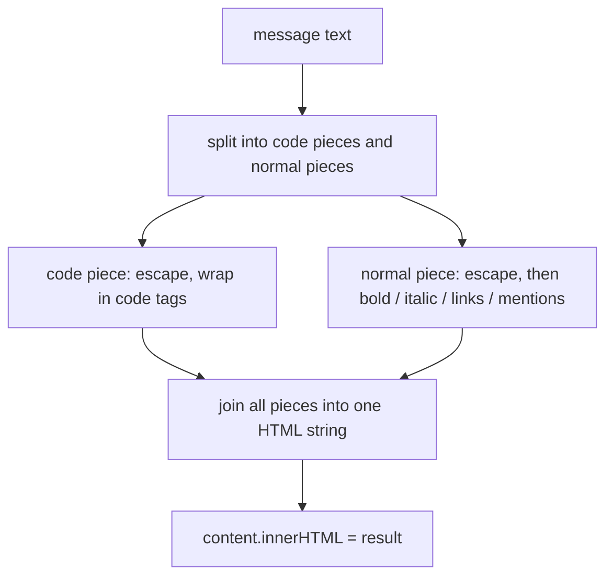

# Lesson 21 — Markdown & links: regex and safe HTML

Chat messages can contain `**bold**`, `*italic*`, `` `code` ``, links and `@mentions`. To show them you have to turn text into HTML, and doing that carelessly opens a serious security hole. This lesson teaches both: how to match patterns in text with regular expressions, and how to do it safely.

## 🎯 Goal

Messages render their formatting: bold, italics, inline code and code blocks, clickable links that open in a new tab, `@Sam` highlighted, and a message that mentions you gets a tinted background with a colored left edge. Edited messages end with a small "(edited)".

{.screenshot}

## 🧠 New concepts

<ConceptList />

### Why you must never put user text into `innerHTML`

So far you put text into the page with `textContent` or by passing text to `el(...)`. Those treat the text as **just text**: if someone writes `<b>hi</b>` you see exactly those characters. `innerHTML` is different: it treats text as **HTML code** and builds elements from it.

Markdown needs that: `**hi**` has to become `<strong>hi</strong>`. But if you set `innerHTML` from what a user typed, then a user can type HTML too. For example:

```text

```

The browser tries to load the image, fails, and runs the `onerror` code. That code is the attacker's, but it runs **inside your page**, with access to everything your page can do, such as reading `localStorage`. This kind of attack is called **XSS** (cross-site scripting). It's one of the most common web security bugs.

The rule:

> **Escape first, format second.** Before turning anything into HTML, replace the five characters that have a special meaning in HTML (`&`, `<`, `>`, `"` and `'`) with **entities**, which display as those characters but are not code: `<` becomes `&lt;`, `>` becomes `&gt;`, and so on.

After escaping, `<b>hi</b>` becomes `&lt;b&gt;hi&lt;/b&gt;`, which the browser displays as the literal text `<b>hi</b>`. Only the HTML that *your* code adds afterwards (`<strong>`, `<a>`) is real.

Order matters: `&` must be replaced first. If you replaced `<` with `&lt;` first and then `&` with `&amp;`, you'd turn your own `&lt;` into `&amp;lt;`.

In the `icon()` helper in `dom.js` you used `innerHTML` for markup that **you** wrote, which is safe. The danger is only text from a user.

### Regular expressions

A **regular expression** (regex) describes a pattern of text. JavaScript writes them between slashes: `/pattern/`. You can use one with string methods like `replace` and `split`. Python has the same idea in its `re` module, with the same syntax in most places.

Building blocks used in this lesson:

| Pattern | Matches |
| --- | --- |
| `abc` | exactly the text `abc` |
| `\*` | a literal `*` (a backslash makes a special character ordinary) |
| `\/` | a literal `/` (needed because `/` ends the regex) |
| `.` | any one character (except a line break) |
| `+` | the thing before it, one or more times |
| `?` | optional: `https?` matches `http` and `https` |
| `\s` | one whitespace character (space, tab, line break) |
| `\w` | one letter, digit or underscore |
| `[abc]` | one of the characters a, b or c |
| `[^abc]` | one character that is **not** a, b or c |
| `[\s\S]` | any character at all, including line breaks |
| `^` and `$` | the start and the end of the text |
| `a\|b` | either `a` or `b` |
| `(...)` | a **group**: remembers what it matched |

And two modifiers:

- **`g` flag** (after the closing slash, `/x/g`): find **all** matches, not just the first.
- **Lazy `+?`**: by default `+` is *greedy*: it grabs as much as it can. In `**a** and **b**`, the greedy pattern `\*\*(.+)\*\*` would match the whole thing from the first `**` to the last. Adding `?`, as in `\*\*(.+?)\*\*`, makes it *lazy*: as little as possible, so you get `**a**` and `**b**` separately.

### `replace`: find and swap

`text.replace(pattern, replacement)` returns a new string (strings never change in place). With a regex and `g`, every match is replaced.

The replacement can use `$1`, `$2`... to insert what the **groups** matched:

```js
'say **hi**'.replace(/\*\*(.+?)\*\*/g, '<strong>$1</strong>');
// 'say <strong>hi</strong>'
```

The replacement can also be a **function**. It receives the matched text and returns what to put there. You'll use that for links, so you can use the matched URL twice (as address and as visible text):

```js
'see http://a.com'.replace(/https?:\/\/\S+/g, (url) => `<a href="${url}">${url}</a>`);
```

`replaceAll(text, replacement)` replaces every occurrence of a plain **string** (no regex). It's what `escapeHtml` uses.

In Python: `re.sub(r'\*\*(.+?)\*\*', r'<strong>\1</strong>', text)`.

### `split` with a capturing group

`text.split(separator)` cuts a string into an array at each separator. If the separator is a regex **with a group in parentheses**, the separators themselves are **kept** in the result:

```js
'a `b` c'.split(/(`[^`]+`)/);
// ['a ', '`b`', ' c']
```

The code parts end up at odd positions between the plain parts. That's how you separate code from normal text: pieces that start with a backtick are code, the others are text.

### Other string methods

- `string.startsWith('```')`: does the text begin with this?
- `string.slice(start, end)`: a part of the string. Negative numbers count from the end: `'`code`'.slice(1, -1)` is `'code'` (drop the first and last character). It's like Python's `s[1:-1]`.

### The order of work



Code is handled **first** so that the formatting regexes never touch it: `` `**not bold**` `` must stay as literal asterisks.

### Links that are safe to open

The link code adds `target="_blank" rel="noopener noreferrer"`:

- `target="_blank"` opens the link in a new tab, so the chat stays open.
- `rel="noopener noreferrer"` stops the new page from getting a handle on your page, and hides which page the visitor came from. Always add it when you use `_blank` on links to other sites.

Also notice that only text beginning with `http://` or `https://` becomes a link. Something like `javascript:...` never matches, so it never becomes a clickable link.

### `color-mix()` and `max-width`

Two CSS items:

- `color-mix(in srgb, var(--brand-accent), transparent 70%)` blends two colors. Here it mixes the accent color with 70% transparent, giving a soft tint of whatever your accent color is, so the mention highlight follows the brand.
- `max-width: 90%` limits how wide something may grow (you know `width` and `min-height`; `max-width` is the upper limit).

## 🛠️ Build it

You'll write `markdown.js` in three steps (escape, format, split), then connect it.

### Step 1 — `markdown.js`: `escapeHtml`

Create `vanilla/js/markdown.js`. Start with a comment describing what the file supports, then the exported function `escapeHtml(text)`. It chains five `replaceAll` calls, starting with `&`. Chaining works because each `replaceAll` returns a new string, which the next call is applied to.

::: solution
```js [vanilla/js/markdown.js]
// Turns the text of a message into safe HTML.
// Supports ```code blocks```, `inline code`, **bold**, *italic*, _italic_,
// links (http/https) and @mentions.

// Makes text safe to put inside HTML: <b> becomes &lt;b&gt; and shows as text.
export function escapeHtml(text) {
  return text
    .replaceAll('&', '&amp;')
    .replaceAll('<', '&lt;')
    .replaceAll('>', '&gt;')
    .replaceAll('"', '&quot;')
    .replaceAll("'", '&#39;');
}
```
:::

### Step 2 — `formatText`: bold, italic, links, mentions

Below `escapeHtml`, add `formatText(html)`. It takes text that's **already escaped** and applies five `replace` calls in a chain. Type and understand them one at a time:

1. `/\*\*(.+?)\*\*/g` → `<strong>$1</strong>`: bold. This has to run **before** the single-asterisk rule, or `**bold**` would be misread as italic.
2. `/\*(.+?)\*/g` → `<em>$1</em>`: italic with `*`.
3. `/(^|\s)_(.+?)_(?=\s|$)/g` → `$1<em>$2</em>`: italic with `_`. It requires the underscore to start the text or come after whitespace, and the closing one to be followed by whitespace or the end (`(?=...)` means "must be followed by this, but don't include it in the match"). This prevents words like `snake_case_name` from turning italic. The first group `(^|\s)` captures the space in front, and `$1` puts it back.
4. `/https?:\/\/[^\s<]+/g` with a **function**: a link. `[^\s<]+` takes everything up to the next whitespace.
5. `/(^|\s)@(\w+)/g` → `$1<span class="mention">@$2</span>`: mention.

Two simplifications to be aware of: this is not a full Markdown parser. It won't handle nested formatting well, and a link followed directly by punctuation (like a full stop) includes it. Good enough for a chat clone.

::: solution
```js [vanilla/js/markdown.js]
// Formatting for the parts of a message that are NOT code.
// The input must already be escaped.
function formatText(html) {
  return html
    .replace(/\*\*(.+?)\*\*/g, '<strong>$1</strong>')
    .replace(/\*(.+?)\*/g, '<em>$1</em>')
    .replace(/(^|\s)_(.+?)_(?=\s|$)/g, '$1<em>$2</em>')
    .replace(/https?:\/\/[^\s<]+/g, (url) => `<a href="${url}" target="_blank" rel="noopener noreferrer">${url}</a>`)
    .replace(/(^|\s)@(\w+)/g, '$1<span class="mention">@$2</span>');
}
```
:::

### Step 3 — `renderMarkdown`: code first

Add the exported `renderMarkdown(text)`:

1. `text.split(/(```[\s\S]*?```|`[^`\n]+`)/)` cuts the message into pieces. The group matches either a fenced block (three backticks, anything lazily, three backticks) or an inline code span (one backtick, one or more non-backtick, non-newline characters, one backtick).
2. For each piece, decide: starts with three backticks (and is at least 6 characters long, so it has both fences) → code block: remove the fences with `slice(3, -3)` and a leading line break, **escape** it, wrap it in `<pre><code>`. Starts with one backtick → inline code. Otherwise → normal text: **escape it, then format it**.
3. Join everything into one string.

The `length` checks guard against a lone backtick or a half-finished fence being treated as code.

::: solution
```js [vanilla/js/markdown.js]
export function renderMarkdown(text) {
  // Split the text into code pieces and normal pieces.
  // The parentheses in the pattern make split() keep the code pieces too.
  const pieces = text.split(/(```[\s\S]*?```|`[^`\n]+`)/);
  let html = '';
  for (const piece of pieces) {
    if (piece.startsWith('```') && piece.length >= 6) {
      const code = piece.slice(3, -3).replace(/^\n/, '');
      html += `<pre><code>${escapeHtml(code)}</code></pre>`;
    } else if (piece.startsWith('`') && piece.length >= 2) {
      html += `<code>${escapeHtml(piece.slice(1, -1))}</code>`;
    } else {
      html += formatText(escapeHtml(piece));
    }
  }
  return html;
}
```
:::

### Step 4 — Test it without the app

You can try `renderMarkdown` directly in the DevTools Console. Pasting this one line is a console-only trick (`import()` loads a module on demand; the app itself doesn't use it):

```text
(await import('./js/markdown.js')).renderMarkdown('<b>hi</b> **bold** and `**code**`')
```

You should get back text where `<b>` has become `&lt;b&gt;` (escaped), `**bold**` is wrapped in `<strong>`, and the asterisks inside the backticks are untouched. If the console complains about the path, use a path like `/vanilla/js/markdown.js` that matches your address.

<!-- no-solution: console experiment, nothing to type -->

### Step 5 — "Mentions me" in `state.js`

A message mentions you when its text contains `@` plus your display name. Add an exported function to `vanilla/js/state.js`, in the "Unread and mentions" section:

`mentionsMe(text)` returns `text.includes(`@${getCurrentUser().displayName}`)`. (`includes` on a string checks for a substring, as it did on arrays.) It's simple: `@Samuel` would also match `@Sam`, which is fine here.

::: solution
```js [vanilla/js/state.js]
// True if a message's text mentions you, like "hey @Sam".
export function mentionsMe(text) {
  return text.includes(`@${getCurrentUser().displayName}`);
}
```
:::

### Step 6 — Use it in `chat.js`

Three edits in `vanilla/js/chat.js`.

**a) Imports.** Also import `mentionsMe` and `CURRENT_USER_ID` from `state.js`, and `renderMarkdown` from `./markdown.js`. Update the first comment too.

**b) The mention class.** In `createMessage`, after the `is-group-start` check, add `is-mention` when the message mentions you **and** you didn't write it yourself (it would be odd to highlight your own message).

**c) The content.** Replace `body.append(el('div', 'message-content', message.content));` with: create the content element, set `innerHTML` from `renderMarkdown(message.content)` (this is the safe use, because the text was escaped), and, if the message has `editedAt`, append a space and a small `(edited)` span. `content.append(' ', span)` accepts several arguments: text and elements mixed.

::: solution
```js [vanilla/js/chat.js]
// The chat area: header and the message feed (grouping, timestamps, dividers, markdown).

import { getActiveChannel, getActiveServer, getMessages, getUser, getRoleColor, mentionsMe, CURRENT_USER_ID } from './state.js';
import { el, icon, avatar } from './dom.js';
import { renderMarkdown } from './markdown.js';
import { isSameDay, minutesBetween, formatTime, formatDate, formatTimestamp } from './time.js';
```

```js [vanilla/js/chat.js]
// in createMessage, right after the is-group-start check:
  if (mentionsMe(message.content) && message.authorId !== CURRENT_USER_ID) {
    item.classList.add('is-mention');
  }
```

```js [vanilla/js/chat.js]
// in createMessage, replacing the old body.append(el('div', 'message-content', ...)) line:
  const content = el('div', 'message-content');
  // renderMarkdown escapes the text first, so this innerHTML is safe.
  content.innerHTML = renderMarkdown(message.content);
  if (message.editedAt) {
    content.append(' ', el('span', 'edited-label', '(edited)'));
  }
  body.append(content);
```
:::

### Step 7 — CSS

In `vanilla/css/chat.css`, add the following after the `.message-content` rule and before the `/* ---------- Composer ---------- */` comment. The `.message.is-mention` rule already exists from an earlier lesson, so it starts working as soon as the class appears.

::: solution
```css [vanilla/css/chat.css]
.edited-label {
  color: var(--text-faint);
  font-size: 10px;
}

/* ---------- Markdown inside messages ---------- */

.message-content pre {
  max-width: 90%;
  margin: 6px 0 0;
  padding: 8px;
  border: 1px solid var(--bg-tertiary);
  border-radius: var(--radius-small);
  background-color: var(--bg-secondary);
  white-space: pre-wrap;
}

.message-content pre code {
  padding: 0;
  background: none;
  font-size: 14px;
}

.mention {
  padding: 0 2px;
  border-radius: 3px;
  background-color: color-mix(in srgb, var(--brand-accent), transparent 70%);
  color: var(--text-strong);
  font-weight: 500;
}
```
:::

### Step 8 — Try it

Reload. In `#general`:

1. Ava's "Hey @Sam, ..." message has a tinted background with a colored left edge, and `@Sam` is highlighted.
2. Words in `**stars**` are bold; backtick text is in a code box; `Omar`'s `_always_` is italic.
3. Noah's link is blue and underlined on hover. Click it: it opens in a new tab.
4. Open DevTools → Elements on that link: check `target="_blank"` and `rel="noopener noreferrer"`.
5. Scroll up to the code block message from Ava: the code is in a box and the `**`-style characters in it are plain text.
6. Sam's first message ("Getting there! ...") ends with a small **(edited)**.

<!-- no-solution: testing, nothing to type -->

## ✅ Checkpoint

- [ ] `**bold**`, `*italic*`, `_italic_`, `` `code` `` and fenced code blocks render as formatted text.
- [ ] URLs become links that open in a new tab, with `rel="noopener noreferrer"` in the Elements panel.
- [ ] `@Sam` is highlighted, and messages mentioning you have a tinted background.
- [ ] The edited message shows **(edited)**.
- [ ] In the Console, `(await import('./js/markdown.js')).renderMarkdown('<b>x</b>')` returns text containing `&lt;b&gt;`, not `<b>`.
- [ ] No errors in the Console.

## 🐛 Common mistakes

**The page shows `<strong>` tags as visible text.** You escaped the text *after* formatting, or you used `textContent`/`el(..., text)` for the content instead of `innerHTML`. The order is: escape, format, then `innerHTML`.

**Everything between the first and last `**` is bold.** You wrote `.+` instead of `.+?`: greedy instead of lazy.

**Only the first bold word in a message is converted.** The regex is missing the `g` flag after the closing slash.

**A link is cut off or has `&amp;` in it.** Escaping already turned `&` in the URL into `&amp;`. In an `href`, that's actually correct HTML: the browser reads it back as `&`. If a link truly doesn't work, check for a space or a stray character in the regex.

**`Invalid regular expression` in the Console.** A special character wasn't escaped, usually the `/` in `https?:\/\/`, or a missing closing parenthesis. Compare your pattern with the solution character by character.

**Code blocks look the same as text.** `chat.css` is missing the `.message-content pre` rules, or the split regex didn't match the fences. Check the Elements panel: a working code block has a `<pre>` element.

## 📝 Quiz

::: quiz
What does this print?

```js
console.log('a **b** c **d**'.replace(/\*\*(.+?)\*\*/g, '[$1]'));
```

- [ ] `a [b** c **d]`
- [x] `a [b] c [d]`
- [ ] `a [b] c **d**`
- [ ] `a **b** c **d**`

> The `g` flag replaces every match, and the lazy `+?` stops at the first closing `**`, so there are two matches. Each is replaced by its captured group `$1` in square brackets.
:::

::: quiz
A user sends the message ``. The app does `content.innerHTML = message.content` with no escaping. What happens?

- [ ] The text appears literally, as typed
- [ ] Nothing, because browsers block scripts in `innerHTML`
- [x] The browser creates an image element; its `onerror` code runs inside your page
- [ ] The message is deleted

> `innerHTML` turns text into real elements, including attributes like `onerror`. That's why you escape `<`, `>` and the other special characters first.
:::

::: quiz
What does `'a `b` c'.split(/(`[^`]+`)/)` return?

- [ ] `['a ', ' c']`
- [x] `['a ', '`b`', ' c']`
- [ ] `['a `b` c']`
- [ ] `['a', 'b', 'c']`

> Without a group, `split` throws the separators away. The parentheses around the pattern make `split` keep what matched, so the code piece stays in the result, between the pieces of normal text.
:::

## 💾 Commit

```sh
git add .
git commit -m "Render markdown and links safely, highlight mentions"
git push
```
