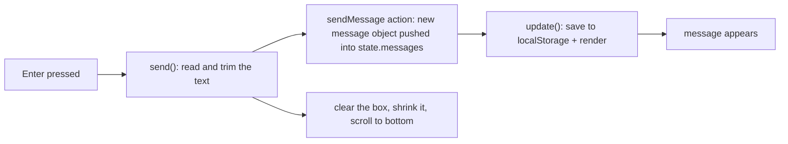

# Lesson 22 — The composer: sending messages

Time to talk back. In this lesson the message box at the bottom starts working: press <kbd>Enter</kbd> to send, <kbd>Shift</kbd>+<kbd>Enter</kbd> for a new line, and the box grows as you type. Your messages are saved in the browser like everything else in `state`.

## 🎯 Goal

You can type a message, press <kbd>Enter</kbd>, and see it appear at the bottom of the channel, stamped "Today at ...", with your name and avatar. Reload the page and it's still there. The box grows with multi-line text (up to half the window height), and formatting like `**bold**` works in your own messages.

{.screenshot}

## 🧠 New concepts

<ConceptList />

### Forms, `submit` and `preventDefault`

The message box sits inside a `<form>` element (it's already in your `index.html`). Forms have a built-in behaviour: when they are **submitted**, the browser sends the form's data to a server and **loads a new page**. For a single-page app, that is the opposite of what you want: the whole app would reload and everything on screen would be lost.

Many browser events have such a built-in **default action**. You can cancel it by calling `event.preventDefault()` inside your handler:

```js
form.addEventListener('submit', (event) => {
  event.preventDefault();   // stop the page from reloading
  // ...do my own thing instead
});
```

`submit` is the event a form fires when it's submitted (for example when someone presses <kbd>Enter</kbd> in a one-line text field or clicks a submit button).

::: info Does this form actually fire `submit`?
In *this* form, probably not: a `<textarea>` inserts a new line when you press <kbd>Enter</kbd> instead of submitting, and the buttons in the message box are `type="button"`, which never submit. So the `submit` handler is a safety net: if you ever add a submit button, the page won't reload. The `keydown` handler below does the real work.
:::

### Reading the keyboard: `keydown`, `key` and `shiftKey`

You've used `keydown` before, for <kbd>Escape</kbd> to close the drawer. The event object tells you which key:

- `event.key` is the key's name: `'Enter'`, `'Escape'`, `'a'`.
- `event.shiftKey` is `true` if <kbd>Shift</kbd> was held down (`ctrlKey`, `altKey` and `metaKey` exist too).

So "Enter without Shift" is:

```js
if (event.key === 'Enter' && !event.shiftKey) {
  event.preventDefault();   // don't insert a line break
  send();
}
```

Here `preventDefault` cancels a *different* default action: the new line the textarea would insert. With <kbd>Shift</kbd> held, the check is false, so the textarea does its normal thing and adds a line.

### `.value` and `.trim()`

For `<textarea>` and `<input>` elements, `element.value` is what's currently typed, and you can set it too: `composerInput.value = ''` clears the box.

`text.trim()` returns the text without spaces and line breaks at both ends. It's Python's `.strip()`. Use it so that a message made only of spaces counts as empty.

### Unique ids and the time: `crypto.randomUUID()` and `toISOString()`

Every message needs an `id` no other message has. `crypto.randomUUID()` makes a random one that looks like `"3b241101-e2bb-4255-8caf-4136c566a962"`. The chance of two being the same is, for all practical purposes, zero. (Python: `uuid.uuid4()`.)

`new Date().toISOString()` gives the current moment as the same kind of text as the data in `messages.json` (`"2026-10-13T10:15:00.000Z"`). It's always in UTC, with a `Z` at the end, so your new message looks just like the old ones, and the `formatTimestamp` function from Lesson 20 can read it.

::: warning `crypto.randomUUID()` needs a secure context
Browsers only offer it on pages served over `https://` or from the local machine (`http://127.0.0.1` or `http://localhost`, which is what Live Server uses). If you ever open the page from another computer on your network through a plain `http://` address, it won't exist.
:::

### Auto-growing a textarea

A `<textarea>` doesn't grow by itself. The trick:

1. set its `style.height` to `'auto'` (so it can shrink to fit its content),
2. read `scrollHeight` (the full height of the content, from Lesson 20),
3. set `style.height` to that many pixels.

```js
function autoResize(textarea) {
  textarea.style.height = 'auto';
  textarea.style.height = `${textarea.scrollHeight}px`;
}
```

Step 1 matters: `scrollHeight` is never smaller than the box's current height, so without resetting it first the box could grow but never shrink.

The CSS `max-height: 50vh` caps the growth at half the height of the window (`vh` = 1% of the window height). Beyond that, the textarea scrolls instead.

### The path of a message



You don't need any extra code to **save** the message: `update()` already saves `state.messages`. That's the payoff of the structure from Lessons 16 and 17: every change goes through an action, and every action calls `update()`.

## 🛠️ Build it

### Step 1 — The `sendMessage` action

In `vanilla/js/actions.js`, add an exported function at the bottom, `sendMessage(channelId, authorId, content)`:

1. Build the message object with the same fields as the ones in `messages.json`: `id` (from `crypto.randomUUID()`), `authorId`, `content`, `timestamp` (from `new Date().toISOString()`) and an empty `reactions` array.
2. If this channel has no list of messages yet, create an empty one.
3. `push` the message onto the list.
4. Call `update()`, and return the message (later lessons use the return value).

::: solution
```js [vanilla/js/actions.js]
// ---------- Messages ----------

export function sendMessage(channelId, authorId, content) {
  const message = {
    id: crypto.randomUUID(),
    authorId: authorId,
    content: content,
    timestamp: new Date().toISOString(),
    reactions: [],
  };
  if (!state.messages[channelId]) {
    state.messages[channelId] = [];
  }
  state.messages[channelId].push(message);
  update();
  return message;
}
```
:::

### Step 2 — Export `autoResize` from `chat.js`

In `vanilla/js/chat.js`, add the `autoResize` function (exported) right above `renderChat`. It's in `chat.js` because it relates to the chat area, and `composer.js` imports it from there. `scrollToBottom` is already exported from Lesson 20.

::: solution
```js [vanilla/js/chat.js]
// Makes a <textarea> exactly as tall as its text.
export function autoResize(textarea) {
  textarea.style.height = 'auto';
  textarea.style.height = `${textarea.scrollHeight}px`;
}
```
:::

### Step 3 — `composer.js`

Create `vanilla/js/composer.js`. Two functions:

**`send()`** (private): read `composerInput.value.trim()`. If it's empty, `return` early: nothing to send. Otherwise call `sendMessage` with the active channel's id and the current user's id, clear the box, shrink it back with `autoResize`, and `scrollToBottom()` so you see your message even if you'd scrolled up. (Setting `.value` from code does **not** fire an `input` event, which is why `send` calls `autoResize` itself.)

**`setupComposer()`** (exported): attach three listeners:

- `submit` on the form → `preventDefault()` and `send()`.
- `keydown` on the textarea → <kbd>Enter</kbd> without <kbd>Shift</kbd>: `preventDefault()` and `send()`.
- `input` on the textarea → `autoResize` (fires whenever the text changes by typing or pasting).

::: solution
```js [vanilla/js/composer.js]
// The message box at the bottom: Enter sends, Shift+Enter adds a new line.

import { getActiveChannel, CURRENT_USER_ID } from './state.js';
import { sendMessage } from './actions.js';
import { autoResize, scrollToBottom } from './chat.js';

const composer = document.querySelector('#composer');
const composerInput = document.querySelector('#composer-input');

function send() {
  const text = composerInput.value.trim();
  if (text === '') {
    return; // don't send empty messages
  }
  sendMessage(getActiveChannel().id, CURRENT_USER_ID, text);
  composerInput.value = '';
  autoResize(composerInput);
  scrollToBottom();
}

export function setupComposer() {
  composer.addEventListener('submit', (event) => {
    event.preventDefault(); // stop the browser from reloading the page
    send();
  });

  composerInput.addEventListener('keydown', (event) => {
    if (event.key === 'Enter' && !event.shiftKey) {
      event.preventDefault(); // don't add a new line
      send();
    }
  });

  composerInput.addEventListener('input', () => autoResize(composerInput));
}
```
:::

### Step 4 — Start it from `main.js`

In `vanilla/js/main.js`, import `setupComposer` from `./composer.js` (put the line after the `chat.js` import) and call `setupComposer();` inside `start()`, after `setupChannels();`.

::: solution
```js [vanilla/js/main.js]
import { renderChat } from './chat.js';
import { setupComposer } from './composer.js';
import { renderMembers } from './members.js';
```

```js [vanilla/js/main.js]
  setupLayout();
  setupServers();
  setupChannels();
  setupComposer();

  onChange(render);
  render();
```
:::

### Step 5 — Limit the height in CSS

In `vanilla/css/chat.css`, add `max-height: 50vh;` to the `.composer-input` rule, right after `min-height: 44px;`.

::: solution
```css [vanilla/css/chat.css]
.composer-input {
  flex: 1;
  min-height: 44px;
  max-height: 50vh;
  padding: 11px 8px;
  resize: none;
}
```
:::

### Step 6 — Send something

Reload and try each of these:

1. Type `Hello!` and press <kbd>Enter</kbd>. It appears at the bottom as *you*, "Today at ...", and the box empties.
2. Type a line, press <kbd>Shift</kbd>+<kbd>Enter</kbd>, type another. The box grows to two lines. Press <kbd>Enter</kbd>: one message with a line break.
3. Press <kbd>Enter</kbd> on an empty box, or after typing only spaces: nothing is sent.
4. Send a second message right away: it's grouped under the first (same author, under 7 minutes), exactly as in Lesson 20.
5. Send a message containing `**bold**` and another word wrapped in single backticks: the bold and code formatting from Lesson 21 both work.
6. Send `<b>not bold</b>`. It must appear as the literal text `<b>not bold</b>`. This is Lesson 21's escaping at work.
7. Reload the page. Your messages are still there.
8. Switch to another channel and send something. It stays in that channel.
9. In DevTools → **Console**, run `crypto.randomUUID()` and `new Date().toISOString()` to see what `sendMessage` produces.

<!-- no-solution: testing, nothing to type -->

## ✅ Checkpoint

- [ ] <kbd>Enter</kbd> sends; <kbd>Shift</kbd>+<kbd>Enter</kbd> adds a new line; an empty or spaces-only message is not sent.
- [ ] The box grows with several lines and shrinks again after sending.
- [ ] Sent messages appear at the bottom, scrolled into view, saying "Today at ...".
- [ ] `<b>not bold</b>` shows as plain text, not as bold.
- [ ] After a reload, sent messages are still there (DevTools → Application → Local Storage → `chat-clone-state-v1` contains them).
- [ ] The page does not reload when you press <kbd>Enter</kbd> (a reload would clear the box and flash the page).
- [ ] No errors in the Console.

## 🐛 Common mistakes

**The page flashes and your text disappears when you press Enter.** The page reloaded. A form submitted without `preventDefault()`. Make sure both the `submit` and the `keydown` handlers call it.

**Enter adds a blank line AND sends.** In the `keydown` handler you forgot `event.preventDefault()`, so the textarea still inserted its line break.

**Shift+Enter sends the message instead of adding a line.** The condition is missing `&& !event.shiftKey`, or it's written `event.shiftKey` without the `!`.

**Nothing happens, and the Console says `setupComposer is not a function` or `... is not exported`.** The function isn't exported from `composer.js`, or the import in `main.js` has a typo. The error message names the file and the name.

**The box grows when you type but never shrinks after sending.** `send()` clears the value but doesn't call `autoResize`. Setting `value` from code doesn't fire the `input` event.

**The message is added, but you have to scroll to see it.** `scrollToBottom` isn't called, or it was called before the message was drawn. `sendMessage` renders (through `update()`) before returning, so call it after.

**`crypto.randomUUID is not a function`.** The page was opened through a plain `http://` address that isn't `127.0.0.1` or `localhost`. Use Live Server's address.

## 📝 Quiz

::: quiz
What does this handler do when you press <kbd>Shift</kbd>+<kbd>Enter</kbd> in the textarea?

```js
composerInput.addEventListener('keydown', (event) => {
  if (event.key === 'Enter' && !event.shiftKey) {
    event.preventDefault();
    send();
  }
});
```

- [ ] Sends the message
- [x] Nothing from this handler: the textarea adds a new line as usual
- [ ] Sends the message and adds a new line
- [ ] Throws an error

> With Shift held, `!event.shiftKey` is `false`, so the `if` body is skipped. `preventDefault` isn't called either, so the browser's default action (a new line) happens.
:::

::: quiz
A user types three spaces and presses Enter. The code is:

```js
const text = composerInput.value.trim();
if (text === '') {
  return;
}
```

What happens?

- [ ] An empty message is sent
- [x] Nothing is sent: `trim()` removes the spaces, leaving `''`
- [ ] A message of three spaces is sent
- [ ] An error is thrown

> `trim()` strips whitespace from both ends. Three spaces become an empty string, so the early `return` runs.
:::

::: quiz
Why does `autoResize` set `style.height = 'auto'` before reading `scrollHeight`?

- [ ] Because `scrollHeight` can't be read otherwise
- [ ] To make the textarea invisible while it resizes
- [x] So the box can shrink: `scrollHeight` is never smaller than the current height, so without the reset the box could only grow
- [ ] Because pixels don't work as a height

> Resetting to `auto` lets the browser compute the height the content actually needs. Then you read that value and set it explicitly.
:::

## 💾 Commit

```sh
git add .
git commit -m "Add the composer: send messages with Enter and auto-growing textarea"
git push
```
