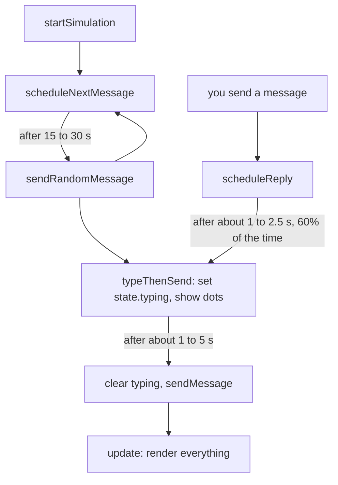

# Lesson 28 — Timers: typing indicator & fake messages

Right now the app is silent until you do something. In this lesson you make it feel alive: every 15–30 seconds somebody "types" and then posts a message, other channels and servers collect unread badges, and when you send a message someone sometimes answers. All of it is **fake**: timers and random numbers, no network and no real people.

## 🎯 Goal

A line under the composer reads "● ● ● **Leo** is typing…" with three dots that pulse one after another. A moment later Leo's message appears (or, if you're looking at another channel, a bold channel name and a badge appear). After you send a message, someone replies about 60% of the time.

{.screenshot}

## 🧠 New concepts

<ConceptList />

### Timers: `setTimeout`

`setTimeout(function, milliseconds)` asks the browser: "run this function once, at least this many milliseconds from now". It returns immediately:

```js
console.log('one');
setTimeout(() => console.log('three'), 2000);
console.log('two');
// prints: one, two, and two seconds later: three
```

This is the big difference from Python's `time.sleep(2)`. `sleep` **blocks**: nothing else in your program runs while it waits. In a browser, blocking would freeze the whole page (no clicks, no scrolling), so JavaScript never waits. Instead you hand the browser a function and a delay and carry on; the browser calls your function later, when the program has nothing else to do. 1000 ms is one second. The delay is a minimum, not a promise: if the page is busy, or the tab is in the background (browsers may slow timers there), it can fire later. See [`setTimeout` on MDN](https://developer.mozilla.org/en-US/docs/Web/API/Window/setTimeout).

```text
time ─────────────────────────────────────────────▶
 your code:   ████ setTimeout(f, 2000) ████ (page stays responsive)
 browser:                                         ... 2000 ms ...▶ calls f()
```

### Scheduling the next run from inside

To do something *repeatedly* at random intervals, a function can schedule **itself** again when it runs:

```js
function scheduleNext() {
  setTimeout(() => {
    console.log('tick');
    scheduleNext(); // book the next one
  }, 15000);
}
```

Each run books the next. (A function calling itself is called **recursion**; here it isn't a problem because each call returns immediately and the *timer* makes the next call later.) The alternative, `setInterval`, repeats at a fixed interval; Lesson 29 uses it. We prefer `setTimeout` here because we want a different random delay every time.

### Randomness: `Math.random()` and `Math.floor()`

- `Math.random()` returns a decimal number from 0 up to (but not including) 1. Like Python's `random.random()`.
- `Math.floor(x)` rounds **down** to a whole number: `Math.floor(2.9)` is `2`.

Two tiny helper recipes come from these:

| Want | Code | Why it works |
| --- | --- | --- |
| a random item from an array | `items[Math.floor(Math.random() * items.length)]` | with 5 items, `random() * 5` is 0–4.999…; `floor` gives 0–4, a valid index |
| a random number between `min` and `max` | `min + Math.random() * (max - min)` | scales 0–1 to the width of the range and shifts it up |
| something happening "40% of the time" | `Math.random() < 0.4` | 40% of the numbers 0–1 are below 0.4 |

(Python has `random.choice(items)` and `random.uniform(a, b)` built in; JavaScript makes you write these.)

### CSS animations: `@keyframes`

A CSS **animation** changes properties over time without any JavaScript. You describe the frames in an `@keyframes` block, then attach it to an element with the `animation` property:

```css
@keyframes pulse {
  0%   { opacity: 0.3; }
  50%  { opacity: 1; }
  100% { opacity: 0.3; }
}

.dot {
  animation: pulse 1.2s infinite ease-in-out;
}
```

`animation: pulse 1.2s infinite ease-in-out` reads: use the keyframes named `pulse`, take 1.2 seconds per cycle, repeat forever, with a smooth start and end. Percentages are positions within one cycle. (A transition from Lesson 8 goes from A to B when something *changes*; an animation runs by itself.)

To make three dots pulse one after another, give them all the same animation but start each a little later with `animation-delay`. The pseudo-class `:nth-child(2)` matches an element that is the 2nd child of its parent, so `.typing-dots span:nth-child(2)` is the middle dot, and `:nth-child(3)` the last. See [`@keyframes`](https://developer.mozilla.org/en-US/docs/Web/CSS/Reference/At-rules/@keyframes) and [`animation`](https://developer.mozilla.org/en-US/docs/Web/CSS/Reference/Properties/animation).

### `aria-live`: telling screen readers about changes

Screen-reader users don't see "Leo is typing…" appear. An element with `aria-live="polite"` is a **live region**: when its content changes, assistive technology announces the change when the user is idle (`polite`), without moving their focus. See [`aria-live` on MDN](https://developer.mozilla.org/en-US/docs/Web/Accessibility/ARIA/Reference/Attributes/aria-live). The region element should exist on the page *before* its text changes, which is why the `<p>` is in the HTML from the start and JavaScript only fills it.

### The plan



## 🛠️ Build it

Files you'll touch: `data/chatter.json` (new), `css/chat.css`, `index.html`, `js/data.js`, `js/state.js`, `js/actions.js`, `js/simulation.js` (new), `js/composer.js`, `js/main.js`.

### Step 1 — The fake lines (`data/chatter.json`)

Create `vanilla/data/chatter.json`. It holds three lists: ordinary `lines`, `mentionLines` containing the placeholder `{me}` (replaced by your name in code) and `replies` for answering you. It's data, not logic, so paste it.

::: starter
<<< @/../solutions/lesson-28/vanilla/data/chatter.json [vanilla/data/chatter.json]
:::

<!-- no-solution: pasting data, nothing to type -->

### Step 2 — Load it and keep it in state

In `vanilla/js/data.js` add `loadJson('data/chatter.json')` as a fifth download (and `chatter` in the destructuring and in the returned object; update the comment to "five").

In `vanilla/js/state.js`, in the `// Temporary — not saved` group add two fields: `chatter: null` (the lines, loaded from JSON) and, at the end, `typing: null`, which will hold `{ channelId, userId }` while someone is "typing".

Also add a small helper after `getRoleColor` and before the `// ---------- Unread and mentions ----------` heading: `findServerOfChannel(channelId)` returns the server that contains a given channel, using `some()` (Lesson 19).

In `vanilla/js/main.js`, in `start()` after `state.emojiCategories = ...`, add `state.chatter = data.chatter;`.

::: solution
```js [vanilla/js/data.js]
export async function loadData() {
  // Start all five downloads at once and wait until every one has finished.
  const [users, servers, messages, emojiCategories, chatter] = await Promise.all([
    loadJson('data/users.json'),
    loadJson('data/servers.json'),
    loadJson('data/messages.json'),
    loadJson('data/emoji.json'),
    loadJson('data/chatter.json'),
  ]);
  return { users, servers, messages, emojiCategories, chatter };
}
```

```js [vanilla/js/state.js]
  // Temporary — not saved
  emojiCategories: [],
  chatter: null, // fake lines for the simulation
  showMembers: true,
  editingMessageId: null, // the message you're editing, if any
  editDraft: '', // what's in the edit box right now
  typing: null, // { channelId, userId } while someone is "typing"
};

// ...after getRoleColor:

export function findServerOfChannel(channelId) {
  return state.servers.find((server) => getChannels(server).some((c) => c.id === channelId));
}
```

```js [vanilla/js/main.js]
  const data = await loadData();
  state.emojiCategories = data.emojiCategories;
  state.chatter = data.chatter;
```
:::

### Step 3 — The typing-indicator element (`index.html`)

In `vanilla/index.html`, inside the chat section, directly after the closing `</form>` of the composer, add the empty live region.

::: solution
```html [vanilla/index.html]
            </form>
            <!-- aria-live: screen readers announce changes to this text -->
            <p class="typing-indicator" id="typing-indicator" aria-live="polite"></p>
          </section>
```
:::

### Step 4 — Style the indicator and animate the dots (`chat.css`)

Open `vanilla/css/chat.css`.

1. In the `.composer` rule change `margin: 0 16px 24px;` to `margin: 0 16px; /* the typing indicator below it adds the space at the bottom */`. The 24 px of space below the composer is now provided by the 24 px tall indicator line, which exists even when empty.
2. At the end of the file, add the typing section. Type the animation part yourself: it is the new idea. The `@keyframes typing-blink` lists the same frame for 0%, 60% and 100% (a comma-separated list of percentages shares one block), and a bright, slightly raised frame at 30%. Each dot runs the animation with a different `animation-delay`, so they take turns.

The very last rule, `.avatar-button`, repeats a rule that already exists higher up in the file. It changes nothing, so you may leave it out; the reference solution has it.

::: solution
```css [vanilla/css/chat.css]
.composer {
  display: flex;
  align-items: flex-start;
  gap: 4px;
  margin: 0 16px; /* the typing indicator below it adds the space at the bottom */
  padding: 0 8px;
  border-radius: var(--radius);
  background-color: var(--bg-input);
}
```

```css [vanilla/css/chat.css]
/* ---------- Typing indicator ---------- */

.typing-indicator {
  display: flex;
  align-items: center;
  gap: 6px;
  height: 24px;
  padding: 0 16px;
  color: var(--text-normal);
  font-size: 14px;
}

.typing-indicator strong {
  font-weight: 700;
}

.typing-dots {
  display: flex;
  gap: 3px;
}

.typing-dots span {
  width: 6px;
  height: 6px;
  border-radius: 50%;
  background-color: var(--text-normal);
  animation: typing-blink 1.2s infinite ease-in-out;
}

.typing-dots span:nth-child(2) {
  animation-delay: 0.2s;
}

.typing-dots span:nth-child(3) {
  animation-delay: 0.4s;
}

@keyframes typing-blink {
  0%,
  60%,
  100% {
    opacity: 0.3;
    transform: translateY(0);
  }
  30% {
    opacity: 1;
    transform: translateY(-2px);
  }
}

.avatar-button {
  margin-top: 2px;
  border-radius: 50%;
}
```
:::

### Step 5 — Unread badges for incoming messages (`actions.js`)

In `vanilla/js/actions.js`:

1. Add `mentionsMe` to the import from `./state.js`.
2. After `markRead` (before the `// ---------- Messages ----------` heading), add `isViewing(channelId)`: is this the channel on screen?
3. In `sendMessage`, after the message is pushed into the array and before `update()`, add the "someone else's message in a channel you're not viewing" rule: mark the channel unread and, if it mentions you, count a mention. These are the badges you built in Lesson 19.

::: solution
```js [vanilla/js/actions.js]
import { state, update, clearSaved, getActiveChannel, getChannels, findChannel, findMessage, mentionsMe, CURRENT_USER_ID } from './state.js';

// ...after markRead:

// True if this channel is the one on screen right now.
export function isViewing(channelId) {
  return getActiveChannel().id === channelId;
}

// ...inside sendMessage, after state.messages[channelId].push(message);

  // A message from someone else in a channel you're not looking at
  if (authorId !== CURRENT_USER_ID && !isViewing(channelId)) {
    const channel = findChannel(channelId);
    channel.unread = true;
    if (mentionsMe(content)) {
      channel.mentions += 1;
    }
  }
  update();
  return message;
```
:::

### Step 6 — Write `js/simulation.js`, part 1: helpers and the indicator

Create `vanilla/js/simulation.js`. Start with the header comment, imports, the lookup of `#typing-indicator`, and these functions:

- `randomItem(items)` and `randomBetween(min, max)`: the recipes from *New concepts*.
- `renderTyping()`: clears the line, and unless someone is typing **in the channel you're viewing**, stops. Otherwise it builds three empty `span`s inside `.typing-dots`, a bold name and the words " is typing…". `typing === null ||` comes first so that we never read `.channelId` of `null`.
- `possibleAuthors(server)`: the members of a server who could post: not you, not offline, not bots. Uses the `map` and `filter` you know.

::: solution
```js [vanilla/js/simulation.js]
// Fake activity, so the app feels alive: people "type", then messages arrive.
// Everything here is made up with timers and random numbers — there is no network.

import { state, getActiveServer, getActiveChannel, getChannels, getUser, getCurrentUser, findServerOfChannel, CURRENT_USER_ID } from './state.js';
import { sendMessage } from './actions.js';
import { el } from './dom.js';

const typingIndicator = document.querySelector('#typing-indicator');

function randomItem(items) {
  return items[Math.floor(Math.random() * items.length)];
}

function randomBetween(min, max) {
  return min + Math.random() * (max - min);
}

// Shows "Ava is typing…" under the composer if they're typing in this channel.
export function renderTyping() {
  typingIndicator.replaceChildren();
  const typing = state.typing;
  if (typing === null || typing.channelId !== getActiveChannel().id) {
    return;
  }
  const dots = el('span', 'typing-dots');
  dots.append(el('span'), el('span'), el('span'));
  typingIndicator.append(dots, el('strong', '', getUser(typing.userId).displayName), ' is typing…');
}

// Online members of a server who could "write" something (not you, not bots).
function possibleAuthors(server) {
  return server.members
    .map((member) => getUser(member.userId))
    .filter((user) => user.id !== CURRENT_USER_ID && user.status !== 'offline' && !user.bot);
}
```
:::

### Step 7 — `simulation.js`, part 2: typing, then sending

Add `typeThenSend`, `pickLine`, `sendRandomMessage` below.

`typeThenSend(channelId, userId, text)` is the heart of the lesson:

1. Set `state.typing` and call `renderTyping()` so the dots appear **now**.
2. Compute how long they "type": 1000 ms plus 50 ms per character, but at most 5000. A 7-character reply takes 1350 ms; a 100-character line is capped at 5000.
3. `setTimeout(...)` clears `state.typing` and calls `sendMessage`. `sendMessage` calls `update()`, which re-renders everything, including `renderTyping()` (which now finds `typing === null` and empties the line).

`pickLine()`: 20% of the time use a mention line, replacing `{me}` with your display name; otherwise a plain line.

`sendRandomMessage()`: 70% of the time pick the server you're viewing, otherwise any server (that's what makes badges appear elsewhere). Pick a random text channel and author. It gives up quietly if somebody is already typing (`state.typing !== null`) or there's nobody to post.

::: solution
```js [vanilla/js/simulation.js]
// Someone types for a moment (longer text = longer typing), then the message appears.
function typeThenSend(channelId, userId, text) {
  state.typing = { channelId: channelId, userId: userId };
  renderTyping();
  const typingTime = Math.min(1000 + text.length * 50, 5000);
  setTimeout(() => {
    state.typing = null;
    sendMessage(channelId, userId, text); // sendMessage re-renders, which also clears the indicator
  }, typingTime);
}

function pickLine() {
  if (Math.random() < 0.2) {
    return randomItem(state.chatter.mentionLines).replace('{me}', getCurrentUser().displayName);
  }
  return randomItem(state.chatter.lines);
}

function sendRandomMessage() {
  // Usually the server you're looking at, sometimes another one (so badges appear).
  const server = Math.random() < 0.7 ? getActiveServer() : randomItem(state.servers);
  const textChannels = getChannels(server).filter((c) => c.type === 'text');
  const authors = possibleAuthors(server);
  if (state.typing !== null || textChannels.length === 0 || authors.length === 0) {
    return;
  }
  typeThenSend(randomItem(textChannels).id, randomItem(authors).id, pickLine());
}
```
:::

### Step 8 — `simulation.js`, part 3: scheduling

Finish the file with the timers:

- `scheduleNextMessage()`: a `setTimeout` whose callback sends a random message and then **schedules itself again**, with a fresh random delay between 15 and 30 seconds.
- `scheduleReply(channelId)`: called after *you* send. It finds the server that owns the channel, and returns without doing anything if nobody can reply or `Math.random() < 0.4` (a 40% chance of staying quiet). Otherwise it waits 0.8–2.5 s, and if nobody is typing yet, starts a reply.
- `startSimulation()`: kicks the first timer off. `main.js` calls it once.

::: solution
```js [vanilla/js/simulation.js]
function scheduleNextMessage() {
  setTimeout(() => {
    sendRandomMessage();
    scheduleNextMessage();
  }, randomBetween(15000, 30000));
}

// After you send a message, someone sometimes answers.
export function scheduleReply(channelId) {
  const authors = possibleAuthors(findServerOfChannel(channelId));
  if (authors.length === 0 || Math.random() < 0.4) {
    return;
  }
  setTimeout(() => {
    if (state.typing === null) {
      typeThenSend(channelId, randomItem(authors).id, randomItem(state.chatter.replies));
    }
  }, randomBetween(800, 2500));
}

export function startSimulation() {
  scheduleNextMessage();
}
```
:::

### Step 9 — Hook it up (`composer.js`, `main.js`)

In `vanilla/js/composer.js`: import `scheduleReply` from `./simulation.js`. In `send()`, store the active channel in a constant first (so the reply goes to the channel you *sent* in, even if you switch away within a second), use it in `sendMessage`, and call `scheduleReply(channel.id)` as the last line.

In `vanilla/js/main.js`: import `renderTyping, startSimulation` from `./simulation.js`; call `renderTyping();` in `render()` after `renderUserPanel();` (before `hideTooltip();`); and call `startSimulation();` as the very last line of `start()`, after `render();`.

::: solution
```js [vanilla/js/composer.js]
import { openEmojiPicker } from './reactions.js';
import { scheduleReply } from './simulation.js';

// ...

function send() {
  const text = composerInput.value.trim();
  if (text === '') {
    return; // don't send empty messages
  }
  const channel = getActiveChannel();
  sendMessage(channel.id, CURRENT_USER_ID, text);
  composerInput.value = '';
  autoResize(composerInput);
  scrollToBottom();
  scheduleReply(channel.id);
}
```

```js [vanilla/js/main.js]
import { setupTooltips, hideTooltip } from './tooltips.js';
import { renderTyping, startSimulation } from './simulation.js';

// ...in render():
  renderUserPanel();
  renderTyping();
  hideTooltip();

// ...at the end of start():
  onChange(render);
  render();
  startSimulation();
```
:::

### Step 10 — Watch it work

Reload and wait: within about 30 seconds you should see the dots and a name, then a message. Send a message yourself: about 6 times in 10 someone replies. Switch to another channel and wait for a bold channel name and a badge to appear in the sidebar. To avoid waiting, open the Console and run `Math.random()` a few times to see the kind of numbers that drive everything.

<!-- no-solution: trying the feature out, nothing to type -->

## ✅ Checkpoint

- [ ] A line under the composer shows three pulsing dots, a bold name and "is typing…", then the message appears and the line empties.
- [ ] The dots take turns pulsing (not all at once).
- [ ] The line occupies space even when empty: the composer doesn't jump down when it appears.
- [ ] After a wait, messages appear in other channels or servers and bump the unread badges. Some mention you (highlighted in the message list).
- [ ] After you send a message, a reply appears within a few seconds most of the time.
- [ ] Switching channels while someone is typing hides the indicator in the new channel (it's only shown in the channel they're typing in).
- [ ] DevTools: Elements shows `<p id="typing-indicator" aria-live="polite">` and, while someone types, three `<span>` children in `.typing-dots`. In the Styles pane you can see `animation-delay` change for the 2nd and 3rd span.
- [ ] Network panel: no new requests appear while messages arrive. It's all local.

## 🐛 Common mistakes

**Messages never arrive.** `startSimulation()` isn't called (check the end of `start()`), or the first message simply hasn't come yet: the first delay is 15–30 seconds. A `console.log('sending')` at the top of `sendRandomMessage` shows when it fires.

**`TypeError: Cannot read properties of null (reading 'lines')`.** `state.chatter` is `null`: you forgot `state.chatter = data.chatter;` in `main.js`, or the `chatter.json` file wasn't added to `loadData()`.

**The function runs immediately instead of after the delay.** You wrote `setTimeout(sendRandomMessage(), 5000)`: calling the function right there. Pass a function: `setTimeout(sendRandomMessage, 5000)` or `setTimeout(() => ..., 5000)`.

**The delay is 1000 times too short.** `setTimeout` counts **milliseconds**, not seconds: 15000 is 15 s.

**All three dots blink in sync.** The `:nth-child(2)` and `:nth-child(3)` rules with `animation-delay` are missing or misspelled. The `animation` shorthand on the base rule must come *before* them so the delay isn't reset.

**"Leo is typing" stays forever.** Something threw an error inside the timer callback before `state.typing = null` ran. Check the Console. Note `sendMessage` is what clears the indicator via `update()`.

## 📝 Quiz

::: quiz
What does this print, and in what order?

```js
console.log('a');
setTimeout(() => console.log('b'), 0);
console.log('c');
```

- [ ] `a`, `b`, `c`
- [x] `a`, `c`, `b`
- [ ] `b`, `a`, `c`
- [ ] Nothing: a delay of 0 is ignored

> Even with 0 ms, the callback only runs after the current code has finished. JavaScript never blocks to wait for a timer (unlike Python's `time.sleep`).
:::

::: quiz
Which expression gives a random whole number from 0 to 9?

- [ ] `Math.random() * 10`
- [x] `Math.floor(Math.random() * 10)`
- [ ] `Math.floor(Math.random()) * 10`
- [ ] `Math.random(10)`

> `Math.random() * 10` is a decimal from 0 up to just under 10; `Math.floor` rounds it down to 0 to 9. Rounding *before* multiplying (third option) always gives 0.
:::

::: quiz
Why is the typing indicator `<p>` in the HTML from the start, with `aria-live="polite"`, instead of being created by JavaScript when someone types?

- [ ] Because `<p>` elements can't be created in JavaScript
- [x] Screen readers announce changes inside an existing live region; a region that appears together with its text may not be announced
- [ ] To make the animation run
- [ ] So the CSS can find it

> Assistive technology watches live regions that already exist. Adding the empty region first and changing its text later is the reliable pattern.
:::

## 💾 Commit

```sh
git add .
git commit -m "Add fake typing indicator and simulated chat activity"
git push
```
