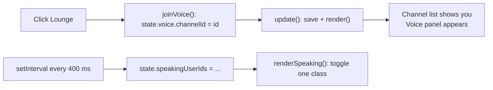

# Lesson 29 — Voice channel UI

Until now clicking a voice channel did nothing. In this lesson you can *join* one: you appear in its list, a green "Voice Connected" panel shows up, and mute and deafen buttons work. People in the channel light up with a green ring when they "speak".

::: danger Nothing here uses your microphone
This lesson is **only a user interface**. No audio is captured, recorded, played or sent anywhere. The app never asks for microphone permission. "Joining" a voice channel just changes some values in JavaScript, and the "speaking" rings are driven by random numbers. Everything is pretend, the same way the typing indicator in Lesson 28 was.
:::

## 🎯 Goal

You click **Lounge** under *Voice Channels*. You appear in its list with the others, the panel at the bottom left says **Voice Connected** with the channel and server name, and people's avatars flash a green ring now and then. The screenshot below shows this: Ava has her ring on at that moment, and the **Disconnect** button sits on the right of the green panel.

{.screenshot}

You'll also be able to mute and deafen yourself (the buttons turn red and show a slashed icon), leave with the disconnect button, and use **Join Voice** from the right-click menu on a voice channel.

## 🧠 New concepts

<ConceptList />

### Modelling UI state

In Lesson 16 you learned the loop: change `state`, then draw the screen from `state`. The hard part is deciding **what** to put in `state`. For voice we need three facts:

- Which voice channel am I in, if any? (`channelId`, or `null` for "none")
- Am I muted? (`muted`, `true` or `false`)
- Am I deafened? (`deafened`)

We keep these together in one object, `state.voice`:

```js
voice: { channelId: null, muted: false, deafened: false },
```

Notice what we do **not** store: a "voice panel is visible" flag. The panel is visible exactly when `channelId` is not `null`. If you store a fact twice, the two copies can disagree. Store each fact once and *derive* the rest when you draw.

The three facts also have rules between them. In Discord, deafening yourself (you can't hear anyone) also mutes you. Un-muting while deafened also un-deafens you. These rules live in the **action functions** (`toggleMute`, `toggleDeafen`), so the screen code never has to think about them.

::: tip Python comparison
A Python dataclass like `Voice(channel_id=None, muted=False, deafened=False)` is the same idea. A good design makes impossible combinations hard to build. Here "muted but not deafened" and "muted and deafened" are both fine, but "deafened but not muted" should never happen, and `toggleDeafen` guarantees that.
:::

### `setInterval`: run code again and again

In Lesson 28 you used `setTimeout` to run a function **once** after a delay. Its sibling `setInterval` runs a function **repeatedly**, every N milliseconds, until the page closes or you stop it:

```js
setInterval(() => {
  console.log('tick');
}, 1000); // prints "tick" every second
```

Like `setTimeout`, it doesn't block: the browser keeps doing everything else between ticks (unlike Python's `time.sleep` inside a `while` loop, which freezes the program). To stop an interval you save what `setInterval` returns and pass it to `clearInterval`. Our speaking simulation runs for as long as the page is open, so we never stop it. See [`setInterval` on MDN](https://developer.mozilla.org/en-US/docs/Web/API/Window/setInterval) and [`clearInterval`](https://developer.mozilla.org/en-US/docs/Web/API/Window/clearInterval).

### Targeted updates: why speaking doesn't call `render()`

Our `render()` rebuilds the whole channel list, the chat and the members from scratch. That's fine after a click. But "who is speaking" changes every 400 milliseconds, that is about 2 to 3 times a second. Rebuilding the page that often would be wasteful, and worse: it would destroy and re-create elements while you are trying to click or hover them. Tooltips and menus would flicker.

So speaking uses a **targeted update**: just find the elements that matter and flip one CSS class on them. Nothing is created or removed.

```text
Full render():     throw away the channel list, build it again   (expensive, resets hover)
Targeted update:   find .voice-user items, toggle "is-speaking"  (cheap, nothing is rebuilt)
```

Rule of thumb: **render for structure changes** (someone joined, a message arrived), **targeted update for tiny, frequent changes** (a class on an existing element).

### `querySelectorAll` and `classList.toggle`

You know `document.querySelector('.x')`, which returns the **first** matching element. `querySelectorAll('.x')` returns **all** of them, as a list you can loop over:

```js
for (const item of document.querySelectorAll('.voice-user')) {
  console.log(item.dataset.userId);
}
```

And `classList.toggle(name, force)` adds a class when `force` is `true` and removes it when `false`:

```js
item.classList.toggle('is-speaking', true);   // same as add
item.classList.toggle('is-speaking', false);  // same as remove
```

That second argument turns "if speaking, add; else remove" (four lines) into one. See [`querySelectorAll`](https://developer.mozilla.org/en-US/docs/Web/API/Document/querySelectorAll) and [`classList`](https://developer.mozilla.org/en-US/docs/Web/API/Element/classList) on MDN.

### A CSS variable that reaches inside `<use>`

The mic and headphone icons come from `icons.svg` through `<use href="…#mic-off">` (Lesson 06). The "slash" line in the crossed-out icons is drawn like this:

```text
<path d="M3 3l18 18" style="stroke: var(--icon-slash-color, currentColor)"/>
```

`var(--icon-slash-color, currentColor)` means "use the variable `--icon-slash-color`; if nobody set it, fall back to `currentColor`" (the text color). CSS custom properties **inherit**, even into the hidden copy of the SVG that `<use>` makes. So in our own CSS we write `--icon-slash-color: var(--red);` on `.icon`, and the slash turns red while the rest of the icon keeps its normal color. One variable lets us style a single part inside an SVG. See [custom properties on MDN](https://developer.mozilla.org/en-US/docs/Web/CSS/Using_CSS_custom_properties).

### Speaking rings with `box-shadow`

A `box-shadow` doesn't have to be a blurry shadow. With zero offset and zero blur it is a solid ring around the element, and you can stack several, separated by commas:

```css
box-shadow: 0 0 0 2px var(--bg-secondary), 0 0 0 4px var(--green);
```

Read each shadow as `x-offset y-offset blur spread color`. The first is a 2px ring in the background color (a small gap). The second is a 4px ring in green, drawn *behind* the first, so you see a green ring with a gap between it and the avatar. Rings don't take up layout space, so the list doesn't jump when they appear. See [`box-shadow` on MDN](https://developer.mozilla.org/en-US/docs/Web/CSS/box-shadow).



Two paths: clicks go through `update()` and a full render. The timer skips it and only touches classes.

## 🛠️ Build it

You'll work from your Lesson 28 code. Open `vanilla/` in VS Code. The data (users, servers, `voiceUserIds` on voice channels) already exists; you are adding the *you can join* part.

### Step 1 — Add voice state

In `vanilla/js/state.js`, find the `state` object and add two properties after `typing`:

- `voice`: the object with the three facts.
- `speakingUserIds`: a list of the ids of people who are speaking *right now*.

We don't add these to `save()`: refreshing the page disconnects you, like closing the real app does.

::: solution
```js [vanilla/js/state.js]
  typing: null, // { channelId, userId } while someone is "typing"
  voice: { channelId: null, muted: false, deafened: false },
  speakingUserIds: [],
};
```
:::

### Step 2 — Voice actions

In `vanilla/js/actions.js`:

1. Add `findServerOfChannel` to the import from `./state.js` (put it after `findMessage,`).
2. Change `selectChannel` so a voice channel calls `joinVoice` instead of doing nothing.
3. In `leaveServer`, if you are connected to a channel *in the server you're leaving*, disconnect first. Otherwise `state.voice.channelId` would point at a channel that no longer exists. Find the server with `find`, compare servers with `===`, and then filter by that server object.
4. Add a `// ---------- Voice ----------` section with four functions: `joinVoice`, `leaveVoice`, `toggleMute` and `toggleDeafen`. Put it just above the `// ---------- Demo data ----------` section.

Notice that `toggleMute` and `toggleDeafen` hold the rules from *New concepts*, and that `leaveVoice` also removes you from `speakingUserIds`, so your avatar can't stay lit after you leave.

::: solution
```js [vanilla/js/actions.js]
import { state, update, clearSaved, getActiveChannel, getChannels, findChannel, findMessage, findServerOfChannel, mentionsMe, CURRENT_USER_ID } from './state.js';
```

```js [vanilla/js/actions.js]
export function selectChannel(channelId) {
  const channel = findChannel(channelId);
  if (channel.type === 'voice') {
    joinVoice(channelId);
    return;
  }
  state.activeChannelByServer[state.activeServerId] = channelId;
  state.editingMessageId = null;
  /* ...rest unchanged... */
}
```

```js [vanilla/js/actions.js]
export function leaveServer(serverId) {
  if (state.servers.length === 1) {
    return; // keep at least one server on screen
  }
  const server = state.servers.find((s) => s.id === serverId);
  if (state.voice.channelId && findServerOfChannel(state.voice.channelId) === server) {
    leaveVoice();
  }
  state.servers = state.servers.filter((s) => s !== server);
  if (state.activeServerId === serverId) {
    state.activeServerId = state.servers[0].id;
  }
  update();
}

// ---------- Voice ----------

export function joinVoice(channelId) {
  state.voice.channelId = channelId;
  update();
}

export function leaveVoice() {
  state.voice.channelId = null;
  state.speakingUserIds = state.speakingUserIds.filter((id) => id !== CURRENT_USER_ID);
  update();
}

export function toggleMute() {
  state.voice.muted = !state.voice.muted;
  // Un-muting also un-deafens, like the real app.
  if (!state.voice.muted) {
    state.voice.deafened = false;
  }
  update();
}

export function toggleDeafen() {
  state.voice.deafened = !state.voice.deafened;
  // Deafening also mutes you: if you can't hear, you shouldn't talk.
  state.voice.muted = state.voice.deafened;
  update();
}
```
:::

Only change the lines shown in `selectChannel`; the rest of the function stays as it was.

### Step 3 — Show yourself in the voice channel

In `vanilla/js/channels.js`:

1. Import `CURRENT_USER_ID` from `./state.js` too.
2. Add `getVoiceUserIds(channel)`: it copies the channel's `voiceUserIds` with `[...channel.voiceUserIds]` (so we don't change the saved data) and adds you if you're in that channel.
3. In `createVoiceUser`, add the class `is-speaking` if the user is in `state.speakingUserIds`, and, for your own row only, append a `headphones-off` icon (deafened) or `mic-off` icon (muted).
4. In `createChannelItem`, use `getVoiceUserIds` to build the list.
5. In the code that decides whether a collapsed category still shows a channel, use `getVoiceUserIds(channel).length` for `isBusyVoice`, so the channel you're in never hides.

::: solution
```js [vanilla/js/channels.js]
import { state, getActiveServer, getActiveChannel, getUser, CURRENT_USER_ID } from './state.js';
```

```js [vanilla/js/channels.js]
// People connected to a voice channel (including you, if you joined it).
function getVoiceUserIds(channel) {
  const ids = [...channel.voiceUserIds];
  if (state.voice.channelId === channel.id) {
    ids.push(CURRENT_USER_ID);
  }
  return ids;
}

function createVoiceUser(userId) {
  const user = getUser(userId);
  const item = el('li', 'voice-user');
  item.dataset.userId = userId;
  if (state.speakingUserIds.includes(userId)) {
    item.classList.add('is-speaking');
  }
  const userAvatar = avatar(user);
  userAvatar.classList.add('tiny');
  item.append(userAvatar, el('span', 'voice-user-name', user.displayName));
  if (userId === CURRENT_USER_ID && state.voice.deafened) {
    item.append(icon('headphones-off'));
  } else if (userId === CURRENT_USER_ID && state.voice.muted) {
    item.append(icon('mic-off'));
  }
  return item;
}
```

```js [vanilla/js/channels.js]
function createChannelItem(channel, isSelected) {
  const item = el('li', 'channel-item');
  item.dataset.channelId = channel.id;
  if (isSelected) {
    item.classList.add('is-selected');
  }
  if (channel.unread) {
    item.classList.add('is-unread');
  }

  const button = el('button', 'channel-button');
  button.type = 'button';
  button.append(icon(channel.type === 'voice' ? 'speaker' : 'hash'), el('span', 'channel-name', channel.name));
  if (channel.mentions > 0) {
    button.append(el('span', 'channel-mention-badge', String(channel.mentions)));
  }
  item.append(button);

  if (channel.type === 'voice') {
    const voiceUserIds = getVoiceUserIds(channel);
    if (voiceUserIds.length > 0) {
      const list = el('ul', 'voice-users');
      for (const userId of voiceUserIds) {
        list.append(createVoiceUser(userId));
      }
      item.append(list);
    }
  }
  return item;
}
```

```js [vanilla/js/channels.js]
    const isBusyVoice = channel.type === 'voice' && getVoiceUserIds(channel).length > 0;
```
:::

The first snippet replaces your existing `createVoiceUser` function (add `getVoiceUserIds` just above it). In the second, only the last block changed: replace the `if (channel.type === 'voice' && …)` block at the end of `createChannelItem`. The last is one line inside the loop in `createCategory`.

### Step 4 — The voice panel in the HTML

In `vanilla/index.html`, find `<section class="user-panel" aria-label="Your account">`. Insert the voice panel **above** it (it's a sibling, at the same level). The `hidden` attribute keeps it invisible until JavaScript removes it.

Then add `aria-pressed="false"` to the mute and deafen buttons. `aria-pressed` tells screen readers a button is a toggle and whether it is currently on ([MDN](https://developer.mozilla.org/en-US/docs/Web/Accessibility/ARIA/Reference/Attributes/aria-pressed)). Our CSS will also use it to turn the button red.

::: solution
```html [vanilla/index.html]
          <!-- Shown while you're connected to a voice channel -->
        <section class="voice-panel" id="voice-panel" aria-label="Voice connection" hidden>
          <div class="voice-panel-info">
            <p class="voice-panel-status">
              <svg class="icon"><use href="assets/icons.svg#signal"></use></svg>
              Voice Connected
            </p>
            <p class="voice-panel-channel" id="voice-panel-channel"></p>
          </div>
          <button class="icon-button" type="button" id="disconnect-button" data-tooltip="Disconnect" aria-label="Disconnect">
            <svg class="icon"><use href="assets/icons.svg#disconnect"></use></svg>
          </button>
        </section>

        <section class="user-panel" aria-label="Your account">
```

```html [vanilla/index.html]
            <button class="icon-button" type="button" id="mute-button" data-tooltip="Mute" aria-label="Mute" aria-pressed="false">
              <svg class="icon"><use href="assets/icons.svg#mic"></use></svg>
            </button>
            <button class="icon-button" type="button" id="deafen-button" data-tooltip="Deafen" aria-label="Deafen" aria-pressed="false">
              <svg class="icon"><use href="assets/icons.svg#headphones"></use></svg>
            </button>
```
:::

The indentation of the new section is a little different from the lines around it in the reference solution. HTML doesn't care, so match your neighbours' indentation if you prefer.

### Step 5 — Draw the panel and the toggle buttons

Replace the whole of `vanilla/js/user-panel.js`. Key ideas:

- Look up each element **once** at the top of the file, not on every render.
- `setToggle` sets four things on a button together: `aria-pressed`, `aria-label`, the tooltip text and the icon (by changing the `href` on the `<use>`). A helper means mute and deafen can't drift apart.
- The icon and label depend on state: when muted the button shows `mic-off` and says **Unmute**.
- `voicePanel.hidden = channelId === null` shows the panel only when connected.
- The status line falls back to your username when you have no custom status (`||` means "the left side, or the right side if the left is empty").

::: solution
```js [vanilla/js/user-panel.js]
// The user panel (bottom left) and the "Voice Connected" panel above it.

import { state, getCurrentUser, findChannel, findServerOfChannel, CURRENT_USER_ID } from './state.js';
import { toggleMute, toggleDeafen } from './actions.js';
import { avatar } from './dom.js';
import { openProfile } from './modals.js';

const profileButton = document.querySelector('#user-panel-profile');
const nameElement = document.querySelector('#user-panel-name');
const tagElement = document.querySelector('#user-panel-tag');
const muteButton = document.querySelector('#mute-button');
const deafenButton = document.querySelector('#deafen-button');
const voicePanel = document.querySelector('#voice-panel');
const voicePanelChannel = document.querySelector('#voice-panel-channel');

function setToggle(button, pressed, iconName, label) {
  button.setAttribute('aria-pressed', String(pressed));
  button.setAttribute('aria-label', label);
  button.dataset.tooltip = label;
  button.querySelector('use').setAttribute('href', `assets/icons.svg#${iconName}`);
}

export function renderUserPanel() {
  const me = getCurrentUser();
  const userAvatar = avatar(me, true);
  userAvatar.id = 'user-panel-avatar';
  document.querySelector('#user-panel-avatar').replaceWith(userAvatar);
  nameElement.textContent = me.displayName;
  tagElement.textContent = me.customStatus || me.username;

  const muted = state.voice.muted;
  const deafened = state.voice.deafened;
  const channelId = state.voice.channelId;
  setToggle(muteButton, muted, muted ? 'mic-off' : 'mic', muted ? 'Unmute' : 'Mute');
  setToggle(deafenButton, deafened, deafened ? 'headphones-off' : 'headphones', deafened ? 'Undeafen' : 'Deafen');

  voicePanel.hidden = channelId === null;
  if (channelId !== null) {
    const channel = findChannel(channelId);
    const server = findServerOfChannel(channelId);
    voicePanelChannel.textContent = `${channel.name} / ${server.name}`;
  }
}

export function setupUserPanel() {
  profileButton.addEventListener('click', () => openProfile(CURRENT_USER_ID));
  muteButton.addEventListener('click', toggleMute);
  deafenButton.addEventListener('click', toggleDeafen);
}
```
:::

`String(pressed)` turns `true` into the text `"true"`: HTML attributes are always text.

### Step 6 — "Join Voice" in the channel menu

In `vanilla/js/menus.js`, add `selectChannel` to the import from `./actions.js` (after `startEditing,`). Then change `channelMenu` so voice channels offer **Join Voice** and text channels offer **Mark As Read**.

::: solution
```js [vanilla/js/menus.js]
import { markServerRead, markRead, leaveServer, startEditing, selectChannel, resetDemoData } from './actions.js';
```

```js [vanilla/js/menus.js]
function channelMenu(channelId) {
  const channel = findChannel(channelId);
  const items = [];
  if (channel.type === 'voice') {
    items.push({ label: 'Join Voice', icon: 'speaker', run: () => selectChannel(channelId) });
  } else {
    items.push({ label: 'Mark As Read', icon: 'check', run: () => markRead(channelId) });
  }
  items.push({ label: 'Copy Channel Name', icon: 'copy', run: () => copyText(channel.name) });
  return items;
}
```
:::

### Step 7 — The pretend speaking simulation

Create `vanilla/js/voice.js`. It has four parts:

- `renderSpeaking()`: the targeted update. It loops over every `.voice-user` and toggles `is-speaking` depending on whether that row's `data-user-id` is in `state.speakingUserIds`. It also toggles the class on your profile button.
- `peopleInVoice()`: collects everyone sitting in any voice channel.
- `startSpeakingSimulation()`: every 400 ms, goes through those people and decides, with `Math.random()`, who is speaking. Someone who was already speaking keeps going with 75% chance; someone quiet starts with 25% chance. That makes rings that stay on for a moment, which looks more natural than coin flips.
- `setupVoice()`: wires the Disconnect button to `leaveVoice`.

Remember: **no audio is involved**. Only `Math.random()` decides who "speaks".

::: solution
```js [vanilla/js/voice.js]
// Voice: who is speaking right now. Speaking changes many times per second,
// so instead of re-rendering everything we only flip one class on the right elements.

import { state, getChannels, CURRENT_USER_ID } from './state.js';
import { leaveVoice } from './actions.js';

const profileButton = document.querySelector('#user-panel-profile');
const disconnectButton = document.querySelector('#disconnect-button');

export function renderSpeaking() {
  for (const item of document.querySelectorAll('.voice-user')) {
    item.classList.toggle('is-speaking', state.speakingUserIds.includes(item.dataset.userId));
  }
  profileButton.classList.toggle('is-speaking', state.speakingUserIds.includes(CURRENT_USER_ID));
}

// Everyone (except you) who is sitting in a voice channel somewhere.
function peopleInVoice() {
  const ids = [];
  for (const server of state.servers) {
    for (const channel of getChannels(server)) {
      if (channel.type === 'voice') {
        ids.push(...channel.voiceUserIds);
      }
    }
  }
  return ids;
}

// Fake speaking: every 400 ms, each person may start or stop talking.
export function startSpeakingSimulation() {
  setInterval(() => {
    const speaking = [];
    for (const userId of peopleInVoice()) {
      const wasSpeaking = state.speakingUserIds.includes(userId);
      const chance = wasSpeaking ? 0.75 : 0.25; // keep talking, or start talking
      if (Math.random() < chance) {
        speaking.push(userId);
      }
    }
    state.speakingUserIds = speaking;
    renderSpeaking();
  }, 400);
}

export function setupVoice() {
  disconnectButton.addEventListener('click', leaveVoice);
}
```
:::

Note that your own id never gets into `speakingUserIds` in this lesson (the simulation only lists the *other* people). Your ring in the user panel is ready for Lesson 30, where your real microphone level can switch it on.

### Step 8 — Hook voice.js into main.js

In `vanilla/js/main.js`:

1. Import `renderSpeaking`, `startSpeakingSimulation` and `setupVoice` from `./voice.js`.
2. Call `renderSpeaking()` at the end of `render()` (after `renderTyping()`, before `hideTooltip()`). A full render rebuilds the voice rows, so the rings must be applied again.
3. Call `setupVoice()` with the other setup calls, and `startSpeakingSimulation()` after `startSimulation()`.

::: solution
```js [vanilla/js/main.js]
import { renderTyping, startSimulation } from './simulation.js';
import { renderSpeaking, startSpeakingSimulation, setupVoice } from './voice.js';
import { setupLayout } from './layout.js';

// Draws the whole screen from the current state.
function render() {
  renderServers();
  renderChannels();
  renderChat();
  renderMembers();
  renderUserPanel();
  renderTyping();
  renderSpeaking();
  hideTooltip();
}
```

```js [vanilla/js/main.js]
  setupModals();
  setupMenus();
  setupTooltips();
  setupVoice();

  onChange(render);
  render();
  startSimulation();
  startSpeakingSimulation();
}
```
:::

Only add the lines that are new; the rest of `main.js` stays the same.

### Step 9 — Style it

First, the end of `vanilla/css/voice.css`. Change the top comment, then append the new rules at the bottom of the file.

::: solution
```css [vanilla/css/voice.css]
/* Voice channels: who is connected, the "Voice Connected" panel, speaking rings. */
```

```css [vanilla/css/voice.css]
.voice-user .icon {
  width: 16px;
  height: 16px;
  color: var(--text-muted);
  --icon-slash-color: var(--red);
}

/* A green ring around the avatar while someone is speaking */
.voice-user .avatar {
  transition: box-shadow 0.1s ease;
}

.voice-user.is-speaking .avatar {
  box-shadow: 0 0 0 2px var(--bg-secondary), 0 0 0 4px var(--green);
}

/* The panel above the user panel while you're connected */
.voice-panel {
  display: flex;
  align-items: center;
  gap: 8px;
  padding: 8px;
  border-bottom: 1px solid var(--divider);
  background-color: var(--bg-secondary-alt);
}

.voice-panel-info {
  flex: 1;
  min-width: 0;
}

.voice-panel-status {
  display: flex;
  align-items: center;
  gap: 4px;
  color: var(--green);
  font-size: 14px;
  font-weight: 600;
}

.voice-panel-status .icon {
  width: 16px;
  height: 16px;
}

.voice-panel-channel {
  color: var(--text-muted);
  font-size: 12px;
  white-space: nowrap;
  overflow: hidden;
  text-overflow: ellipsis;
}

/* Muted or deafened: the button turns red */
.user-panel .icon-button[aria-pressed="true"] {
  color: var(--red);
  --icon-slash-color: var(--red);
}

/* Your own avatar in the user panel lights up too */
.user-panel-profile.is-speaking .avatar {
  box-shadow: 0 0 0 2px var(--bg-secondary-alt), 0 0 0 4px var(--green);
}
```
:::

How it fits together:

- `.voice-panel` is a flexbox row (Lesson 06): the info grows (`flex: 1`), the button stays small. `min-width: 0` lets long channel names be cut off with `…` instead of stretching the panel.
- `.voice-user.is-speaking .avatar` is the green ring from *New concepts*. The `transition` fades it in and out over 0.1 seconds.
- `.user-panel .icon-button[aria-pressed="true"]` has higher priority than the general `.icon-button[aria-pressed="true"]` rule in `base.css`, so inside the user panel a pressed button is red instead of white.

## ✅ Checkpoint

- [ ] Click **Lounge**: you appear in its list (with an `S` avatar), and **Voice Connected** shows `Lounge / Frontend Friends`.
- [ ] Every second or so, avatars of Ava, Priya, etc. get a green ring and lose it again.
- [ ] Click the microphone button: it turns red, shows a slashed icon, its tooltip says **Unmute**, and a small slashed mic appears next to your name in the channel list.
- [ ] Click the headphones button: both buttons are now red (deafening also mutes). Click the microphone again: both turn off (un-muting un-deafens).
- [ ] Click the **Disconnect** button: the green panel vanishes and you leave the list.
- [ ] Right-click a voice channel: the menu offers **Join Voice**. Right-click a text channel: it offers **Mark As Read**.
- [ ] Reload the page: you are no longer connected (voice state is not saved).
- [ ] DevTools → **Elements**: select a `.voice-user` row. Watch the `is-speaking` class appear and disappear **without the row being replaced** (it flashes only the class, not the whole element).
- [ ] DevTools → **Network**: nothing new appears while you use voice, and the browser never asks for microphone permission.
- [ ] DevTools → **Console** is free of errors.

## 🐛 Common mistakes

**The Lounge click does nothing.** Either `selectChannel` still has the old `return;` for voice channels, or `joinVoice` isn't exported or imported. Check the Console for a red error naming the missing function.

**The rings never appear.** Check that `.voice-user` rows have `item.dataset.userId` (Step 3), because `renderSpeaking` reads `item.dataset.userId`. Also make sure `startSpeakingSimulation()` is called in `main.js`.

**The rings flicker or disappear whenever you click something.** `render()` rebuilds the rows and the new rows don't have the class yet. Make sure `renderSpeaking()` is called at the end of `render()` and that `createVoiceUser` adds `is-speaking` for ids in `state.speakingUserIds`.

**The icon doesn't change when you mute.** `setAttribute('href', …)` is on the `<use>` element, not on the `<svg>`. Check that `button.querySelector('use')` finds it, and that the icon name, like `mic-off`, is spelled exactly as in `icons.svg`.

**The slash on the muted icon stays white.** The variable `--icon-slash-color` must be set on an element that *contains* the `<use>`, such as `.icon` or the button. Check the spelling of the variable name, which must match `icons.svg` exactly.

**The voice panel is always visible, or never.** The `hidden` attribute is set by `voicePanel.hidden = channelId === null`. Triple `=` matters: with a single `=` you'd be assigning, not comparing. Also check that `id="voice-panel"` matches the `querySelector('#voice-panel')`.

## 📝 Quiz

::: quiz
Which of these is the best reason that speaking uses `renderSpeaking()` instead of `update()`?

- [ ] `update()` can't change CSS classes
- [x] Speaking changes several times a second, and a full re-render would rebuild the whole page that often
- [ ] `update()` would send audio to a server
- [ ] `renderSpeaking()` is the only function that can read `state`

> A full render throws away and re-creates elements. Doing that 2 to 3 times a second wastes work and can reset hover and tooltips. Toggling one class on existing elements is cheap.
:::

::: quiz
What is the state after this runs, if it starts as `{ muted: false, deafened: false }`?

```js
toggleDeafen();
toggleMute();
```

- [ ] `muted: true, deafened: true`
- [ ] `muted: false, deafened: true`
- [x] `muted: false, deafened: false`
- [ ] `muted: true, deafened: false`

> `toggleDeafen()` makes both `true`. Then `toggleMute()` flips `muted` to `false`, and the `if (!state.voice.muted)` rule also sets `deafened` to `false`.
:::

::: quiz
In this CSS, why do you see a green ring with a small gap around the avatar?

```css
box-shadow: 0 0 0 2px var(--bg-secondary), 0 0 0 4px var(--green);
```

- [ ] The first shadow is green and the second is the gap
- [x] The first shadow is a 2px ring in the background color, and the second is a 4px green ring behind it
- [ ] `box-shadow` can only draw one ring
- [ ] The gap comes from `padding`

> Shadows are painted in order with the first on top. A 2px ring in the background color covers the inner part of the 4px green ring, which leaves a 2px green band outside it.
:::

## 💾 Commit

```sh
git add .
git commit -m "Add voice channel UI: join, mute, deafen and speaking rings"
git push
```
