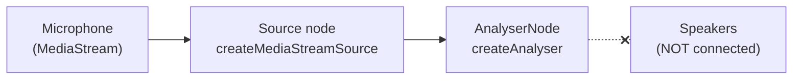

# Lesson 30 — Optional: your mic, locally, with Web Audio

In Lesson 29 everyone's "speaking" ring was random. In this **optional** lesson your own ring can be real: the browser measures how loud your microphone is, and your avatar lights up when you talk. You can skip this lesson. Lesson 31 does not depend on it.

::: danger Privacy first: what this lesson does and does not do
- **The sound stays on this device.** The code measures loudness many times a second and throws each measurement away.
- **Nothing is recorded, saved, played back or sent anywhere.** There is no `fetch`, no WebSocket and no file writing in the code. You will verify this yourself with the Network panel.
- **The mic is off until you tick a checkbox and approve the browser's permission prompt.** Unticking the box (or clicking Disconnect) switches it off again.
- If you'd rather not use your microphone at all, don't tick the box. The rest of the app works exactly as in Lesson 29.
:::

## 🎯 Goal

When you're connected to a voice channel, a checkbox appears in the green panel: **Light up when I talk (uses my mic)**. Tick it, allow the microphone in the browser's prompt, and your avatar (in the channel list and in the bottom-left user panel) gets a green ring while you speak or clap, and loses it when you stop.

{.screenshot}

## 🧠 New concepts

<ConceptList />

### Why the browser asks permission

A web page that could listen to your microphone without asking would be a spying tool. So browsers enforce two rules before a page can use the mic:

1. **Secure context.** The page must be loaded over `https://`, or from a "potentially trustworthy" local address. MDN's page on [secure contexts](https://developer.mozilla.org/en-US/docs/Web/Security/Secure_Contexts) lists `localhost` and the `127.0.0.0/8` range (which includes `127.0.0.1`, the address Live Server uses) as trustworthy. So your Live Server page works. A plain `http://` page on someone else's server would not: there, `navigator.mediaDevices` is `undefined`. Your GitHub Pages site from Lesson 31 is HTTPS, so it works there too.
2. **User permission.** The first time a page asks, the browser shows a prompt ("Allow this site to use your microphone?"). The page can't answer it. You can say yes or no, and you can change your mind later in the browser's site settings.

Most browsers also show an indicator (for example an icon on the tab or in the address bar) while a page is using the microphone. The exact look differs by browser and version.

### `getUserMedia`: asking for the mic

```js
const stream = await navigator.mediaDevices.getUserMedia({ audio: true });
```

- `navigator.mediaDevices` is the browser's door to cameras and microphones.
- `getUserMedia({ audio: true })` means "I want audio, no video". It returns a **Promise** (Lesson 18), so we `await` it. The promise stays pending while the prompt is on screen.
- If you click **Block**, or no microphone exists, the promise is **rejected** and `await` throws an error. MDN lists `NotAllowedError` (permission denied) and `NotFoundError` (no matching device). We'll catch these with `try`/`catch`. MDN also notes the promise may never settle if you just ignore the prompt. See [`getUserMedia` on MDN](https://developer.mozilla.org/en-US/docs/Web/API/MediaDevices/getUserMedia).

What you get back is a **`MediaStream`**: a live flow of sound that comes from the mic.

### Tracks and `stop()`

A `MediaStream` contains one or more **tracks**, each one source of media. A mic gives one audio track. `stream.getTracks()` returns them as an array. To really let go of the microphone you must call `track.stop()` on each track:

```js
for (const track of stream.getTracks()) {
  track.stop();
}
```

Merely forgetting the `stream` variable isn't enough: the browser keeps the mic open (and its indicator on) until the tracks are stopped. MDN: [`getTracks()`](https://developer.mozilla.org/en-US/docs/Web/API/MediaStream/getTracks), [`MediaStreamTrack.stop()`](https://developer.mozilla.org/en-US/docs/Web/API/MediaStreamTrack/stop).

### Web Audio: a graph of nodes

The **Web Audio API** processes sound by connecting small building blocks called **nodes** into a chain, like pipes:



- `new AudioContext()` creates the workspace that holds all the nodes ([MDN](https://developer.mozilla.org/en-US/docs/Web/API/AudioContext)).
- `audioContext.createMediaStreamSource(stream)` makes a **source node** that feeds the stream's sound into the graph.
- `audioContext.createAnalyser()` makes an **AnalyserNode**: a node that lets you *look at* the sound passing through without changing it.
- `source.connect(analyser)` links one node to the next.

We deliberately do **not** connect anything to the speakers. If we did, you'd hear your own voice with a delay, and probably get squealing feedback. The analyser only measures.

### Reading the sound wave

Sound is a wave: the air pressure goes up and down hundreds or thousands of times per second. A computer stores a wave as a list of **samples**, numbers between about `-1` and `1`. Silence is all zeros. Loud sound swings far from zero in both directions.

```js
analyser.fftSize = 512;
const samples = new Float32Array(analyser.fftSize);
analyser.getFloatTimeDomainData(samples);
```

- `fftSize` is how many samples the analyser keeps ready. It must be a power of two (32, 64 … 32768); 2048 is the default ([MDN](https://developer.mozilla.org/en-US/docs/Web/API/AnalyserNode/fftSize)). We use `512`, which is a short slice of sound, roughly 10 milliseconds at common sample rates (44,100 or 48,000 samples per second are typical).
- `Float32Array` is a fixed-length list of decimal numbers, a typed array, like an `array('f')` in Python or a NumPy `float32` array.
- `getFloatTimeDomainData(samples)` **copies the latest sound into your array**. It doesn't return anything: it fills the array you give it ([MDN](https://developer.mozilla.org/en-US/docs/Web/API/AnalyserNode/getFloatTimeDomainData)).

### Loudness is the RMS, not the average

How loud is a list of samples? The plain average is useless, because a wave swings positive and negative and the average of those is about zero, even when it's very loud:

```text
samples:  0.5, -0.5, 0.5, -0.5     average = 0       (but it's loud!)
```

The standard fix is **RMS** (root mean square):

1. **Square** every sample (that makes all of them positive).
2. Take the **mean** (average) of the squares.
3. Take the **square root** to scale back.

```text
loud:   0.5, -0.5, 0.5, -0.5   squares: 0.25 each   mean: 0.25   sqrt: 0.5
quiet:  0.01, -0.01, 0.01, -0.01   squares: 0.0001   mean: 0.0001   sqrt: 0.01
```

In code, with `Math.sqrt` ([MDN](https://developer.mozilla.org/en-US/docs/Web/JavaScript/Reference/Global_Objects/Math/sqrt)):

```js
let sumOfSquares = 0;
for (const sample of samples) {
  sumOfSquares += sample * sample;
}
const loudness = Math.sqrt(sumOfSquares / samples.length);
```

::: tip Python comparison
In Python: `math.sqrt(sum(s * s for s in samples) / len(samples))`. Same recipe.
:::

### Threshold and hold time

A silent room isn't exactly silent: the mic hears faint noise, maybe `0.005`. We pick a **threshold**: "louder than `0.02` counts as speaking". That number is a guess that works on many setups. If background noise lights you up, raise it. If you're ignored, lower it.

Speech has tiny pauses between words. If the ring switched off every time loudness dipped for a moment, it would flicker. So we add a **hold time**: after the last loud moment, stay "speaking" for another `300` milliseconds.

```text
time →        loud  loud  quiet quiet quiet quiet ...
raw:           ON    ON    off   off   off   off      (flickery)
with hold:     ON    ON    ON    ON    off   off      (stays on briefly)
```

### `requestAnimationFrame`, `cancelAnimationFrame` and `performance.now()`

We need to measure again and again, not just once. `setInterval` (Lesson 29) would work, but for visual updates the browser offers a better tool: `requestAnimationFrame(fn)` says "call `fn` right before you draw the next frame". On most screens that's about 60 times a second, and the browser **pauses it in background tabs** to save power ([MDN](https://developer.mozilla.org/en-US/docs/Web/API/Window/requestAnimationFrame)). Calling it again from inside `fn` makes a loop:

```js
function measure() {
  // ...look at the sound...
  frameId = requestAnimationFrame(measure);
}
measure();
```

It returns an id number. `cancelAnimationFrame(frameId)` stops the loop ([MDN](https://developer.mozilla.org/en-US/docs/Web/API/Window/cancelAnimationFrame)).

`performance.now()` returns the milliseconds since the page started, as a very precise decimal ([MDN](https://developer.mozilla.org/en-US/docs/Web/API/Performance/now)). It's the right clock for "how long since the last loud moment?". Python's `time.perf_counter()` is similar.

### Checkboxes and the `change` event

`<input type="checkbox">` is a tick box ([MDN](https://developer.mozilla.org/en-US/docs/Web/HTML/Reference/Elements/input/checkbox)). Its JavaScript property `.checked` is `true` or `false`, and it fires a `change` event each time the user ticks or unticks it ([MDN](https://developer.mozilla.org/en-US/docs/Web/API/HTMLElement/change_event)). You can also set `.checked = false` from code, which is how we untick it when something goes wrong. Wrapping the checkbox and its text in a `<label>` ([MDN](https://developer.mozilla.org/en-US/docs/Web/HTML/Reference/Elements/label)) means clicking the text toggles the box too.

## 🛠️ Build it

You need your Lesson 29 code working. Remember: the mic only turns on if you tick the box.

### Step 1 — Add the checkbox to the voice panel

In `vanilla/index.html`, inside `<div class="voice-panel-info">`, add a comment and a `<label>` right after the `<p class="voice-panel-channel" …>` line.

::: solution
```html [vanilla/index.html]
          <div class="voice-panel-info">
            <p class="voice-panel-status">
              <svg class="icon"><use href="assets/icons.svg#signal"></use></svg>
              Voice Connected
            </p>
            <p class="voice-panel-channel" id="voice-panel-channel"></p>
            <!-- Optional (Lesson 30): measure your own mic's loudness, locally -->
            <label class="mic-toggle">
              <input type="checkbox" id="mic-toggle">
              <span id="mic-toggle-text">Light up when I talk (uses my mic)</span>
            </label>
          </div>
```
:::

### Step 2 — Style it

In `vanilla/css/voice.css`, add a `.mic-toggle` rule right **before** the `/* Muted or deafened: the button turns red */` comment.

::: solution
```css [vanilla/css/voice.css]
.mic-toggle {
  display: flex;
  align-items: center;
  gap: 6px;
  margin-top: 2px;
  color: var(--text-muted);
  font-size: 12px;
}
```
:::

### Step 3 — Write `mic.js`

Create `vanilla/js/mic.js`. It exports three things: `isMicOn`, `startMic(onSpeakingChange)` and `stopMic`. Type it in this order and read each part against *New concepts*:

1. Constants for the threshold and hold time at the top. Naming them in CAPITALS (a Python habit too) marks them as settings you may want to tweak.
2. Three module-level variables (`stream`, `audioContext`, `frameId`) that remember what is running, so `stopMic` can shut it down later.
3. `startMic`: ask for the mic, build the graph, then define and start the `measure` loop. `onSpeakingChange` is a **callback**: `mic.js` knows nothing about the app, it just calls whoever started it when you start or stop talking.
4. `stopMic`: cancel the loop, stop every track, close the context and reset the variables.

::: solution
```js [vanilla/js/mic.js]
// OPTIONAL (Lesson 30): light up YOUR speaking indicator using your microphone.
//
// Privacy: the sound stays inside this browser tab. We only measure how loud it
// is, many times per second. Nothing is recorded, saved, played back or sent anywhere.

const LOUDNESS_THRESHOLD = 0.02; // raise this if background noise lights you up
const HOLD_TIME = 300; // ms to stay "speaking" after the last loud moment

let stream = null;
let audioContext = null;
let frameId = null;

export function isMicOn() {
  return stream !== null;
}

// Asks for the mic, then calls onSpeakingChange(true/false) whenever you start or stop talking.
export async function startMic(onSpeakingChange) {
  stream = await navigator.mediaDevices.getUserMedia({ audio: true });
  audioContext = new AudioContext();
  const source = audioContext.createMediaStreamSource(stream);
  const analyser = audioContext.createAnalyser();
  analyser.fftSize = 512;
  // The analyser is NOT connected to the speakers, so you won't hear yourself.
  source.connect(analyser);

  const samples = new Float32Array(analyser.fftSize);
  let speaking = false;
  let lastLoudTime = 0;

  function measure() {
    analyser.getFloatTimeDomainData(samples); // the latest sound wave, values from -1 to 1
    let sumOfSquares = 0;
    for (const sample of samples) {
      sumOfSquares += sample * sample;
    }
    const loudness = Math.sqrt(sumOfSquares / samples.length); // "root mean square"

    const now = performance.now();
    if (loudness > LOUDNESS_THRESHOLD) {
      lastLoudTime = now;
    }
    const isSpeakingNow = now - lastLoudTime < HOLD_TIME;
    if (isSpeakingNow !== speaking) {
      speaking = isSpeakingNow;
      onSpeakingChange(speaking);
    }
    frameId = requestAnimationFrame(measure);
  }
  measure();
}

export function stopMic() {
  if (frameId !== null) {
    cancelAnimationFrame(frameId);
  }
  if (stream !== null) {
    for (const track of stream.getTracks()) {
      track.stop(); // this turns off the browser's "recording" indicator
    }
  }
  if (audioContext !== null) {
    audioContext.close();
  }
  stream = null;
  audioContext = null;
  frameId = null;
}
```
:::

Things worth noticing:

- `lastLoudTime` starts at `0`, which is long ago, so you start as "not speaking".
- `isSpeakingNow !== speaking` means the callback runs **only when the state changes**, not 60 times a second. That keeps the rest of the app calm.
- `for (const sample of samples)` loops over a typed array exactly like over a normal array.
- Nothing in this file calls `fetch`, opens a connection, or writes to storage. The samples live in one array that is overwritten on every frame.

### Step 4 — Wire it into `voice.js`

Edit `vanilla/js/voice.js` in five places:

1. Import `startMic` and `stopMic` from `./mic.js`.
2. Look up `#mic-toggle` and `#mic-toggle-text` at the top.
3. Add the exported `setMySpeaking(isSpeaking)`. It removes you from `speakingUserIds`, and puts you back only if you asked to be speaking **and** you are connected **and** not muted.
4. In the simulation, keep your own id if it was already in `speakingUserIds` (the simulation rebuilds the list from scratch every 400 ms; without this it would erase your ring).
5. Add `turnMicOff()`, and replace `setupVoice` so that Disconnect turns the mic off first, and ticking the box calls `startMic` inside `try`/`catch`.

`startMic(setMySpeaking)` passes our function as the callback. If the user blocks the mic, the `await` throws, we log a warning, untick the box and explain in the label.

::: solution
```js [vanilla/js/voice.js]
import { state, getChannels, CURRENT_USER_ID } from './state.js';
import { leaveVoice } from './actions.js';
import { startMic, stopMic } from './mic.js';

const profileButton = document.querySelector('#user-panel-profile');
const disconnectButton = document.querySelector('#disconnect-button');
const micToggle = document.querySelector('#mic-toggle');
const micToggleText = document.querySelector('#mic-toggle-text');
```

```js [vanilla/js/voice.js]
// Turns your own speaking light on or off (used by the optional mic feature).
export function setMySpeaking(isSpeaking) {
  const others = state.speakingUserIds.filter((id) => id !== CURRENT_USER_ID);
  const canSpeak = state.voice.channelId !== null && !state.voice.muted;
  state.speakingUserIds = isSpeaking && canSpeak ? [...others, CURRENT_USER_ID] : others;
  renderSpeaking();
}
```

```js [vanilla/js/voice.js]
// Fake speaking: every 400 ms, each person may start or stop talking.
export function startSpeakingSimulation() {
  setInterval(() => {
    const speaking = [];
    for (const userId of peopleInVoice()) {
      const wasSpeaking = state.speakingUserIds.includes(userId);
      const chance = wasSpeaking ? 0.75 : 0.25; // keep talking, or start talking
      if (Math.random() < chance) {
        speaking.push(userId);
      }
    }
    // Your own light is controlled by your mic, not by chance (and muting turns it off).
    const canSpeak = state.voice.channelId !== null && !state.voice.muted;
    if (state.speakingUserIds.includes(CURRENT_USER_ID) && canSpeak) {
      speaking.push(CURRENT_USER_ID);
    }
    state.speakingUserIds = speaking;
    renderSpeaking();
  }, 400);
}

function turnMicOff() {
  stopMic();
  micToggle.checked = false;
  setMySpeaking(false);
}

export function setupVoice() {
  disconnectButton.addEventListener('click', () => {
    turnMicOff();
    leaveVoice();
  });

  micToggle.addEventListener('change', async () => {
    if (!micToggle.checked) {
      turnMicOff();
      return;
    }
    try {
      await startMic(setMySpeaking);
      micToggleText.textContent = 'Using my mic (stays on this device)';
    } catch (error) {
      console.warn('Microphone not available:', error);
      turnMicOff();
      micToggleText.textContent = 'Mic blocked: check the browser permission';
    }
  });
}
```
:::

The `setMySpeaking` snippet goes just above `startSpeakingSimulation`. The last snippet replaces your old `startSpeakingSimulation` and `setupVoice`; `peopleInVoice` and `renderSpeaking` stay as they were.

::: info `[...others, CURRENT_USER_ID]`
That `...` copies every item of `others` into a new list, then adds your id at the end. In Python: `[*others, CURRENT_USER_ID]`. You'll use the same idea on objects in Lesson 34.
:::

### Step 5 — Try it

1. Reload the page and click **Lounge** to connect.
2. Tick **Light up when I talk (uses my mic)**. The browser asks for permission. Allow it. The label changes to `Using my mic (stays on this device)`.
3. Talk, clap or tap your desk. Your avatar gets a green ring in two places and loses it about a third of a second after you stop.
4. Click the microphone button to mute: the ring stops lighting. Un-mute and it works again.
5. Untick the checkbox, or click **Disconnect**. The browser's microphone indicator should go away. If you see no indicator on your browser, you can check the site settings.

::: warning Permission prompts differ between browsers
The prompt text, the indicator and the place to change a decision (usually the icon at the left of the address bar, then site settings) differ by browser and version. If you clicked **Block** by mistake, reset the site's microphone permission there and reload.
:::

<!-- no-solution: trying out the feature, nothing to type -->

### Step 6 — Prove that nothing leaves your computer

1. Open DevTools → **Network**. Click the **Clear** button (the circle with a line), then tick the checkbox and talk for a few seconds. No new requests appear (you may see nothing at all).
2. Open `mic.js` and search it (<Keys mac="Cmd+F" win="Ctrl+F" />) for `fetch`. The only matches are none in the code itself: the file never sends anything. The only thing it hands back to the app is `true` or `false`.

The Network panel only shows what *this page* sends over the network. Seeing it stay quiet while the mic is on is solid evidence that your audio isn't being sent. The measurements stay in memory in the tab and vanish when you stop.

<!-- no-solution: checking DevTools, nothing to type -->

::: warning Privacy limits to know about
Two honest notes about this lesson's code, so you can judge it for yourself:

- **Muting only hides your ring.** The mic stays open (and the browser's indicator stays on) until you untick the box or click **Disconnect**. The mute button changes what the app shows, not what the browser listens to.
- **Leaving a server while connected** (right-click a server, then **Leave Server**) disconnects you from voice but doesn't call `turnMicOff()`. Untick the box first if you want the mic off.

A production app would turn the mic off in both cases. They'd be good exercises once you know the code.
:::

## ✅ Checkpoint

- [ ] When you aren't connected to a voice channel, the checkbox is not visible. When you are, it is.
- [ ] Ticking the box makes the browser ask for permission (the first time). Nothing is asked before you tick it.
- [ ] While you talk, your ring lights up in the channel list and in the user panel, and goes off shortly after you stop.
- [ ] Muting stops your ring from lighting up.
- [ ] Unticking the box (or clicking Disconnect) removes the browser's microphone indicator.
- [ ] If you click **Block** instead, the box unticks itself, the label says **Mic blocked: check the browser permission**, and the Console shows a warning starting with `Microphone not available:`.
- [ ] DevTools → **Network** shows no new requests while the mic is on.

## 🐛 Common mistakes

**Nothing happens when I tick the box, and the Console shows a `TypeError` about `getUserMedia` (in Chrome the text is like `Cannot read properties of undefined (reading 'getUserMedia')`).** `navigator.mediaDevices` is `undefined`, which MDN says happens when the page isn't a secure context. Open the app at `http://127.0.0.1:5500/…` (Live Server) or `http://localhost:…`, not at your computer's network address like `http://192.168.x.x:5500`, and not over plain `http://` on another host.

**The checkbox unticks itself and says "Mic blocked".** You clicked **Block**, or the browser or operating system has the microphone disabled for it. Reset the permission in the browser's site settings (and, on macOS, check System Settings → Privacy & Security → Microphone for your browser), then try again.

**The permission is granted but the ring never lights up.** Try making a louder sound. If the ring still doesn't light, lower `LOUDNESS_THRESHOLD` (for example to `0.01`). If it still doesn't, the `AudioContext` may be paused by the browser's autoplay rules (MDN describes this for sites that haven't had a user interaction); I haven't tested every browser. Reloading and ticking the box again is the first thing to try.

**The ring is always on, or flickers on with background noise.** The threshold is too low for your room. Raise `LOUDNESS_THRESHOLD`, for example to `0.05`.

**My ring flashes on then immediately disappears.** The simulation in `voice.js` rebuilds `speakingUserIds` every 400 ms. Check that you added the "keep your own id" lines (Step 4, part 4).

**I hear myself with an echo.** You connected the analyser to `audioContext.destination`. Remove that line: the analyser should be a dead end.

## 📝 Quiz

::: quiz
You've ticked the box and talk. What is true about your voice in this lesson's code?

- [ ] It is recorded to a file and uploaded when you click Disconnect
- [ ] It is sent to the other people in the channel
- [x] It is measured as a loudness number many times per second, and the numbers are discarded
- [ ] It is stored in `localStorage` for later

> Only the loudness is computed from each tiny slice of sound. The sound itself is never played, saved or sent, and the Network panel stays quiet.
:::

::: quiz
What does this code print?

```js
const samples = [0.4, -0.4, 0.4, -0.4];
let sumOfSquares = 0;
for (const sample of samples) {
  sumOfSquares += sample * sample;
}
console.log(Math.sqrt(sumOfSquares / samples.length));
```

- [ ] `0`
- [ ] `0.16`
- [x] `0.4` (give or take floating-point rounding)
- [ ] `1.6`

> Each square is 0.16, the mean of four 0.16s is 0.16, and the square root of 0.16 is 0.4. The plain average of the samples would have been 0, which is why RMS is used instead.
:::

::: quiz
Why does `mic.js` keep a `HOLD_TIME` of 300 ms?

- [ ] To make the microphone use less battery
- [ ] Because `getUserMedia` takes 300 ms to start
- [x] So short pauses between words don't make the ring flicker off and on
- [ ] Because browsers can only measure sound every 300 ms

> The ring stays on for 300 ms after the last loud moment. Speech has tiny gaps, and without the hold time the ring would blink with every gap.
:::

## 💾 Commit

```sh
git add .
git commit -m "Add optional local microphone speaking indicator"
git push
```
