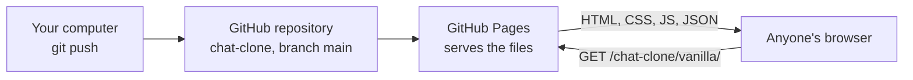

# Lesson 31 — Deploy to GitHub Pages

So far your app only exists on your own computer. In this lesson you put it on the internet for free, so you can send a link to a friend, and you'll see why the "relative paths" you've been writing all along matter.

## 🎯 Goal

Your chat app opens from a public address of the form `https://YOUR-USERNAME.github.io/chat-clone/vanilla/`, on any computer or phone, with no Live Server running. It looks exactly like it does locally:

{.screenshot}

(The screenshot is the app itself. It looks the same as in Lesson 30, because deploying changes *where* the app runs, not how it looks.)

You'll also add a small **landing page** at the root of the repository and a **live demo link** in your README.

## 🧠 New concepts

<ConceptList />

### Static hosting

Your app is made only of files: HTML, CSS, JavaScript, JSON, SVG. There is no program running on a server that computes anything per visitor. A server only has to hand those files to the browser when asked, as in Lesson 00. That is called **static hosting**, and it's the simplest kind there is.

**GitHub Pages** is a static hosting service from GitHub: it takes the files from a repository and serves them over the web ([About GitHub Pages](https://docs.github.com/en/pages/getting-started-with-github-pages/about-github-pages)). It cannot run server programs (no Python, no databases), but your app doesn't need any: all its data is fake JSON and its "backend" is JavaScript running in the visitor's browser.



### Public repository needed

On GitHub's docs, Pages is "available in public repositories with GitHub Free" (and in private ones on paid plans). That's why Lesson 01 had you create a **public** repository. A Pages site is visible to anyone on the internet, even if its repository is private (on plans where that's allowed), so never publish anything sensitive. Plans change, so check [GitHub's plans](https://docs.github.com/en/get-started/learning-about-github/githubs-plans) if you're unsure.

### Deploy from a branch

GitHub gives you two ways to publish: a custom **GitHub Actions workflow** (a program that builds your site), or **Deploy from a branch**: "whenever changes are pushed to the source branch, the changes in the source folder will be published". You choose a branch (we use `main`) and a folder (we use the root, `/`). GitHub's docs recommend the branch method if you don't need control over the build process ([publishing sources](https://docs.github.com/en/pages/getting-started-with-github-pages/configuring-a-publishing-source-for-your-github-pages-site)). Our files need no build, so that's what we use.

After each `git push`, GitHub copies your files to its servers. GitHub's docs say publishing "can take up to 10 minutes" after a push, but it's often much quicker.

### The address of a project site

A site for a repository is published at an address of this shape (from GitHub's [docs](https://docs.github.com/en/pages/getting-started-with-github-pages/about-github-pages)):

```text
https://<owner>.github.io/<repository-name>
```

For you: `https://YOUR-USERNAME.github.io/chat-clone/`. Everything in the repository is below that address, in the same folder layout as on your computer:

| File in the repository | Address on the web |
| --- | --- |
| `index.html` | `https://YOUR-USERNAME.github.io/chat-clone/` |
| `vanilla/index.html` | `https://YOUR-USERNAME.github.io/chat-clone/vanilla/` |
| `vanilla/data/users.json` | `https://YOUR-USERNAME.github.io/chat-clone/vanilla/data/users.json` |

The server serves `index.html` automatically when the address is a folder. That's why `…/vanilla/` works without typing `index.html`.

### Why relative paths matter

Notice the address has an extra part, `/chat-clone/`, that you don't have locally in Live Server (where it was `/vanilla/`). If your code asked for a file with a path that starts with a slash, like `/vanilla/data/users.json`, the browser would look at the **root of the whole domain**: `https://YOUR-USERNAME.github.io/vanilla/data/users.json`, which doesn't exist (404). A **relative** path like `data/users.json` is resolved against the folder of the current page, so it works wherever the folder lives.

```text
page:      https://YOUR-USERNAME.github.io/chat-clone/vanilla/
relative:  data/users.json   →  …/chat-clone/vanilla/data/users.json   ✓
absolute:  /data/users.json  →  https://YOUR-USERNAME.github.io/data/users.json   ✗ (404)
```

Every path in your app (`css/…`, `js/…`, `assets/…`, `data/…`) is relative, so it works as-is. You've written them this way all along, so nothing needs changing.

::: tip Python comparison
It's the difference between `open('data/users.json')` (relative to where the program runs) and `open('/home/me/project/data/users.json')` (hard-coded, and broken on anyone else's machine).
:::

### HTTPS and a new "origin"

GitHub Pages sites are served over **HTTPS**: the connection is encrypted, and the address bar shows a padlock. GitHub's docs say all Pages sites support HTTPS. As Lesson 30 explained, HTTPS is also what browsers want before allowing powerful features like the microphone.

Browsers keep `localStorage` separately for each **origin** (scheme + host + port). `http://127.0.0.1:5500` and `https://YOUR-USERNAME.github.io` are different origins. So the deployed app starts with fresh data; the messages you typed locally are not there. That is expected.

### Hard reload

Browsers cache files so pages load faster. After you deploy a change, you may still see the old version. A **hard reload** (<kbd>Cmd</kbd>+<kbd>Shift</kbd>+<kbd>R</kbd> in Chrome) fetches everything again. If you have DevTools open, you can also tick **Disable cache** in the Network panel while testing.

## 🛠️ Build it

### Step 1 — Check that your repository is up to date and public

In the terminal, in `~/code/chat-clone`:

```sh
git status
git remote -v
```

`git status` should say that there is nothing unexpected (if you have unsaved lesson 30 work, commit it later in Step 3 together with this lesson's files). `git remote -v` should list your `origin` with `github.com/YOUR-USERNAME/chat-clone`.

Then open your repository on github.com in the browser. A **Public** badge should appear next to the repository name. If it says **Private**, GitHub Pages may not be available on your plan: check GitHub's current plans, or change the visibility under **Settings** (the *Danger Zone* at the bottom of the General page, though the name and place may change).

::: warning GitHub's website changes
Menu names and layout on github.com change from time to time. The steps below follow GitHub's documentation at the time of writing. If a button isn't where this lesson says, look for the closest label, or search GitHub's docs for "Configuring a publishing source for your GitHub Pages site".
:::

<!-- no-solution: checking settings in the terminal and browser, nothing to type -->

### Step 2 — Add a landing page at the repository root

Create `index.html` in the **root** of `chat-clone` (next to `README.md`, *not* inside `vanilla/`). The site's top address, `…/chat-clone/`, will show it. It links to each version of the app: the React version joins it in Lesson 32 onward.

The link `href="vanilla/"` is relative to this page, so it leads to `…/chat-clone/vanilla/`.

::: solution
```html [index.html]
<!DOCTYPE html>
<html lang="en">
  <head>
    <meta charset="utf-8">
    <meta name="viewport" content="width=device-width, initial-scale=1">
    <title>My Chat App</title>
  </head>
  <body>
    <h1>My Chat App</h1>
    <p>A Discord-style chat app built while learning frontend development. All data is fake.</p>
    <ul>
      <li><a href="vanilla/">The plain HTML, CSS and JavaScript version</a></li>
    </ul>
  </body>
</html>
```
:::

### Step 3 — Update the README and push

Open `README.md` and replace its content so it has: the one-line intro plus a note that everything is fake, a **Live demo** link, the list of what's inside (now including `index.html`) and a **Run it locally** section.

In the link, replace `YOUR-USERNAME` with your real GitHub username, which is also in your repository's address. (In the reference solution the placeholder stays so that the file is the same for everybody.)

::: solution
```md [README.md]
# My Chat App

A Discord-style chat app I'm building to learn frontend development.
All data is fake and everything runs in the browser: there is no server and no real accounts.

**Live demo:** https://YOUR-USERNAME.github.io/chat-clone/vanilla/

## What's inside

- `vanilla/` — the plain HTML, CSS and JavaScript version
- `index.html` — a small landing page that links to each version

## Run it locally

Open this folder in VS Code and use **Open with Live Server** on `vanilla/index.html`.
```
:::

Now commit and push with the commands in the **💾 Commit** section at the bottom of this page. Pages publishes what's on GitHub, so the push must happen before the next step shows anything.

### Step 4 — Turn on GitHub Pages

On github.com, open your `chat-clone` repository, then:

1. Click **Settings** (the tab row under the repository name; it may be hidden in a **…** menu on narrow windows).
2. In the left sidebar, click **Pages**.
3. Under **Build and deployment**, set **Source** to **Deploy from a branch**.
4. Under **Branch**, choose `main` and the folder `/ (root)`, then click **Save**.

These steps are from GitHub's [documentation](https://docs.github.com/en/pages/getting-started-with-github-pages/configuring-a-publishing-source-for-your-github-pages-site) as I read it. GitHub changes this page now and then, so labels may differ.

::: warning GitHub may have moved things
GitHub has redesigned the Pages settings before. If **Source** offers "GitHub Actions" and "Deploy from a branch", choose the branch option. If you can't find Pages in Settings at all, your repository may be private on a plan that doesn't include Pages (see Step 1).
:::

After a minute or two, reload the **Pages** settings page. GitHub shows the address of your site, with a message that it is live (the exact wording and button names may differ). GitHub says publishing can take up to 10 minutes, so be patient and reload the settings page now and then. The **Actions** tab of the repository also lists the deployment while it runs.

<!-- no-solution: clicking through GitHub's settings, nothing to type -->

### Step 5 — Visit your live site and check it

1. Open `https://YOUR-USERNAME.github.io/chat-clone/` in Chrome. You should see your landing page. Click the link, or go directly to `https://YOUR-USERNAME.github.io/chat-clone/vanilla/`.
2. The app should load with all the servers, channels and messages. Click around, send a message, open the emoji picker.
3. Look at the address bar: it starts with `https://` and has a padlock (Chrome may show a settings icon instead).
4. Open DevTools → **Network**, tick **Disable cache** and do a hard reload (<kbd>Cmd</kbd>+<kbd>Shift</kbd>+<kbd>R</kbd>). Find `users.json` and `main.js` in the list: both should have status **200** and their address starts with `https://YOUR-USERNAME.github.io/chat-clone/vanilla/`.
5. Open the **Console**: there should be no red errors.
6. Open the address on your phone. Notice that your layout from Lesson 11 adapts to the narrow screen.

<!-- no-solution: visiting the live site, nothing to type -->

### Step 6 — Update the site with a change

To see the deployment loop, change something small, such as the text of the landing page's heading (`My Chat App` → `My Chat App (live!)`), then:

```sh
git add .
git commit -m "Tweak landing page heading"
git push
```

Wait a minute or so, then hard-reload `https://YOUR-USERNAME.github.io/chat-clone/`. The change shows up. This is the whole workflow from here on: edit, test locally with Live Server, commit, push, and Pages updates the site.

Undo the joke if you like (change the heading back, commit and push again).

<!-- no-solution: optional experiment, not part of the snapshot -->

## ✅ Checkpoint

- [ ] `index.html` exists in the repository root and `README.md` has a **Live demo** link with your real username.
- [ ] Your latest commit is on GitHub (the repository page lists your files, including `index.html`).
- [ ] `https://YOUR-USERNAME.github.io/chat-clone/` shows the landing page.
- [ ] `https://YOUR-USERNAME.github.io/chat-clone/vanilla/` shows the working chat app.
- [ ] DevTools → **Network** on the live site shows `200` for `main.js` and the JSON files, all from `github.io`.
- [ ] The Console on the live site shows no errors.

## 🐛 Common mistakes

**The address shows a 404 page ("There isn't a GitHub Pages site here").** The site isn't published yet or isn't configured. Check **Settings → Pages**: source must be *Deploy from a branch* with `main` and `/ (root)` selected, and you must have pushed. Then wait a few minutes. A typo in the address (`chat-clone` vs your repository name) gives the same page.

**The landing page works but `vanilla/` is blank.** Open DevTools → Console and Network. A red `404` next to a file means a path or filename is wrong. GitHub's servers treat upper and lower case as different (`Avatar.svg` and `avatar.svg` are different files), while your Mac usually doesn't. Make the names in your code match the file names exactly, including capitals.

**My new changes don't show up.** Wait a little: GitHub's docs say it can take up to 10 minutes. Then hard-reload (<kbd>Cmd</kbd>+<kbd>Shift</kbd>+<kbd>R</kbd>). Also check that you really pushed (`git status` should say "Your branch is up to date with 'origin/main'").

**The app loads but it's empty or my messages are gone.** The deployed site is a different origin from Live Server, so it has its own `localStorage` (see *New concepts*). It starts fresh from the JSON files. Nothing is wrong.

**I can't find "Pages" in Settings.** Make sure the repository is public (Step 1), that you are on *your* repository's Settings (not your account's), and look at GitHub's current docs: the sidebar may have been reorganized.

**The link in my README is broken.** You left `YOUR-USERNAME` in the address. Replace it with your own username.

## 📝 Quiz

::: quiz
Your page is at `https://sam.github.io/chat-clone/vanilla/`. Which path in `vanilla/js/data.js` works there?

- [ ] `fetch('/data/users.json')`
- [ ] `fetch('/vanilla/data/users.json')`
- [x] `fetch('data/users.json')`
- [ ] `fetch('C:/chat-clone/vanilla/data/users.json')`

> A relative path is resolved against the folder of the current page, giving `…/chat-clone/vanilla/data/users.json`. A path starting with `/` starts at the root of `sam.github.io`, which isn't where your files are.
:::

::: quiz
What does "Deploy from a branch" do?

- [ ] It runs your JavaScript on GitHub's servers every time someone visits
- [x] It publishes the files from a chosen branch and folder, updating whenever you push to that branch
- [ ] It makes your repository private
- [ ] It converts your JavaScript to Python

> Pages is static hosting: it only hands out your files. Pushing new commits to the chosen branch updates what is served.
:::

::: quiz
You open your deployed app and none of the messages you wrote locally are there. Why?

- [ ] GitHub deleted them for security
- [ ] `git push` doesn't upload `localStorage`, so it's a bug in your code
- [x] `localStorage` is stored per origin, and the deployed site's origin differs from `http://127.0.0.1:5500`
- [ ] The app only works on `127.0.0.1`

> `localStorage` lives in your browser, separately for each origin. The deployed site never saw the data of the Live Server origin, so it starts from the JSON files.
:::

## 💾 Commit

```sh
git add .
git commit -m "Add landing page and live demo link"
git push
```
