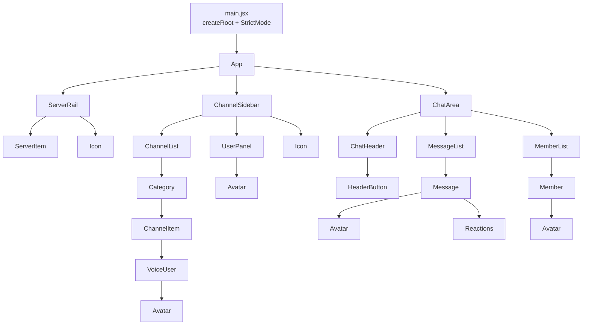

# Lesson 33 — Components, props, lists & keys

Last lesson the whole page was one giant `App` component with the same markup typed out again and again. This lesson splits it into small reusable components, feeds them real data from the JSON files you already know, and uses `map()` to draw lists. The page will look much like your vanilla app, with real servers, channels, messages and members.

## 🎯 Goal

The React app shows real data: five servers in the rail (with unread dots and mention badges), the *Frontend Friends* channels (with Ava and Priya in the voice channel *Lounge*), the `#general` messages with dates, grouped authors, bold, inline code, a code block and a reaction, and the full member list with status dots. Still nothing is clickable: the app always shows the first server and its first text channel. Clicking and typing arrive in Lesson 34.

{.screenshot}

## 🧠 New concepts

<ConceptList />

### Components and props

Last lesson a component was a function that takes nothing and returns JSX. A **prop** (short for *property*) is information the parent passes in, written like an HTML attribute. React collects all of a component's props into **one object** and passes it as the function's only argument:

```jsx
function Greeting(props) {
  return <p>Hello, {props.name}!</p>;
}

// used like:  <Greeting name="Sam" />
```

Here `name="Sam"` becomes `props.name`. Strings go in quotes. Anything else (numbers, booleans, objects, arrays, functions) goes in **curly braces**: `<Avatar user={currentUser} withStatus={true} />`. See [Passing props to a component](https://react.dev/learn/passing-props-to-a-component).

Props flow **one way, down**: a parent gives them to a child, and the child must not change them. React calls props *immutable*: if the data has to change, the parent passes new props. (Lesson 34 shows how.)

::: tip Python comparison
A component is like a function whose arguments are keyword arguments: `Greeting(name="Sam")`. The `props` object is like the `**kwargs` dict that collects them.
:::

### Destructuring

Writing `props.user`, `props.isActive` everywhere gets noisy. **Destructuring** pulls fields out of an object into variables of the same name, in one line:

```js
const person = { name: 'Sam', age: 30 };
const { name, age } = person;      // name is 'Sam', age is 30
```

In a component you do it right in the parameter list. These two components are identical:

```jsx
function ServerItem(props) {
  return <li>{props.server.name}</li>;
}

function ServerItem({ server }) {
  return <li>{server.name}</li>;
}
```

A destructured name can have a **default value**, used when the prop wasn't passed (or is `undefined`):

```js
function Avatar({ user, withStatus = false }) { /* ... */ }
```

Python's unpacking (`a, b = pair`) is the nearest relative, but JavaScript matches by **name**, not position. See [destructuring on MDN](https://developer.mozilla.org/en-US/docs/Web/JavaScript/Reference/Operators/Destructuring).

### `{expressions}` in JSX

Curly braces switch from markup back to JavaScript. You can use them in two places:

```jsx
<h2>{channel.name}</h2>                 // as the content of an element
<button aria-label={server.name} />      // as the value of an attribute (no quotes around the braces!)
```

Any JavaScript **expression** (something that produces a value) works: a variable, `user.displayName[0]`, a function call, a template literal like `` `icons.svg#${name}` ``. Statements such as `if` and `for` don't.

When the value is a string or number, it's drawn as text. React escapes it, so `<b>` in a message would show as characters, not become bold. `true`, `false`, `null` and `undefined` draw **nothing**. That last fact powers the next idea.

### Conditional rendering

To draw something only sometimes, use `&&` (you know it from Lesson 12):

```jsx
{mentions > 0 && <span className="mention-badge">{mentions}</span>}
```

If `mentions > 0` is `false`, the whole expression is `false`, and React draws nothing. If it's `true`, the result is the `<span>`. For either/or, use a ternary `? :`:

```jsx
{startsGroup ? <Avatar user={author} /> : <time>{time}</time>}
```

::: warning The `0 && ...` trap
`0` is falsy, so `count && <Badge />` evaluates to `0`, and React *does* draw a `0`. react.dev warns about this: don't put a number on the left of `&&`. Compare with `count > 0 && ...`, which is a real boolean. See [Conditional rendering](https://react.dev/learn/conditional-rendering).
:::

### Lists with `map()` and `key`

In Lesson 14 you built lists with a `for` loop and `append`. In JSX you transform an array of data into an array of JSX with `map()`:

```jsx
<ul>
  {servers.map((server) => (
    <ServerItem key={server.id} server={server} />
  ))}
</ul>
```

`map` calls your function once per item and collects the results into a new array, which React draws in order. (`map` is like a Python list comprehension: `[ServerItem(s) for s in servers]`.)

Every item needs a **`key`** prop: a value that is **unique among its siblings** and **stays the same** for the same item. React uses it to recognise "this is the same server as before" when the list changes: items added, removed or reordered. Without keys, React could attach the wrong DOM element (and, later, the wrong state) to an item. Use the item's own `id`. Don't use the array index when items can move, and don't make up random keys while rendering ([Rendering lists](https://react.dev/learn/rendering-lists)). `key` isn't a normal prop: your component never receives it.

### Inline styles and CSS variables

Our CSS gives each avatar its color through a CSS variable, `--avatar-color`, which the vanilla `avatar()` helper set per user. In JSX the `style` prop takes an **object**, not a string:

```jsx
<span className="avatar" style={{ '--avatar-color': user.avatarColor }} />
```

The **double braces** are two different things: the outer `{ }` means "a JavaScript expression", the inner `{ }` is the object `{ '--avatar-color': user.avatarColor }`. Normal CSS properties are written in camelCase (`backgroundColor`). A custom property name like `--avatar-color` is quoted and written exactly as in CSS. React's docs describe the `style` object in [common components](https://react.dev/reference/react-dom/components/common); that page doesn't list custom properties explicitly, but the app built in this lesson relies on them, and it works in Chrome.

### `dangerouslySetInnerHTML`

Your `renderMarkdown()` from Lesson 21 returns a **string of HTML** (`<strong>`, `<code>`…). Since React escapes strings, putting that string in `{ }` would show the tags as text. To insert real HTML, React offers the deliberately scary-named prop `dangerouslySetInnerHTML`, which takes an object with an `__html` key:

```jsx
<span dangerouslySetInnerHTML={{ __html: renderMarkdown(message.content) }} />
```

React's docs say it "should be used with extreme caution": if the HTML contains something a user typed, it can run their scripts (XSS, Lesson 21). It's safe here **only because** `renderMarkdown` escapes the text first. Never use it with unescaped text.

### Importing JSON

Vite lets you `import` a JSON file like a module ([Vite features](https://vite.dev/guide/features)):

```js
import users from './data/users.json';
```

`users` is already the parsed array. There is no `fetch` and no `await`: Vite includes the data in the app. It's convenient for fixed demo data. (The vanilla app used `fetch` so you'd learn it; React has its own ways of loading data, which come in later lessons.)

### Rest props and spread props

`...rest` in a parameter list collects **all the other props** into one object:

```jsx
function HeaderButton({ icon, label, ...rest }) {
  return <button aria-label={label} {...rest}>...</button>;
}
// <HeaderButton icon="members" label="Member List" id="members-button" />
// rest is { id: "members-button" }
```

`{...rest}` in JSX does the reverse: it **spreads** an object into props, as if each key were written out. Together they let a wrapper component pass any extra props through. Python comparison: `def f(icon, label, **rest)` and `g(**rest)`. See [rest parameters](https://developer.mozilla.org/en-US/docs/Web/JavaScript/Reference/Functions/rest_parameters) and [spread syntax](https://developer.mozilla.org/en-US/docs/Web/JavaScript/Reference/Operators/Spread_syntax).

### `filter(Boolean)`

Building a `className` from several parts, some of which may be missing, is common. Our helper in `classNames.js`:

```js
names.filter(Boolean).join(' ')
```

Passing the function `Boolean` to `filter` keeps only the **truthy** items (`false`, `null`, `undefined`, `0` and `''` are dropped). Then `join(' ')` glues the rest with spaces. So `classNames('server-item', isActive && 'is-active')` gives `'server-item is-active'` or just `'server-item'`. In Python: `' '.join(filter(None, names))`.

### The component tree

Components are used inside other components, which forms a **tree**. Here is the tree you'll build. An arrow means "renders":



Data flows **down** this tree through props. `App` knows `servers`, `messages` and the chosen channel. It passes what each child needs:

```text
App                 servers, messages  ─┐
 ├─ ServerRail      servers, activeServerId
 ├─ ChannelSidebar  server, activeChannelId, data
 │   ├─ ChannelList → Category → ChannelItem → VoiceUser   (each gets what it needs)
 │   └─ UserPanel   user
 └─ ChatArea        server, channel, messages, data
     ├─ MessageList → Message → Avatar
     └─ MemberList  → Member → Avatar
```

Notice `data` (users, servers, messages) is handed down several levels just so deep components can look up a user. This is called **prop drilling**, and Lesson 35 will show a cure.

Some components live in the same file as their parent when only the parent uses them (`ServerItem` is inside `ServerRail.jsx`). `Avatar` and `Icon` are used all over, so each has its own file. Components that are used elsewhere are exported with `export function X`, a **named export**, so you import them with braces: `import { Avatar } from './Avatar.jsx'`. Only `App` still uses `export default`.

### Vanilla vs React

::: info Same job, different style
| | Vanilla (Lesson 19) | React (this lesson) |
| --- | --- | --- |
| A voice user row | `createVoiceUser(userId)` builds elements with `el()` and `append` | `<VoiceUser user={user} />` returns JSX describing the row |
| A class that depends on state | `if (isSelected) item.classList.add('is-selected')` | `className={classNames('channel-item', isSelected && 'is-selected')}` |
| A list | `for (const x of items) list.append(createX(x))` | `{items.map((x) => <X key={x.id} x={x} />)}` |
| Showing/hiding | `badge.hidden = true`, or not creating it | `{count > 0 && <Badge />}` |
| Data | `fetch` + `await` in `data.js` | `import users from './data/users.json'` |

In vanilla you wrote the *steps* to build the DOM. In React you write *what it should look like*. The shapes of the lists, loops and ifs are the same ideas as before.
:::

## 🛠️ Build it

You'll create about a dozen files. Work in the order given, since later components use earlier ones. Keep `npm run dev` running in the terminal and the browser open at `http://localhost:5173/`: it will show errors for a while whenever a file imports something that doesn't exist yet. That is normal.

### Step 1 — Copy the data and the helpers you already wrote

The JSON data and two helper modules from the vanilla app work unchanged. Copy them, with these commands in the terminal inside `~/code/chat-clone/react-app`:

```sh
mkdir src/data src/lib src/state src/components
cp ../vanilla/data/users.json ../vanilla/data/servers.json ../vanilla/data/messages.json src/data/
cp ../vanilla/js/markdown.js ../vanilla/js/time.js src/lib/
```

- `src/data/` gets the three JSON files (`users`, `servers`, `messages`). The other vanilla JSON files (emoji, chatter) aren't needed yet.
- `src/lib/markdown.js` (Lesson 21: `renderMarkdown`) and `src/lib/time.js` (Lesson 20: date and time formatting) are plain JavaScript with nothing React-specific. They can be reused as they are, one of the nice things about keeping logic out of the DOM code.

Check the Explorer: `src/data` has three files and `src/lib` has two.

<!-- no-solution: copying files with cp -->

### Step 2 — Branding in `brand.js`, and `main.jsx`

React's components draw everything inside `#root`, but the browser tab title, the favicon and the accent color live outside it, in `index.html` and on the `<html>` element. You'll keep a small `applyBrand()` function for those, called once at startup.

Create `react-app/src/brand.js`. Compared to the vanilla one, `logo` points into `public/`, and there's no line for the logo ``, because React draws that one.

::: solution
```js [react-app/src/brand.js]
// ============================================================
//  BRANDING — the only file you need to edit to rebrand the app.
// ============================================================

export const brand = {
  name: 'Hubbub',
  logo: 'brand/logo.svg', // a file in public/
  accentColor: '#0f7b6c',
};

// Applies the parts of the brand that live outside React's components:
// the tab title, the favicon and the accent color CSS variable.
export function applyBrand() {
  document.title = brand.name;
  document.querySelector('link[rel="icon"]').href = brand.logo;
  document.documentElement.style.setProperty('--brand-accent', brand.accentColor);
}
```
:::

Then in `react-app/src/main.jsx` import it, and call `applyBrand()` once, before `createRoot`.

::: solution
```jsx [react-app/src/main.jsx]
import App from './App.jsx';
import { applyBrand } from './brand.js';

applyBrand();

createRoot(document.getElementById('root')).render(
  <StrictMode>
    <App />
  </StrictMode>,
);
```
:::

Only the import line and `applyBrand();` are new. The CSS imports above stay where they are.

### Step 3 — Data helpers in `state/selectors.js`

A **selector** is a small function that looks something up in the data and changes nothing. Our data lives in one object `{ users, servers, messages }` (you'll see it created in `App.jsx`), and every selector receives it as the first argument when it needs users. Create `react-app/src/state/selectors.js`.

Notes:
- `getChannels(server)` uses `flatMap`: it runs a function on each category, and joins the resulting arrays into one flat array.
- `total += channel.mentions ?? 0` uses `??`: "the left value, unless it is `null` or `undefined`, then `0`".
- `getRoleColor` returns `undefined` when a member has no role: `member && ...` stops early when `member` is missing.

::: solution
```js [react-app/src/state/selectors.js]
// Small functions that look things up in the app's data. They never change anything.
// `state` is an object with users, servers and messages.

export const CURRENT_USER_ID = 'u-me';

export function getUser(state, userId) {
  return state.users.find((user) => user.id === userId);
}

// All channels of a server, without the categories around them.
export function getChannels(server) {
  return server.categories.flatMap((category) => category.channels);
}

export function getRoleColor(server, userId) {
  const member = server.members.find((m) => m.userId === userId);
  const role = member && server.roles.find((r) => r.id === member.roleId);
  return role ? role.color : undefined;
}

export function isServerUnread(server) {
  return getChannels(server).some((channel) => channel.unread);
}

export function countServerMentions(server) {
  let total = 0;
  for (const channel of getChannels(server)) {
    total += channel.mentions ?? 0;
  }
  return total;
}

export function mentionsMe(state, text) {
  return text.includes(`@${getUser(state, CURRENT_USER_ID).displayName}`);
}
```
:::

### Step 4 — `classNames.js`

Create `react-app/src/lib/classNames.js` with the helper from *New concepts*. It uses a rest parameter `...names` to accept any number of arguments.

::: solution
```js [react-app/src/lib/classNames.js]
// classNames('message', isEditing && 'is-editing') → "message is-editing" or "message"
// (false, null and undefined are left out)
export function classNames(...names) {
  return names.filter(Boolean).join(' ');
}
```
:::

### Step 5 — `Icon` and `Avatar`

These are your first real components, and the most reused ones.

`react-app/src/components/Icon.jsx`: takes one prop, `name`, and draws an `<svg>` that points into the icon sheet. The `href` is a template literal inside braces.

`react-app/src/components/Avatar.jsx`: takes `user`, an optional `withStatus` (default `false`) and an optional `className`. It combines classes with `classNames`, sets the CSS variable with `style`, draws the first letter of the name, and draws the status dot only when `withStatus` is true. In the JSX, the text `{user.displayName[0]}` and `{withStatus && ...}` sit side by side as children.

::: solution
```jsx [react-app/src/components/Icon.jsx]
// One icon from public/icons.svg, e.g. <Icon name="hash" />
export function Icon({ name }) {
  return (
    <svg className="icon" aria-hidden="true">
      <use href={`icons.svg#${name}`} />
    </svg>
  );
}
```

```jsx [react-app/src/components/Avatar.jsx]
import { classNames } from '../lib/classNames.js';

// A round avatar with the user's first letter on their color.
export function Avatar({ user, withStatus = false, className }) {
  return (
    <span
      className={classNames('avatar', className, withStatus && `status-${user.status}`)}
      style={{ '--avatar-color': user.avatarColor }}
    >
      {user.displayName[0]}
      {withStatus && <span className="status-dot" />}
    </span>
  );
}
```
:::

### Step 6 — `UserPanel`, with a temporary `App`

`UserPanel` is the one you converted by hand last lesson. Now it takes a `user` prop and fills in the name and status text from data. Note `user.customStatus || user.username`: show the status, or fall back to the username when the status is empty.

Create `react-app/src/components/UserPanel.jsx`.

::: solution
```jsx [react-app/src/components/UserPanel.jsx]
import { Avatar } from './Avatar.jsx';
import { Icon } from './Icon.jsx';

export function UserPanel({ user }) {
  return (
    <section className="user-panel" aria-label="Your account">
      <button className="user-panel-profile" type="button" id="user-panel-profile">
        <Avatar user={user} withStatus />
        <span className="user-panel-names">
          <span className="user-panel-name" id="user-panel-name">{user.displayName}</span>
          <span className="user-panel-tag" id="user-panel-tag">{user.customStatus || user.username}</span>
        </span>
      </button>
      <button className="icon-button" type="button" id="mute-button" data-tooltip="Mute" aria-label="Mute">
        <Icon name="mic" />
      </button>
      <button className="icon-button" type="button" id="deafen-button" data-tooltip="Deafen" aria-label="Deafen">
        <Icon name="headphones" />
      </button>
      <button className="icon-button" type="button" id="settings-button" data-tooltip="User Settings" aria-label="User Settings">
        <Icon name="settings" />
      </button>
    </section>
  );
}
```
:::

To see it work before building the rest, temporarily **replace** `react-app/src/App.jsx` with this small version, which renders only the user panel for the first user in `users.json`:

::: solution
```jsx [react-app/src/App.jsx]
import users from './data/users.json';
import { UserPanel } from './components/UserPanel.jsx';

function App() {
  return <UserPanel user={users[0]} />;
}

export default App;
```
:::

The browser should show your panel: a blue **S** avatar with a green status dot, "Sam", "Learning frontend 🚀", and the three icon buttons. If so, `Icon`, `Avatar`, `classNames`, props, JSON import and a CSS variable all work. In DevTools → Elements, find the avatar `<span>` and look at its `style` attribute: `--avatar-color: #3b82f6`.

Now try one change: in `App`, pass `user={users[1]}` instead. The panel shows Ava, in orange. Change it back to `users[0]` and carry on. (We replace this file in Step 12.)

### Step 7 — `ServerRail`

`ServerRail.jsx` has two components. `ServerItem` is private to the file (not exported): it draws one server button, with an unread dot class and a mention badge. `ServerRail` is exported and renders the home button, a separator, the `servers.map(...)` list (with `key`) and the "add server" button. `brand.logo` provides the home button's image.

Look for each idea: `&&` for the badge, `classNames` with several conditions, `key={server.id}`, `data-tooltip` (the tooltip comes back in a later lesson) and the self-closing `<li ... />`.

::: solution
```jsx [react-app/src/components/ServerRail.jsx]
import { isServerUnread, countServerMentions } from '../state/selectors.js';
import { brand } from '../brand.js';
import { classNames } from '../lib/classNames.js';
import { Icon } from './Icon.jsx';

function ServerItem({ server, isActive }) {
  const mentions = countServerMentions(server);
  return (
    <li className={classNames('server-item', isActive && 'is-active', isServerUnread(server) && 'is-unread')}>
      <button
        className={classNames('server-button', server.iconIsEmoji && 'is-emoji')}
        type="button"
        data-tooltip={server.name}
        aria-label={server.name}
      >
        {server.icon}
        {mentions > 0 && <span className="mention-badge">{mentions}</span>}
      </button>
    </li>
  );
}

export function ServerRail({ servers, activeServerId }) {
  return (
    <nav className="server-rail" aria-label="Servers">
      <ul className="server-list">
        <li className="server-item">
          <button className="server-button home-button" type="button" data-tooltip="Direct Messages" aria-label="Direct Messages">
            
          </button>
        </li>
        <li className="server-separator" role="separator" />
      </ul>
      <ul className="server-list" id="server-list">
        {servers.map((server) => (
          <ServerItem key={server.id} server={server} isActive={server.id === activeServerId} />
        ))}
      </ul>
      <ul className="server-list">
        <li className="server-item">
          <button className="server-button add-server-button" type="button" data-tooltip="Add a Server" aria-label="Add a Server">
            <Icon name="plus" />
          </button>
        </li>
      </ul>
    </nav>
  );
}
```
:::

### Step 8 — `ChannelList` and `ChannelSidebar`

`ChannelList.jsx` holds four components, from the smallest to the biggest: `VoiceUser`, `ChannelItem`, `Category`, `ChannelList`. Each one draws what its name says and passes the needed props to the next. Two map calls are nested (categories → channels, and a channel's voice users).

Points to notice:
- `voiceUserIds.length > 0 && (<ul>…</ul>)`: the voice user list appears only for voice channels with people in them. Parentheses after `&&` allow multi-line JSX.
- `aria-expanded={true}`: a boolean must be written in braces; `"true"` would be a string.
- `getUser(data, userId)` looks up the user object for each id.
- `Avatar` gets `className="tiny"`, which passes through to the CSS class list.

`ChannelSidebar.jsx` assembles the server name header, the list and the user panel. It picks the current user with `getUser(data, CURRENT_USER_ID)`.

::: solution
```jsx [react-app/src/components/ChannelList.jsx]
import { getUser } from '../state/selectors.js';
import { classNames } from '../lib/classNames.js';
import { Avatar } from './Avatar.jsx';
import { Icon } from './Icon.jsx';

function VoiceUser({ user }) {
  return (
    <li className="voice-user" data-user-id={user.id}>
      <Avatar user={user} className="tiny" />
      <span className="voice-user-name">{user.displayName}</span>
    </li>
  );
}

function ChannelItem({ channel, isSelected, data }) {
  const voiceUserIds = channel.type === 'voice' ? channel.voiceUserIds : [];
  return (
    <li className={classNames('channel-item', isSelected && 'is-selected', channel.unread && 'is-unread')}>
      <button className="channel-button" type="button">
        <Icon name={channel.type === 'voice' ? 'speaker' : 'hash'} />
        <span className="channel-name">{channel.name}</span>
        {channel.mentions > 0 && <span className="channel-mention-badge">{channel.mentions}</span>}
      </button>
      {voiceUserIds.length > 0 && (
        <ul className="voice-users">
          {voiceUserIds.map((userId) => (
            <VoiceUser key={userId} user={getUser(data, userId)} />
          ))}
        </ul>
      )}
    </li>
  );
}

function Category({ category, activeChannelId, data }) {
  return (
    <section className="category">
      <h3>
        <button className="category-toggle" type="button" aria-expanded={true}>
          <Icon name="chevron-down" />
          {category.name}
        </button>
      </h3>
      <ul>
        {category.channels.map((channel) => (
          <ChannelItem key={channel.id} channel={channel} isSelected={channel.id === activeChannelId} data={data} />
        ))}
      </ul>
    </section>
  );
}

export function ChannelList({ server, activeChannelId, data }) {
  return (
    <nav className="channel-list scroller" id="channel-list" aria-label="Channel list">
      {server.categories.map((category) => (
        <Category key={category.id} category={category} activeChannelId={activeChannelId} data={data} />
      ))}
    </nav>
  );
}
```

```jsx [react-app/src/components/ChannelSidebar.jsx]
import { CURRENT_USER_ID, getUser } from '../state/selectors.js';
import { ChannelList } from './ChannelList.jsx';
import { UserPanel } from './UserPanel.jsx';
import { Icon } from './Icon.jsx';

export function ChannelSidebar({ server, activeChannelId, data }) {
  return (
    <aside className="channel-sidebar" aria-label="Channels">
      <header className="sidebar-header">
        <h1 className="server-name" id="server-name">
          {server.name}
        </h1>
        <Icon name="chevron-down" />
      </header>
      <ChannelList server={server} activeChannelId={activeChannelId} data={data} />
      <UserPanel user={getUser(data, CURRENT_USER_ID)} />
    </aside>
  );
}
```
:::

### Step 9 — `Message` and `MessageList`

`Message.jsx`: one message. Inside it is a small private component, `Reactions`.

- `startsGroup` decides between an avatar (first message of a group) and a small hover time.
- `renderMarkdown(...)` and `dangerouslySetInnerHTML` draw the message text with its formatting. The JSX comment says why it is safe.
- `author.bot && <span className="bot-tag">Bot</span>` shows the **Bot** tag.
- `message.reactions.map(...)` has `key={reaction.emoji}`, since an emoji appears once per message.
- `style={{ '--author-color': getRoleColor(server, author.id) }}` colors the author's name by role.

`MessageList.jsx`: groups messages like the vanilla version did. Here the list isn't one simple `map`: we need date dividers *between* some messages. So the code loops with `for...of`, pushes JSX elements into an `items` array (each with a `key`), and then draws `{items}`. An array of JSX elements is a perfectly valid child. The first item is a welcome header, written by hand.

::: solution
```jsx [react-app/src/components/Message.jsx]
import { CURRENT_USER_ID, getUser, getRoleColor, mentionsMe } from '../state/selectors.js';
import { renderMarkdown } from '../lib/markdown.js';
import { formatTime, formatTimestamp } from '../lib/time.js';
import { classNames } from '../lib/classNames.js';
import { Avatar } from './Avatar.jsx';

function Reactions({ message }) {
  return (
    <div className="reactions">
      {message.reactions.map((reaction) => (
        <button
          key={reaction.emoji}
          className={classNames('reaction', reaction.userIds.includes(CURRENT_USER_ID) && 'is-mine')}
          type="button"
          data-emoji={reaction.emoji}
        >
          <span className="reaction-emoji">{reaction.emoji}</span>
          <span className="reaction-count">{reaction.userIds.length}</span>
        </button>
      ))}
    </div>
  );
}

export function Message({ message, server, startsGroup, data }) {
  const author = getUser(data, message.authorId);
  const isMine = message.authorId === CURRENT_USER_ID;

  return (
    <li
      className={classNames('message', startsGroup && 'is-group-start', !isMine && mentionsMe(data, message.content) && 'is-mention')}
      data-message-id={message.id}
    >
      <div className="message-gutter">
        {startsGroup ? (
          <button className="avatar-button" type="button" data-user-id={author.id} aria-label={`${author.displayName}'s profile`}>
            <Avatar user={author} />
          </button>
        ) : (
          <time className="message-hover-time" dateTime={message.timestamp}>
            {formatTime(message.timestamp)}
          </time>
        )}
      </div>

      <div className="message-body">
        {startsGroup && (
          <h3 className="message-header">
            <button className="message-author" type="button" data-user-id={author.id} style={{ '--author-color': getRoleColor(server, author.id) }}>
              {author.displayName}
            </button>
            {author.bot && <span className="bot-tag">Bot</span>}
            <time className="message-time" dateTime={message.timestamp}>
              {formatTimestamp(message.timestamp)}
            </time>
          </h3>
        )}
        <div className="message-content">
          {/* renderMarkdown escapes the text first, so this is safe */}
          <span dangerouslySetInnerHTML={{ __html: renderMarkdown(message.content) }} />
          {message.editedAt && <span className="edited-label"> (edited)</span>}
        </div>
        {message.reactions.length > 0 && <Reactions message={message} />}
      </div>
    </li>
  );
}
```

```jsx [react-app/src/components/MessageList.jsx]
import { isSameDay, minutesBetween, formatDate } from '../lib/time.js';
import { Message } from './Message.jsx';
import { Icon } from './Icon.jsx';

// A new group starts when the author changes, after 7 minutes, or on a new day.
function startsNewGroup(previous, message) {
  return (
    !previous ||
    previous.authorId !== message.authorId ||
    minutesBetween(previous.timestamp, message.timestamp) > 7 ||
    !isSameDay(previous.timestamp, message.timestamp)
  );
}

export function MessageList({ server, channel, messages, data }) {
  // Build the list: date dividers between days, and grouped messages.
  const items = [];
  let previous = null;
  for (const message of messages) {
    if (!previous || !isSameDay(previous.timestamp, message.timestamp)) {
      items.push(
        <li key={`day-${message.id}`} className="date-divider" role="separator">
          <span>{formatDate(message.timestamp)}</span>
        </li>,
      );
    }
    items.push(<Message key={message.id} message={message} server={server} startsGroup={startsNewGroup(previous, message)} data={data} />);
    previous = message;
  }

  return (
    <ol className="message-list scroller" id="message-list">
      <li className="channel-welcome">
        <div className="channel-welcome-icon">
          <Icon name="hash" />
        </div>
        <h3 className="channel-welcome-title">Welcome to #{channel.name}!</h3>
        <p className="channel-welcome-text">This is the start of the #{channel.name} channel.</p>
      </li>
      {items}
    </ol>
  );
}
```
:::

### Step 10 — `MemberList` and `ChatArea`

`MemberList.jsx`: maps `server.members` to users and shows a `Member` for each. We show one flat list here ("Members — 13"). Grouping by role and online status comes later. Note the pair of conditions `user.customStatus && !isOffline && ...`.

`ChatArea.jsx`: the header, the message list, the composer (still just markup) and the member list.

- `HeaderButton` is the rest-props example: it takes `icon` and `label`, and `{...rest}` forwards anything else (`id`, `aria-pressed`) to the `<button>`.
- Numbers and booleans use braces: `rows={1}`, `aria-pressed={true}`.
- `placeholder={`Message #${channel.name}`}` is a template literal inside braces.

::: solution
```jsx [react-app/src/components/MemberList.jsx]
import { getUser } from '../state/selectors.js';
import { classNames } from '../lib/classNames.js';
import { Avatar } from './Avatar.jsx';

function Member({ user }) {
  const isOffline = user.status === 'offline';
  return (
    <button className={classNames('member', isOffline && 'is-offline')} type="button">
      <Avatar user={user} withStatus />
      <span className="member-names">
        <span className="member-name">{user.displayName}</span>
        {user.customStatus && !isOffline && <span className="member-status-text">{user.customStatus}</span>}
      </span>
    </button>
  );
}

export function MemberList({ server, data }) {
  const users = server.members.map((member) => getUser(data, member.userId));
  return (
    <aside className="member-list scroller" id="member-list" aria-label="Members">
      <h3 className="member-group-title">Members — {users.length}</h3>
      {users.map((user) => (
        <Member key={user.id} user={user} />
      ))}
    </aside>
  );
}
```

```jsx [react-app/src/components/ChatArea.jsx]
import { Icon } from './Icon.jsx';
import { MessageList } from './MessageList.jsx';
import { MemberList } from './MemberList.jsx';

// A button with an icon and a tooltip. ...rest passes any other props (id, onClick...) to the <button>.
function HeaderButton({ icon, label, ...rest }) {
  return (
    <button className="icon-button" type="button" data-tooltip={label} aria-label={label} {...rest}>
      <Icon name={icon} />
    </button>
  );
}

function ChatHeader({ channel }) {
  return (
    <header className="chat-header">
      <button className="icon-button menu-button" type="button" id="menu-button" aria-label="Open channels">
        <Icon name="menu" />
      </button>
      <svg className="icon chat-header-icon" aria-hidden="true">
        <use href="icons.svg#hash" />
      </svg>
      <h2 className="chat-title" id="chat-title">
        {channel.name}
      </h2>
      <p className="chat-topic" id="chat-topic">
        {channel.topic}
      </p>
      <div className="chat-toolbar">
        <HeaderButton icon="bell" label="Notification Settings" />
        <HeaderButton icon="pin" label="Pinned Messages" />
        <HeaderButton icon="members" label="Member List" id="members-button" aria-pressed={true} />
        <label className="search">
          <input className="search-input" type="search" placeholder="Search" aria-label="Search" />
          <Icon name="search" />
        </label>
        <HeaderButton icon="inbox" label="Inbox" />
        <HeaderButton icon="help" label="Help" />
      </div>
    </header>
  );
}

export function ChatArea({ server, channel, messages, data }) {
  return (
    <main className="chat">
      <ChatHeader channel={channel} />
      <div className="chat-body">
        <section className="chat-main" aria-label="Messages">
          <MessageList server={server} channel={channel} messages={messages} data={data} />
          <form className="composer" id="composer">
            <button className="icon-button composer-button" type="button" aria-label="Upload a file">
              <Icon name="plus" />
            </button>
            <textarea className="composer-input" id="composer-input" rows={1} aria-label="Message" placeholder={`Message #${channel.name}`} />
            <button className="icon-button composer-button" type="button" id="composer-emoji-button" aria-label="Choose an emoji">
              <Icon name="emoji" />
            </button>
          </form>
          <p className="typing-indicator" id="typing-indicator" aria-live="polite"></p>
        </section>
        <MemberList server={server} data={data} />
      </div>
    </main>
  );
}
```
:::

### Step 11 — Put it together in `App.jsx`

Replace the temporary `App.jsx`. `App` imports the three JSON files and the top-level components. For now it always shows the first server and the first text channel, because nothing is clickable yet.

- `const data = { users, servers, messages };` is defined **outside** the component, so it's created once, and passed to the children that need to look up users.
- `servers[0]`, then `getChannels(server).find((c) => c.type === 'text')`.
- `messages[channel.id] ?? []`: the messages of that channel, or an empty list if there are none.
- The component returns a fragment: the `div.app` and the drawer backdrop are siblings.

::: solution
```jsx [react-app/src/App.jsx]
import users from './data/users.json';
import servers from './data/servers.json';
import messages from './data/messages.json';
import { getChannels } from './state/selectors.js';
import { ServerRail } from './components/ServerRail.jsx';
import { ChannelSidebar } from './components/ChannelSidebar.jsx';
import { ChatArea } from './components/ChatArea.jsx';

// All the data, in one object that components can look things up in.
const data = { users, servers, messages };

function App() {
  // No interactivity yet: always show the first server's first text channel.
  const server = servers[0];
  const channel = getChannels(server).find((c) => c.type === 'text');
  const channelMessages = messages[channel.id] ?? [];

  return (
    <>
      <div className="app">
        <div className="nav-drawer">
          <ServerRail servers={servers} activeServerId={server.id} />
          <ChannelSidebar server={server} activeChannelId={channel.id} data={data} />
        </div>
        <ChatArea server={server} channel={channel} messages={channelMessages} data={data} />
      </div>
      <div className="drawer-backdrop" id="drawer-backdrop" />
    </>
  );
}

export default App;
```
:::

Save everything. The browser should show the complete app from the screenshot. If something is off, open the Console: the first error usually points at the culprit.

### Step 12 — Explore

1. In DevTools → **Elements**, compare the generated DOM with your vanilla app's. It's the same HTML, produced by components.
2. Open `src/data/servers.json`, change the name of the first server, save, and watch the sidebar header change by itself (HMR).
3. In `App.jsx`, change `servers[0]` to `servers[1]` and see a different server. Because `getChannels(server).find(...)` needs a text channel, check that this server has one, and change it back afterwards.

<!-- no-solution: exploring, nothing to type -->

## ✅ Checkpoint

- [ ] The page shows five servers in the rail; the first is selected, and two have red mention badges (1 and 2).
- [ ] The channel list shows *Text Channels*, *Info* and *Voice Channels*, with **Lounge** listing Ava and Priya.
- [ ] The message list starts with **Welcome to #general!** and shows date dividers, grouped messages, **bold**, `inline code`, a code block and a reaction.
- [ ] The member list says **Members — 13** and each member has a status dot.
- [ ] The tab title is **Hubbub** (set by `applyBrand()`).
- [ ] DevTools → **Console** has no errors or `key` warnings.
- [ ] DevTools → **Elements**: the avatar `<span>` of any user has `style="--avatar-color: …"`.
- [ ] Every file in `src/components/` has exactly one exported main component, and names start with a capital letter.

## 🐛 Common mistakes

**Warning: Each child in a list should have a unique "key" prop.** A `map()` (or an `items.push(...)`) produces elements without a `key`. Add `key={…}` with the item's `id` to the outermost element returned inside the loop.

**An error that includes "Objects are not valid as a React child".** You put a whole object, like `{user}` or `{message}`, between tags. Draw a field (`{user.displayName}`) instead.

**An error like "Element type is invalid … got: undefined".** An import doesn't match its export. Components here are *named* exports, so write `import { Avatar } from './Avatar.jsx'` with braces. Writing `import Avatar from …` gives `undefined`. Check the spelling and the file extension, too.

**A lowercase component draws nothing useful, or the DevTools show an unknown `<avatar>` element.** JSX treats lowercase tags as plain HTML. Component names must start with a capital letter: `Avatar`, not `avatar`.

**An error about `style` expecting a mapping from style properties to values, not a string.** You wrote `style="..."`. In JSX it is an object: `style={{ '--avatar-color': color }}` (two pairs of braces).

**A `0` appears on the page.** An expression like `count && <Badge />` with `count` equal to `0` draws `0`. Write `count > 0 && …`.

**`Cannot read properties of undefined (reading '...')`.** A prop is missing or misspelled, so a variable is `undefined`. Check the name in the parent (`<Avatar user={u} />`) and the child (`function Avatar({ user })`) match exactly. Case matters.

## 📝 Quiz

::: quiz
What does this draw when `unread` is `0`?

```jsx
<li>{unread && <span className="badge">{unread}</span>}</li>
```

- [ ] An empty `<li>`
- [x] An `<li>` containing the text `0`
- [ ] A badge with `0` inside
- [ ] An error

> `0 && something` evaluates to `0`, and React draws numbers, so a `0` appears. Writing `unread > 0 && ...` gives a real boolean, which draws nothing when false.
:::

::: quiz
Why does each `ServerItem` in `servers.map(...)` get `key={server.id}`?

- [ ] So the component can read `props.key`
- [ ] Because `map` requires it, otherwise it throws an error
- [x] So React can tell which item is which when the list changes, and match old items to new ones
- [ ] To give the `<li>` an `id` attribute in the page

> The key is a hint for React alone. It isn't passed to the component and isn't added to the DOM. It identifies each item among its siblings, so React can update, move or remove the right ones.
:::

::: quiz
What does `classNames('message', false, undefined, 'is-mention')` return?

```js
function classNames(...names) {
  return names.filter(Boolean).join(' ');
}
```

- [ ] `'message false undefined is-mention'`
- [x] `'message is-mention'`
- [ ] `'message'`
- [ ] `['message', 'is-mention']`

> `filter(Boolean)` drops falsy values (`false`, `undefined`, `null`, `0`, `''`). `join(' ')` then glues the remaining strings with a space, giving a string, not an array.
:::

## 💾 Commit

```sh
git add .
git commit -m "Split the React page into components and render real data"
git push
```
