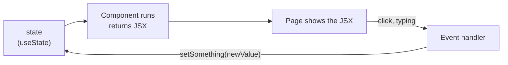

# Lesson 34 — State & events with useState

Last lesson drew the whole app from data, but nothing could change. Now you make it interactive: clicking servers and channels, collapsing categories, toggling the member list, opening the mobile drawer and sending messages. You'll meet React's most important tool, **state**, and learn the rules that go with it.

## 🎯 Goal

The React app now behaves like Lesson 16's vanilla app:

- clicking a server or channel switches to it, and clears its unread dot and mention badge;
- clicking a category name collapses and expands it;
- the member-list button hides and shows the member list;
- in a narrow window, the menu button opens the channel drawer and the dark backdrop closes it;
- typing in the message box and pressing <kbd>Enter</kbd> (or <kbd>Shift</kbd>+<kbd>Enter</kbd> for a new line) adds your message to the channel.

Messages aren't saved yet: reloading the page starts over. (Voice channels still do nothing; that's Lesson 40.)

{.screenshot}

On first load it looks just like the previous lesson: what changed is what happens when you click and type.

## 🧠 New concepts

<ConceptList />

### State: a component's memory

A normal variable inside a component can't hold on to a changing value. React **calls your component function again** every time it needs to redraw, so every local variable starts from scratch, and changing a local variable doesn't tell React to redraw anything:

```jsx
function Counter() {
  let count = 0;                       // reset to 0 on every call
  function add() { count = count + 1; } // changes a variable React doesn't watch
  return <button onClick={add}>Clicked</button>;
}
```

React's answer is **state**, a value React stores for you between calls, plus a function to change it. You ask for it with the `useState` **hook** ([useState on react.dev](https://react.dev/reference/react/useState)):

```jsx
import { useState } from 'react';

function Counter() {
  const [count, setCount] = useState(0);
  return <button onClick={() => setCount(count + 1)}>Clicked</button>;
}
```

`useState(0)` returns a two-item array: the **current value** and a **setter function**. We name them with array destructuring (like Python's `count, set_count = pair`): `const [count, setCount] = ...`. The `0` is the **initial value**: it is used only the first time the component draws.

Calling `setCount(1)` does two things: React stores the new value, and it **calls your component again** (a "re-render"), so `count` is `1` this time and the page shows the new result. This is the loop you built by hand in Lesson 16 (`state` → `render()` → page), except React runs the render for you:



A few rules to remember:

- **State is a snapshot.** Inside one run of the component, a state variable never changes. Calling `setCount(count + 1)` doesn't change `count` in the code that is already running; the *next* run sees the new value. React's docs show logging the state right after setting it and still seeing the old value.
- **Hooks go at the top level.** Call `useState` (and other hooks, whose names start with `use`) directly in the component body: not inside `if`, loops or nested functions, so React sees them in the same order every time ([Hooks rules](https://react.dev/learn/state-a-components-memory)).
- **State is per component copy.** If you draw `<Composer />` twice, each has its own text.
- **Only store what can't be computed.** In `App` we store the *id* of the active server, and compute the server object from it on every run. Two copies of the same fact can disagree. (You used the same rule for voice in Lesson 29.)

### Events in React

You attach a handler by passing a function to a camelCase **prop** on the element: `onClick`, `onChange`, `onKeyDown`, `onSubmit`:

```jsx
<button onClick={handleClick}>Save</button>
```

Compared to Lesson 15: no `addEventListener`, no `querySelector`, no event delegation to write yourself. The handler sits right next to the element it belongs to. React takes care of the rest.

**Pass the function, don't call it.** `onClick={handleClick}` passes it; `onClick={handleClick()}` calls it *while drawing* and passes its result. react.dev lists this as a classic pitfall ([Responding to events](https://react.dev/learn/responding-to-events)). When you need to pass an argument, wrap the call in an **arrow function**:

```jsx
<button onClick={() => onSelect(channel.id)}>{channel.name}</button>
```

The arrow function is the thing passed; it runs `onSelect(channel.id)` later, when the click happens.

Your handler receives the **event object** as its argument, as in the vanilla app: `event.key`, `event.shiftKey`, `event.target.value`, `event.preventDefault()`. Python comparison: it's like a callback registered for a GUI button (`command=...` in tkinter).

### Controlled inputs

In vanilla JS you read what's typed with `textarea.value` when you need it. In React the usual style is a **controlled input**: React state is the single source of truth, and the textarea always shows it.

```jsx
const [text, setText] = useState('');

<textarea value={text} onChange={(event) => setText(event.target.value)} />
```

Each keystroke fires `onChange`, the handler stores the new text with `setText`, and the component re-draws the textarea with that text. If you set `value` without an `onChange`, you can't type. To clear the box after sending, you simply `setText('')`. See [`<textarea>` on react.dev](https://react.dev/reference/react-dom/components/textarea).

### Never change state, replace it

State objects and arrays must be treated as **read-only**. To change something, make a **copy** with the change in it and give the copy to the setter. React decides whether anything changed by comparing the old and new value; if you mutate the old object and pass it back, it's the *same* object, so React may decide nothing changed and skip the redraw ([updating objects in state](https://react.dev/learn/updating-objects-in-state), [arrays](https://react.dev/learn/updating-arrays-in-state)).

**Spread** (`...`) copies the items of an object or array into a new one:

```js
const user = { name: 'Sam', status: 'online' };
const renamed = { ...user, name: 'Samira' };   // { name: 'Samira', status: 'online' }

const list = ['a', 'b'];
const longer = [...list, 'c'];                   // ['a', 'b', 'c']
const withoutB = list.filter((item) => item !== 'b');   // ['a']
```

Put the spread first, then the keys you want to override. `map` and `filter` already return new arrays, so they're safe too. Avoid `push`, `splice`, `sort`, and assigning to `obj.field` on state.

A **computed key** is a key whose name comes from a variable: write it in square brackets.

```js
const channelId = 'c-ff-help';
const byServer = { ...old, [serverId]: channelId };   // key is the VALUE of serverId
```

Without the brackets, `{ serverId: channelId }` would use the literal name `"serverId"`. Python comparison: `{**old, server_id: channel_id}` evaluates the variable `server_id` in key position, which is what the brackets do in JS.

Nested data needs a copy at every level you touch. Our `updateChannel` helper copies the server, the category and the channel that changed, and reuses everything else.

### Lifting state up, and passing handlers down

If two components need the same changing value, the state moves up to their closest common parent. That's called **lifting state up** ([react.dev](https://react.dev/learn/sharing-state-between-components)). Here, the server rail, the sidebar and the chat all depend on which server is active, so the state lives in `App`.

A child can't change its parent's state directly. Instead, the parent passes a **handler function** down as a prop, and the child calls it. The convention: props that receive handlers start with `on` (`onSelectChannel`), and the functions in the parent are named for what they do (`selectChannel`).

```text
Data flows DOWN as props.            Events flow UP by calling handler props.

App  (owns the state)
 └─ ChannelSidebar   ← server, onSelectChannel
     └─ ChannelList  ← server, onSelectChannel
         └─ Category ← category, onSelectChannel
             └─ ChannelItem ← channel, onSelect
                 <button onClick={() => onSelect(channel.id)}>
                      │
                      └─ click → onSelect → ... → App's selectChannel → setActiveChannelByServer(...)
```

Notice `onSelectChannel` passes through `ChannelSidebar`, `ChannelList` and `Category` without any of them using it. That's **prop drilling**. It's fine at this size, and Lesson 35 will show how to avoid it.

::: info Vanilla vs React
| | Vanilla (Lessons 15–16) | React (this lesson) |
| --- | --- | --- |
| Where state lives | one `state` object in `state.js` | several `useState` calls in `App` |
| Changing it | `state.activeServerId = id; update()` | `setActiveServerId(id)` |
| Redrawing | you call `render()` (through `update()`) | React calls your components again |
| Click handlers | `addEventListener` and delegation on a parent | `onClick` on the element itself |
| Reading a textarea | `textarea.value` when sending | `value={text}` kept in state on every keystroke |
| Class for "selected" | `classList.add('is-selected')` | `classNames('channel-item', isSelected && 'is-selected')` |
:::

## 🛠️ Build it

Keep `npm run dev` running and the page open at `http://localhost:5173/`. You'll change `App.jsx` and four components, then add `Composer.jsx` and `updates.js`. After each wiring step, test in the browser.

### Step 1 — Helpers that copy: `state/updates.js`

Create `react-app/src/state/updates.js` with two functions that return **changed copies**:

- `updateChannel(servers, channelId, changes)`: returns new servers where one channel has the `changes` merged in. It copies the server, the category and the channel on the path to it, and leaves everything else as it was. `{ ...channel, ...changes }` copies all channel fields, then overwrites those in `changes`.
- `toggleInList(list, item)`: adds the item if missing, removes it if present. The ternary `? :` picks between `filter` (remove) and `[...list, item]` (add).

::: solution
```js [react-app/src/state/updates.js]
// Helpers that return CHANGED COPIES of nested data. React only notices a change
// when it gets a new object or array, so we never modify the old ones.

// Returns new servers where one channel has some fields changed.
export function updateChannel(servers, channelId, changes) {
  return servers.map((server) => ({
    ...server,
    categories: server.categories.map((category) => ({
      ...category,
      channels: category.channels.map((channel) => (channel.id === channelId ? { ...channel, ...changes } : channel)),
    })),
  }));
}

// Adds the item if it isn't in the list, removes it if it is.
export function toggleInList(list, item) {
  return list.includes(item) ? list.filter((x) => x !== item) : [...list, item];
}
```
:::

### Step 2 — Put the state in `App`

Now replace the top of `App.jsx`. The data files are now only the **initial values**, so they're imported under new names (`initialServers`, `initialMessages`). The component keeps its changing data in seven pieces of state, computes `data`, `server` and `channel` from them, and defines the handlers you'll wire up in the next steps.

Read the code in three parts:

1. **State.** `servers` and `messages` (data that changes when you mark channels read or send messages). `activeServerId`. `activeChannelByServer`, an object like `{ 's-frontend': 'c-ff-help' }`, so each server remembers its own channel. `collapsedCategoryIds`, an array of ids. `showMembers` and `navOpen`, booleans.
2. **Derived values.** `data`, `server` and `channel` are plain constants computed on every run. `pickChannel` returns the server's remembered channel, or the first text channel (`??` means "if the left side is `undefined` or `null`, use the right side").
3. **Handlers.** Each one calls setters with **new** values: `markRead` replaces `servers` with an updated copy; `selectChannel` creates a new object with the computed key `[server.id]`; `toggleCategory` uses `toggleInList`; `sendMessage` builds a message object and replaces `messages` with a copy whose one channel's list is a new array.

Two notes: `crypto.randomUUID()` creates a unique id, and `new Date().toISOString()` gives the current time as text, the same format as in `messages.json`. Browsers only offer `randomUUID` in secure contexts; MDN says so, and `localhost` counts as secure (see Lesson 30).

In `return`, only the `messages` prop of `ChatArea` changes for now.

::: solution
```jsx [react-app/src/App.jsx]
import { useState } from 'react';
import users from './data/users.json';
import initialServers from './data/servers.json';
import initialMessages from './data/messages.json';
import { CURRENT_USER_ID, getChannels } from './state/selectors.js';
import { updateChannel, toggleInList } from './state/updates.js';
import { ServerRail } from './components/ServerRail.jsx';
import { ChannelSidebar } from './components/ChannelSidebar.jsx';
import { ChatArea } from './components/ChatArea.jsx';

// The channel to open for a server: the one you looked at last, or its first text channel.
function pickChannel(server, activeChannelByServer) {
  const channels = getChannels(server);
  return channels.find((c) => c.id === activeChannelByServer[server.id]) ?? channels.find((c) => c.type === 'text');
}

function App() {
  // ---------- State: everything that can change ----------
  const [servers, setServers] = useState(initialServers);
  const [messages, setMessages] = useState(initialMessages);
  const [activeServerId, setActiveServerId] = useState(initialServers[0].id);
  const [activeChannelByServer, setActiveChannelByServer] = useState({});
  const [collapsedCategoryIds, setCollapsedCategoryIds] = useState([]);
  const [showMembers, setShowMembers] = useState(true);
  const [navOpen, setNavOpen] = useState(false);

  // ---------- Values computed from the state on every render ----------
  const data = { users, servers, messages };
  const server = servers.find((s) => s.id === activeServerId);
  const channel = pickChannel(server, activeChannelByServer);

  // ---------- Event handlers: they change the state ----------
  function markRead(channelId) {
    setServers(updateChannel(servers, channelId, { unread: false, mentions: 0 }));
  }

  function selectServer(serverId) {
    const nextServer = servers.find((s) => s.id === serverId);
    setActiveServerId(serverId);
    markRead(pickChannel(nextServer, activeChannelByServer).id);
  }

  function selectChannel(channelId) {
    const clicked = getChannels(server).find((c) => c.id === channelId);
    if (clicked.type === 'voice') {
      return; // joining voice channels comes in Lesson 40
    }
    setActiveChannelByServer({ ...activeChannelByServer, [server.id]: channelId });
    markRead(channelId);
    setNavOpen(false);
  }

  function toggleCategory(categoryId) {
    setCollapsedCategoryIds(toggleInList(collapsedCategoryIds, categoryId));
  }

  function sendMessage(content) {
    const message = {
      id: crypto.randomUUID(),
      authorId: CURRENT_USER_ID,
      content,
      timestamp: new Date().toISOString(),
      reactions: [],
    };
    const list = messages[channel.id] ?? [];
    setMessages({ ...messages, [channel.id]: [...list, message] });
  }

  return (
    <>
      <div className="app">
        <div className="nav-drawer">
          <ServerRail servers={servers} activeServerId={server.id} />
          <ChannelSidebar server={server} activeChannelId={channel.id} data={data} />
        </div>
        <ChatArea server={server} channel={channel} messages={messages[channel.id] ?? []} data={data} />
      </div>
      <div className="drawer-backdrop" id="drawer-backdrop" />
    </>
  );
}

export default App;
```
:::

Save. The page should look exactly as before: you've moved the data into state, but nothing calls the handlers yet.

### Step 3 — Click a server

`ServerRail.jsx`: `ServerItem` gets an `onSelect` prop and its `<button>` gets `onClick={() => onSelect(server.id)}`. `ServerRail` gets `onSelectServer` and passes it down as `onSelect`. (Props are renamed on the way down: that's normal.)

::: solution
```jsx [react-app/src/components/ServerRail.jsx]
import { isServerUnread, countServerMentions } from '../state/selectors.js';
import { brand } from '../brand.js';
import { classNames } from '../lib/classNames.js';
import { Icon } from './Icon.jsx';

function ServerItem({ server, isActive, onSelect }) {
  const mentions = countServerMentions(server);
  return (
    <li className={classNames('server-item', isActive && 'is-active', isServerUnread(server) && 'is-unread')}>
      <button
        className={classNames('server-button', server.iconIsEmoji && 'is-emoji')}
        type="button"
        data-tooltip={server.name}
        aria-label={server.name}
        onClick={() => onSelect(server.id)}
      >
        {server.icon}
        {mentions > 0 && <span className="mention-badge">{mentions}</span>}
      </button>
    </li>
  );
}

export function ServerRail({ servers, activeServerId, onSelectServer }) {
  return (
    <nav className="server-rail" aria-label="Servers">
      <ul className="server-list">
        <li className="server-item">
          <button className="server-button home-button" type="button" data-tooltip="Direct Messages" aria-label="Direct Messages">
            
          </button>
        </li>
        <li className="server-separator" role="separator" />
      </ul>
      <ul className="server-list" id="server-list">
        {servers.map((server) => (
          <ServerItem key={server.id} server={server} isActive={server.id === activeServerId} onSelect={onSelectServer} />
        ))}
      </ul>
      <ul className="server-list">
        <li className="server-item">
          <button className="server-button add-server-button" type="button" data-tooltip="Add a Server" aria-label="Add a Server">
            <Icon name="plus" />
          </button>
        </li>
      </ul>
    </nav>
  );
}
```
:::

Then in `App.jsx`, pass the handler to the rail:

::: solution
```jsx [react-app/src/App.jsx]
<ServerRail servers={servers} activeServerId={server.id} onSelectServer={selectServer} />
```
:::

Test: click the other servers in the rail. The sidebar, header, messages and members all change, and a server's unread dot or badge disappears (its channel is marked read). Click **Frontend Friends** again to go back.

### Step 4 — Click a channel, collapse a category

`ChannelList.jsx` is the biggest change. Follow the handler downward:

- `ChannelList` receives `collapsedCategoryIds`, `onSelectChannel` and `onToggleCategory`, and gives each `Category` an `isCollapsed` boolean (`collapsedCategoryIds.includes(category.id)`).
- `Category` filters which channels to show. A collapsed category still shows the selected channel and voice channels that have people in them, like the vanilla app. It adds the class `is-collapsed`, sets `aria-expanded={!isCollapsed}`, and the toggle button calls `onToggle(category.id)`.
- `ChannelItem`'s button calls `onSelect(channel.id)`.

`ChannelSidebar.jsx` just passes the new props through to `ChannelList` (prop drilling!).

::: solution
```jsx [react-app/src/components/ChannelList.jsx]
import { getUser } from '../state/selectors.js';
import { classNames } from '../lib/classNames.js';
import { Avatar } from './Avatar.jsx';
import { Icon } from './Icon.jsx';

function VoiceUser({ user }) {
  return (
    <li className="voice-user" data-user-id={user.id}>
      <Avatar user={user} className="tiny" />
      <span className="voice-user-name">{user.displayName}</span>
    </li>
  );
}

function ChannelItem({ channel, isSelected, onSelect, data }) {
  const voiceUserIds = channel.type === 'voice' ? channel.voiceUserIds : [];
  return (
    <li className={classNames('channel-item', isSelected && 'is-selected', channel.unread && 'is-unread')}>
      <button className="channel-button" type="button" onClick={() => onSelect(channel.id)}>
        <Icon name={channel.type === 'voice' ? 'speaker' : 'hash'} />
        <span className="channel-name">{channel.name}</span>
        {channel.mentions > 0 && <span className="channel-mention-badge">{channel.mentions}</span>}
      </button>
      {voiceUserIds.length > 0 && (
        <ul className="voice-users">
          {voiceUserIds.map((userId) => (
            <VoiceUser key={userId} user={getUser(data, userId)} />
          ))}
        </ul>
      )}
    </li>
  );
}

function Category({ category, activeChannelId, isCollapsed, onSelectChannel, onToggle, data }) {
  // A collapsed category still shows the selected channel and busy voice channels.
  const visibleChannels = category.channels.filter((channel) => {
    const isBusyVoice = channel.type === 'voice' && channel.voiceUserIds.length > 0;
    return !isCollapsed || channel.id === activeChannelId || isBusyVoice;
  });

  return (
    <section className={classNames('category', isCollapsed && 'is-collapsed')}>
      <h3>
        <button className="category-toggle" type="button" aria-expanded={!isCollapsed} onClick={() => onToggle(category.id)}>
          <Icon name="chevron-down" />
          {category.name}
        </button>
      </h3>
      <ul>
        {visibleChannels.map((channel) => (
          <ChannelItem key={channel.id} channel={channel} isSelected={channel.id === activeChannelId} onSelect={onSelectChannel} data={data} />
        ))}
      </ul>
    </section>
  );
}

export function ChannelList({ server, activeChannelId, collapsedCategoryIds, onSelectChannel, onToggleCategory, data }) {
  return (
    <nav className="channel-list scroller" id="channel-list" aria-label="Channel list">
      {server.categories.map((category) => (
        <Category
          key={category.id}
          category={category}
          activeChannelId={activeChannelId}
          isCollapsed={collapsedCategoryIds.includes(category.id)}
          onSelectChannel={onSelectChannel}
          onToggle={onToggleCategory}
          data={data}
        />
      ))}
    </nav>
  );
}
```

```jsx [react-app/src/components/ChannelSidebar.jsx]
import { CURRENT_USER_ID, getUser } from '../state/selectors.js';
import { ChannelList } from './ChannelList.jsx';
import { UserPanel } from './UserPanel.jsx';
import { Icon } from './Icon.jsx';

export function ChannelSidebar({ server, activeChannelId, collapsedCategoryIds, onSelectChannel, onToggleCategory, data }) {
  return (
    <aside className="channel-sidebar" aria-label="Channels">
      <header className="sidebar-header">
        <h1 className="server-name" id="server-name">
          {server.name}
        </h1>
        <Icon name="chevron-down" />
      </header>
      <ChannelList
        server={server}
        activeChannelId={activeChannelId}
        collapsedCategoryIds={collapsedCategoryIds}
        onSelectChannel={onSelectChannel}
        onToggleCategory={onToggleCategory}
        data={data}
      />
      <UserPanel user={getUser(data, CURRENT_USER_ID)} />
    </aside>
  );
}
```
:::

In `App.jsx`, replace the `<ChannelSidebar ... />` line with the multi-line version:

::: solution
```jsx [react-app/src/App.jsx]
<ChannelSidebar
  server={server}
  activeChannelId={channel.id}
  collapsedCategoryIds={collapsedCategoryIds}
  onSelectChannel={selectChannel}
  onToggleCategory={toggleCategory}
  data={data}
/>
```
:::

Test: click `#help`. The chat switches to it, the red `1` and bold unread styling disappear. Click a category name (for example **Text Channels**): it collapses, leaving only the selected channel, and the arrow turns. Click it again to expand. Click a voice channel: nothing happens, since voice arrives in Lesson 40.

### Step 5 — `Composer.jsx`, a component with its own state

Create `react-app/src/components/Composer.jsx`. This component owns its own little piece of state, the text being typed. Nobody else needs it, so it doesn't belong in `App`: keep state as low in the tree as it can be.

- `const [text, setText] = useState('')` and the controlled `<textarea value={text} onChange=…>`.
- `send()` trims the text, ignores empty messages, calls the parent's `onSend(content)` and clears the box.
- `handleKeyDown`: <kbd>Enter</kbd> without <kbd>Shift</kbd> sends. `event.preventDefault()` stops the textarea from adding a new line.
- `handleSubmit` is for the `<form>`'s `onSubmit`. `preventDefault()` stops the browser from reloading the page, which a form submit does by default.

::: solution
```jsx [react-app/src/components/Composer.jsx]
import { useState } from 'react';
import { Icon } from './Icon.jsx';

// The message box: Enter sends, Shift+Enter adds a new line.
// Its text lives in this component's own state (a "controlled" textarea).
export function Composer({ channel, onSend }) {
  const [text, setText] = useState('');

  function send() {
    const content = text.trim();
    if (content === '') {
      return;
    }
    onSend(content);
    setText('');
  }

  function handleKeyDown(event) {
    if (event.key === 'Enter' && !event.shiftKey) {
      event.preventDefault(); // don't add a new line
      send();
    }
  }

  function handleSubmit(event) {
    event.preventDefault(); // don't reload the page
    send();
  }

  return (
    <form className="composer" id="composer" onSubmit={handleSubmit}>
      <button className="icon-button composer-button" type="button" aria-label="Upload a file">
        <Icon name="plus" />
      </button>
      <textarea
        className="composer-input"
        id="composer-input"
        rows={1}
        aria-label="Message"
        placeholder={`Message #${channel.name}`}
        value={text}
        onChange={(event) => setText(event.target.value)}
        onKeyDown={handleKeyDown}
      />
      <button className="icon-button composer-button" type="button" id="composer-emoji-button" aria-label="Choose an emoji">
        <Icon name="emoji" />
      </button>
    </form>
  );
}
```
:::

### Step 6 — `ChatArea.jsx`: header buttons and the composer

`ChatArea.jsx` gets four changes:

1. Import `Composer` and use `<Composer channel={channel} onSend={onSend} />` in place of the static `<form>` from Lesson 33.
2. The menu button gets `onClick={onOpenNav}`.
3. The members button gets `aria-pressed={showMembers}` and `onClick={onToggleMembers}`. It's built with `HeaderButton`, whose `...rest` passes `onClick` straight through to the `<button>`.
4. `{showMembers && <MemberList ... />}` shows the member list only when `showMembers` is true.

`ChatArea` and `ChatHeader` have more props now, and they pass `showMembers`, `onToggleMembers` and `onOpenNav` down to `ChatHeader`.

::: solution
```jsx [react-app/src/components/ChatArea.jsx]
import { Icon } from './Icon.jsx';
import { MessageList } from './MessageList.jsx';
import { MemberList } from './MemberList.jsx';
import { Composer } from './Composer.jsx';

// A button with an icon and a tooltip. ...rest passes any other props (id, onClick...) to the <button>.
function HeaderButton({ icon, label, ...rest }) {
  return (
    <button className="icon-button" type="button" data-tooltip={label} aria-label={label} {...rest}>
      <Icon name={icon} />
    </button>
  );
}

function ChatHeader({ channel, showMembers, onToggleMembers, onOpenNav }) {
  return (
    <header className="chat-header">
      <button className="icon-button menu-button" type="button" id="menu-button" aria-label="Open channels" onClick={onOpenNav}>
        <Icon name="menu" />
      </button>
      <svg className="icon chat-header-icon" aria-hidden="true">
        <use href="icons.svg#hash" />
      </svg>
      <h2 className="chat-title" id="chat-title">
        {channel.name}
      </h2>
      <p className="chat-topic" id="chat-topic">
        {channel.topic}
      </p>
      <div className="chat-toolbar">
        <HeaderButton icon="bell" label="Notification Settings" />
        <HeaderButton icon="pin" label="Pinned Messages" />
        <HeaderButton icon="members" label="Member List" id="members-button" aria-pressed={showMembers} onClick={onToggleMembers} />
        <label className="search">
          <input className="search-input" type="search" placeholder="Search" aria-label="Search" />
          <Icon name="search" />
        </label>
        <HeaderButton icon="inbox" label="Inbox" />
        <HeaderButton icon="help" label="Help" />
      </div>
    </header>
  );
}

export function ChatArea({ server, channel, messages, showMembers, onToggleMembers, onOpenNav, onSend, data }) {
  return (
    <main className="chat">
      <ChatHeader channel={channel} showMembers={showMembers} onToggleMembers={onToggleMembers} onOpenNav={onOpenNav} />
      <div className="chat-body">
        <section className="chat-main" aria-label="Messages">
          <MessageList server={server} channel={channel} messages={messages} data={data} />
          <Composer channel={channel} onSend={onSend} />
          <p className="typing-indicator" id="typing-indicator" aria-live="polite"></p>
        </section>
        {showMembers && <MemberList server={server} data={data} />}
      </div>
    </main>
  );
}
```
:::

### Step 7 — Finish `App.jsx`

Now give `App` its last wiring. Add `import { classNames } from './lib/classNames.js';` after the `updates.js` import. Then update the `return`: the `app` div gets a class when the drawer is open, `ChatArea` gets its new props and the backdrop closes the drawer on click.

`onToggleMembers={() => setShowMembers(!showMembers)}` is an arrow function that **replaces** the boolean with its opposite.

Compare your whole file with this final version.

::: solution
```jsx [react-app/src/App.jsx]
import { useState } from 'react';
import users from './data/users.json';
import initialServers from './data/servers.json';
import initialMessages from './data/messages.json';
import { CURRENT_USER_ID, getChannels } from './state/selectors.js';
import { updateChannel, toggleInList } from './state/updates.js';
import { classNames } from './lib/classNames.js';
import { ServerRail } from './components/ServerRail.jsx';
import { ChannelSidebar } from './components/ChannelSidebar.jsx';
import { ChatArea } from './components/ChatArea.jsx';

// The channel to open for a server: the one you looked at last, or its first text channel.
function pickChannel(server, activeChannelByServer) {
  const channels = getChannels(server);
  return channels.find((c) => c.id === activeChannelByServer[server.id]) ?? channels.find((c) => c.type === 'text');
}

function App() {
  // ---------- State: everything that can change ----------
  const [servers, setServers] = useState(initialServers);
  const [messages, setMessages] = useState(initialMessages);
  const [activeServerId, setActiveServerId] = useState(initialServers[0].id);
  const [activeChannelByServer, setActiveChannelByServer] = useState({});
  const [collapsedCategoryIds, setCollapsedCategoryIds] = useState([]);
  const [showMembers, setShowMembers] = useState(true);
  const [navOpen, setNavOpen] = useState(false);

  // ---------- Values computed from the state on every render ----------
  const data = { users, servers, messages };
  const server = servers.find((s) => s.id === activeServerId);
  const channel = pickChannel(server, activeChannelByServer);

  // ---------- Event handlers: they change the state ----------
  function markRead(channelId) {
    setServers(updateChannel(servers, channelId, { unread: false, mentions: 0 }));
  }

  function selectServer(serverId) {
    const nextServer = servers.find((s) => s.id === serverId);
    setActiveServerId(serverId);
    markRead(pickChannel(nextServer, activeChannelByServer).id);
  }

  function selectChannel(channelId) {
    const clicked = getChannels(server).find((c) => c.id === channelId);
    if (clicked.type === 'voice') {
      return; // joining voice channels comes in Lesson 40
    }
    setActiveChannelByServer({ ...activeChannelByServer, [server.id]: channelId });
    markRead(channelId);
    setNavOpen(false);
  }

  function toggleCategory(categoryId) {
    setCollapsedCategoryIds(toggleInList(collapsedCategoryIds, categoryId));
  }

  function sendMessage(content) {
    const message = {
      id: crypto.randomUUID(),
      authorId: CURRENT_USER_ID,
      content,
      timestamp: new Date().toISOString(),
      reactions: [],
    };
    const list = messages[channel.id] ?? [];
    setMessages({ ...messages, [channel.id]: [...list, message] });
  }

  return (
    <>
      <div className={classNames('app', navOpen && 'is-nav-open')}>
        <div className="nav-drawer">
          <ServerRail servers={servers} activeServerId={server.id} onSelectServer={selectServer} />
          <ChannelSidebar
            server={server}
            activeChannelId={channel.id}
            collapsedCategoryIds={collapsedCategoryIds}
            onSelectChannel={selectChannel}
            onToggleCategory={toggleCategory}
            data={data}
          />
        </div>
        <ChatArea
          server={server}
          channel={channel}
          messages={messages[channel.id] ?? []}
          showMembers={showMembers}
          onToggleMembers={() => setShowMembers(!showMembers)}
          onOpenNav={() => setNavOpen(true)}
          onSend={sendMessage}
          data={data}
        />
      </div>
      <div className="drawer-backdrop" id="drawer-backdrop" onClick={() => setNavOpen(false)} />
    </>
  );
}

export default App;
```
:::

### Step 8 — Test everything, and break it on purpose

1. **Members:** click the people icon in the header. The member list disappears, and the button's pressed look goes off. Click again.
2. **Drawer:** make the browser window narrower than about 760 px (or use Chrome's DevTools device toolbar: <Keys mac="Cmd+Shift+M" win="Ctrl+Shift+M" />). The server rail and sidebar hide, and a menu button appears. Click it: the drawer slides in. Click the dark backdrop, or choose a channel: it closes.
3. **Messages:** type `hello **world**` and press <kbd>Enter</kbd>. Your message appears with the bold text. Press <kbd>Shift</kbd>+<kbd>Enter</kbd>: a new line, no send. An empty or all-space message isn't sent. Switch channels and back: the message is still there (state lives in `App`), but reload the page and it's gone.
4. **Experiment A, stale state.** In `toggleCategory`, add `console.log(collapsedCategoryIds);` before `setCollapsedCategoryIds(...)`. Collapse a category and check the Console: it prints the value from *before* the click (`[]`). That's the snapshot rule. Remove the line.
5. **Experiment B, mutation.** Temporarily change `toggleCategory` to:

```jsx
function toggleCategory(categoryId) {
  collapsedCategoryIds.push(categoryId);
  setCollapsedCategoryIds(collapsedCategoryIds);
}
```

Click a category: nothing visibly happens, because you gave React the very same array. React's docs say it skips re-rendering when the new value is identical to the old one. (Click another channel or toggle members, which forces a redraw, and you may see the category collapse late: the array *was* changed behind React's back.) Put the correct version back.

<!-- no-solution: experiments, nothing to keep -->

## ✅ Checkpoint

- [ ] Clicking each server in the rail changes the sidebar, header, messages and members.
- [ ] Clicking a text channel selects it and removes its unread dot and mention badge.
- [ ] Clicking a category name collapses and expands it; the selected channel stays visible in a collapsed category.
- [ ] The member-list button hides and shows the list, and its pressed state follows.
- [ ] In a window narrower than about 760 px, the menu button opens the drawer and the backdrop closes it.
- [ ] <kbd>Enter</kbd> sends a message, <kbd>Shift</kbd>+<kbd>Enter</kbd> adds a line, and the box clears after sending.
- [ ] Console: no errors, and no "key" warnings. Reloading the page resets all state (expected).
- [ ] In DevTools → **Elements**, after sending a message, the new `<li class="message …">` appears at the bottom of the list.

## 🐛 Common mistakes

**The page freezes or the Console says "Too many re-renders".** You wrote `onClick={handleClick()}` (calling the function while drawing) or called a setter directly in the component body. Pass the function: `onClick={handleClick}` or `onClick={() => handleClick(id)}`.

**I click, but nothing changes.** Usually you changed state in place: `list.push(x)`, `obj.field = y` or `state.x = z`. Make a copy and pass it to the setter (`[...list, x]`, `{ ...obj, field: y }`).

**I can't type in the textarea.** It has `value={text}` but no working `onChange`, so React keeps resetting the text. Check `onChange={(event) => setText(event.target.value)}`.

**Typing a message reloads the page.** The form's `onSubmit` handler is missing `event.preventDefault()`, so the browser performs its default form submission.

**`selectChannel` (or another handler) is "not a function".** A handler prop isn't passed through every level, or is misspelled. Follow it down: `App` → `ChannelSidebar` → `ChannelList` → `Category` → `ChannelItem`. Each level must receive it and pass it on, and the name must match exactly (`onSelectChannel` vs `onSelect`).

**The category collapses, but it opens a different one.** Check `key={category.id}` and that you pass `category.id` (not the index or the name) to the toggle.

**`setX(x + 1)` three times in a row only adds one.** State is a snapshot: all three calls see the same `x`. We avoid this in this lesson by calling each setter once per event. (React has a "functional update" form for it, which you can read about on react.dev, but it isn't needed here.)

## 📝 Quiz

::: quiz
A user clicks the button once. What does the Console print, and what does the page show?

```jsx
function Counter() {
  const [count, setCount] = useState(0);
  function handleClick() {
    setCount(count + 1);
    console.log(count);
  }
  return <button onClick={handleClick}>Clicked {count} times</button>;
}
```

- [ ] Prints `1`, page shows 1
- [x] Prints `0`, page shows 1
- [ ] Prints `0`, page still shows 0
- [ ] Prints `1`, page still shows 0

> State is a snapshot: while `handleClick` runs, `count` is still `0`. `setCount(1)` schedules a new render in which `count` is `1`, so the page shows `Clicked 1 times`.
:::

::: quiz
Which handler correctly **adds** `'c-new'` to the state array `ids`?

- [ ] `ids.push('c-new'); setIds(ids);`
- [ ] `setIds(ids.push('c-new'));`
- [x] `setIds([...ids, 'c-new']);`
- [ ] `ids = [...ids, 'c-new'];`

> The first one mutates the old array and passes back the same one, so React may skip the update. `push` returns the new length, not an array. The last assigns a local variable and never tells React. Only the spread creates a new array and hands it to the setter.
:::

::: quiz
What is the value of `next`?

```js
const serverId = 's-pixels';
const old = { 's-frontend': 'c-ff-help' };
const next = { ...old, [serverId]: 'c-art' };
```

- [ ] `{ 's-frontend': 'c-ff-help' }`
- [ ] `{ serverId: 'c-art' }`
- [x] `{ 's-frontend': 'c-ff-help', 's-pixels': 'c-art' }`
- [ ] `{ 's-pixels': 'c-art' }`

> `...old` copies the existing entry, and `[serverId]` is a computed key, so its *value* `'s-pixels'` becomes the key.
:::

## 💾 Commit

```sh
git add .
git commit -m "Add state and events to the React app with useState"
git push
```
