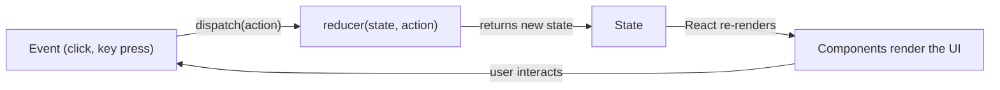

# Lesson 35 — useReducer & Context

In Lesson 34 all the state lived in `App` and you passed it down through props, level after level. This lesson moves the state into one **reducer** and shares it through **Context**, so any component can read it or change it directly. You also add editing and deleting your own messages.

## 🎯 Goal

The app looks the same as before, but the code is organized very differently. `App` no longer owns any state, and almost no component receives data or callbacks as props. New behavior: hover one of your own messages (the ones written by Sam) to get **Edit** and **Delete** buttons, or press <kbd>↑</kbd> in the empty message box to edit your last message.

{.screenshot}

The screenshot shows the resting state (nothing hovered), so it looks like Lesson 34. The change is under the surface. Clicking servers and channels, sending messages and collapsing categories must all still work.

## 🧠 New concepts

<ConceptList />

### The problem: prop drilling

In Lesson 34, `App` held the state and every component that needed a piece of it got it through props. `onSelectChannel` travelled `App → ChannelSidebar → ChannelList → Category → ChannelItem`, and four of those components only passed it along. Adding one more feature means touching a whole chain. This is called **prop drilling**.

Two tools fix it, and they work together:

1. A **reducer** puts all the *rules for changing state* in one place.
2. **Context** lets any component reach that state without props.

### Reducers: one function that decides every change

A **reducer** is a function with this shape:

```text
(state, action) => newState
```

It gets the current state and an **action** (a plain object that says what happened) and returns the next state. It never changes the old state. It builds a new one with the spread syntax from Lesson 34.

An action is just an object with a `type` and any extra data:

```text
{ type: 'toggleMembers' }
{ type: 'setNavOpen', open: true }
{ type: 'selectChannel', channelId: 'c-help' }
```

Inside the reducer, a `switch` picks the code for each `type`. You've seen `if`/`else if` chains; `switch` is the same idea when you compare one value against many fixed options:

```js
function describe(action) {
  switch (action.type) {
    case 'toggleMembers':
      return 'show or hide the member list';
    case 'setNavOpen':
      return 'open or close the drawer';
    default:
      return 'unknown';
  }
}
```

Each `case` ends with `return` (otherwise JavaScript would "fall through" into the next case). The `default` case runs when nothing matched.

::: tip Python comparison
Python 3.10+ has `match`/`case`, which is similar. A reducer is also like a function you'd pass to `functools.reduce`: it takes the "result so far" and one new item and returns the next result. Replaying a list of actions through the reducer rebuilds the state, step by step.
:::

#### Reducers must be pure

React's docs say a reducer must be **pure**: the same inputs always give the same output, and it changes nothing else. That is why `crypto.randomUUID()` and `new Date()` are *not* called inside the reducer: they return something different each time. The component that dispatches creates the id and timestamp and puts them in the action, as `Composer` does in this lesson. The reducer then only copies them into the state.

In development React also calls your reducer twice on purpose when `StrictMode` is on (you've had `<StrictMode>` in `main.jsx` since Lesson 32), to expose impure code. According to the `useReducer` page on react.dev, it keeps the result of one call and ignores the other. A pure reducer never notices.

### useReducer

`useReducer` is a hook like `useState`, but you give it your reducer:

```text
const [state, dispatch] = useReducer(reducer, initialArg, init)
```

- `reducer`: your `(state, action) => newState` function.
- `initialArg` and `init`: how to build the first state. React calls `init(initialArg)` once and uses the result as the first state. The third argument is optional; without it, `initialArg` itself is the first state.
- `state`: the current state.
- `dispatch`: a function. `dispatch(action)` sends an action to the reducer, and React re-renders with the new state.

In your own words: instead of calling several `setSomething` functions, a component says *what happened* (`dispatch({ type: 'toggleMembers' })`) and the reducer decides *what changes*.

### The data flow

This is the loop every React app with a reducer follows:



Compare with Lesson 16's loop in the plain-JS app: there, an event handler changed `state` directly and then called `update()`. Here, an event handler only *describes* the change with `dispatch`; the reducer applies it; and React, not you, calls the render.

### Context: sharing state without props

**Context** lets a component put a value somewhere that every component below it can read, no matter how deep. Three pieces:

```jsx
import { createContext, useContext } from 'react';

const ThemeContext = createContext(null);   // 1. create it

function Parent() {
  return (
    <ThemeContext value="dark">             {/* 2. provide a value */}
      <Child />
    </ThemeContext>
  );
}

function Child() {
  const theme = useContext(ThemeContext);   // 3. read it
  return <p>The theme is {theme}</p>;
}
```

- `createContext(defaultValue)` makes a context object. The default is only used when there is no provider above. We pass `null`.
- You **provide** a value by rendering the context object as a component with a `value` prop. Everything inside can read it.
- `useContext(ThemeContext)` returns the value from the nearest provider above.

::: warning React 19 syntax
Older tutorials write `<ThemeContext.Provider value={...}>`. According to react.dev's `createContext` page, "starting in React 19, you can render `<SomeContext>` as a provider", and `<SomeContext.Provider>` is the older way. This course uses React 19, so the snapshot writes `<AppContext value={...}>`. If you see `.Provider` in older code, it means the same thing.
:::

When the value changes, React re-renders the components that read it. We provide `{ state, dispatch }`, a new object on each render, so every component that calls `useApp()` re-renders whenever the app re-renders. That is fine for an app this size.

### A custom hook: useApp

Any function whose name starts with `use` and that calls other hooks is a **custom hook**. Ours is tiny:

```js
export function useApp() {
  return useContext(AppContext);
}
```

Components write `const { state, dispatch } = useApp();` and never need to know about `AppContext`. (Lesson 40 writes more custom hooks.)

### Where does state live now?

Not everything belongs in the shared reducer. The text typed into the edit box lives in `MessageEditor` with `useState`, because only that one component needs it while it is open. React keeps it as long as the editor is on screen. In the plain-JS app it had to be a global `state.editDraft`, kept in sync by hand. The rule of thumb: **state that many components read goes in the reducer; state only one component cares about stays local.**

New in the code this lesson: `autoFocus` (a JSX attribute that focuses an element when it first appears) and `Object.entries(obj)`, which gives an array of `[key, value]` pairs. Python's `dict.items()` is the same idea.

::: info Vanilla vs React
Plain-JS Lesson 31, `vanilla/js/actions.js`: a function changes the shared `state` object, then calls `update()` so the screen is redrawn.

```js
export function startEditing(messageId) {
  state.editingMessageId = messageId;
  state.editDraft = findMessage(messageId).content;
  update();
}
```

React, `react-app/src/state/reducer.js` and a component:

```js
case 'startEditing':
  return { ...state, editingMessageId: action.messageId };
```

```jsx
onClick={() => dispatch({ type: 'startEditing', messageId: message.id })}
```

The vanilla version mutates, and you must remember `update()`. The React version never mutates and never redraws by hand. Also note `state.editDraft` is gone: the draft is local state in `MessageEditor`.
:::

## 🛠️ Build it

All files are in `react-app/src/`. Run `npm run dev` inside `react-app/` and keep the page open. The page will break halfway through (components read context that does not exist yet) and work again once all steps are done, so don't worry about errors in the middle.

### Step 1 — Add selectors for the active server and channel

The "active server" and "active channel" used to be computed inside `App`. Move that logic into `state/selectors.js` so any component can reuse it.

1. At the top, delete the comment line `// \`state\` is an object with users, servers and messages.` (the state now has more than that).
2. After `getChannels`, add `getActiveServer`, `pickChannel` (moved here from `App.jsx`) and `getActiveChannel`.

::: solution
```js [react-app/src/state/selectors.js]
// Small functions that look things up in the app's data. They never change anything.


export const CURRENT_USER_ID = 'u-me';

export function getUser(state, userId) {
  return state.users.find((user) => user.id === userId);
}

// All channels of a server, without the categories around them.
export function getChannels(server) {
  return server.categories.flatMap((category) => category.channels);
}

export function getActiveServer(state) {
  return state.servers.find((server) => server.id === state.activeServerId);
}

// The channel to open for a server: the one you looked at last, or its first text channel.
export function pickChannel(server, activeChannelByServer) {
  const channels = getChannels(server);
  return channels.find((c) => c.id === activeChannelByServer[server.id]) ?? channels.find((c) => c.type === 'text');
}

export function getActiveChannel(state) {
  return pickChannel(getActiveServer(state), state.activeChannelByServer);
}

/* ...getRoleColor, isServerUnread, countServerMentions and mentionsMe stay unchanged... */
```
:::

### Step 2 — Add `updateMessage` to updates.js

Editing a message means "return a copy of the messages object where one message is replaced". Add this function at the bottom of `state/updates.js`. It uses `Object.entries` to loop over every channel's list.

::: solution
```js [react-app/src/state/updates.js]
/* ...updateChannel and toggleInList stay unchanged... */

// Returns new messages where one message is replaced by update(message).
export function updateMessage(messages, messageId, update) {
  const result = {};
  for (const [channelId, list] of Object.entries(messages)) {
    result[channelId] = list.map((message) => (message.id === messageId ? update(message) : message));
  }
  return result;
}
```
:::

### Step 3 — Create the reducer: initial state and navigation actions

Create `state/reducer.js`. First the state: everything `App` used to keep in `useState`, in one object, plus `editingMessageId` (which message is being edited, or `null`). Then the start of the reducer with the actions you already had in Lesson 34 (`selectServer`, `selectChannel`, `toggleCategory`, `toggleMembers`, `setNavOpen`).

Compare each case with the Lesson 34 handler in `App.jsx`: the logic is the same, but it *returns* a new state instead of calling several `set…` functions. For example, `selectServer` used to call `setActiveServerId` and `markRead`; now it returns one object with both changes.

The `default` case throws an error, so a typo in an action's `type` shows up immediately instead of silently doing nothing.

::: solution
```js [react-app/src/state/reducer.js]
// The reducer: ONE pure function that takes the current state and an action,
// and returns the next state. It never changes the old state — it builds a new one.
// (Random ids and timestamps are made by the caller: a reducer must give the
// same result every time it's called with the same input.)

import { getChannels, pickChannel } from './selectors.js';
import { updateChannel, updateMessage, toggleInList } from './updates.js';

export function createInitialState(data) {
  return {
    users: data.users,
    servers: data.servers,
    messages: data.messages,
    activeServerId: data.servers[0].id,
    activeChannelByServer: {},
    collapsedCategoryIds: [],
    showMembers: true,
    navOpen: false,
    editingMessageId: null,
  };
}

export function reducer(state, action) {
  switch (action.type) {
    case 'selectServer': {
      const server = state.servers.find((s) => s.id === action.serverId);
      const channel = pickChannel(server, state.activeChannelByServer);
      return {
        ...state,
        activeServerId: action.serverId,
        servers: updateChannel(state.servers, channel.id, { unread: false, mentions: 0 }),
        editingMessageId: null,
      };
    }
    case 'selectChannel': {
      const server = state.servers.find((s) => s.id === state.activeServerId);
      const channel = getChannels(server).find((c) => c.id === action.channelId);
      if (channel.type === 'voice') {
        return state; // joining voice channels comes in Lesson 40
      }
      return {
        ...state,
        activeChannelByServer: { ...state.activeChannelByServer, [server.id]: channel.id },
        servers: updateChannel(state.servers, channel.id, { unread: false, mentions: 0 }),
        navOpen: false,
        editingMessageId: null,
      };
    }
    case 'toggleCategory':
      return { ...state, collapsedCategoryIds: toggleInList(state.collapsedCategoryIds, action.categoryId) };
    case 'toggleMembers':
      return { ...state, showMembers: !state.showMembers };
    case 'setNavOpen':
      return { ...state, navOpen: action.open };

    /* ...message actions come in the next step... */

    default:
      throw new Error(`Unknown action: ${action.type}`);
  }
}
```
:::

### Step 4 — Add the message actions

Inside the same `switch`, replace the `/* ...message actions come in the next step... */` placeholder with the cases for sending, editing and deleting. Notice:

- `sendMessage` receives the whole `message` object in the action (id and timestamp made by the composer), and only appends it.
- `saveEdit` receives `content` and `editedAt` in the action. It skips the update when the text didn't change, so a no-op edit doesn't add "(edited)".
- `deleteMessage` builds a new `messages` object with `Object.entries`, filtering the message out of every channel's list.

::: solution
```js [react-app/src/state/reducer.js]
export function reducer(state, action) {
  switch (action.type) {
    /* ...the five navigation cases from Step 3 stay unchanged... */

    case 'sendMessage': {
      const list = state.messages[action.channelId] ?? [];
      return { ...state, messages: { ...state.messages, [action.channelId]: [...list, action.message] } };
    }
    case 'startEditing':
      return { ...state, editingMessageId: action.messageId };
    case 'cancelEditing':
      return { ...state, editingMessageId: null };
    case 'saveEdit':
      return {
        ...state,
        editingMessageId: null,
        messages: updateMessage(state.messages, action.messageId, (message) =>
          message.content === action.content ? message : { ...message, content: action.content, editedAt: action.editedAt },
        ),
      };
    case 'deleteMessage': {
      const messages = {};
      for (const [channelId, list] of Object.entries(state.messages)) {
        messages[channelId] = list.filter((m) => m.id !== action.messageId);
      }
      return { ...state, messages, editingMessageId: null };
    }

    default:
      throw new Error(`Unknown action: ${action.type}`);
  }
}
```
:::

### Step 5 — Create the context and provider

Create `state/AppContext.jsx`. This file is the only place that calls `useReducer`. `AppProvider` runs the reducer and provides `{ state, dispatch }` to its children; `useApp` is the hook everyone else uses. Since the file contains JSX, it must end in `.jsx`.

The initial data is imported from the JSON files, and `createInitialState(initialData)` runs once for the first state.

::: solution
```jsx [react-app/src/state/AppContext.jsx]
// One place that owns the app's state, shared with every component through Context.

import { createContext, useContext, useReducer } from 'react';
import { reducer, createInitialState } from './reducer.js';
import users from '../data/users.json';
import servers from '../data/servers.json';
import messages from '../data/messages.json';

const initialData = { users, servers, messages };

const AppContext = createContext(null);

export function AppProvider({ children }) {
  // createInitialState(initialData) runs once, to build the first state.
  const [state, dispatch] = useReducer(reducer, initialData, createInitialState);
  return <AppContext value={{ state, dispatch }}>{children}</AppContext>;
}

// Any component gets the state and dispatch with: const { state, dispatch } = useApp();
export function useApp() {
  return useContext(AppContext);
}
```
:::

### Step 6 — Wrap the app in the provider

In `main.jsx`, import `AppProvider` and wrap `<App />` with it, inside `<StrictMode>`. Everything inside the provider can now call `useApp()`.

::: solution
```jsx [react-app/src/main.jsx]
import { StrictMode } from 'react';
import { createRoot } from 'react-dom/client';
// The same CSS files as the vanilla app, copied into src/styles/
import './styles/theme.css';
import './styles/base.css';
import './styles/layout.css';
import './styles/server-rail.css';
import './styles/channels.css';
import './styles/chat.css';
import './styles/members.css';
import './styles/voice.css';
import './styles/overlays.css';
import './styles/responsive.css';
import App from './App.jsx';
import { AppProvider } from './state/AppContext.jsx';
import { applyBrand } from './brand.js';

applyBrand();

createRoot(document.getElementById('root')).render(
  <StrictMode>
    <AppProvider>
      <App />
    </AppProvider>
  </StrictMode>,
);
```
:::

### Step 7 — Slim down App.jsx

`App` shrinks to almost nothing: read the state, work out the active server and channel with the selectors, render the layout. Replace the whole file. The only thing it still passes down is `server`, `channel` and the active ids (values *derived* from state, which the children would otherwise each have to recompute).

The backdrop's click handler is now one `dispatch`.

::: solution
```jsx [react-app/src/App.jsx]
import { useApp } from './state/AppContext.jsx';
import { getActiveServer, getActiveChannel } from './state/selectors.js';
import { classNames } from './lib/classNames.js';
import { ServerRail } from './components/ServerRail.jsx';
import { ChannelSidebar } from './components/ChannelSidebar.jsx';
import { ChatArea } from './components/ChatArea.jsx';

function App() {
  const { state, dispatch } = useApp();
  const server = getActiveServer(state);
  const channel = getActiveChannel(state);

  return (
    <>
      <div className={classNames('app', state.navOpen && 'is-nav-open')}>
        <div className="nav-drawer">
          <ServerRail activeServerId={server.id} />
          <ChannelSidebar server={server} activeChannelId={channel.id} />
        </div>
        <ChatArea server={server} channel={channel} />
      </div>
      <div className="drawer-backdrop" id="drawer-backdrop" onClick={() => dispatch({ type: 'setNavOpen', open: false })} />
    </>
  );
}

export default App;
```
:::

### Step 8 — Let the sidebar components use context

Four files change in the same way. In each: import `useApp`, call it at the top of the component, delete the props you no longer need, and replace `onSomething(...)` callbacks with `dispatch({ type: ..., ... })`.

**`ServerRail.jsx`**: `ServerItem` loses `onSelect` and dispatches `selectServer`. `ServerRail` loses `servers` and `onSelectServer`, and maps `state.servers`.

**`ChannelSidebar.jsx`**: only passes `server` and `activeChannelId` to `ChannelList`, and renders `<UserPanel />` with no props. Remove the `selectors.js` import, which it no longer uses.

**`ChannelList.jsx`**: `VoiceUser` receives just a `userId` and looks the user up. `ChannelItem` dispatches `selectChannel`. `Category` works out `isCollapsed` from `state.collapsedCategoryIds` and dispatches `toggleCategory`.

**`UserPanel.jsx`**: no props; it finds the current user itself with `getUser(state, CURRENT_USER_ID)`.

::: solution
```jsx [react-app/src/components/ServerRail.jsx]
import { useApp } from '../state/AppContext.jsx';
import { isServerUnread, countServerMentions } from '../state/selectors.js';
import { brand } from '../brand.js';
import { classNames } from '../lib/classNames.js';
import { Icon } from './Icon.jsx';

function ServerItem({ server, isActive }) {
  const { dispatch } = useApp();
  const mentions = countServerMentions(server);
  return (
    <li className={classNames('server-item', isActive && 'is-active', isServerUnread(server) && 'is-unread')}>
      <button
        className={classNames('server-button', server.iconIsEmoji && 'is-emoji')}
        type="button"
        data-tooltip={server.name}
        aria-label={server.name}
        onClick={() => dispatch({ type: 'selectServer', serverId: server.id })}
      >
        {server.icon}
        {mentions > 0 && <span className="mention-badge">{mentions}</span>}
      </button>
    </li>
  );
}

export function ServerRail({ activeServerId }) {
  const { state } = useApp();
  return (
    <nav className="server-rail" aria-label="Servers">
      <ul className="server-list">
        <li className="server-item">
          <button className="server-button home-button" type="button" data-tooltip="Direct Messages" aria-label="Direct Messages">
            
          </button>
        </li>
        <li className="server-separator" role="separator" />
      </ul>
      <ul className="server-list" id="server-list">
        {state.servers.map((server) => (
          <ServerItem key={server.id} server={server} isActive={server.id === activeServerId} />
        ))}
      </ul>
      <ul className="server-list">
        <li className="server-item">
          <button className="server-button add-server-button" type="button" data-tooltip="Add a Server" aria-label="Add a Server">
            <Icon name="plus" />
          </button>
        </li>
      </ul>
    </nav>
  );
}
```
```jsx [react-app/src/components/ChannelSidebar.jsx]
import { ChannelList } from './ChannelList.jsx';
import { UserPanel } from './UserPanel.jsx';
import { Icon } from './Icon.jsx';

export function ChannelSidebar({ server, activeChannelId }) {
  return (
    <aside className="channel-sidebar" aria-label="Channels">
      <header className="sidebar-header">
        <h1 className="server-name" id="server-name">
          {server.name}
        </h1>
        <Icon name="chevron-down" />
      </header>
      <ChannelList server={server} activeChannelId={activeChannelId} />
      <UserPanel />
    </aside>
  );
}
```
```jsx [react-app/src/components/ChannelList.jsx]
import { useApp } from '../state/AppContext.jsx';
import { getUser } from '../state/selectors.js';
import { classNames } from '../lib/classNames.js';
import { Avatar } from './Avatar.jsx';
import { Icon } from './Icon.jsx';

function VoiceUser({ userId }) {
  const { state } = useApp();
  const user = getUser(state, userId);
  return (
    <li className="voice-user" data-user-id={userId}>
      <Avatar user={user} className="tiny" />
      <span className="voice-user-name">{user.displayName}</span>
    </li>
  );
}

function ChannelItem({ channel, isSelected }) {
  const { dispatch } = useApp();
  const voiceUserIds = channel.type === 'voice' ? channel.voiceUserIds : [];
  return (
    <li className={classNames('channel-item', isSelected && 'is-selected', channel.unread && 'is-unread')}>
      <button className="channel-button" type="button" onClick={() => dispatch({ type: 'selectChannel', channelId: channel.id })}>
        <Icon name={channel.type === 'voice' ? 'speaker' : 'hash'} />
        <span className="channel-name">{channel.name}</span>
        {channel.mentions > 0 && <span className="channel-mention-badge">{channel.mentions}</span>}
      </button>
      {voiceUserIds.length > 0 && (
        <ul className="voice-users">
          {voiceUserIds.map((userId) => (
            <VoiceUser key={userId} userId={userId} />
          ))}
        </ul>
      )}
    </li>
  );
}

function Category({ category, activeChannelId }) {
  const { state, dispatch } = useApp();
  const isCollapsed = state.collapsedCategoryIds.includes(category.id);

  // A collapsed category still shows the selected channel and busy voice channels.
  const visibleChannels = category.channels.filter((channel) => {
    const isBusyVoice = channel.type === 'voice' && channel.voiceUserIds.length > 0;
    return !isCollapsed || channel.id === activeChannelId || isBusyVoice;
  });

  return (
    <section className={classNames('category', isCollapsed && 'is-collapsed')}>
      <h3>
        <button
          className="category-toggle"
          type="button"
          aria-expanded={!isCollapsed}
          onClick={() => dispatch({ type: 'toggleCategory', categoryId: category.id })}
        >
          <Icon name="chevron-down" />
          {category.name}
        </button>
      </h3>
      <ul>
        {visibleChannels.map((channel) => (
          <ChannelItem key={channel.id} channel={channel} isSelected={channel.id === activeChannelId} />
        ))}
      </ul>
    </section>
  );
}

export function ChannelList({ server, activeChannelId }) {
  return (
    <nav className="channel-list scroller" id="channel-list" aria-label="Channel list">
      {server.categories.map((category) => (
        <Category key={category.id} category={category} activeChannelId={activeChannelId} />
      ))}
    </nav>
  );
}
```
```jsx [react-app/src/components/UserPanel.jsx]
import { useApp } from '../state/AppContext.jsx';
import { CURRENT_USER_ID, getUser } from '../state/selectors.js';
import { Avatar } from './Avatar.jsx';
import { Icon } from './Icon.jsx';

export function UserPanel() {
  const { state } = useApp();
  const me = getUser(state, CURRENT_USER_ID);
  return (
    <section className="user-panel" aria-label="Your account">
      <button className="user-panel-profile" type="button" id="user-panel-profile">
        <Avatar user={me} withStatus />
        <span className="user-panel-names">
          <span className="user-panel-name" id="user-panel-name">{me.displayName}</span>
          <span className="user-panel-tag" id="user-panel-tag">{me.customStatus || me.username}</span>
        </span>
      </button>
      {/* ...the three icon buttons (mute, deafen, settings) stay unchanged... */}
    </section>
  );
}
```
:::

### Step 9 — Let the chat components use context

Same pattern for three more files:

- **`ChatArea.jsx`**: `ChatHeader` reads `state.navOpen` and `state.showMembers` and dispatches `setNavOpen` / `toggleMembers`. The menu button gets `aria-expanded={state.navOpen}`. `ChatArea` only takes `server` and `channel` and reads `state.showMembers`. (The comment above `HeaderButton` is removed in the snapshot; keeping it is harmless.)
- **`MessageList.jsx`**: reads its messages with `state.messages[channel.id] ?? []`, so the `messages` and `data` props disappear. (`Message` also loses `data`.)
- **`MemberList.jsx`**: uses `state` instead of the `data` prop in `getUser(state, member.userId)`.

::: solution
```jsx [react-app/src/components/ChatArea.jsx]
import { useApp } from '../state/AppContext.jsx';
import { Icon } from './Icon.jsx';
import { MessageList } from './MessageList.jsx';
import { MemberList } from './MemberList.jsx';
import { Composer } from './Composer.jsx';

function HeaderButton({ icon, label, ...rest }) {
  return (
    <button className="icon-button" type="button" data-tooltip={label} aria-label={label} {...rest}>
      <Icon name={icon} />
    </button>
  );
}

function ChatHeader({ channel }) {
  const { state, dispatch } = useApp();
  return (
    <header className="chat-header">
      <button
        className="icon-button menu-button"
        type="button"
        id="menu-button"
        aria-label="Open channels"
        aria-expanded={state.navOpen}
        onClick={() => dispatch({ type: 'setNavOpen', open: true })}
      >
        <Icon name="menu" />
      </button>
      <svg className="icon chat-header-icon" aria-hidden="true">
        <use href="icons.svg#hash" />
      </svg>
      <h2 className="chat-title" id="chat-title">
        {channel.name}
      </h2>
      <p className="chat-topic" id="chat-topic">
        {channel.topic}
      </p>
      <div className="chat-toolbar">
        <HeaderButton icon="bell" label="Notification Settings" />
        <HeaderButton icon="pin" label="Pinned Messages" />
        <HeaderButton
          icon="members"
          label="Member List"
          id="members-button"
          aria-pressed={state.showMembers}
          onClick={() => dispatch({ type: 'toggleMembers' })}
        />
        <label className="search">
          <input className="search-input" type="search" placeholder="Search" aria-label="Search" />
          <Icon name="search" />
        </label>
        <HeaderButton icon="inbox" label="Inbox" />
        <HeaderButton icon="help" label="Help" />
      </div>
    </header>
  );
}

export function ChatArea({ server, channel }) {
  const { state } = useApp();
  return (
    <main className="chat">
      <ChatHeader channel={channel} />
      <div className="chat-body">
        <section className="chat-main" aria-label="Messages">
          <MessageList server={server} channel={channel} />
          <Composer channel={channel} />
          <p className="typing-indicator" id="typing-indicator" aria-live="polite"></p>
        </section>
        {state.showMembers && <MemberList server={server} />}
      </div>
    </main>
  );
}
```
```jsx [react-app/src/components/MessageList.jsx]
import { useApp } from '../state/AppContext.jsx';
import { isSameDay, minutesBetween, formatDate } from '../lib/time.js';
import { Message } from './Message.jsx';
```
```jsx [react-app/src/components/MessageList.jsx]
export function MessageList({ server, channel }) {
  const { state } = useApp();
  const messages = state.messages[channel.id] ?? [];

  const items = [];
  let previous = null;
  for (const message of messages) {
    if (!previous || !isSameDay(previous.timestamp, message.timestamp)) {
      items.push(
        <li key={`day-${message.id}`} className="date-divider" role="separator">
          <span>{formatDate(message.timestamp)}</span>
        </li>,
      );
    }
    items.push(<Message key={message.id} message={message} server={server} startsGroup={startsNewGroup(previous, message)} />);
    previous = message;
  }

  return (
    <ol className="message-list scroller" id="message-list">
      <li className="channel-welcome">
        <div className="channel-welcome-icon">
          <Icon name="hash" />
        </div>
        <h3 className="channel-welcome-title">Welcome to #{channel.name}!</h3>
        <p className="channel-welcome-text">This is the start of the #{channel.name} channel.</p>
      </li>
      {items}
    </ol>
  );
}
```
```jsx [react-app/src/components/MemberList.jsx]
import { useApp } from '../state/AppContext.jsx';
import { getUser } from '../state/selectors.js';
import { classNames } from '../lib/classNames.js';
import { Avatar } from './Avatar.jsx';
```
```jsx [react-app/src/components/MemberList.jsx]
export function MemberList({ server }) {
  const { state } = useApp();
  const users = server.members.map((member) => getUser(state, member.userId));
  return (
    <aside className="member-list scroller" id="member-list" aria-label="Members">
      <h3 className="member-group-title">Members — {users.length}</h3>
      {users.map((user) => (
        <Member key={user.id} user={user} />
      ))}
    </aside>
  );
}
```
:::

### Step 10 — Dispatch from the Composer

In `Composer.jsx`:

1. Import `useApp` and `CURRENT_USER_ID`.
2. The `onSend` prop is gone. In `send()`, build the whole message *here* (id and timestamp are made here, not in the reducer) and `dispatch({ type: 'sendMessage', ... })`.
3. In `handleKeyDown`, add the <kbd>↑</kbd> shortcut: when the box is empty, find your own last message in the current channel and dispatch `startEditing`.

::: solution
```jsx [react-app/src/components/Composer.jsx]
import { useState } from 'react';
import { useApp } from '../state/AppContext.jsx';
import { CURRENT_USER_ID } from '../state/selectors.js';
import { Icon } from './Icon.jsx';

// The message box: Enter sends, Shift+Enter adds a new line.
export function Composer({ channel }) {
  const { state, dispatch } = useApp();
  const [text, setText] = useState('');

  function send() {
    const content = text.trim();
    if (content === '') {
      return;
    }
    dispatch({
      type: 'sendMessage',
      channelId: channel.id,
      message: { id: crypto.randomUUID(), authorId: CURRENT_USER_ID, content, timestamp: new Date().toISOString(), reactions: [] },
    });
    setText('');
  }

  function handleKeyDown(event) {
    if (event.key === 'Enter' && !event.shiftKey) {
      event.preventDefault();
      send();
    }
    // Up arrow in an empty box edits your last message
    if (event.key === 'ArrowUp' && text === '') {
      const mine = (state.messages[channel.id] ?? []).filter((m) => m.authorId === CURRENT_USER_ID);
      if (mine.length > 0) {
        event.preventDefault();
        dispatch({ type: 'startEditing', messageId: mine[mine.length - 1].id });
      }
    }
  }

  function handleSubmit(event) {
    event.preventDefault();
    send();
  }

  return (
    <form className="composer" id="composer" onSubmit={handleSubmit}>
      <button className="icon-button composer-button" type="button" aria-label="Upload a file">
        <Icon name="plus" />
      </button>
      <textarea
        className="composer-input"
        id="composer-input"
        rows={1}
        aria-label="Message"
        placeholder={`Message #${channel.name}`}
        value={text}
        onChange={(event) => setText(event.target.value)}
        onKeyDown={handleKeyDown}
      />
      <button className="icon-button composer-button" type="button" id="composer-emoji-button" aria-label="Choose an emoji">
        <Icon name="emoji" />
      </button>
    </form>
  );
}
```
:::

### Step 11 — Edit and delete in Message.jsx

This is the biggest change. In `Message.jsx`:

1. Add imports: `useState` from `react`, `useApp`, and `Icon`.
2. Add `MessageEditor`. It keeps `draft` in **local** `useState`, starting from `message.content`. <kbd>Esc</kbd> cancels, <kbd>Enter</kbd> saves, and saving an empty draft deletes the message (like the vanilla app). `autoFocus` puts the cursor in the box when it appears. The `{' '}` pieces keep a visible space between the text and the buttons, because JSX trims whitespace around line breaks.
3. Add `ActionButton`, a small button used for Edit and Delete.
4. In `Message`: read `state` and `dispatch` from `useApp()`, compute `isEditing`, add `handleDelete` (Shift+click deletes at once, otherwise `window.confirm` asks first), add `is-editing` to the class list, show `<MessageEditor>` instead of the text when editing, and render the Edit/Delete buttons only for your own messages.

::: solution
```jsx [react-app/src/components/Message.jsx]
import { useState } from 'react';
import { useApp } from '../state/AppContext.jsx';
import { CURRENT_USER_ID, getUser, getRoleColor, mentionsMe } from '../state/selectors.js';
import { renderMarkdown } from '../lib/markdown.js';
import { formatTime, formatTimestamp } from '../lib/time.js';
import { classNames } from '../lib/classNames.js';
import { Avatar } from './Avatar.jsx';
import { Icon } from './Icon.jsx';

// The edit box. Its text lives in this component's own state: React keeps it
// even when the rest of the app re-renders.
function MessageEditor({ message }) {
  const { dispatch } = useApp();
  const [draft, setDraft] = useState(message.content);

  function save() {
    const content = draft.trim();
    if (content === '') {
      dispatch({ type: 'deleteMessage', messageId: message.id });
    } else {
      dispatch({ type: 'saveEdit', messageId: message.id, content, editedAt: new Date().toISOString() });
    }
  }

  function handleKeyDown(event) {
    if (event.key === 'Escape') {
      dispatch({ type: 'cancelEditing' });
    } else if (event.key === 'Enter' && !event.shiftKey) {
      event.preventDefault();
      save();
    }
  }

  return (
    <div className="editor">
      <textarea
        className="edit-input"
        rows={3}
        aria-label="Edit message"
        autoFocus
        value={draft}
        onChange={(event) => setDraft(event.target.value)}
        onKeyDown={handleKeyDown}
      />
      <p className="edit-hint">
        escape to{' '}
        <button type="button" onClick={() => dispatch({ type: 'cancelEditing' })}>
          cancel
        </button>{' '}
        • enter to{' '}
        <button type="button" onClick={save}>
          save
        </button>
      </p>
    </div>
  );
}
```
```jsx [react-app/src/components/Message.jsx]
function ActionButton({ action, icon, label, className, onClick }) {
  return (
    <button
      className={classNames('icon-button', className)}
      type="button"
      data-action={action}
      data-tooltip={label}
      aria-label={label}
      onClick={onClick}
    >
      <Icon name={icon} />
    </button>
  );
}

export function Message({ message, server, startsGroup }) {
  const { state, dispatch } = useApp();
  const author = getUser(state, message.authorId);
  const isMine = message.authorId === CURRENT_USER_ID;
  const isEditing = state.editingMessageId === message.id;

  function handleDelete(event) {
    // Shift+click deletes right away; otherwise ask first. (Lesson 39 replaces confirm() with a dialog.)
    if (event.shiftKey || window.confirm('Delete this message?')) {
      dispatch({ type: 'deleteMessage', messageId: message.id });
    }
  }

  return (
    <li
      className={classNames(
        'message',
        startsGroup && 'is-group-start',
        !isMine && mentionsMe(state, message.content) && 'is-mention',
        isEditing && 'is-editing',
      )}
      data-message-id={message.id}
    >
      <div className="message-gutter">
        {startsGroup ? (
          <button className="avatar-button" type="button" data-user-id={author.id} aria-label={`${author.displayName}'s profile`}>
            <Avatar user={author} />
          </button>
        ) : (
          <time className="message-hover-time" dateTime={message.timestamp}>
            {formatTime(message.timestamp)}
          </time>
        )}
      </div>

      <div className="message-body">
        {startsGroup && (
          <h3 className="message-header">
            <button className="message-author" type="button" data-user-id={author.id} style={{ '--author-color': getRoleColor(server, author.id) }}>
              {author.displayName}
            </button>
            {author.bot && <span className="bot-tag">Bot</span>}
            <time className="message-time" dateTime={message.timestamp}>
              {formatTimestamp(message.timestamp)}
            </time>
          </h3>
        )}

        {isEditing ? (
          <MessageEditor message={message} />
        ) : (
          <div className="message-content">
            {/* renderMarkdown escapes the text first, so this is safe */}
            <span dangerouslySetInnerHTML={{ __html: renderMarkdown(message.content) }} />
            {message.editedAt && <span className="edited-label"> (edited)</span>}
          </div>
        )}

        {message.reactions.length > 0 && <Reactions message={message} />}
      </div>

      {isMine && (
        <div className="message-actions">
          <ActionButton action="edit" icon="edit" label="Edit" onClick={() => dispatch({ type: 'startEditing', messageId: message.id })} />
          <ActionButton action="delete" icon="trash" label="Delete" className="danger" onClick={handleDelete} />
        </div>
      )}
    </li>
  );
}
```
:::

## ✅ Checkpoint

- [ ] The page loads with no red errors in the DevTools **Console**, and looks like Lesson 34.
- [ ] Clicking a server, a channel and a category title still works, and the member-list button still toggles the list.
- [ ] Sending a message with <kbd>Enter</kbd> still adds it and clears the box.
- [ ] Hovering one of Sam's messages shows Edit and Delete buttons. Other people's messages show none.
- [ ] Clicking Edit shows a text box with the old text. Typing and pressing <kbd>Enter</kbd> saves it and shows "(edited)". <kbd>Esc</kbd> cancels.
- [ ] Pressing <kbd>↑</kbd> in the empty message box starts editing your last message.
- [ ] Delete asks "Delete this message?"; <kbd>Shift</kbd>+click on Delete skips the question.
- [ ] `grep -r "onSelectChannel" react-app/src` (in the terminal, from the project root) finds nothing: the drilled props are gone.
- [ ] If you have the React Developer Tools browser extension, the **Components** tab shows `AppProvider` above `App`. (Optional.)

## 🐛 Common mistakes

**An error about destructuring `state` from `null` (exact wording varies by browser).** A component calls `useApp()` outside `AppProvider`, usually because you forgot to wrap `<App />` in `main.jsx` (Step 6). The context's default value is `null`, so there is nothing to destructure.

**Nothing happens when you click, and there is no error.** You probably mutated state (`state.showMembers = !state.showMembers; return state;`). A reducer must return a *new* object. Use `{ ...state, ... }`.

**`Unknown action: selectChanel`.** A typo in a `type` string; the `default` case throws on purpose. Compare the string in `dispatch` with the `case` in the reducer.

**The edit text jumps back to the old text.** The draft state was put in the wrong place, or `value={draft}` is missing `onChange`. In `MessageEditor` both `value` and `onChange` must be set, as in the Lesson 34 composer.

**A `.js` file with JSX fails to parse.** `AppContext.jsx` contains JSX (`<AppContext value=…>`), so its extension must be `.jsx`. Make sure the imports say `AppContext.jsx` too.

## 📝 Quiz

::: quiz
What does a reducer function return?

- [ ] Nothing: it changes `state` directly
- [x] The next state, as a new object, without changing the old one
- [ ] The action that should run next
- [ ] The component to render

> A reducer has the shape `(state, action) => newState`. It must not mutate the old state; React uses the new object to know that something changed.
:::

::: quiz
Predict what happens:

```js
function reducer(state, action) {
  switch (action.type) {
    case 'add':
      return { ...state, count: state.count + 1 };
    default:
      throw new Error(`Unknown action: ${action.type}`);
  }
}
// in a component:
dispatch({ type: 'remove' });
```

- [ ] `count` goes down by one
- [ ] Nothing happens
- [x] The `default` case runs and throws an error
- [ ] `count` stays the same and the page re-renders

> There is no `case 'remove'`, so the `default` branch runs and throws. That is deliberate: a misspelled action type is loud instead of silent.
:::

::: quiz
Why do `Composer` and `MessageEditor` call `crypto.randomUUID()` and `new Date()` themselves instead of the reducer doing it?

- [ ] Because reducers cannot use JavaScript built-ins
- [x] Because a reducer must be pure: the same state and action must always give the same result
- [ ] Because `dispatch` only accepts strings
- [ ] Because the browser blocks `new Date()` inside `switch`

> Random ids and the current time change on every call. Created by the caller and sent inside the action, they are just data to the reducer, so the reducer stays predictable (and React can safely call it twice in development to check this).
:::

## 💾 Commit

```sh
git add .
git commit -m "Move app state into a reducer and share it with Context"
git push
```
