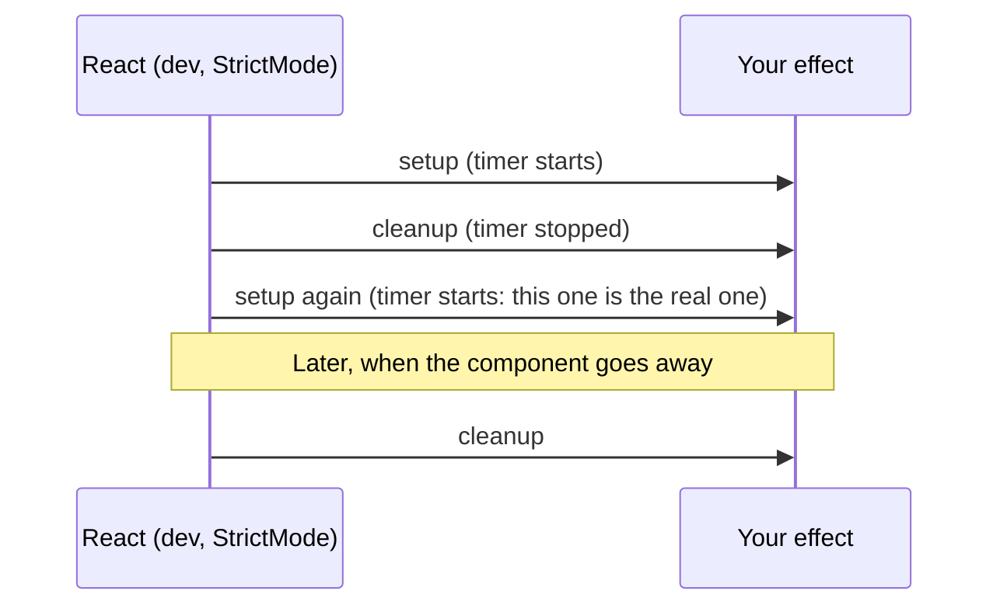

# Lesson 36 — Effects & refs

Rendering a component is supposed to be a pure calculation: props and state in, JSX out. But a real app also has to talk to things *outside* React: `localStorage`, timers, the keyboard, the size of a text box. **Effects** and **refs** are React's tools for that. In this lesson you add saving, fake chat activity, a typing indicator, auto-growing text boxes and smart scrolling.

## 🎯 Goal

The app now behaves like the plain-JS version from the end of the vanilla half: your servers, messages and open channel survive a page reload, other people send messages every so often, and "Ava is typing…" appears under the message box before their message arrives. Messages and the composer also scroll and resize on their own.

{.screenshot}

The screenshot is a still frame, so most of the new behavior is invisible in it. One clue: the message list is scrolled all the way down to the newest messages, which is the new scroll effect at work. Verify the rest in the browser, as the Checkpoint describes: send a message, wait for a reply, reload the page.

## 🧠 New concepts

<ConceptList />

### Render vs effect

Your component function runs during **rendering**. It should only calculate JSX from props and state. If it also saved to `localStorage` or started a timer, that would happen every time React happened to render, which can be more often than you expect.

An **effect** is code that runs *after* React has put the result on the screen. You write it with `useEffect`:

```jsx
useEffect(() => {
  // runs after the render is on screen
  document.title = `Channel: ${channel.name}`;
}, [channel.name]);
```

React's docs describe effects as a way to **synchronize a component with an external system**: `localStorage`, the browser's title, a timer, the keyboard, a server. If you're not talking to something outside React, you probably don't need an effect.

### The dependency array

The second argument is the **dependency array**: a list of values the effect uses. React runs the effect after the first render and then again after any render where one of those values changed.

| Second argument | When the effect runs |
| --- | --- |
| `[a, b]` | after the first render, and after renders where `a` or `b` changed |
| `[]` | once, after the first render |
| left out | after every render |

React compares each dependency with its previous value using `Object.is`: roughly, "is it the same value or the same object?". This is why Lesson 34 insisted on never mutating state: a mutated object is still "the same object", so React would not notice the change.

### Cleanup

An effect can return a **cleanup function**. React runs it before running the effect again, and when the component disappears:

```jsx
useEffect(() => {
  const timer = setTimeout(() => console.log('time is up'), 5000);
  return () => clearTimeout(timer);   // cleanup: undo what the effect started
}, []);
```

Whatever an effect starts (a timer, an event listener), the cleanup should stop. `clearTimeout(timer)` cancels a timer made with `setTimeout`; `removeEventListener` is the opposite of `addEventListener`. Without cleanup you get duplicate timers and listeners.

### StrictMode runs effects twice in development

`main.jsx` wraps the app in `<StrictMode>`. According to react.dev's `useEffect` page, when Strict Mode is on, React runs **one extra development-only setup + cleanup cycle** before the first real setup. Your effect starts, gets cleaned up, and starts again. This is a stress test: if your cleanup truly undoes your setup, nothing visible changes. If you forget cleanup, you'll see two timers or two listeners, and that is the bug StrictMode wants you to find. It only happens in development, not in a production build.



### Refs: a box that React doesn't watch

`useRef(initialValue)` returns an object `{ current: initialValue }` that stays the same between renders. Changing `ref.current` does **not** cause a re-render. Two uses in this lesson:

1. **Reaching a DOM element.** Put `ref={myRef}` on a JSX element, and after React creates the element, `myRef.current` is the real DOM element: the same thing `document.querySelector` would give you in the plain-JS app. You need it to call `.focus()` or to read `scrollHeight`.
2. **Remembering a value without re-rendering.** For example "was the user near the bottom of the list?". It isn't shown on screen, so it shouldn't be state.

```jsx
function Example() {
  const inputRef = useRef(null);   // starts as null
  return (
    <>
      <input ref={inputRef} />
      <button type="button" onClick={() => inputRef.current.focus()}>Focus</button>
    </>
  );
}
```

`inputRef.current` is `null` until React has created the element, which is why you use it in effects and event handlers, never while rendering.

### useLayoutEffect: before the browser paints

`useEffect` runs after the browser has painted. For scrolling that causes a flash: the list appears at the top for one frame and then jumps. `useLayoutEffect` has the same shape but fires **before the browser repaints**, so the jump happens invisibly. React's docs say it can hurt performance and that you should prefer `useEffect` when possible. We use it exactly once, for scroll position.

### Reading the latest state from a timer

A timer started in an effect with `[]` captures the `state` from the render where it started and keeps seeing that old value forever. The fix used here: `AppProvider` keeps the latest state in a ref (`stateRef`), and offers `getState()`, which reads `stateRef.current`. Timer code calls `getState()` when it fires and always sees the current state.

### Optional chaining `?.`

`saved?.users` means "`saved.users`, but if `saved` is `null` or `undefined`, give `undefined` instead of crashing". Combined with the `??` fallback operator you've already used, `saved?.users ?? data.users` reads: "the saved users, or the default if nothing was saved".

::: tip Python comparison
`saved?.users ?? data.users` is like `saved.get("users") if saved else None` followed by `or data["users"]`. And `useEffect` cleanup is like a `try`/`finally` or a context manager's `__exit__`: whatever you set up, you promise to tear down.
:::

::: info Vanilla vs React
The plain-JS app (`vanilla/js/layout.js`) adds listeners once at startup and never removes them, because the page lives as long as the script:

```js
document.addEventListener('keydown', (event) => {
  if (event.key === 'Escape') {
    closeNav();
  }
});
```

In React (`react-app/src/App.jsx`) the same behavior is an effect with a cleanup, because React components can be removed and re-created (and StrictMode does exactly that in development):

```jsx
useEffect(() => {
  function handleKeyDown(event) {
    if (event.key === 'Escape') {
      closeNav();
    }
  }
  document.addEventListener('keydown', handleKeyDown);
  return () => document.removeEventListener('keydown', handleKeyDown);
}, [dispatch]);
```

More code, but the lifetime of the listener is now written down next to the code that creates it.
:::

## 🛠️ Build it

Files are in `react-app/src/`. Keep `npm run dev` running.

### Step 1 — Selectors to find a channel

The simulation and the reducer need to find a channel (or its server) from just a channel id. In `state/selectors.js`, add `findChannel` and `findServerOfChannel` right after `getChannels`.

::: solution
```js [react-app/src/state/selectors.js]
export function findChannel(state, channelId) {
  for (const server of state.servers) {
    const channel = getChannels(server).find((c) => c.id === channelId);
    if (channel) {
      return channel;
    }
  }
  return null;
}

export function findServerOfChannel(state, channelId) {
  return state.servers.find((server) => getChannels(server).some((c) => c.id === channelId));
}
```
:::

### Step 2 — Saving and loading with localStorage

Create `state/storage.js`. It uses the same key and format as the plain-JS app: `loadSaved` returns the saved object or `null`, `save` stores only the data (not temporary UI like "is the drawer open"), and `clearSaved` deletes it.

::: solution
```js [react-app/src/state/storage.js]
// Saving and loading the app's data in localStorage.
// Same key and same format as the vanilla app.

const STORAGE_KEY = 'chat-clone-state-v1';

export function loadSaved() {
  const text = localStorage.getItem(STORAGE_KEY);
  if (text === null) {
    return null;
  }
  try {
    return JSON.parse(text);
  } catch (error) {
    console.warn('Saved state was corrupted, starting fresh.', error);
    return null;
  }
}

export function save(state) {
  const saved = {
    users: state.users,
    servers: state.servers,
    messages: state.messages,
    activeServerId: state.activeServerId,
    activeChannelByServer: state.activeChannelByServer,
    collapsedCategoryIds: state.collapsedCategoryIds,
  };
  localStorage.setItem(STORAGE_KEY, JSON.stringify(saved));
}

export function clearSaved() {
  localStorage.removeItem(STORAGE_KEY);
}
```
:::

### Step 3 — The chatter data

The fake messages come from a JSON file, the same idea as the vanilla `data/` files.

::: starter
<<< @/../solutions/lesson-36/react-app/src/data/chatter.json [react-app/src/data/chatter.json]
:::

<!-- no-solution: starter data is pasted, nothing to type -->

### Step 4 — Reducer: load saved state, unread badges, typing

In `state/reducer.js`:

1. Import `loadSaved`, and add `CURRENT_USER_ID`, `getActiveChannel` and `findChannel` to the selectors import.
2. `createInitialState` now calls `loadSaved()` first. Each data field is `saved?.x ?? data.x`. It also keeps `chatter` (never changes), `typing: null`, and decides whether the member list starts visible with `window.matchMedia('(max-width: 1000px)')` (hidden on narrow screens, like the vanilla app).
3. `sendMessage` now does more: when someone **else** posts in a channel you're not looking at, it marks that channel unread and counts a mention if the action says so (`mentionsMe`). It also clears `typing` if the sender was the one "typing".
4. A new `setTyping` case.

The reducer still doesn't generate anything random: `mentionsMe` is calculated by the dispatcher and sent in the action.

::: solution
```js [react-app/src/state/reducer.js]
// The reducer: ONE pure function that takes the current state and an action,
// and returns the next state. It never changes the old state — it builds a new one.
// (Random ids and timestamps are made by the caller: a reducer must give the
// same result every time it's called with the same input.)

import { loadSaved } from './storage.js';
import { CURRENT_USER_ID, getActiveChannel, getChannels, pickChannel, findChannel } from './selectors.js';
import { updateChannel, updateMessage, toggleInList } from './updates.js';

// Builds the first state: from localStorage if something was saved, otherwise from the JSON files.
export function createInitialState(data) {
  const saved = loadSaved();
  return {
    // Data (saved in localStorage)
    users: saved?.users ?? data.users,
    servers: saved?.servers ?? data.servers,
    messages: saved?.messages ?? data.messages,
    activeServerId: saved?.activeServerId ?? data.servers[0].id,
    activeChannelByServer: saved?.activeChannelByServer ?? {},
    collapsedCategoryIds: saved?.collapsedCategoryIds ?? [],

    // Never changes
    chatter: data.chatter,

    // Temporary UI state (not saved)
    showMembers: !window.matchMedia('(max-width: 1000px)').matches,
    navOpen: false,
    editingMessageId: null,
    typing: null, // { channelId, userId } while someone is "typing"
  };
}
```
```js [react-app/src/state/reducer.js]
export function reducer(state, action) {
  switch (action.type) {
    /* ...the navigation cases are unchanged... */

    case 'sendMessage': {
      const { message, channelId, mentionsMe } = action;
      const list = state.messages[channelId] ?? [];
      let servers = state.servers;
      // A message from someone else in a channel you're not looking at
      if (message.authorId !== CURRENT_USER_ID && channelId !== getActiveChannel(state).id) {
        const channel = findChannel(state, channelId);
        servers = updateChannel(servers, channelId, { unread: true, mentions: channel.mentions + (mentionsMe ? 1 : 0) });
      }
      return {
        ...state,
        servers,
        messages: { ...state.messages, [channelId]: [...list, message] },
        // Whoever was "typing" this message is done typing
        typing: state.typing && state.typing.userId === message.authorId ? null : state.typing,
      };
    }
    case 'setTyping':
      return { ...state, typing: action.typing };

    /* ...startEditing, cancelEditing, saveEdit, deleteMessage and default are unchanged... */
  }
}
```
:::

### Step 5 — Provider: latest-state ref and the save effect

In `state/AppContext.jsx`:

1. Import `useEffect` and `useRef`, `save` from `./storage.js`, and `chatter.json`. `initialData` now includes `chatter`.
2. Create `stateRef` with `useRef(state)`. An effect **with no dependency array** runs after every render and copies the newest state into `stateRef.current`.
3. A second effect calls `save(state)`. Its dependency array lists only the *data* parts of the state, so editing in the edit box or opening the drawer doesn't write to `localStorage`.
4. Provide `getState: () => stateRef.current` next to `state` and `dispatch`.

::: solution
```jsx [react-app/src/state/AppContext.jsx]
// One place that owns the app's state, shared with every component through Context.

import { createContext, useContext, useEffect, useReducer, useRef } from 'react';
import { reducer, createInitialState } from './reducer.js';
import { save } from './storage.js';
import users from '../data/users.json';
import servers from '../data/servers.json';
import messages from '../data/messages.json';
import chatter from '../data/chatter.json';

const initialData = { users, servers, messages, chatter };

const AppContext = createContext(null);

export function AppProvider({ children }) {
  // createInitialState runs once, to build the first state (from localStorage or the JSON files).
  const [state, dispatch] = useReducer(reducer, initialData, createInitialState);

  // Timers need the *latest* state, not the state from when they were started.
  // A ref is a box whose .current value survives re-renders without causing one.
  const stateRef = useRef(state);
  useEffect(() => {
    stateRef.current = state;
  });

  // Save the data whenever it changes (not on every UI change).
  useEffect(() => {
    save(state);
  }, [state.users, state.servers, state.messages, state.activeServerId, state.activeChannelByServer, state.collapsedCategoryIds]);

  const value = { state, dispatch, getState: () => stateRef.current };
  return <AppContext value={value}>{children}</AppContext>;
}

// Any component gets the state and dispatch with: const { state, dispatch } = useApp();
export function useApp() {
  return useContext(AppContext);
}
```
:::

### Step 6 — The simulation

Create `lib/simulation.js`. It is the vanilla `simulation.js` rewritten so it has no global state: it receives `getState` (to read the latest state) and `dispatch` (to change it). Read it top to bottom:

- `typeThenSend` dispatches `setTyping`, waits `typingTime` with `setTimeout`, then dispatches `sendMessage`. It **returns the timer id** so the caller can cancel it.
- `startSimulation` runs a loop of `setTimeout`s (every 15 to 30 seconds), remembers both timer ids, and **returns a function that clears them**. That returned function is what an effect cleanup will call.
- `scheduleReply` makes someone sometimes answer after you send a message.

::: solution
```js [react-app/src/lib/simulation.js]
// Fake activity: people "type", then messages arrive. Pure timers and randomness.
// These functions get the latest state with getState() and change it with dispatch().

import { CURRENT_USER_ID, getUser, getChannels, getActiveServer, findServerOfChannel, mentionsMe } from '../state/selectors.js';

function randomItem(items) {
  return items[Math.floor(Math.random() * items.length)];
}

function randomBetween(min, max) {
  return min + Math.random() * (max - min);
}

function possibleAuthors(state, server) {
  return server.members
    .map((member) => getUser(state, member.userId))
    .filter((user) => user.id !== CURRENT_USER_ID && user.status !== 'offline' && !user.bot);
}

// Someone types for a moment (longer text = longer typing), then the message appears.
function typeThenSend(getState, dispatch, channelId, userId, text) {
  dispatch({ type: 'setTyping', typing: { channelId, userId } });
  const typingTime = Math.min(1000 + text.length * 50, 5000);
  return setTimeout(() => {
    const state = getState();
    dispatch({
      type: 'sendMessage',
      channelId,
      mentionsMe: mentionsMe(state, text),
      message: { id: crypto.randomUUID(), authorId: userId, content: text, timestamp: new Date().toISOString(), reactions: [] },
    });
  }, typingTime);
}

function pickLine(state) {
  if (Math.random() < 0.2) {
    return randomItem(state.chatter.mentionLines).replace('{me}', getUser(state, CURRENT_USER_ID).displayName);
  }
  return randomItem(state.chatter.lines);
}

// Starts the endless "someone writes something every 15–30 seconds" loop.
// Returns a function that stops it (for a useEffect cleanup).
export function startSimulation(getState, dispatch) {
  let timer = null;
  let typingTimer = null;
  function scheduleNext() {
    timer = setTimeout(() => {
      const state = getState();
      // Usually the server you're looking at, sometimes another one (so badges appear).
      const server = Math.random() < 0.7 ? getActiveServer(state) : randomItem(state.servers);
      const textChannels = getChannels(server).filter((c) => c.type === 'text');
      const authors = possibleAuthors(state, server);
      if (state.typing === null && textChannels.length > 0 && authors.length > 0) {
        typingTimer = typeThenSend(getState, dispatch, randomItem(textChannels).id, randomItem(authors).id, pickLine(state));
      }
      scheduleNext();
    }, randomBetween(15000, 30000));
  }
  scheduleNext();
  return () => {
    clearTimeout(timer);
    clearTimeout(typingTimer);
  };
}

// After you send a message, someone sometimes answers.
export function scheduleReply(getState, dispatch, channelId) {
  const state = getState();
  const authors = possibleAuthors(state, findServerOfChannel(state, channelId));
  if (authors.length === 0 || Math.random() < 0.4) {
    return;
  }
  setTimeout(() => {
    if (getState().typing === null) {
      typeThenSend(getState, dispatch, channelId, randomItem(authors).id, randomItem(getState().chatter.replies));
    }
  }, randomBetween(800, 2500));
}
```
:::

### Step 7 — The useSimulation hook

Create `hooks/useSimulation.js` (a new `hooks` folder). The effect starts the simulation when the component appears and returns `stop` as its cleanup. The array is `[dispatch]`: `dispatch` never changes, so the effect runs once (twice in development because of StrictMode, which is exactly what the cleanup makes harmless).

::: solution
```js [react-app/src/hooks/useSimulation.js]
import { useEffect } from 'react';
import { useApp } from '../state/AppContext.jsx';
import { startSimulation } from '../lib/simulation.js';

// Starts the fake chat activity when the app appears, and stops it if it goes away.
export function useSimulation() {
  const { dispatch, getState } = useApp();
  useEffect(() => {
    const stop = startSimulation(getState, dispatch);
    return stop; // React calls this cleanup when the component unmounts
    // getState always reads the latest state, so the effect only needs to run once.
  }, [dispatch]);
}
```
:::

### Step 8 — Use the hook, and turn App's listeners into an effect

In `App.jsx`, import `useEffect` and `useSimulation`. Call `useSimulation()` at the top of `App`. Then add the effect for <kbd>Esc</kbd> and for `matchMedia`: when the window grows wider than 1000px, the drawer closes. Both listeners are removed in the cleanup.

::: solution
```jsx [react-app/src/App.jsx]
import { useEffect } from 'react';
import { useApp } from './state/AppContext.jsx';
import { getActiveServer, getActiveChannel } from './state/selectors.js';
import { useSimulation } from './hooks/useSimulation.js';
import { classNames } from './lib/classNames.js';
import { ServerRail } from './components/ServerRail.jsx';
import { ChannelSidebar } from './components/ChannelSidebar.jsx';
import { ChatArea } from './components/ChatArea.jsx';

function App() {
  const { state, dispatch } = useApp();
  const server = getActiveServer(state);
  const channel = getActiveChannel(state);

  // Fake people typing and sending messages.
  useSimulation();

  // Escape closes the drawer; growing the window past the breakpoint does too.
  // The cleanup function removes the listeners if App ever goes away.
  useEffect(() => {
    const narrowScreen = window.matchMedia('(max-width: 1000px)');
    const closeNav = () => dispatch({ type: 'setNavOpen', open: false });
    function handleKeyDown(event) {
      if (event.key === 'Escape') {
        closeNav();
      }
    }
    document.addEventListener('keydown', handleKeyDown);
    narrowScreen.addEventListener('change', closeNav);
    return () => {
      document.removeEventListener('keydown', handleKeyDown);
      narrowScreen.removeEventListener('change', closeNav);
    };
  }, [dispatch]);

  return (
    <>
      <div className={classNames('app', state.navOpen && 'is-nav-open')}>
        <div className="nav-drawer">
          <ServerRail activeServerId={server.id} />
          <ChannelSidebar server={server} activeChannelId={channel.id} />
        </div>
        <ChatArea server={server} channel={channel} />
      </div>
      <div className="drawer-backdrop" id="drawer-backdrop" onClick={() => dispatch({ type: 'setNavOpen', open: false })} />
    </>
  );
}

export default App;
```
:::

### Step 9 — TypingIndicator

Create `components/TypingIndicator.jsx`. It reads `state.typing` and shows the dots and "Ava is typing…" only when the typing person is in *this* channel. The `<p>` always renders (with `aria-live="polite"`, so screen readers announce changes) and the content inside it comes and goes with `&&`.

Then in `ChatArea.jsx`, import it and replace the empty `<p className="typing-indicator" …>` with `<TypingIndicator channel={channel} />`.

::: solution
```jsx [react-app/src/components/TypingIndicator.jsx]
import { useApp } from '../state/AppContext.jsx';
import { getUser } from '../state/selectors.js';

// "Ava is typing…" under the composer, if they're typing in this channel.
export function TypingIndicator({ channel }) {
  const { state } = useApp();
  const typing = state.typing;
  const isTypingHere = typing !== null && typing.channelId === channel.id;
  return (
    <p className="typing-indicator" id="typing-indicator" aria-live="polite">
      {isTypingHere && (
        <>
          <span className="typing-dots">
            <span />
            <span />
            <span />
          </span>
          <strong>{getUser(state, typing.userId).displayName}</strong> is typing…
        </>
      )}
    </p>
  );
}
```
```jsx [react-app/src/components/ChatArea.jsx]
import { useApp } from '../state/AppContext.jsx';
import { Icon } from './Icon.jsx';
import { MessageList } from './MessageList.jsx';
import { MemberList } from './MemberList.jsx';
import { Composer } from './Composer.jsx';
import { TypingIndicator } from './TypingIndicator.jsx';
```
```jsx [react-app/src/components/ChatArea.jsx]
export function ChatArea({ server, channel }) {
  const { state } = useApp();
  return (
    <main className="chat">
      <ChatHeader channel={channel} />
      <div className="chat-body">
        <section className="chat-main" aria-label="Messages">
          <MessageList server={server} channel={channel} />
          <Composer channel={channel} />
          <TypingIndicator channel={channel} />
        </section>
        {state.showMembers && <MemberList server={server} />}
      </div>
    </main>
  );
}
```
:::

### Step 10 — Composer: auto-height and replies

In `Composer.jsx`:

1. Import `useEffect` and `useRef`, plus `mentionsMe` and `scheduleReply`.
2. Take `getState` from `useApp()`.
3. Create `inputRef = useRef(null)` and attach it with `ref={inputRef}` on the `<textarea>`.
4. Add an effect with `[text]` as its dependency: set the height to `auto`, then to its `scrollHeight`, so the box grows with the text. (Setting `auto` first lets it shrink again.)
5. In `send()`, add `mentionsMe: mentionsMe(state, content)` to the action and call `scheduleReply(getState, dispatch, channel.id)` after `setText('')`.

::: solution
```jsx [react-app/src/components/Composer.jsx]
import { useEffect, useRef, useState } from 'react';
import { useApp } from '../state/AppContext.jsx';
import { CURRENT_USER_ID, mentionsMe } from '../state/selectors.js';
import { scheduleReply } from '../lib/simulation.js';
import { Icon } from './Icon.jsx';

// The message box: Enter sends, Shift+Enter adds a new line.
export function Composer({ channel }) {
  const { state, dispatch, getState } = useApp();
  const [text, setText] = useState('');
  const inputRef = useRef(null); // gives us the real <textarea> element

  // After every change to the text: make the box exactly as tall as its text.
  useEffect(() => {
    const input = inputRef.current;
    input.style.height = 'auto';
    input.style.height = `${input.scrollHeight}px`;
  }, [text]);

  function send() {
    const content = text.trim();
    if (content === '') {
      return;
    }
    dispatch({
      type: 'sendMessage',
      channelId: channel.id,
      mentionsMe: mentionsMe(state, content),
      message: { id: crypto.randomUUID(), authorId: CURRENT_USER_ID, content, timestamp: new Date().toISOString(), reactions: [] },
    });
    setText('');
    scheduleReply(getState, dispatch, channel.id);
  }

  function handleKeyDown(event) {
    if (event.key === 'Enter' && !event.shiftKey) {
      event.preventDefault();
      send();
    }
    // Up arrow in an empty box edits your last message
    if (event.key === 'ArrowUp' && text === '') {
      const mine = (state.messages[channel.id] ?? []).filter((m) => m.authorId === CURRENT_USER_ID);
      if (mine.length > 0) {
        event.preventDefault();
        dispatch({ type: 'startEditing', messageId: mine[mine.length - 1].id });
      }
    }
  }

  function handleSubmit(event) {
    event.preventDefault();
    send();
  }

  return (
    <form className="composer" id="composer" onSubmit={handleSubmit}>
      <button className="icon-button composer-button" type="button" aria-label="Upload a file">
        <Icon name="plus" />
      </button>
      <textarea
        ref={inputRef}
        className="composer-input"
        id="composer-input"
        rows={1}
        aria-label="Message"
        placeholder={`Message #${channel.name}`}
        value={text}
        onChange={(event) => setText(event.target.value)}
        onKeyDown={handleKeyDown}
      />
      <button className="icon-button composer-button" type="button" id="composer-emoji-button" aria-label="Choose an emoji">
        <Icon name="emoji" />
      </button>
    </form>
  );
}
```
:::

### Step 11 — MessageList: scroll position

In `MessageList.jsx`, add three refs: `listRef` (the `<ol>`), `wasNearBottom` (a remembered true/false) and `renderedChannelId`. `handleScroll` (connected with `onScroll`) updates `wasNearBottom` whenever you scroll. A `useLayoutEffect` runs after every change of channel, message count or editing message: if you switched channels or were near the bottom, it scrolls to the bottom *before the browser paints*.

::: solution
```jsx [react-app/src/components/MessageList.jsx]
import { useLayoutEffect, useRef } from 'react';
import { useApp } from '../state/AppContext.jsx';
import { isSameDay, minutesBetween, formatDate } from '../lib/time.js';
import { Message } from './Message.jsx';
import { Icon } from './Icon.jsx';

// A new group starts when the author changes, after 7 minutes, or on a new day.
function startsNewGroup(previous, message) {
  return (
    !previous ||
    previous.authorId !== message.authorId ||
    minutesBetween(previous.timestamp, message.timestamp) > 7 ||
    !isSameDay(previous.timestamp, message.timestamp)
  );
}

export function MessageList({ server, channel }) {
  const { state } = useApp();
  const messages = state.messages[channel.id] ?? [];
  const listRef = useRef(null);
  const wasNearBottom = useRef(true);
  const renderedChannelId = useRef(null);

  // Remember, while you scroll, whether you're near the newest messages.
  function handleScroll() {
    const list = listRef.current;
    wasNearBottom.current = list.scrollHeight - list.scrollTop - list.clientHeight < 80;
  }

  // After React has updated the list: jump to the newest message if you
  // switched channels or were already near the bottom.
  useLayoutEffect(() => {
    const list = listRef.current;
    if (renderedChannelId.current !== channel.id || wasNearBottom.current) {
      list.scrollTop = list.scrollHeight;
      wasNearBottom.current = true;
    }
    renderedChannelId.current = channel.id;
  }, [channel.id, messages.length, state.editingMessageId]);

  // Build the list: date dividers between days, and grouped messages.
  const items = [];
  let previous = null;
  for (const message of messages) {
    if (!previous || !isSameDay(previous.timestamp, message.timestamp)) {
      items.push(
        <li key={`day-${message.id}`} className="date-divider" role="separator">
          <span>{formatDate(message.timestamp)}</span>
        </li>,
      );
    }
    items.push(<Message key={message.id} message={message} server={server} startsGroup={startsNewGroup(previous, message)} />);
    previous = message;
  }

  return (
    <ol className="message-list scroller" id="message-list" ref={listRef} onScroll={handleScroll}>
      <li className="channel-welcome">
        <div className="channel-welcome-icon">
          <Icon name="hash" />
        </div>
        <h3 className="channel-welcome-title">Welcome to #{channel.name}!</h3>
        <p className="channel-welcome-text">This is the start of the #{channel.name} channel.</p>
      </li>
      {items}
    </ol>
  );
}
```
:::

### Step 12 — MessageEditor: focus with a ref

In `Message.jsx`, replace Lesson 35's `autoFocus` with a ref and effects:

1. Import `useEffect` and `useRef`.
2. Add a small `autoResize(textarea)` helper above `MessageEditor`.
3. In `MessageEditor`, create `inputRef`; one effect with `[]` focuses the box and moves the cursor to the end; another with `[draft]` resizes it. Remove `autoFocus`, set `rows={1}`, and add `ref={inputRef}`.
4. After saving or cancelling, give the focus back to the composer with `document.querySelector('#composer-input').focus()`.

::: solution
```jsx [react-app/src/components/Message.jsx]
import { useEffect, useRef, useState } from 'react';
import { useApp } from '../state/AppContext.jsx';
import { CURRENT_USER_ID, getUser, getRoleColor, mentionsMe } from '../state/selectors.js';
import { renderMarkdown } from '../lib/markdown.js';
import { formatTime, formatTimestamp } from '../lib/time.js';
import { classNames } from '../lib/classNames.js';
import { Avatar } from './Avatar.jsx';
import { Icon } from './Icon.jsx';

function autoResize(textarea) {
  textarea.style.height = 'auto';
  textarea.style.height = `${textarea.scrollHeight}px`;
}

// The edit box. Its text lives in this component's own state: React keeps it
// even when the rest of the app re-renders.
function MessageEditor({ message }) {
  const { dispatch } = useApp();
  const [draft, setDraft] = useState(message.content);
  const inputRef = useRef(null);

  // Runs once, after the editor first appears: focus it, cursor at the end.
  useEffect(() => {
    const input = inputRef.current;
    input.focus();
    input.setSelectionRange(input.value.length, input.value.length);
  }, []);

  // Keep the box as tall as its text.
  useEffect(() => {
    autoResize(inputRef.current);
  }, [draft]);

  function save() {
    const content = draft.trim();
    if (content === '') {
      dispatch({ type: 'deleteMessage', messageId: message.id });
    } else {
      dispatch({ type: 'saveEdit', messageId: message.id, content, editedAt: new Date().toISOString() });
    }
    document.querySelector('#composer-input').focus();
  }

  function handleKeyDown(event) {
    if (event.key === 'Escape') {
      dispatch({ type: 'cancelEditing' });
      document.querySelector('#composer-input').focus();
    } else if (event.key === 'Enter' && !event.shiftKey) {
      event.preventDefault();
      save();
    }
  }

  return (
    <div className="editor">
      <textarea
        ref={inputRef}
        className="edit-input"
        rows={1}
        aria-label="Edit message"
        value={draft}
        onChange={(event) => setDraft(event.target.value)}
        onKeyDown={handleKeyDown}
      />
      <p className="edit-hint">
        escape to{' '}
        <button type="button" onClick={() => dispatch({ type: 'cancelEditing' })}>
          cancel
        </button>{' '}
        • enter to{' '}
        <button type="button" onClick={save}>
          save
        </button>
      </p>
    </div>
  );
}
```
:::

## ✅ Checkpoint

- [ ] No red errors in the **Console**.
- [ ] Send a message, then reload the page (<Keys mac="Cmd+R" win="Ctrl+R" />): your message is still there. In DevTools → **Application** → **Local Storage**, a key named `chat-clone-state-v1` exists.
- [ ] Within about 30 seconds, "someone is typing…" appears under the composer, then their message arrives. After you send a message there's a good chance someone replies within a few seconds.
- [ ] Switch to another channel while a message arrives in a channel you're not looking at: a badge or a bold name shows up.
- [ ] Scroll up in the message list: new messages do *not* pull you down. Scroll to the bottom: they follow again.
- [ ] Typing several lines in the composer (<kbd>Shift</kbd>+<kbd>Enter</kbd>) makes it taller; deleting them makes it shorter.
- [ ] Click Edit on your own message: the cursor is in the box, at the end of the text. <kbd>Esc</kbd> and <kbd>Enter</kbd> return focus to the composer.
- [ ] Resize the window narrower than 1000px, open the drawer (menu button), then widen the window: the drawer closes.

## 🐛 Common mistakes

**Messages arrive twice as fast, or "typing" flickers.** A timer or listener wasn't cleaned up, so two copies run. Check that your effect returns a cleanup that calls `clearTimeout` / `removeEventListener`, and that `startSimulation` returns the clearing function.

**The page re-renders forever, or an effect keeps running.** An effect without a dependency array that also changes state (for example `useEffect(() => dispatch(...))`). Add a dependency array, or move the code into an event handler.

**`Cannot read properties of null (reading 'focus')`.** `inputRef.current` is `null` because the ref isn't attached (`ref={inputRef}` missing) or you used it during rendering instead of in an effect or handler.

**Timers see old data.** A timer that reads `state` directly keeps the value from when it started. Read through `getState()` instead, as `simulation.js` does.

**The scroll jumps visibly.** You used `useEffect` for scrolling. Use `useLayoutEffect` here, so the scroll happens before the browser paints.

**The "saved" data looks wrong after you change the data format.** The old saved state in `localStorage` is loaded instead of the new data. In the Console run `localStorage.removeItem('chat-clone-state-v1')`, then reload.

## 📝 Quiz

::: quiz
Predict what happens:

```jsx
useEffect(() => {
  const id = setInterval(() => console.log('tick'), 1000);
}, []);
```

In development with `<StrictMode>`, how many `tick` messages appear per second after the page loads?

- [ ] One
- [x] Two, because the first setup was never cleaned up and the extra development-only setup started a second interval
- [ ] None, because effects don't run in StrictMode
- [ ] One, because StrictMode prevents duplicate intervals

> StrictMode runs one extra setup and cleanup cycle in development. This effect has no cleanup, so the first interval keeps running when the second one starts. Returning `() => clearInterval(id)` fixes it.
:::

::: quiz
When does `useEffect(fn, [channel.id])` run `fn`?

- [ ] After every render
- [ ] Only once, after the first render
- [x] After the first render, and after any render where `channel.id` changed
- [ ] Only when the component is removed

> The dependency array lists the values the effect uses. React re-runs the effect only when one of them is different from last time.
:::

::: quiz
You change `inputRef.current.value` in a handler. What does React do?

- [ ] Re-render the component
- [x] Nothing: changing a ref does not cause a re-render
- [ ] Throw an error, because refs are read-only
- [ ] Reset the ref to `null`

> A ref is a plain box that React doesn't watch. That is why it fits values that don't appear on screen, and why anything you *display* belongs in state.
:::

## 💾 Commit

```sh
git add .
git commit -m "Add persistence, simulated chat activity and refs/effects"
git push
```
