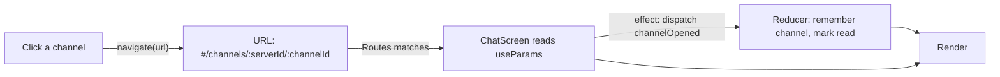

# Lesson 37 — Routing with React Router

Right now the app has no idea what the browser's address bar says: you can click through servers and channels, but the URL never changes, Back does nothing and you can't share a link to a channel. In this lesson you let the **URL** decide which channel is on screen, using the React Router library.

## 🎯 Goal

The address bar changes as you click, for example `http://localhost:5173/#/channels/s-frontend/c-ff-help`. The browser's Back and Forward buttons move between channels you visited, reloading the page keeps you in the same channel, and an unknown address redirects to the first channel.

{.screenshot}

The screenshot looks like before: the change is in the address bar and in how the code decides what to show. The exact port in the address may differ on your computer (Vite prints it when you run `npm run dev`).

## 🧠 New concepts

<ConceptList />

### The URL is state too

So far, "which channel am I looking at?" was a value in your reducer. But it is also exactly what a URL is for: an address that says *where you are in the app*. If the URL holds that information:

- the **Back** and **Forward** buttons work without extra code,
- you can **bookmark or share** a channel,
- **reloading** brings you back to the same place.

So the question changes from "how do I store the active channel in state?" to "how does the app *read* it from the URL?". This is called **routing**.

### React Router

React itself has no routing. **React Router** is a separate library for it. This lesson uses its **declarative** style (components like `<Routes>` and `<Route>` describe what to show for each URL), from the `react-router` package. In the installed version (8.x at the time of writing) all the pieces below are imported from `'react-router'`.

You install a library with npm, like `pip install`, and the code in `node_modules/` appears next to your React and Vite packages. Lesson 32 introduced `package.json`; the install adds a line to its `dependencies`.

### Routes and params

You describe your URLs with `<Routes>` containing `<Route>` elements. Each `<Route>` has a `path` pattern and an `element` to show:

```jsx
<Routes>
  <Route path="/channels/:serverId/:channelId" element={<ChatScreen />} />
  <Route path="*" element={<GoToDefaultChannel />} />
</Routes>
```

- Segments starting with `:` are **params**: `/channels/s-frontend/c-ff-help` matches the first route with `serverId` = `"s-frontend"` and `channelId` = `"c-ff-help"`.
- `path="*"` matches anything else. React Router picks the best matching route, so the specific one wins when it fits.

Inside the element, `useParams()` returns the params as an object:

```jsx
function ChatScreen() {
  const { serverId, channelId } = useParams();
  // ...
}
```

Param values are always strings.

### HashRouter vs BrowserRouter

A router component must wrap your app, so the hooks can find the current URL. There are two flavors:

| Router | URL looks like | Needs the server's help? |
| --- | --- | --- |
| `BrowserRouter` | `https://site.com/channels/s-frontend/c-ff-help` | Yes: reloading asks the server for that path, so the server must be set up to serve your `index.html` for it |
| `HashRouter` | `https://site.com/#/channels/s-frontend/c-ff-help` | No |

`HashRouter` keeps the route in the part of the URL after `#`, the **hash**. According to the type comments in the installed package, it stores the location in the hash "so it is not sent to the server". The browser requests only `https://site.com/`, always your `index.html`, and React Router reads the rest in JavaScript. This is why we use it: the app will be published on a plain static host in Lesson 41, and a hash needs no server configuration. (Whether GitHub Pages can be configured to serve `index.html` for unknown paths is something I did not verify; the hash makes the question irrelevant.)

### Navigating: useNavigate and Navigate

Two ways to move to another URL:

- **`useNavigate()`** returns a function. Call it in an event handler: `navigate('/channels/s-frontend/c-ff-help')`. The type comments in the package describe it as navigating "in response to user interactions or effects".
- **`<Navigate to="..." replace />`** is a component. When it renders, it sends the browser to `to`. You use it for **redirects** while rendering, where you can't call a function. `replace` swaps the current history entry instead of adding a new one, so Back doesn't land you on the address that just redirected.

::: warning About `<Navigate>`
The package's own comments call `<Navigate>` "a component-based version of `useNavigate` to use in a class component" and recommend `useNavigate` when hooks are available. We use `<Navigate>` anyway, because deciding *during rendering* that "this URL is wrong" is what a redirect element is for, and `useNavigate`'s function is meant for event handlers and effects. If you prefer, you could do the redirect in an effect with `navigate(..., { replace: true })`; the snapshot uses the component.
:::

### Where should state live?

Now there are three places a piece of information can live. Ask where it belongs:

| Information | Lives in | Why |
| --- | --- | --- |
| Which channel is open | **The URL** | Back/Forward, bookmarks, reload |
| Last channel you opened *per server* | Reducer, saved in `localStorage` | So clicking a server returns you to where you were |
| Is the drawer open? Is someone typing? | Reducer, not saved | Temporary UI |
| The text in an edit box | Local `useState` | Only one component cares |

The URL is now the **source of truth** for the active channel. The reducer keeps `viewingChannelId` only as a *copy*, so code outside React's rendering (the chat simulation) can ask "which channel is on screen?" through `getState()`.



::: info Vanilla vs React
In the plain-JS app (`vanilla/js/actions.js`) selecting a channel changed `state` directly. Nothing outside the page knew:

```js
export function selectChannel(channelId) {
  const channel = findChannel(channelId);
  // ...
  state.activeChannelByServer[state.activeServerId] = channelId;
  markChannelRead(channel);
  update();
}
```

In React (`react-app/src/components/ChannelList.jsx`) a click only changes the URL; the screen follows from the URL:

```jsx
function handleClick() {
  if (channel.type === 'voice') {
    return; // joining voice channels comes in Lesson 40
  }
  navigate(`/channels/${serverId}/${channel.id}`);
  dispatch({ type: 'setNavOpen', open: false });
}
```

You *could* add the same URL-reading to the vanilla app with `location.hash` and a `hashchange` listener, but you would write that machinery yourself. The router gives it to you ready-made.
:::

## 🛠️ Build it

### Step 1 — Install React Router

Open the terminal in VS Code, go into the React project and install the package:

<!-- ledger-ignore: npm commands are explained in Lesson 32; the Lesson 32 writer owns the sh:npm tokens -->
```sh
cd react-app
npm install react-router
```

If the dev server is running, stop it first with <kbd>Ctrl</kbd>+<kbd>C</kbd> and start it again afterwards with `npm run dev`. Open `package.json`: there is now a `"react-router"` line under `dependencies`.

::: warning Version differences
The course's reference project was built with React Router 8 (the installed `react-router` package in this repository is 8.4.0), where `HashRouter`, `Routes`, `Route`, `Navigate`, `useParams` and `useNavigate` are all imported from `'react-router'`. If `npm install` gives you a different major version in the future, check [the React Router docs](https://reactrouter.com/start/declarative/installation) for changes. The version number in your `package.json` will not match the reference project's exactly, and that is fine.
:::

The template's `package.json` in the reference snapshot does not list `react-router`; you add it yourself with this command.

<!-- no-solution: terminal command only -->

### Step 2 — Selectors: find a server, pick a default channel

Open `state/selectors.js`. You no longer need "the active server" (the URL tells you), so delete `getActiveServer`, `pickChannel` and `getActiveChannel`. Add two new functions in their place:

- `findServer(state, serverId)`: find a server by id.
- `defaultChannelId(state, server)`: the channel you looked at last in that server, if it still exists, otherwise the first text channel. This replaces `pickChannel` but returns an *id*.

::: solution
```js [react-app/src/state/selectors.js]
export function findServerOfChannel(state, channelId) {
  return state.servers.find((server) => getChannels(server).some((c) => c.id === channelId));
}

export function findServer(state, serverId) {
  return state.servers.find((server) => server.id === serverId);
}

// The channel to open for a server: the last one you looked at, or its first text channel.
export function defaultChannelId(state, server) {
  const remembered = state.activeChannelByServer[server.id];
  const channels = getChannels(server);
  if (channels.some((c) => c.id === remembered)) {
    return remembered;
  }
  return channels.find((c) => c.type === 'text').id;
}
```
:::

### Step 3 — Stop saving the active server

The active server is now in the URL, so it must not be saved. In `state/storage.js`, delete the line `activeServerId: state.activeServerId,` from `save`. In `state/AppContext.jsx`, remove `state.activeServerId` from the save effect's dependency array.

::: solution
```js [react-app/src/state/storage.js]
export function save(state) {
  const saved = {
    users: state.users,
    servers: state.servers,
    messages: state.messages,
    activeChannelByServer: state.activeChannelByServer,
    collapsedCategoryIds: state.collapsedCategoryIds,
  };
  localStorage.setItem(STORAGE_KEY, JSON.stringify(saved));
}
```

```jsx [react-app/src/state/AppContext.jsx]
  // Save the data whenever it changes (not on every UI change).
  useEffect(() => {
    save(state);
  }, [state.users, state.servers, state.messages, state.activeChannelByServer, state.collapsedCategoryIds]);
```
:::

### Step 4 — Reducer: one `channelOpened` action

In `state/reducer.js`:

1. Change the selectors import to `import { CURRENT_USER_ID, findChannel } from './selectors.js';` (the others are no longer used).
2. In `createInitialState`, remove `activeServerId` and add `viewingChannelId: null` under the temporary UI state.
3. Replace the `selectServer` and `selectChannel` cases with one `channelOpened` case. It remembers the channel for its server, marks it read, records `viewingChannelId` and stops any editing.
4. In `sendMessage`, compare with `state.viewingChannelId` instead of `getActiveChannel(state).id`.

Notice what disappeared: the reducer no longer needs to know how channels are picked, or whether a channel is a voice channel. The URL and `App.jsx` decide that.

::: solution
```js [react-app/src/state/reducer.js]
// The reducer: ONE pure function that takes the current state and an action,
// and returns the next state. It never changes the old state — it builds a new one.
// (Random ids and timestamps are made by the caller: a reducer must give the
// same result every time it's called with the same input.)

import { loadSaved } from './storage.js';
import { CURRENT_USER_ID, findChannel } from './selectors.js';
import { updateChannel, updateMessage, toggleInList } from './updates.js';

// Builds the first state: from localStorage if something was saved, otherwise from the JSON files.
export function createInitialState(data) {
  const saved = loadSaved();
  return {
    // Data (saved in localStorage)
    users: saved?.users ?? data.users,
    servers: saved?.servers ?? data.servers,
    messages: saved?.messages ?? data.messages,
    activeChannelByServer: saved?.activeChannelByServer ?? {},
    collapsedCategoryIds: saved?.collapsedCategoryIds ?? [],

    // Never changes
    chatter: data.chatter,

    // Temporary UI state (not saved)
    viewingChannelId: null, // the channel on screen (the URL decides it; see App.jsx)
    showMembers: !window.matchMedia('(max-width: 1000px)').matches,
    navOpen: false,
    editingMessageId: null,
    typing: null, // { channelId, userId } while someone is "typing"
  };
}
```
```js [react-app/src/state/reducer.js]
export function reducer(state, action) {
  switch (action.type) {
    // The URL changed to /channels/:serverId/:channelId (see App.jsx)
    case 'channelOpened': {
      const { serverId, channelId } = action;
      return {
        ...state,
        activeChannelByServer: { ...state.activeChannelByServer, [serverId]: channelId },
        servers: updateChannel(state.servers, channelId, { unread: false, mentions: 0 }),
        viewingChannelId: channelId,
        editingMessageId: null,
      };
    }
    case 'toggleCategory':
      return { ...state, collapsedCategoryIds: toggleInList(state.collapsedCategoryIds, action.categoryId) };
    case 'toggleMembers':
      return { ...state, showMembers: !state.showMembers };
    case 'setNavOpen':
      return { ...state, navOpen: action.open };

    case 'sendMessage': {
      const { message, channelId, mentionsMe } = action;
      const list = state.messages[channelId] ?? [];
      let servers = state.servers;
      // A message from someone else in a channel you're not looking at
      if (message.authorId !== CURRENT_USER_ID && channelId !== state.viewingChannelId) {
        const channel = findChannel(state, channelId);
        servers = updateChannel(servers, channelId, { unread: true, mentions: channel.mentions + (mentionsMe ? 1 : 0) });
      }
      /* ...the rest of sendMessage and all the other cases are unchanged... */
      return { ...state, servers };
    }

    default:
      throw new Error(`Unknown action: ${action.type}`);
  }
}
```
:::

### Step 5 — The simulation picks the server you're viewing

`lib/simulation.js` used `getActiveServer(state)`. Remove it from the import, and in `startSimulation` work out the viewed server from `state.viewingChannelId`. Before the first channel opens, `viewingChannelId` is `null`, so `findServerOfChannel` finds nothing; `?? state.servers[0]` is the fallback.

::: solution
```js [react-app/src/lib/simulation.js]
// Fake activity: people "type", then messages arrive. Pure timers and randomness.
// These functions get the latest state with getState() and change it with dispatch().

import { CURRENT_USER_ID, getUser, getChannels, findServerOfChannel, mentionsMe } from '../state/selectors.js';

```
```js [react-app/src/lib/simulation.js]
export function startSimulation(getState, dispatch) {
  let timer = null;
  let typingTimer = null;
  function scheduleNext() {
    timer = setTimeout(() => {
      const state = getState();
      const viewingServer = findServerOfChannel(state, state.viewingChannelId) ?? state.servers[0];
      const server = Math.random() < 0.7 ? viewingServer : randomItem(state.servers);
      /* ...the rest is unchanged... */
      scheduleNext();
    }, randomBetween(15000, 30000));
  }
  scheduleNext();
  /* ...the returned cleanup function is unchanged... */
}
```
:::

### Step 6 — Wrap the app in HashRouter

In `main.jsx`, import `HashRouter` from `'react-router'` and put it around `<App />`, **inside** `AppProvider` (so the router and the state are both available everywhere).

::: solution
```jsx [react-app/src/main.jsx]
import { StrictMode } from 'react';
import { createRoot } from 'react-dom/client';
import { HashRouter } from 'react-router';
// The same CSS files as the vanilla app, copied into src/styles/
import './styles/theme.css';
import './styles/base.css';
import './styles/layout.css';
import './styles/server-rail.css';
import './styles/channels.css';
import './styles/chat.css';
import './styles/members.css';
import './styles/voice.css';
import './styles/overlays.css';
import './styles/responsive.css';
import App from './App.jsx';
import { AppProvider } from './state/AppContext.jsx';
import { applyBrand } from './brand.js';

applyBrand();

createRoot(document.getElementById('root')).render(
  <StrictMode>
    <AppProvider>
      <HashRouter>
        <App />
      </HashRouter>
    </AppProvider>
  </StrictMode>,
);
```
:::

### Step 7 — Rewrite App.jsx with routes

`App.jsx` now has three parts:

1. **`GoToDefaultChannel`**: renders `<Navigate … replace />` to the first server's default channel. Used for `/` and for any unknown URL.
2. **`ChatScreen`**: the old `App` layout. It reads `serverId` and `channelId` from `useParams()` and looks up the server and channel in state. If either doesn't exist, or the channel is a voice channel (`c.type === 'text'` fails), it redirects. An effect dispatches `channelOpened` whenever the URL's server or channel changes. The effect is in `ChatScreen`, **before** the early `return <GoToDefaultChannel />`, because hooks must always run in the same order (the rules of hooks: no hook after a conditional return).
3. **`App`**: keeps the simulation and the <kbd>Esc</kbd> listener, and renders the `<Routes>`.

`Boolean(channel)` turns "a channel object or `undefined`" into `true`/`false`. It is stored in `channelExists` so the effect can depend on a simple boolean.

::: solution
```jsx [react-app/src/App.jsx]
import { useEffect } from 'react';
import { Navigate, Route, Routes, useParams } from 'react-router';
import { useApp } from './state/AppContext.jsx';
import { defaultChannelId, findServer, getChannels } from './state/selectors.js';
import { useSimulation } from './hooks/useSimulation.js';
import { classNames } from './lib/classNames.js';
import { ServerRail } from './components/ServerRail.jsx';
import { ChannelSidebar } from './components/ChannelSidebar.jsx';
import { ChatArea } from './components/ChatArea.jsx';

// Sends you to the first server's default channel (used for "/" and unknown URLs).
function GoToDefaultChannel() {
  const { state } = useApp();
  const server = state.servers[0];
  return <Navigate to={`/channels/${server.id}/${defaultChannelId(state, server)}`} replace />;
}

// The chat screen for the URL /channels/:serverId/:channelId
function ChatScreen() {
  const { serverId, channelId } = useParams();
  const { state, dispatch } = useApp();
  const server = findServer(state, serverId);
  const channel = server && getChannels(server).find((c) => c.id === channelId && c.type === 'text');
  const channelExists = Boolean(channel);

  // When the URL changes: remember the channel and mark it as read.
  useEffect(() => {
    if (channelExists) {
      dispatch({ type: 'channelOpened', serverId, channelId });
    }
  }, [serverId, channelId, channelExists, dispatch]);

  if (!channelExists) {
    return <GoToDefaultChannel />;
  }

  return (
    <>
      <div className={classNames('app', state.navOpen && 'is-nav-open')}>
        <div className="nav-drawer">
          <ServerRail activeServerId={server.id} />
          <ChannelSidebar server={server} activeChannelId={channel.id} />
        </div>
        <ChatArea server={server} channel={channel} />
      </div>
      <div className="drawer-backdrop" id="drawer-backdrop" onClick={() => dispatch({ type: 'setNavOpen', open: false })} />
    </>
  );
}

function App() {
  const { dispatch } = useApp();
  useSimulation();

  // Escape closes the drawer; growing the window past the breakpoint does too.
  useEffect(() => {
    const narrowScreen = window.matchMedia('(max-width: 1000px)');
    const closeNav = () => dispatch({ type: 'setNavOpen', open: false });
    function handleKeyDown(event) {
      if (event.key === 'Escape') {
        closeNav();
      }
    }
    document.addEventListener('keydown', handleKeyDown);
    narrowScreen.addEventListener('change', closeNav);
    return () => {
      document.removeEventListener('keydown', handleKeyDown);
      narrowScreen.removeEventListener('change', closeNav);
    };
  }, [dispatch]);

  return (
    <Routes>
      <Route path="/channels/:serverId/:channelId" element={<ChatScreen />} />
      <Route path="*" element={<GoToDefaultChannel />} />
    </Routes>
  );
}

export default App;
```
:::

### Step 8 — Navigate from clicks

Last, the clicks. In `ChannelList.jsx`:

1. Import `useNavigate` from `'react-router'`.
2. `ChannelItem` gets a `serverId` prop and a `handleClick`: voice channels do nothing yet; text channels `navigate(...)` and close the drawer.
3. `Category` receives `serverId` and passes it to `ChannelItem`; `ChannelList` passes `server.id` to `Category`.

In `ServerRail.jsx`, `ServerItem` navigates to the server's default channel instead of dispatching `selectServer`. It now needs `state` (for `defaultChannelId`) instead of `dispatch`.

::: solution
```jsx [react-app/src/components/ChannelList.jsx]
import { useNavigate } from 'react-router';
import { useApp } from '../state/AppContext.jsx';
import { getUser } from '../state/selectors.js';
import { classNames } from '../lib/classNames.js';
import { Avatar } from './Avatar.jsx';
import { Icon } from './Icon.jsx';

function VoiceUser({ userId }) {
  const { state } = useApp();
  const user = getUser(state, userId);
  return (
    <li className="voice-user" data-user-id={userId}>
      <Avatar user={user} className="tiny" />
      <span className="voice-user-name">{user.displayName}</span>
    </li>
  );
}

function ChannelItem({ channel, serverId, isSelected }) {
  const { dispatch } = useApp();
  const navigate = useNavigate();
  const voiceUserIds = channel.type === 'voice' ? channel.voiceUserIds : [];

  function handleClick() {
    if (channel.type === 'voice') {
      return; // joining voice channels comes in Lesson 40
    }
    navigate(`/channels/${serverId}/${channel.id}`);
    dispatch({ type: 'setNavOpen', open: false });
  }

  return (
    <li className={classNames('channel-item', isSelected && 'is-selected', channel.unread && 'is-unread')}>
      <button className="channel-button" type="button" onClick={handleClick}>
        <Icon name={channel.type === 'voice' ? 'speaker' : 'hash'} />
        <span className="channel-name">{channel.name}</span>
        {channel.mentions > 0 && <span className="channel-mention-badge">{channel.mentions}</span>}
      </button>
      {voiceUserIds.length > 0 && (
        <ul className="voice-users">
          {voiceUserIds.map((userId) => (
            <VoiceUser key={userId} userId={userId} />
          ))}
        </ul>
      )}
    </li>
  );
}

function Category({ category, serverId, activeChannelId }) {
  const { state, dispatch } = useApp();
  const isCollapsed = state.collapsedCategoryIds.includes(category.id);

  // A collapsed category still shows the selected channel and busy voice channels.
  const visibleChannels = category.channels.filter((channel) => {
    const isBusyVoice = channel.type === 'voice' && channel.voiceUserIds.length > 0;
    return !isCollapsed || channel.id === activeChannelId || isBusyVoice;
  });

  return (
    <section className={classNames('category', isCollapsed && 'is-collapsed')}>
      <h3>
        <button
          className="category-toggle"
          type="button"
          aria-expanded={!isCollapsed}
          onClick={() => dispatch({ type: 'toggleCategory', categoryId: category.id })}
        >
          <Icon name="chevron-down" />
          {category.name}
        </button>
      </h3>
      <ul>
        {visibleChannels.map((channel) => (
          <ChannelItem key={channel.id} channel={channel} serverId={serverId} isSelected={channel.id === activeChannelId} />
        ))}
      </ul>
    </section>
  );
}

export function ChannelList({ server, activeChannelId }) {
  return (
    <nav className="channel-list scroller" id="channel-list" aria-label="Channel list">
      {server.categories.map((category) => (
        <Category key={category.id} category={category} serverId={server.id} activeChannelId={activeChannelId} />
      ))}
    </nav>
  );
}
```
```jsx [react-app/src/components/ServerRail.jsx]
import { useNavigate } from 'react-router';
import { useApp } from '../state/AppContext.jsx';
import { isServerUnread, countServerMentions, defaultChannelId } from '../state/selectors.js';
import { brand } from '../brand.js';
import { classNames } from '../lib/classNames.js';
import { Icon } from './Icon.jsx';

function ServerItem({ server, isActive }) {
  const { state } = useApp();
  const navigate = useNavigate();
  const mentions = countServerMentions(server);
  return (
    <li className={classNames('server-item', isActive && 'is-active', isServerUnread(server) && 'is-unread')}>
      <button
        className={classNames('server-button', server.iconIsEmoji && 'is-emoji')}
        type="button"
        data-tooltip={server.name}
        aria-label={server.name}
        onClick={() => navigate(`/channels/${server.id}/${defaultChannelId(state, server)}`)}
      >
        {server.icon}
        {mentions > 0 && <span className="mention-badge">{mentions}</span>}
      </button>
    </li>
  );
}
```
:::

## ✅ Checkpoint

- [ ] `package.json` lists `react-router` under `dependencies`.
- [ ] Open `http://localhost:5173/` (your port may differ): the address changes by itself to something like `…/#/channels/s-frontend/c-ff-general`.
- [ ] Click another channel: the address bar changes and the chat changes. Click the browser's **Back** button: you return to the previous channel.
- [ ] Click a different server, then click back on the first one: it opens the channel you last used there, not necessarily the first.
- [ ] Reload the page (<kbd>Cmd</kbd>+<kbd>R</kbd>) while in a non-default channel: you stay in that channel.
- [ ] Type `#/channels/nope/nothing` after the `localhost:5173/` in the address bar and press <kbd>Enter</kbd>: you are redirected to a real channel.
- [ ] Clicking a voice channel (🔊 Lounge) does nothing yet.
- [ ] No red errors in the Console. DevTools → **Application** → **Local Storage** → the saved JSON no longer has an `activeServerId` field after you click around once.

## 🐛 Common mistakes

**A white page, and the Console says a hook can only be used inside a Router.** The exact wording varies, but the cause is always the same: a component calls `useParams`, `useNavigate` or similar outside `<HashRouter>`. Check that `HashRouter` wraps `<App />` in `main.jsx`.

**The URL changes but the chat doesn't.** The route `path` doesn't match the URL you navigate to. Compare `/channels/:serverId/:channelId` with the string passed to `navigate`: the same segments, in the same order, and no typo.

**An error about React hooks being called in a different order.** You put the `useEffect` after the `if (!channelExists) return …` line in `ChatScreen`. Hooks must come before any early `return`.

**Infinite redirects or the page flickers.** `GoToDefaultChannel` redirects to a URL that the `ChatScreen` route itself rejects (for example a voice channel or a missing id), which sends you back. Make sure `defaultChannelId` always returns a text channel.

**Everything breaks after a reload on a deployed site (not on your computer).** You used `BrowserRouter` and the server doesn't know the path. That's why this course uses `HashRouter`.

**`Failed to resolve import "react-router"`.** The package isn't installed (Step 1), or you ran `npm install` in the wrong folder. Run it inside `react-app/`, then restart `npm run dev`.

## 📝 Quiz

::: quiz
Which URL matches `<Route path="/channels/:serverId/:channelId" />`, and what does `useParams()` return for it?

- [ ] `/channels/s-pixel` → `{ serverId: "s-pixel" }`
- [x] `/channels/s-pixel/c-px-sketch` → `{ serverId: "s-pixel", channelId: "c-px-sketch" }`
- [ ] `/s-pixel/c-px-sketch` → `{ serverId: "s-pixel", channelId: "c-px-sketch" }`
- [ ] `/channels/s-pixel/c-px-sketch/extra` → `{ serverId: "s-pixel", channelId: "c-px-sketch" }`

> The pattern needs the literal segment `channels`, then two more segments. Each `:name` segment becomes a key in the params object, and values are strings.
:::

::: quiz
Why does this app use `HashRouter` rather than `BrowserRouter`?

- [ ] `HashRouter` is faster
- [x] The route is stored after the `#`, which is not sent to the server, so a plain static host needs no special setup
- [ ] `BrowserRouter` doesn't work with React 19
- [ ] `HashRouter` makes the Back button work, `BrowserRouter` doesn't

> Both support Back and Forward. The difference is where the route is stored. With a hash, the browser always requests the same `index.html`, so reloading any channel URL works on any static host.
:::

::: quiz
Predict what happens when you open `#/channels/s-frontend/c-ff-lounge`, where `c-ff-lounge` is a **voice** channel:

```jsx
const channel = server && getChannels(server).find((c) => c.id === channelId && c.type === 'text');
const channelExists = Boolean(channel);
// ...
if (!channelExists) {
  return <GoToDefaultChannel />;
}
```

- [ ] The voice channel opens as a chat
- [ ] A blank page appears
- [x] You are redirected to the default text channel
- [ ] An error is thrown because `channel` is `undefined`

> The `find` requires `c.type === 'text'`, so a voice channel gives `undefined`, `channelExists` is `false`, and the component renders `<Navigate … replace />` instead of the chat.
:::

## 💾 Commit

```sh
git add .
git commit -m "Add React Router: channel URLs with HashRouter"
git push
```
