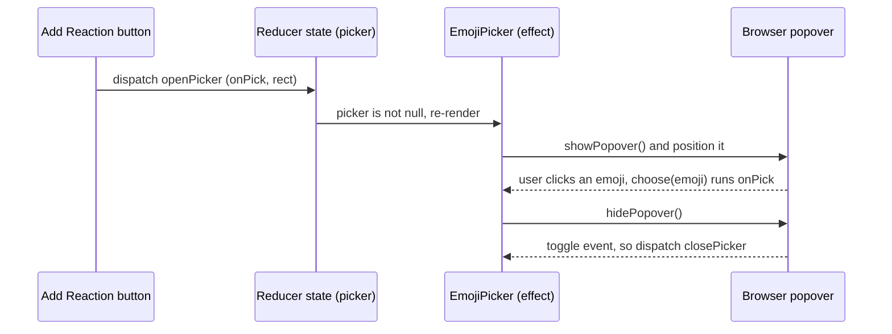

# Lesson 38 — Reactions, emoji picker & member list

This lesson adds three chat features: clickable reactions with an emoji picker, drafts that are remembered per channel, and a member list grouped by role. The emoji picker is the interesting part: it uses a browser feature (the `popover` attribute) that React doesn't know how to drive, so you'll connect the two with a ref and an effect.

## 🎯 Goal

- The member list on the right is split into groups: **Admin**, **Mentor**, **Bots**, **Online** and **Offline**, each with a count, and names are colored by role.
- Hovering a message shows an **Add Reaction** button. It opens an emoji picker next to the button; picking an emoji adds your reaction. Clicking an existing reaction toggles yours.
- The emoji button next to the message box opens the same picker and inserts the emoji where the cursor is.
- If you type half a message, switch channels and come back, your draft is still there.

{.screenshot}

## 🧠 New concepts

<ConceptList />

### Things React doesn't know how to do: the popover

A **popover** is an element the browser shows on top of everything else (in the *top layer*), and closes automatically when you press <kbd>Esc</kbd> or click outside. You turn an element into one with the `popover` attribute, and you open and close it with JavaScript: `element.showPopover()` and `element.hidePopover()`. The CSS selector `:popover-open` matches it while it is open. See MDN's [Popover API](https://developer.mozilla.org/en-US/docs/Web/API/Popover_API) page.

The plain-JS app used this in Lesson 31's emoji picker. The trouble in React: *open or closed* is a property that lives inside the browser, not in your JSX. You can't write `<div popover open={isOpen}>`. So you split the job:

- **React decides what to show** (the emoji list, filtered by the search box) and stores "which picker request is active" in state.
- **An effect tells the browser** to open or close the popover when that state changes.
- **A ref** gives the effect the real DOM element.



The `toggle` event matters: if the user presses <kbd>Esc</kbd> or clicks outside, the *browser* closes the popover, and React has to hear about it so the state says "closed". React's `onToggle` prop listens for it. (react.dev's page on common DOM props only mentions `onToggle` for `<details>`. I read the installed `react-dom` code to check: when an element has the `popover` prop, React registers `toggle` and `beforetoggle` listeners for it. So `onToggle` works on popover elements in React 19.)

### Storing a callback in state

Who gets the chosen emoji? It depends on who opened the picker: the composer inserts it as text, a message adds a reaction. So the request carries the answer:

```js
dispatch({ type: 'openPicker', onPick: insertEmoji, rect: event.currentTarget.getBoundingClientRect() });
```

`onPick` is a function stored in state. That is unusual: normally state is plain data that can be saved as JSON. A function can't be saved. Here that is fine, because `picker` is temporary UI state that we never write to `localStorage`. The reducer stays pure: it only stores what it is given.

`rect` is the button's position on screen, from `getBoundingClientRect()`. The picker uses it to place itself next to the button.

### currentTarget vs target

An event object has two similar properties. `event.target` is the element that was actually clicked (maybe a child, like the icon inside a button). `event.currentTarget` is the element the handler is attached to. For "where is *this button*?", `currentTarget` is the one you want:

```jsx
function openReactionPicker(event) {
  const rect = event.currentTarget.getBoundingClientRect();
  // ...
}
```

### Keyed Fragments

A component must return one parent element. In Lesson 32 you used `<>...</>` for that. The member list needs more: for each group, a heading *and* its members, side by side, with no wrapper element (a wrapper would break the CSS). Inside `.map()` each item needs a `key`, but the short `<>` syntax can't take one. So you import `Fragment` and write `<Fragment key={...}>`. According to react.dev, the explicit `<Fragment>` syntax is what you use when you need to pass a key.

### Shared draft state: a trade-off

The composer's text used to be local `useState`. Now it lives in `state.drafts`, an object keyed by channel id, so each channel remembers its own unsent text. The price: every keystroke is a `dispatch`, and since all components that call `useApp()` re-render when state changes, typing re-renders more of the app than before. For this app size, that isn't noticeable. It would be a real consideration in a bigger app. Rule of thumb from Lesson 35: local state unless more than one place needs it. Here the "more than one place" is "the same composer, but for different channels, and the emoji picker inserting text from outside".

::: info Vanilla vs React
Plain-JS Lesson 31 (`vanilla/js/reactions.js`) remembers who the picker is for in a module variable, and opens it directly:

```js
let target = null;

export function openEmojiPicker(anchor, newTarget) {
  target = newTarget;
  search.value = '';
  renderEmojiGrid('');
  picker.showPopover();
  positionPicker(anchor);
  search.focus();
}
```

React (`react-app/src/components/EmojiPicker.jsx`) keeps the same request in the reducer (`state.picker`) and an effect opens the popover when it appears:

```jsx
useLayoutEffect(() => {
  const element = pickerRef.current;
  if (picker === null) {
    if (element.matches(':popover-open')) {
      element.hidePopover();
    }
    return;
  }
  element.showPopover();
  positionPicker(element, picker.rect);
  searchRef.current.focus();
}, [picker]);
```

Both call the same browser methods. What changed is *who calls them and when*: in React you don't open the picker, you change state and let the effect do it.
:::

## 🛠️ Build it

### Step 1 — The emoji data

The picker needs a list of emoji grouped by category. Paste this file into `react-app/src/data/emoji.json`; it is data, not code you need to type.

::: starter
<<< @/../solutions/lesson-38/react-app/src/data/emoji.json [react-app/src/data/emoji.json]
:::

<!-- no-solution: starter data is pasted, nothing to type -->

### Step 2 — Load the emoji data into state

In `state/AppContext.jsx`, import `emoji.json` as `emojiCategories` and add it to `initialData`.

::: solution
```jsx [react-app/src/state/AppContext.jsx]
import users from '../data/users.json';
import servers from '../data/servers.json';
import messages from '../data/messages.json';
import emojiCategories from '../data/emoji.json';
import chatter from '../data/chatter.json';

const initialData = { users, servers, messages, emojiCategories, chatter };
```
:::

### Step 3 — Reducer: drafts, reactions and the picker

In `state/reducer.js`:

1. In `createInitialState` add `emojiCategories: data.emojiCategories` under "Never changes", and `drafts: {}` and `picker: null` under the temporary UI state.
2. Add four new cases: `setDraft`, `toggleReaction`, `openPicker`, `closePicker`.

`toggleReaction` finds your message and, if nobody used that emoji yet, adds `{ emoji, userIds: [you] }`. Otherwise it toggles your id in that reaction's `userIds` (with `toggleInList` from Lesson 34's helpers) and drops any reaction left with nobody.

::: solution
```js [react-app/src/state/reducer.js]
export function createInitialState(data) {
  const saved = loadSaved();
  return {
    /* ...saved data fields unchanged... */

    // Never changes
    emojiCategories: data.emojiCategories,
    chatter: data.chatter,

    // Temporary UI state (not saved)
    viewingChannelId: null, // the channel on screen (the URL decides it; see App.jsx)
    showMembers: !window.matchMedia('(max-width: 1000px)').matches,
    navOpen: false,
    drafts: {}, // channel id → unsent text in the composer
    editingMessageId: null,
    typing: null, // { channelId, userId } while someone is "typing"
    picker: null, // { onPick, rect } while the emoji picker is open
  };
}

export function reducer(state, action) {
  switch (action.type) {
    /* ...earlier cases unchanged... */
    case 'setTyping':
      return { ...state, typing: action.typing };
    case 'setDraft':
      return { ...state, drafts: { ...state.drafts, [action.channelId]: action.text } };

    /* ...startEditing, cancelEditing, saveEdit, deleteMessage unchanged... */

    case 'toggleReaction':
      return {
        ...state,
        messages: updateMessage(state.messages, action.messageId, (message) => {
          const existing = message.reactions.find((r) => r.emoji === action.emoji);
          let reactions;
          if (!existing) {
            reactions = [...message.reactions, { emoji: action.emoji, userIds: [CURRENT_USER_ID] }];
          } else {
            reactions = message.reactions
              .map((r) => (r === existing ? { ...r, userIds: toggleInList(r.userIds, CURRENT_USER_ID) } : r))
              .filter((r) => r.userIds.length > 0);
          }
          return { ...message, reactions };
        }),
      };

    // ----- The emoji picker -----
    case 'openPicker':
      return { ...state, picker: { onPick: action.onPick, rect: action.rect } };
    case 'closePicker':
      return { ...state, picker: null };

    default:
      throw new Error(`Unknown action: ${action.type}`);
  }
}
```
:::

### Step 4 — A selector that groups members

Add `groupMembers` at the bottom of `state/selectors.js`. It returns an array of groups in display order, each `{ title, members: [{ user, role }] }`: one group per role, then "Online" (members without a role), then "Offline". Offline users always go to "Offline", whatever their role. Each group is sorted by display name with `localeCompare`, and empty groups are dropped.

::: solution
```js [react-app/src/state/selectors.js]
// Returns [{ title, members: [{ user, role }] }] in display order.
export function groupMembers(state, server) {
  const roleGroups = server.roles.map((role) => ({ title: role.name, roleId: role.id, members: [] }));
  const online = { title: 'Online', members: [] };
  const offline = { title: 'Offline', members: [] };

  for (const member of server.members) {
    const user = getUser(state, member.userId);
    const role = server.roles.find((r) => r.id === member.roleId);
    const entry = { user, role };
    if (user.status === 'offline') {
      offline.members.push(entry);
    } else if (role) {
      roleGroups.find((group) => group.roleId === role.id).members.push(entry);
    } else {
      online.members.push(entry);
    }
  }

  const groups = [...roleGroups, online, offline];
  for (const group of groups) {
    group.members.sort((a, b) => a.user.displayName.localeCompare(b.user.displayName));
  }
  return groups.filter((group) => group.members.length > 0);
}
```
:::

### Step 5 — The grouped member list

Replace `MemberList.jsx`. Each group becomes a heading plus its members, wrapped in a **keyed `Fragment`** (the key is the group title). `Member` now receives `role` and uses its color for the name through the CSS variable `--author-color`; `role?.color` is `undefined` for members without a role.

::: solution
```jsx [react-app/src/components/MemberList.jsx]
import { Fragment } from 'react';
import { useApp } from '../state/AppContext.jsx';
import { groupMembers } from '../state/selectors.js';
import { classNames } from '../lib/classNames.js';
import { Avatar } from './Avatar.jsx';

function Member({ user, role }) {
  const isOffline = user.status === 'offline';
  return (
    <button className={classNames('member', isOffline && 'is-offline')} type="button">
      <Avatar user={user} withStatus />
      <span className="member-names">
        <span className="member-name" style={{ '--author-color': role?.color }}>
          {user.displayName}
        </span>
        {user.customStatus && !isOffline && <span className="member-status-text">{user.customStatus}</span>}
      </span>
    </button>
  );
}

export function MemberList({ server }) {
  const { state } = useApp();
  return (
    <aside className="member-list scroller" id="member-list" aria-label="Members">
      {groupMembers(state, server).map((group) => (
        <Fragment key={group.title}>
          <h3 className="member-group-title">
            {group.title} — {group.members.length}
          </h3>
          {group.members.map((entry) => (
            <Member key={entry.user.id} user={entry.user} role={entry.role} />
          ))}
        </Fragment>
      ))}
    </aside>
  );
}
```
:::

### Step 6 — The EmojiPicker component

Create `components/EmojiPicker.jsx`. Read it in this order:

1. `positionPicker(picker, rect)`: plain DOM code, the same maths as the vanilla version. It puts the picker above the button if there is room, otherwise below, and keeps it inside the window.
2. `query` is the search text, local `useState` (nobody else cares about it).
3. The `useLayoutEffect` with `[picker]`: when `state.picker` becomes non-null, show the popover, position it and focus the search box; when it becomes `null`, hide the popover if it is still open. Layout effect, so the position is set before the browser paints (no flash at the wrong place).
4. `handleToggle` (from `onToggle`): if the popover is no longer open (the user pressed <kbd>Esc</kbd> or clicked outside), clear the search and dispatch `closePicker`.
5. `choose(emoji)` calls the stored `picker.onPick(emoji)` and closes the popover.
6. The rendering filters `state.emojiCategories` by the search text and shows an "empty" message when nothing matches. Always render the `<div popover="auto">`, even when closed: a popover is hidden by the browser until you call `showPopover()`.

::: solution
```jsx [react-app/src/components/EmojiPicker.jsx]
import { useLayoutEffect, useRef, useState } from 'react';
import { useApp } from '../state/AppContext.jsx';

// Places the picker next to the button that opened it, inside the window.
function positionPicker(picker, rect) {
  const width = picker.offsetWidth;
  const height = picker.offsetHeight;
  let left = rect.right - width;
  let top = rect.top - height - 8;
  if (top < 8) {
    top = rect.bottom + 8;
  }
  left = Math.max(8, Math.min(left, window.innerWidth - width - 8));
  top = Math.min(top, window.innerHeight - height - 8);
  picker.style.left = `${left}px`;
  picker.style.top = `${top}px`;
}

export function EmojiPicker() {
  const { state, dispatch } = useApp();
  const [query, setQuery] = useState('');
  const pickerRef = useRef(null);
  const searchRef = useRef(null);
  const picker = state.picker;

  // React decides WHAT the picker shows; this effect tells the browser to
  // open or close the popover (something React can't do with JSX alone).
  useLayoutEffect(() => {
    const element = pickerRef.current;
    if (picker === null) {
      if (element.matches(':popover-open')) {
        element.hidePopover();
      }
      return;
    }
    element.showPopover();
    positionPicker(element, picker.rect);
    searchRef.current.focus();
  }, [picker]);

  // The browser closes the popover by itself on Escape or an outside click.
  function handleToggle(event) {
    if (!event.currentTarget.matches(':popover-open')) {
      setQuery('');
      dispatch({ type: 'closePicker' });
    }
  }

  function choose(emoji) {
    picker.onPick(emoji);
    pickerRef.current.hidePopover();
  }

  const search = query.trim().toLowerCase();
  const categories = state.emojiCategories
    .map((category) => ({ ...category, emoji: category.emoji.filter((e) => e.name.includes(search)) }))
    .filter((category) => category.emoji.length > 0);

  return (
    <div className="emoji-picker" id="emoji-picker" popover="auto" ref={pickerRef} onToggle={handleToggle}>
      <input
        ref={searchRef}
        className="emoji-search"
        id="emoji-search"
        type="search"
        placeholder="Find the perfect emoji"
        aria-label="Search emoji"
        value={query}
        onChange={(event) => setQuery(event.target.value)}
      />
      <div className="emoji-grid scroller" id="emoji-grid">
        {categories.map((category) => (
          <div key={category.category}>
            <h3 className="emoji-category">{category.category}</h3>
            <div className="emoji-options">
              {category.emoji.map((emoji) => (
                <button
                  key={emoji.char}
                  className="emoji-option"
                  type="button"
                  title={`:${emoji.name.split(' ')[0]}:`}
                  onClick={() => choose(emoji.char)}
                >
                  {emoji.char}
                </button>
              ))}
            </div>
          </div>
        ))}
        {categories.length === 0 && <p className="emoji-empty">No emoji match that search.</p>}
      </div>
    </div>
  );
}
```
:::

### Step 7 — Render the picker once, at the top

In `App.jsx`, import `EmojiPicker` and render it next to `<Routes>`, inside a fragment. It sits outside the routes because it belongs on top of every screen.

::: solution
```jsx [react-app/src/App.jsx]
import { EmojiPicker } from './components/EmojiPicker.jsx';

/* ...GoToDefaultChannel and ChatScreen unchanged... */

function App() {
  const { dispatch } = useApp();
  useSimulation();

  /* ...the Escape/matchMedia effect is unchanged... */

  return (
    <>
      <Routes>
        <Route path="/channels/:serverId/:channelId" element={<ChatScreen />} />
        <Route path="*" element={<GoToDefaultChannel />} />
      </Routes>
      {/* Overlays live outside the routes, on top of everything */}
      <EmojiPicker />
    </>
  );
}
```
:::

### Step 8 — Composer: drafts in state, emoji button

In `Composer.jsx`:

1. Drop `useState` from the import.
2. Replace the `useState` line: `text` is `state.drafts[channel.id] ?? ''`, and `setText` is a small function that dispatches `setDraft`. The rest of the component keeps calling `setText` and reading `text`, so almost nothing else changes.
3. Add `insertEmoji(emoji)`: it reads the *latest* draft with `getState()` (the picker can open from a stale render), puts the emoji between `selectionStart` and `selectionEnd`, and focuses the box again.
4. Add `openEmojiPicker(event)`, which dispatches `openPicker` with `insertEmoji` and the button's rectangle (`event.currentTarget.getBoundingClientRect()`), and hook it to the emoji button's `onClick`.

::: solution
```jsx [react-app/src/components/Composer.jsx]
import { useEffect, useRef } from 'react';
import { useApp } from '../state/AppContext.jsx';
import { CURRENT_USER_ID, mentionsMe } from '../state/selectors.js';
import { scheduleReply } from '../lib/simulation.js';
import { Icon } from './Icon.jsx';

// The message box: Enter sends, Shift+Enter adds a new line.
// Its text is kept per channel in state.drafts, so switching channels keeps your draft.
export function Composer({ channel }) {
  const { state, dispatch, getState } = useApp();
  const text = state.drafts[channel.id] ?? '';
  const inputRef = useRef(null);

  const setText = (newText) => dispatch({ type: 'setDraft', channelId: channel.id, text: newText });

  // Keep the box as tall as its text.
  useEffect(() => {
    const input = inputRef.current;
    input.style.height = 'auto';
    input.style.height = `${input.scrollHeight}px`;
  }, [text]);

  function send() {
    const content = text.trim();
    if (content === '') {
      return;
    }
    dispatch({
      type: 'sendMessage',
      channelId: channel.id,
      mentionsMe: mentionsMe(state, content),
      message: { id: crypto.randomUUID(), authorId: CURRENT_USER_ID, content, timestamp: new Date().toISOString(), reactions: [] },
    });
    setText('');
    scheduleReply(getState, dispatch, channel.id);
  }

  function handleKeyDown(event) {
    if (event.key === 'Enter' && !event.shiftKey) {
      event.preventDefault();
      send();
    }
    // Up arrow in an empty box edits your last message
    if (event.key === 'ArrowUp' && text === '') {
      const mine = (state.messages[channel.id] ?? []).filter((m) => m.authorId === CURRENT_USER_ID);
      if (mine.length > 0) {
        event.preventDefault();
        dispatch({ type: 'startEditing', messageId: mine[mine.length - 1].id });
      }
    }
  }

  function handleSubmit(event) {
    event.preventDefault();
    send();
  }

  // Puts an emoji where the cursor is.
  function insertEmoji(emoji) {
    const input = inputRef.current;
    const current = getState().drafts[channel.id] ?? '';
    setText(current.slice(0, input.selectionStart) + emoji + current.slice(input.selectionEnd));
    input.focus();
  }

  function openEmojiPicker(event) {
    dispatch({ type: 'openPicker', onPick: insertEmoji, rect: event.currentTarget.getBoundingClientRect() });
  }

  return (
    <form className="composer" id="composer" onSubmit={handleSubmit}>
      <button className="icon-button composer-button" type="button" aria-label="Upload a file">
        <Icon name="plus" />
      </button>
      <textarea
        ref={inputRef}
        className="composer-input"
        id="composer-input"
        rows={1}
        aria-label="Message"
        placeholder={`Message #${channel.name}`}
        value={text}
        onChange={(event) => setText(event.target.value)}
        onKeyDown={handleKeyDown}
      />
      <button className="icon-button composer-button" type="button" id="composer-emoji-button" aria-label="Choose an emoji" onClick={openEmojiPicker}>
        <Icon name="emoji" />
      </button>
    </form>
  );
}
```
:::

### Step 9 — Reactions and the Add Reaction button

In `Message.jsx`:

1. `Reactions` gets `dispatch` from `useApp()` and each reaction button gets an `aria-label` and an `onClick` that dispatches `toggleReaction`.
2. In `Message`, add `openReactionPicker(event)`, like the composer's: `onPick` toggles a reaction on this message.
3. The `message-actions` bar is now shown for every message and starts with an **Add Reaction** button; Edit and Delete still appear only when `isMine`.

::: solution
```jsx [react-app/src/components/Message.jsx]
function Reactions({ message }) {
  const { dispatch } = useApp();
  return (
    <div className="reactions">
      {message.reactions.map((reaction) => (
        <button
          key={reaction.emoji}
          className={classNames('reaction', reaction.userIds.includes(CURRENT_USER_ID) && 'is-mine')}
          type="button"
          data-emoji={reaction.emoji}
          aria-label={`${reaction.emoji} reaction, ${reaction.userIds.length}`}
          onClick={() => dispatch({ type: 'toggleReaction', messageId: message.id, emoji: reaction.emoji })}
        >
          <span className="reaction-emoji">{reaction.emoji}</span>
          <span className="reaction-count">{reaction.userIds.length}</span>
        </button>
      ))}
    </div>
  );
}
```
```jsx [react-app/src/components/Message.jsx]
function openReactionPicker(event) {
  dispatch({
    type: 'openPicker',
    onPick: (emoji) => dispatch({ type: 'toggleReaction', messageId: message.id, emoji }),
    rect: event.currentTarget.getBoundingClientRect(),
  });
}
```
(this function goes inside `Message`, above `handleDelete`)

```jsx [react-app/src/components/Message.jsx]
<div className="message-actions">
  <ActionButton action="react" icon="reaction-add" label="Add Reaction" onClick={openReactionPicker} />
  {isMine && (
    <ActionButton action="edit" icon="edit" label="Edit" onClick={() => dispatch({ type: 'startEditing', messageId: message.id })} />
  )}
  {isMine && <ActionButton action="delete" icon="trash" label="Delete" className="danger" onClick={handleDelete} />}
</div>
```
(this replaces the old `{isMine && (<div className="message-actions">…</div>)}` block at the bottom of `Message`)
:::

## ✅ Checkpoint

- [ ] The member list shows headings like **ADMIN — 1**, **MENTOR — 2**, **BOTS — 1**, **ONLINE — n**, **OFFLINE — n**, and role-colored names.
- [ ] Hover over any message: an Add Reaction button appears. Click it: the emoji picker opens next to it, with the search box focused.
- [ ] Type `heart` in the search: only matching emoji remain. Pick one: the picker closes and your reaction appears under the message with a count of 1 (highlighted as yours).
- [ ] Click your reaction: it is removed. Click someone else's reaction (like the 🙏 on Leo's message): your count is added, and clicking again removes it.
- [ ] Open the picker and press <kbd>Esc</kbd>, or click outside: it closes, and opening it again shows an empty search box.
- [ ] Click the emoji button next to the message box: the picker opens above it. Choose an emoji: it appears at the cursor in the message box.
- [ ] Type `half a mess` in #general, click #help, click back to #general: the text is still there. Reload the page: it's gone (drafts aren't saved).
- [ ] No red errors in the Console. In DevTools → **Elements**, the `div#emoji-picker` has a `popover="auto"` attribute.

## 🐛 Common mistakes

**The picker never appears (no error).** The `useLayoutEffect` depends on `[picker]` but the dispatch never changes it, or `openPicker` is not in the reducer. In the Console, an `Unknown action: openPicker` error means a missing case.

**The picker opens in the wrong place (top-left of the window).** `positionPicker` ran before the picker was shown, so its `offsetWidth` and `offsetHeight` were 0. Call `showPopover()` first, then `positionPicker(...)`.

**After <kbd>Esc</kbd> or an outside click, the old search text is still there the next time the picker opens.** `onToggle` isn't hooked up, so React never hears that the browser closed the popover and never clears the search or sets `picker` back to `null`. Check `onToggle={handleToggle}` on the popover `div`.

**A warning about each child in a list needing a unique `key`.** The `Fragment` in `MemberList` has no key. `<>…</>` can't take one; use `<Fragment key={group.title}>`.

**Clicking the reaction button's icon opens the picker at the wrong spot.** You used `event.target` instead of `event.currentTarget`; `target` can be the icon inside the button.

**Typing in the message box feels laggy or the cursor jumps.** `value` must be exactly what is in state: `state.drafts[channel.id] ?? ''`. If you forget `?? ''`, the value is `undefined` at first and React treats the box as uncontrolled.

## 📝 Quiz

::: quiz
Why does `EmojiPicker` use an effect to call `showPopover()` instead of just rendering it open?

- [ ] Effects are faster than JSX
- [x] Whether a popover is open is controlled by the browser through `showPopover()` and `hidePopover()`, which React's JSX cannot express, so an effect syncs the browser with React's state
- [ ] Because `showPopover()` only works inside `useEffect`
- [ ] Because JSX doesn't allow the `popover` attribute

> The `popover` attribute is allowed in JSX, but opening and closing is a method call on a DOM element. That makes it an "outside the render" job, which is what effects and refs are for.
:::

::: quiz
Predict what happens:

```jsx
<button onClick={(event) => console.log(event.target === event.currentTarget)}>
  <svg className="icon" />
</button>
```

You click exactly on the little icon in the middle of the button. What is logged?

- [ ] `true`
- [x] `false`, because `target` is the `svg` that was clicked and `currentTarget` is the `button` with the handler
- [ ] `undefined`
- [ ] Nothing: the click is ignored

> `target` is where the click landed (the deepest element). `currentTarget` is the element the handler belongs to. If you click the icon, they differ.
:::

::: quiz
Why is `drafts` kept in the reducer instead of in `Composer`'s own `useState`?

- [ ] Because `useState` can't hold strings
- [ ] Because reducer state is saved to `localStorage`
- [x] Because the draft must survive switching channels, and the emoji picker callback has to update it from outside the component
- [ ] Because components cannot re-render from `useState`

> Each channel remembers its own text, so the value must outlive any one channel's composer. The trade-off: typing now goes through `dispatch`, so more of the app re-renders on each keystroke.
:::

## 💾 Commit

```sh
git add .
git commit -m "Add reactions, emoji picker, drafts and grouped member list"
git push
```
